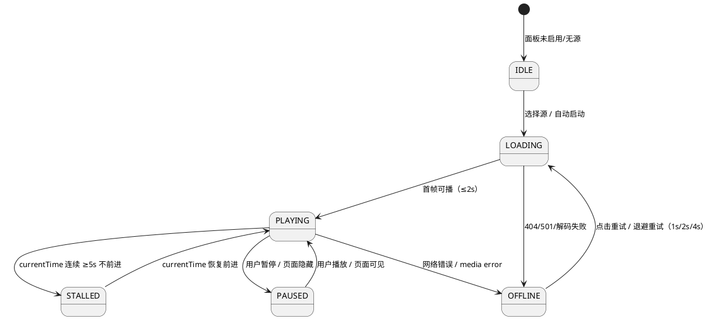
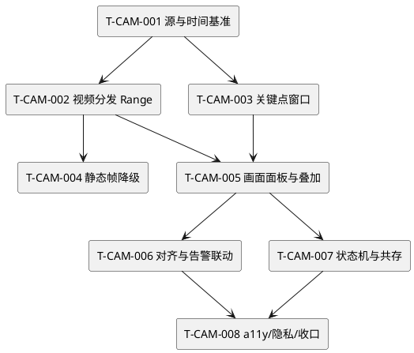
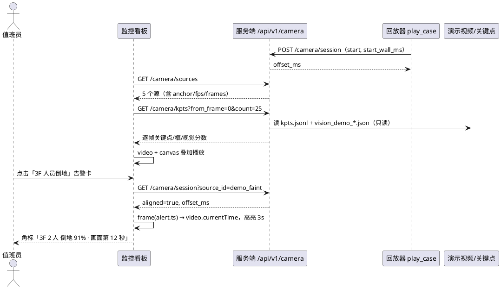

# 现场画面（摄像头视图）需求规格（EARS）

> 本文档只定义「监控看板里那块现场画面应该是什么、在什么条件下必须怎样表现」，以及服务端要提供什么形态的数据通路；
> **不写实现代码、不改任何既有需求条目、不改既有任务条目**。
> 本轮交付物仅本文档；`service/`、`dashboard/`、`common/`、`results/` 一律不动。

## 0. 阅读指南

### 0.1 目的与范围

用户原始诉求：「前端检测加一个摄像头的？」。本文档把它拆成可验收的工程条目，覆盖：

- 现状盘点：A 侧视频/关键点/视觉产物**已有什么**，服务端**没有**什么（每条指向文件与行号）；
- 视频源与时间基准契约（离线演示优先，保留真实摄像头开关）；
- 新增 `/api/v1/camera/*` 契约（路径、字段、错误码、降级），以及与既有接口的不冲突判据；
- 前端硬约束下的画面面板规格（单文件、零构建、零外链、离线演示、性能预算、断连、隐私、可访问性）；
- 告警 ↔ 画面联动（楼层、`device_id`、时间戳对齐、事件标注）；
- 以 `REQ-CAM-001` 起编号的 EARS 需求条目（含 P0/P1/P2 与可验证判据）；
- 以 `T-CAM-001` 起编号的任务拆解建议、风险与未决项、验收清单（区分沙箱可验 / 需端口 / 需人工）。

**明确不在本文档范围内**：`service/` 与 `dashboard/` 的任何改动、模型与算法、评测产物、部署脚本、数据库结构。

### 0.2 与既有文档的关系

| 文档 | 关系 | 本文档的引用方式 |
|---|---|---|
| `docs/spec/frontend.md` | 看板本轮基线（`REQ-UI-001~031`、`T-UI-001~009`、第 8 章实测：672 行 / 25,276 B / 25/25 通过） | **不改写任何条目语义**；以 0.2.1 的 `AMEND-CAM-*` 声明扩展点 |
| `docs/spec/requirement.md` | 123 条总基线（`REQ-FUNC/DATA/EXPL/QUAL/...`）与 DEC-01/03 裁决 | 只引用「`ts` 为 13 位毫秒」「五类 `event_type`」「`trapped → urgency ≥ 2`」 |
| `docs/spec/design.md` | B 侧架构与 `Decision` / `VisionOut` 口径 | 只引用 `VisionOut` 六字段，不把 B 侧设计当作前端依据 |
| `docs/spec/supplement_ac.md` | A 侧产物清单、C 侧 3.9 兼容、第 7 章实测（五类 5/5、直通 11/11、沙箱 `WinError 10051`） | 引用 3.1（3.9 注解红线）、3.2（依赖策略）、7.3（无端口的环境限制） |
| `docs/spec/integration.md` | `REQ-INT-001~024`、`CMD-01~13`、联调实测 | 引用 `REQ-INT-015`（字段直通）、`REQ-INT-017`（统计口径） |
| `docs/spec/tasks.md` | 附录 A（冻结回归命令）、附录 D（联调交叉引用） | 新任务挂靠方式参照附录 A 的命令清单与附录 D 的「指针式追加」体例 |

#### 0.2.1 本轮新增的修订声明（AMEND，不改原文）

| 编号 | 声明的扩展 | 为什么必须扩展 | 扩展边界（不得越界） |
|---|---|---|---|
| **AMEND-CAM-01** | `REQ-UI-002` 的接口白名单由 4 条扩展为 4 条 + `/api/v1/camera/*` 子集（见 4.1） | 画面必须有一条数据通路；原白名单写于「本轮零新增接口」的语境 | `REQ-UI-002` 原文不动；**既有 6 个接口的路径/参数/字段/错误码一个字节都不变**（见 `REQ-CAM-003`） |
| **AMEND-CAM-02** | `REQ-UI-001`/`C-02` 的「零外链」允许**同源**媒体加载（`/api/v1/camera/video`、`/api/v1/camera/frame`） | 画面来自本服务自己，不是 CDN | 仍禁止任何 `http(s)://` 外部域、`<link>`、远程字体、图标库；`` 仍为 0 |
| **AMEND-CAM-03** | `scripts/check_frontend.py` 的 `API_ALLOWED`（第 19 行）追加 `/api/v1/camera/`，`MAX_BYTES`（第 18 行）由 40 KB 调整为 48 KB | 现有闸门会把合法的新路径判失败，把新增面板判超体积 | 只改这两个常量；其余 25 项断言一条不删；`dashboard/` 仍单文件 |
| **AMEND-CAM-04** | `REQ-UI-028` 的「单轮最多 3 个请求 / 仅一个轮询定时器」在语义上保持不变，新增**画面专用节流器**（不属于该轮次） | 画面若混入 2 秒轮次会拖垮断连判定 | 关闭画面时，请求数与定时器行为必须与基线**逐项一致**（见 `REQ-CAM-001`） |
| **AMEND-CAM-05** | 允许 `service/` 新增文件 `service/camera.py`，并在 `service/main.py` **只追加**路由与 import | 契约不冲突的前提是「既有行零删除」 | 交付判据：`git diff --numstat service/main.py` 的删除行数为 **0**（见 `REQ-CAM-003`） |

> 上述五条是本轮唯一的「改动既有约定」的地方，全部登记在案；其余既有文档一律只读。

### 0.3 编号与优先级

- 需求：`REQ-CAM-001` 起三位序号，本文件内唯一；不复用 `REQ-UI-*`、`REQ-INT-*`、`REQ-SUP-*`、`REQ-B-*`。
- 缺口：`CAM-GAP-01` 起；任务：`T-CAM-001` 起；验收命令：`CMD-CAM-01` 起；风险 `R-CAM-01` 起；未决 `Q-CAM-01` 起。
- 优先级沿用项目口径（与 `frontend.md` 0.3 一致）：`P0` 缺失即「摄像头视图」不成立或会破坏现有演示；`P1` 应当实现、允许降级但不允许缺失；`P2` 可选加分。
- EARS 句式沿用 `requirement.md` 0.2 五类：普遍 / 事件驱动 / 状态驱动 / 非期望 / 可选。

### 0.4 事实与证据口径

本文档「现状」与「契约」中的每条陈述都可在仓库内复现（`grep`/`wc`/阅读行号），命令见第 9 章 `CMD-CAM-01~12`。凡属推断而非实测，一律标注「待验」并进第 8 章未决项。

### 0.5 本轮交付边界

| 项 | 本轮（需求规格） | 下一轮（实现） |
|---|---|---|
| 本文档 | 新建 | 按任务回填实测 |
| `service/` | **零改动** | 新增 `service/camera.py`，`main.py` 只追加 |
| `dashboard/index.html` | **零改动** | 新增画面面板 + 叠加层 |
| `scripts/` | 零改动 | 新增 `scripts/check_camera.py`；改 `check_frontend.py` 两个常量 |
| `common/`、`results/` | **零改动、只读** | 仍只读（不改 A/B 冻结产物） |
| git | 不提交 | 由实现轮决定 |

## 1. 现状盘点

### 1.1 基线快照

| 项 | 实测值 | 证据 |
|---|---|---|
| 前端文件 | **1**（`dashboard/index.html`） | `ls dashboard` |
| 前端规模（本轮起点） | **688 行 / 25,854 B**（`frontend.md` 8.1 记录为 672 行 / 25,276 B，其后有少量追加） | `wc -l -c dashboard/index.html` |
| 前端媒体元素 | **0** 个 `<video>` / `<canvas>` / ``（``、`<script src>` | `grep -nE "https?://\|<link\|<script[^>]*src" dashboard/index.html` 无输出 |
| 前端接口白名单 | 现有 2 处 `fetch`（`getJson` 统一 + `ack` 单独），路径仅 `/api/v1/alerts`、`/stats`、`/devices` | `dashboard/index.html:602-612`、`228`（`API` 常量） |
| 服务端路由 | 6 个：`health`、`edge/report`、`alerts`、`alerts/{id}/ack`、`stats`、`devices` | `service/main.py:120-195` |
| 静态挂载 | `StaticFiles(directory=dashboard, html=True)` 挂到 `/`，位于全部 API 路由**之后** | `service/main.py:201-202` |
| 服务端媒体能力 | **零**：`service/` 内无 `mp4`/`video`/`frame`/`cv2`/`stream` 任何引用 | `grep -rnE "mp4\|video\|frame\|stream\|cv2" service/*.py` 无输出 |
| 前端静态闸门 | `MAX_BYTES = 40*1024`；`API_ALLOWED = (alerts, stats, devices)` | `scripts/check_frontend.py:18-19` |
| 前端验收现状 | `python scripts/check_frontend.py --strict` → 25/25，退出码 0 | `frontend.md` 8.3 |

### 1.2 已有素材与通路事实（A 侧）

| 项 | 实测事实 | 证据 |
|---|---|---|
| 演示视频 | 5 段：`demo_normal/estop/trapped/pry/faint.mp4`，**1280×720 / 25 fps / H.264 / 20 s / 500 帧** | `common/demo_data/README.md:11-16` |
| 关键点侧车 | 同名 `_kpts.jsonl`，逐帧一行，字段 `frame` / `ts` / `persons` / `scores`；每人 **17 个关键点**，每个 `[x, y, conf]`（原始像素坐标） | `common/demo_data/demo_faint_kpts.jsonl` 首行；`vision/sources.py:389` 注释 `persons:[17x[x,y,conf]]` |
| 场景元数据 | `_meta.json` 含 `fps`/`frames`/`width`/`height`/`duration_sec`/`start_ts_ms`/`event_type`/`expected_urgency`/`keypoint_sidecar` | `common/demo_data/demo_faint_meta.json:1-16` |
| 时间锚点（5 段） | normal `1794915000000`、estop `1794915300000`、trapped `1794915600000`、pry `1794915900000`、faint `1794916200000`（间隔 5 分钟） | 各 `*_meta.json` 的 `start_ts_ms` |
| 视觉逐帧分数 | `results/vision_demo_<case>.json`：**500 帧**，间隔 40 ms，字段 `ts`/`person_count`/`fall_prob`/`door_approach`/`crowded`/`keypoints_ok` | `results/vision_demo_faint.json` 首尾行 |
| 判决产物 | `results/demo_<case>_decision.json`：`ts` 起点恒为 **1763300000000**，条数 13~207，`device_id` 恒为 `ELEV-DEMO-001` | 各文件首行；`grep -o "ELEV-[A-Z0-9-]*"` 五段均为同一 ID |
| 回放器时间处理 | `play_case.py` 的 `rebase_ts()` 把判决 `ts` 平移到「当前时刻」，保留相对间隔 | `scripts/play_case.py:63-72` |
| 现有画面消费者 | 仅 A 侧离线渲染：`vision/sources.py`（`VideoReader` 用 `cv2.VideoCapture`）、`vision/visualize.py`（`cv2` 画框/骨架/HUD） | 均为离线脚本，**不对外提供任何界面** |

### 1.3 缺口清单

| 编号 | 缺口 | 现状证据 | 影响 | 级别 |
|---|---|---|---|---|
| **CAM-GAP-01** | 服务端没有任何视频/帧通路 | `service/*.py` 零命中（1.1） | 前端即便想显示画面也无数据可取 | **P0** |
| **CAM-GAP-02** | 关键点只存在于 A 侧内部文件，无对外形态 | `vision/sources.py:400-411` 仅供 `SyntheticBackend` 读 | 叠加层无法在前端复现「框/骨架」 | **P0** |
| CAM-GAP-03 | 前端无媒体载体 | `<video>`/`<canvas>` 计数 0（1.1） | 无位置、无渲染层 | **P0** |
| CAM-GAP-04 | 无「设备/场景 → 画面」映射 | 5 场景共用 `ELEV-DEMO-001` | 告警无法唯一反查画面（要靠 `event_type` 或源选择器） | **P0** |
| **CAM-GAP-05** | 两套时间基准并存 | 判决 `ts` 起 `1763300000000`；视频锚点 `1794915xxx000`；回放又整体 `rebase` 到当前 | 直接按 `ts` 求帧号必然错位（数量级差 3 个月） | **P0** |
| CAM-GAP-06 | 首屏布局无画面席位 | 主体区为 8:4 两列（`dashboard/index.html:60`、`182-198`） | 加画面必须明确占位，否则挤掉「至少 1 条完整告警卡」（`REQ-UI-005/029`） | P1 |
| CAM-GAP-07 | 静态闸门未预留 | `check_frontend.py:18-19`（40 KB / 3 条白名单） | 合法新增会被判失败 | P1 |
| CAM-GAP-08 | 只有全局连接三态，无画面级故障语义 | `dashboard/index.html:270-290`（`setConn`/`renderFreshness`） | 画面卡顿/冻结会被误读成「系统断连」，或反之被静默忽略 | P1 |
| CAM-GAP-09 | 无隐私与「演示非取证」口径 | 全文无相关文案 | 评委可能误以为系统在做人脸/取证录像 | P1 |
| CAM-GAP-10 | 沙箱无法起端口 | `WinError 10051`（`supplement_ac.md` 7.3） | 流式语义、Range、浏览器解码均无法在本机验证 | P1（验收口径问题） |
| CAM-GAP-11 | `cv2` 版本漂移 | 本机实测 `cv2 5.1.0`；`requirements.lock.txt:10` 为 `opencv-python==4.10.0.84`；`supplement_ac.md` 7.1 记录安装 `5.1.0.95` | 若服务端用 cv2 截帧，只能用跨版本稳定子集 | P1 |
| CAM-GAP-12 | 无画面的可访问描述 | `aria` 标注中无任何媒体相关项 | 读屏用户完全拿不到画面信息 | P2 |

### 1.4 三个 P0 缺口（本轮必须先解决）

1. **无通路（CAM-GAP-01/02/03）**：缺一条从 `common/demo_data/*` 到浏览器的数据通路。没有它，「加摄像头」只是加一个空盒子。
2. **无时间基准（CAM-GAP-05）**：判决与视频是两套时钟，且回放器还会再平移一次。不对齐就必然出现「点了告警，画面跳到 3 个月前/10 分钟后」这种一眼假。
3. **无源身份（CAM-GAP-04）**：5 段场景共用一个 `device_id`，告警只能靠 `event_type` 或人工选择源来定位画面，这一点必须写进契约，不能靠猜。

> 其余缺口（06~12）属「应做、可降级、需登记」，在 `REQ-CAM-011/016/018/019/020/021` 中落条。

### 1.5 已知风险与未决项（本章）

| 编号 | 事项 | 影响 | 建议 |
|---|---|---|---|
| R1-CAM-01 | 本机沙箱禁止 `socketpair`，`uvicorn` 与 `TestClient` 均无法起 | 本机只能验「同步函数 + 生成器」，不能验真实 HTTP | 验收严格分档（第 9 章） |
| R1-CAM-02 | 判决产物 `device_id` 全场景复用 | 联动只能「按 `event_type` 猜 + 允许人工选源」 | 落为 `Q-CAM-01` 未决项 |
| R1-CAM-03 | `cv2 5.1.0` 与 lock `4.10.0.84` 不一致 | 服务端若用 `cv2`，需限定稳定 API | 只允许 `VideoCapture`/`imencode`/`CAP_PROP_*`，且失败即降级 |

## 2. 目标与约束

### 2.1 目标

| 编号 | 目标 | 可度量判据 |
|---|---|---|
| **G-CAM-01** | **画面能看见人**：在 1920×1080 首屏内看到一段真实视频画面，并叠加人体框/骨架与人数、事件标注 | 截图核对；见 `REQ-CAM-011/012/013` |
| **G-CAM-02** | **告警能指到画面**：点击任意活动告警卡，画面在 ≤1 秒内定位到该告警对应的时刻并高亮 | 机器可算：定位后 `frame_ts` 与告警 `ts` 差 ≤200 ms（目标）/ 500 ms（上限）；见 `REQ-CAM-009/014` |
| **G-CAM-03** | **演示零破坏**：画面不可用（无视频/无 cv2/无会话）时，告警列表、统计、处置、断连提示全部照旧 | 关闭画面开关后 `check_frontend.py --strict` + `passthrough_test.py` 11/11 全绿；见 `REQ-CAM-001/018` |
| **G-CAM-04** | **离线自足**：断网、无 CDN、无构建，画面与告警同时可用 | 断网打开页面无外链报错、无 404 资源；见 `REQ-CAM-002` |
| **G-CAM-05** | **不拖慢轮询**：2 秒轮询的请求数、间隔、退避、断连判定与基线逐项一致 | Network 面板 + 代码审查；见 `REQ-CAM-017` |
| **G-CAM-06** | **可解释的故障**：画面任何异常都有独立的中文提示，不与「系统断连」混淆 | 断画面源后全局仍显示「实时在线」；见 `REQ-CAM-016` |
| **G-CAM-07** | **口径干净**：不做人脸识别、不留存视频、不出公网、画面常驻「演示数据 · 非取证」水印 | 代码审查 + 截图；见 `REQ-CAM-020` |

### 2.2 硬约束

| 编号 | 约束 | 判定方式 |
|---|---|---|
| C-CAM-01 | **单文件**：画面面板与叠加层必须写进 `dashboard/index.html`；不得新增 `app.css`/`app.js`/`worker.js` | `ls dashboard` 文件数 = 1 |
| C-CAM-02 | **零构建、零外链**：不引入 npm/node/打包器/CDN/远程字体/图标库；媒体只允许同源 `/api/v1/camera/*` | `grep -nE "https?://\|<link\|<script[^>]*src"` 无输出；媒体 `src` 必须以 `/api/v1/camera/` 开头 |
| C-CAM-03 | **体积上限**：`dashboard/index.html` ≤ **48 KB**（当前 25,854 B，可增 ≤22 KB；建议面板净增 ≤8 KB） | `wc -c`；`check_frontend.py` 的 `MAX_BYTES` 同步（AMEND-CAM-03） |
| C-CAM-04 | **不改既有接口**：`/alerts`、`/stats`、`/devices`、`/ack`、`/health`、`/edge/report` 的路径、方法、查询参数、返回字段、错误体一律不变 | `git diff --numstat service/main.py` 删除行 = 0；`passthrough_test.py` 11/11 |
| C-CAM-05 | **不新增 Python 依赖**：`requirements.txt`、`requirements.lock.txt`、`requirements-c39.txt` 一行不改；服务端只允许标准库 + 已锁依赖 | `git status --short requirements*` 为空 |
| C-CAM-06 | **Python 3.9 兼容**：禁止 PEP 604 `X \| Y` 运行时注解与 PEP 585 裸泛型以外的 3.10+ 写法；数据结构用 `@dataclass`（`frozen=True`）；注解用 `Optional/List/Dict/Any` | `python -c "import service.camera"` 在 3.9.12 退出码 0；`grep -nE ": *[A-Za-z0-9_.\\[\\]]+ *\\|" service/camera.py` 无输出 |
| C-CAM-07 | **不改 A/B 冻结产物**：`common/demo_data/*`、`results/demo_*_decision.json`、`results/vision_demo_*.json`、`metrics.csv`、`ablation.*` 等只读；判据以**本轮起点快照**为基线（工作树中既有 A 侧重生成改动不属本轮，不得新增任何改动） | 实现前后 `git status --short common results` 的条目集合完全一致（集合相等，不要求为空） |
| C-CAM-08 | **离线演示优先**：默认媒体模式为「演示文件」，无需任何采集设备；无真实摄像头也必须完整可看 | 断网/无 USB 场景下画面仍播放 |
| C-CAM-09 | **真实源为开关**：`CAMERA_SOURCE_MODE = demo \| file \| usb \| rtsp`，默认 `demo`；`usb`/`rtsp` 未实现时必须返回明确「不支持」而非崩溃 | 设 `CAMERA_SOURCE_MODE=rtsp` 后接口返回 `CAM_SOURCE_UNSUPPORTED`，服务不崩 |
| C-CAM-10 | **不访问公网**：不得出现任何外部 IP/域名/云推流地址；RTSP 仅允许内网地址且需显式开启 | `grep -nE "rtsp://\|https?://" service/camera.py` 仅在注释/校验白名单中；代码审查 |
| C-CAM-11 | **不引入估算口径**：画面角标上的人数、置信度、判据必须直接来自 `vision_demo_*.json` 或告警字段，前端不自算 | 字段映射表（3.3、4.2）；代码审查 |
| C-CAM-12 | **文案简体中文**：错误、状态、图例、水印全部中文；`source_id`/`device_id` 等标识符可保留英文 | 人工核对 |

### 2.3 明确不做（Non-goals）

1. **不做人脸识别**、不做身份识别、不做口罩/安全帽等属性识别。
2. **不做本地录像留存**：不写盘、不做 `MediaRecorder`、不做回放归档；刷新页面即丢弃。
3. **不做截图/导出**：不提供「保存画面」按钮（与 `frontend.md` 2.3 第 6 条一致）。
4. **不接公网**：不做云推流、不做公网 RTSP、不做第三方视频 SDK。
5. **不做多路并发墙**（P2 可选见 `REQ-CAM-022`，默认单路）。
6. **不做 WebSocket/SSE 推送**（P2 扩展位见 `REQ-CAM-024`；本期以「分段下载 + 批量关键点」为准）。
7. **不做云台控制**、不做音频对讲、不做布防撤防。
8. **不改告警九字段契约**：不在 `Decision` 里加画面字段（`device_id`/`ts` 已足够联动）。

### 2.4 已知风险与未决项（本章）

| 编号 | 事项 | 影响 | 建议 |
|---|---|---|---|
| R2-CAM-01 | 是否允许同源 `<video>` 计入「零外链」审计 | 若不明确，闸门与实现来回拉扯 | 以 AMEND-CAM-02 固化：允许同源媒体，禁止跨源 |
| R2-CAM-02 | 48 KB 体积上限是否够放画面面板 | 超限则被迫拆文件，破坏单文件原则 | 面板预算 ≤8 KB；超出则先砍装饰（不放缩略图列表） |
| R2-CAM-03 | 画面「实时」语义与大屏叙事 | 演示其实是 20 s 回放循环，不能说成「实时监控」 | 页面文案统一为「演示画面」，水印写明非取证 |
| R2-CAM-04 | 真实摄像头是否进本期 | 若评委追问「真摄像头呢」 | 以 `REQ-CAM-010` 的开关 + 501 明确边界，不承诺未实现能力 |

## 3. 视频源与时间基准契约

### 3.1 源登记表（离线演示）

| `source_id` | `device_id` | `event_type` | 视频 | 关键点 | 视觉分数 | 锚点 `anchor_ts_ms` | 时长 |
|---|---|---|---|---|---|---|---|
| `demo_normal` | `ELEV-DEMO-001` | `normal` | `common/demo_data/demo_normal.mp4` | `..._kpts.jsonl` | `results/vision_demo_normal.json` | `1794915000000` | 20 s |
| `demo_estop` | `ELEV-DEMO-001` | `estop` | 同上模式 | 同上模式 | 同上模式 | `1794915300000` | 20 s |
| `demo_trapped` | `ELEV-DEMO-001` | `trapped` | 同上模式 | 同上模式 | 同上模式 | `1794915600000` | 20 s |
| `demo_pry` | `ELEV-DEMO-001` | `pry` | 同上模式 | 同上模式 | 同上模式 | `1794915900000` | 20 s |
| `demo_faint` | `ELEV-DEMO-001` | `faint` | 同上模式 | 同上模式 | 同上模式 | `1794916200000` | 20 s |

**登记规则（必须）**：

1. 源清单必须**从磁盘事实推导**（`common/demo_data/*_meta.json`），不得在代码里硬编码 5 条字符串清单；新增/删除演示文件后清单自动跟随。
2. `source_id` 必须等于 `meta.case`，且必须与文件名主干一致；不一致的源必须被跳过并记 WARN，不得静默纳入。
3. 每个源必须携带 `fps`、`frames`、`width`、`height`、`duration_ms`，缺一即视为该源「登记不完整」，不得对外提供。
4. `event_type` 必须取自 `meta.event_type`，不得前端另设映射表覆盖（当前 `EVT` 常量只管中文名，不参与联动判定）。

### 3.2 时间基准与对齐（本方案的唯一硬契约）

存在三个时间：

- `anchor_ts_ms`：视频第 0 帧的「素材时间」（来自 `_meta.json`）；
- `alert.ts`：告警时间（判决产物起点 `1763300000000`，再被 `play_case.rebase_ts()` 平移到当前）；
- `offset_ms`：**回放偏移**，由「起播会话」引入，用于把素材时间搬到当前时钟。

对齐公式（必须唯一，禁止第二套换算法）：

```text
frame_ms      = 1000 / fps                      （本素材恒为 40）
wall(frame)   = offset_ms + anchor_ts_ms + frame × frame_ms
offset_ms     = start_wall_ms − anchor_ts_ms     （起播时由播放器上报）
frame(alert)  = round((alert.ts − offset_ms − anchor_ts_ms) / frame_ms)
对齐误差 err  = |wall(frame(alert)) − alert.ts| ≤ 200 ms（目标） / ≤ 500 ms（上限）
```

约束：

1. **未建立会话 → 禁止联动跳转**：`offset_ms` 未知时接口必须返回 `aligned=false`，前端必须显示「画面未对齐（尚未开始播放）」，不得按 0 偏移硬算。
2. **越界钳制必须显式**：`frame(alert)` 落在 `[0, frames-1]` 外时，必须钳到边界并在响应里给出 `clamped=true`，前端提示「该告警时刻不在当前画面范围内」。
3. **会话必须有超时**：起播后无心跳/无访问 ≥10 分钟视为会话失效（`aligned=false`），避免隔夜演示用旧偏移。
4. **同一时刻只允许 1 个活动会话**：新会话必须覆盖旧会话（`source_id` 变化即切换），不得出现两套 `offset_ms` 并存。

### 3.3 数据模型（服务端 `@dataclass`，字段即 JSON 契约）

| 结构 | 字段 | 类型 | 约束 |
|---|---|---|---|
| `CameraSource` | `source_id` | `str` | 等于 `meta.case`，`[a-z0-9_]{1,20}` |
| | `device_id` | `str` | 默认 `ELEV-DEMO-001`（来自设备约定，非 `Decision`） |
| | `label` | `str` | 中文场景名，≤24 字，如「3F 轿厢内 · 晕倒演示」 |
| | `event_type` | `str` | 五类之一 |
| | `fps` / `frames` / `width` / `height` | `float` / `int` | `fps>0`、`frames>0`、宽高 >0 |
| | `anchor_ts_ms` | `int` | 13 位毫秒 |
| | `duration_ms` | `int` | `= round(frames × 1000 / fps)`，与 `meta.duration_sec` 误差 ≤40 ms |
| | `video` / `keypoints` / `vision` | `bool` | 三项均为磁盘探测结果，不得猜测 |
| | `transport` | `List[str]` | 至少含 `"video"`；可含 `"frames"`、`"keypoints"` |
| `CameraSession` | `session_id` | `str` | 进程内唯一，形如 `<source_id>-<epoch_ms>` |
| | `source_id` | `str` | 必须在源清单内 |
| | `start_wall_ms` | `int` | 起播墙钟，与告警 `ts` 同量级 |
| | `offset_ms` | `int` | `= start_wall_ms − anchor_ts_ms` |
| | `updated_ms` | `int` | 最近心跳/访问时间 |
| `KptPerson` | `keypoints` | `List[List[float]]` | **17** 项，每项 `[x, y, conf]`；`conf=0` 表示该点不可见 |
| | `score` | `float` | `[0,1]`，缺省 1.0 |
| | `bbox` | `List[float]` | **[x1,y1,x2,y2]**（原始 1280×720 像素），由「可见关键点包络」推算，与 `vision/geometry.py:129 bbox_from_keypoints` 同口径 |
| `KptFrame` | `frame` / `ts` | `int` | `ts = anchor_ts_ms + frame × frame_ms`（素材时间，非墙钟） |
| | `persons` | `List[KptPerson]` | 允许空数组（无人） |
| | `vision` | `Optional[Dict]` | 六字段直通 `VisionOut`；缺失为 `null` |
| `CameraAlignment` | `source_id` / `aligned` / `offset_ms` / `drift_ms` | `str`/`bool`/`int`/`int` | `drift_ms = now − wall(当前应播帧)`，无会话时为 `0` |

> 说明：`bbox` 属「派生展示量」，不得反过来当作检测结果回灌给 B 侧；`vision` 必须原样直通，不做任何重算（C-CAM-11）。

### 3.4 播放会话（为什么需要它）

- 现状（1.2）里判决与视频差 3 个月，且回放器会整体平移；**只有播放器自己知道「现在播的是素材的第几毫秒」**，因此偏移必须由起播方上报。
- 会话是「对齐的唯一事实源」：前端所有跳转、角标时间、kpts 窗口换算都读同一个 `offset_ms`。
- 会话不做持久化：进程重启即失效；失效后前端必须自动落到「仅回放、不联动」的可降级态（`REQ-CAM-018`）。

## 4. 接口契约（新增 `/api/v1/camera/*`）

### 4.1 路由清单与冲突检查

| 方法 | 路径 | 用途 | 是否改既有接口 | 优先级 |
|---|---|---|---|---|
| GET | `/api/v1/camera/sources` | 画面源清单（含锚点与能力位） | 否 | P0 |
| GET | `/api/v1/camera/video?source_id=` | 视频分发（支持 Range） | 否 | P0 |
| GET | `/api/v1/camera/kpts?source_id=&from_frame=&count=` | 关键点 + 派生框 + 视觉分数（窗口批量） | 否 | P0 |
| POST | `/api/v1/camera/session` | 起播/停止/心跳，登记 `offset_ms` | 否 | P0 |
| GET | `/api/v1/camera/session?source_id=` | 查询对齐状态 | 否 | P0 |
| GET | `/api/v1/camera/frame?source_id=&frame=` | 单帧 JPEG（降级/取证以外用途） | 否 | P1 |
| GET | `/api/v1/camera/health` | 画面子系统自检（源数、cv2、会话） | 否 | P1 |

**不冲突判据（全部为 P0 验收项）**：

1. `service/main.py` 既有行**零删除**（`git diff --numstat` 删除列 = 0）；
2. 新路由必须定义在 `app.mount("/", StaticFiles…)`（`main.py:201-202`）**之前**，否则被静态兜住；
3. 既有 6 接口的响应字段、错误体、状态码逐字节不变（`passthrough_test.py` 11/11 + `smoke_test.py` 11/11）；
4. `/docs`、`/openapi.json` 仍在（新路由会自然出现在 Swagger，可接受，不改变既有条目语义）。

### 4.2 字段契约

#### 4.2.1 `GET /api/v1/camera/sources`

```text
{
  "items": [
    {
      "source_id": "demo_faint",
      "device_id": "ELEV-DEMO-001",
      "label": "3F 轿厢内 · 晕倒演示",
      "event_type": "faint",
      "fps": 25.0,
      "frames": 500,
      "width": 1280,
      "height": 720,
      "duration_ms": 20000,
      "anchor_ts_ms": 1794916200000,
      "video": true,
      "keypoints": true,
      "vision": true,
      "transport": ["video", "frames", "keypoints"],
      "demo": true
    }
  ],
  "server_time_ms": 1763300180120,
  "mode": "demo",
  "watermark": "演示数据 · 非取证"
}
```

- `items` 必须按 `source_id` 字典序稳定排序（同一请求两次结果逐字节一致，便于截图与 diff）。
- `mode` 直通 `CAMERA_SOURCE_MODE` 取值，供前端选择器文案（「演示源 / 文件源 / 未接入真实摄像头」）。
- 无任何可用源时：`200 + {"items": [], "mode": "...", "degraded": true}`，**不得**返回 404（前端要能区分「空清单」与「路由错」）。

#### 4.2.2 `GET /api/v1/camera/video?source_id=`

| 项 | 规格 |
|---|---|
| 成功 | `200`，`Content-Type: video/mp4`，`Content-Length` 精确，`Accept-Ranges: bytes` |
| 分段 | Range 请求必须返回 `206` + `Content-Range: bytes a-b/size`；`Range` 越界返回 `416` + `Content-Range: bytes */size` |
| 缓存 | `Cache-Control: no-store`（隐私：画面不留在中间层） |
| 不支持 Range 的实现 | **视为不达标**（Safari/iOS 与拖拽定位均依赖它） |
| 失败 | `404 CAM_VIDEO_NOT_FOUND`（登记有源但文件缺失）；`404 CAM_SOURCE_NOT_FOUND`（源未知） |

#### 4.2.3 `GET /api/v1/camera/kpts`

参数：`source_id`（必填）、`from_frame`（整数，缺省 0）、`count`（1~120，缺省 25）、`ts`（可选，整数毫秒）。

- **`ts` 语义**：允许按时间取窗口起点，`ts` 视为**告警时间（墙钟量级）**，服务端按 3.2 公式换算为 `from_frame`；此时若 `aligned=false`，必须返回 `409 CAM_NOT_ALIGNED`（不得按 0 偏移硬算）。与 `from_frame` 同时出现时以 `from_frame` 为准。
- `ts` 换算结果越界同样只钳制并置 `clamped=true`；响应中的 `ts` 仍为素材时间。

```text
{
  "source_id": "demo_faint",
  "fps": 25.0,
  "frame_ms": 40,
  "total_frames": 500,
  "from_frame": 300,
  "count": 50,
  "clamped": false,
  "aligned": true,
  "offset_ms": -31616020000,
  "items": [
    {
      "frame": 300,
      "ts": 1794916212000,
      "persons": [
        {"keypoints": [[809.9, 332.1, 0.96], "…共 17 项…"], "score": 0.97,
         "bbox": [776.9, 309.4, 842.5, 512.0]}
      ],
      "vision": {"person_count": 2, "fall_prob": 0.0, "door_approach": 0.0,
                 "crowded": 0.10, "keypoints_ok": true}
    }
  ]
}
```

- `count` 超过 120 → `400 CAM_WINDOW_TOO_LARGE`；`count<1` → `400 CAM_BAD_REQUEST`。
- `from_frame` 越界 → **钳制**并在响应 `clamped=true`（不静默，不报错）。
- 无 `_kpts.jsonl` 的源 → `200` + `items=[{"frame":…, "ts":…, "persons": [], "vision": {…}}]`，前端只画视频不画骨架；**不得** 500。
- `ts` 必须是**素材时间**（与 `anchor_ts_ms` 同源），**不得**下发已加偏移的墙钟时间（避免两套时间在前端混用）。

#### 4.2.4 `POST /api/v1/camera/session`

请求体：

```text
{"source_id": "demo_faint", "event": "start", "start_wall_ms": 1763300180000}
```

- `event ∈ {start, stop, heartbeat}`；`start` 必带 `start_wall_ms`（13 位毫秒）。
- 响应 `200`：`{"ok": true, "session": {"session_id": "...", "source_id": "...", "start_wall_ms": 1763300180000, "offset_ms": -31616020000, "updated_ms": ...}}`
- `stop` 后响应 `{"ok": true, "session": null}`；`heartbeat` 只刷 `updated_ms`。
- 同 `source_id` 重复 `start` 必须**覆盖**旧会话（返回新 `offset_ms`），不得并存。
- `source_id` 未知 → `404 CAM_SOURCE_NOT_FOUND`；`start_wall_ms` 非整数/量级异常（非 13 位）→ `400 CAM_BAD_TIMESTAMP`。

#### 4.2.5 `GET /api/v1/camera/session?source_id=`

```text
{"source_id":"demo_faint","session":{...}|null,"aligned":true,"offset_ms":-31616020000,
 "drift_ms":120,"server_time_ms":1763300180120,"expire_sec":600}
```

- `aligned` 仅在「有会话 + 未过期 + `source_id` 匹配」时为 `true`。
- `drift_ms` 为「当前墙钟 − 按会话推算的应播时刻」，用于前端显示「对齐偏差 N ms」弱提示；`|drift|>500` 时必须给出 `warn=true`。

#### 4.2.6 `GET /api/v1/camera/frame?source_id=&frame=`（P1 降级通道）

- 成功：`200`，`Content-Type: image/jpeg`，附带响应头 `X-Camera-Frame`、`X-Camera-Ts`（素材时间）、`Cache-Control: no-store`。
- 也接受 `ts`（素材时间毫秒）替代 `frame`；两者同时给出时以 `frame` 为准。
- 未装 `cv2` / `imencode` 不可用 → `501 CAM_TRANSPORT_UNSUPPORTED`（服务不得崩）。
- 文件缺失 → `404 CAM_VIDEO_NOT_FOUND`；`frame` 越界 → `400 CAM_BAD_FRAME`（本接口**不**钳制，避免「以为是第 500 帧其实是第 499 帧」的取证误读）。
- 同一源同一帧在 1 秒内重复请求必须命中内存缓存（≤8 帧），不得反复解码（性能见 `REQ-CAM-017`）。

### 4.3 错误码表（新增；既有接口错误体不变）

| HTTP | `code` | 触发 | 用户可见文案（前端映射） |
|---|---|---|---|
| 400 | `CAM_BAD_REQUEST` | 缺参/参数类型错 | 「画面请求参数有误」 |
| 400 | `CAM_BAD_TIMESTAMP` | `start_wall_ms` 非 13 位 | 「起播时间格式异常」 |
| 400 | `CAM_BAD_FRAME` | `frame` 越界（仅 frame 接口） | 「该帧不存在」 |
| 400 | `CAM_WINDOW_TOO_LARGE` | `count>120` | 「请求帧数过多」 |
| 404 | `CAM_SOURCE_NOT_FOUND` | `source_id` 不在清单 | 「未找到该画面源」 |
| 404 | `CAM_VIDEO_NOT_FOUND` | 登记有源但文件缺失 | 「画面文件缺失，仅显示叠加示意」 |
| 409 | `CAM_NOT_ALIGNED` | 请求「按告警时间取帧」但无会话 | 「画面未对齐（尚未开始播放）」 |
| 416 | `CAM_RANGE_INVALID` | Range 越界 | （浏览器原生处理，页面显示「画面片段不可用」） |
| 501 | `CAM_TRANSPORT_UNSUPPORTED` | `usb/rtsp` 未接入 / `cv2` 缺失 | 「未接入真实摄像头 / 当前环境不支持截帧」 |
| 503 | `CAM_NOT_READY` | 启动中、源清单尚未加载 | 「画面服务启动中…」 |
| 500 | `CAM_INTERNAL` | 未预期异常 | 「画面异常，已降级为仅告警」 |

错误体统一为：

```text
{"detail": {"code": "CAM_SOURCE_NOT_FOUND", "message": "未找到该画面源：demo_x", "source_id": "demo_x"}}
```

**边界**：既有 `POST /ack` 的 404 仍必须是字符串 `detail`（`main.py:180`），**不得**为了统一而改成对象（会破坏 `frontend.md` `REQ-UI-019` 的既有断言）。

### 4.4 降级矩阵

| 条件 | 服务端行为 | 前端行为 | 用户感知 |
|---|---|---|---|
| 无 `mp4` | `sources.video=false` | 不创建播放器 | 「该源无视频，仅显示关键点示意」 |
| 无 `kpts` | `sources.keypoints=false`，kpts 返回空 `persons` | 只播画面不画骨架 | 「仅有画面，无叠加」 |
| 无 `vision_demo_*.json` | kpts 的 `vision=null` | 不显示 `fall_prob`/`door_approach` 角标 | 角标区留空，不显示「0%」 |
| `cv2` 缺失 | `frame` 返回 501 | 不发帧请求（探测一次后记忆） | 主通道不受影响 |
| 浏览器不能解码 H.264 | 服务端无感 | 切 `frame` 通道，帧率降至 4 fps | 「已切换为低帧率画面」 |
| 会话未建立/过期 | `aligned=false` | 禁用联动跳转按钮，只允许自由播放 | 「画面未对齐（尚未开始播放）」 |
| 服务重启 | 会话清空、源清单重建 | 3 次指数退避重连后恢复或提示重试 | 「画面已重新连接」/「画面不可用 · 点击重试」 |
| `CAMERA_SOURCE_MODE=rtsp` | 返回 501 | 显示「真实摄像头未接入」占位 | 告警区完全照常 |

**降级红线**：任何画面降级**不得**影响 `/alerts`、`/stats`、`/devices` 的渲染与全局连接三态（`REQ-CAM-016/018`）。

### 4.5 Python 3.9 与依赖约束

1. 注解只用 `Optional[...]`、`List[...]`、`Dict[str, Any]`；**禁止** `str | None`、`dict[str, Any]` 以外的 3.10+ 写法（`supplement_ac.md` 3.1 已实测 `TypeError` 后果）。
2. 数据结构一律 `@dataclass(frozen=True)`；JSON 序列化用 `dataclasses.asdict` 或等价手写字典，**不得**引入 `pydantic` 新模型（避免与 `DecisionIn` 的 v2 语义纠缠）。
3. 依赖零新增：`cv2` 属 A 侧已锁依赖（`requirements.lock.txt:10`），服务端仅在 `frame` 通路上**懒加载**并捕获 `ImportError`→501；不得 import `numpy`、`ultralytics`、`onnxruntime`。
4. 只用 `cv2` 的稳定子集：`VideoCapture`、`CAP_PROP_*`、`set(CAP_PROP_POS_FRAMES)`、`read`、`imencode(".jpg")`；**禁止**使用 5.x 新增 API（本机 5.1.0 与 lock 4.10.0.84 不一致，见 `R-CAM-05`）。
5. 文件读取一律 `encoding="utf-8"`、路径基于 `config.BASE_DIR`，禁止绝对路径与 `C:\` 硬编码（沿用 `service/config.py:9` 的约定）。

### 4.6 观测与日志

- 必须记录（INFO）：`画面源载入 N 条`、`会话建立 source=… offset=…`、`会话过期 source=…`、`画面请求降级 code=…`。
- 必须**禁止**记录：画面内容、关键点坐标全文、任何可复原画面的字段；错误日志只记 `code`/`source_id`/`frame`。
- 频率约束：单源 1 分钟内同类 WARN 合并计数，不得每次请求一行（避免日志风暴拖慢 2 s 轮询）。验收：`grep -c "画面源载入"` 每次启动 = 1。

## 5. 前端规格（`dashboard/index.html`）

### 5.1 布局与席位（不破坏首屏）

在现有「主体区 8:4」不变的前提下，把画面放到**右侧列的上半部**，设备区下移并独立滚动：

```text
┌──────────────────────────────────────────────────────────────────────┐
│ 电梯困人主动预警   [14:32:05]   ● 实时在线 · 2s 前更新   [SQLite兜底] │
├──────────────────────────────────────────────────────────────────────┤
│ [今日告警 12] [未处理 3 ▲] [平均响应 48s] [设备在线 4/5]              │
│ 紧急度：○正常 ◆关注 ▲告警 ■紧急      筛选：活动 | 已处置 | 全部       │
├─────────────────────────────────────────────┬────────────────────────┤
│ ■ 3F 人员被困 2 人 · 置信 91% · 3 分钟前     │ 现场画面 [demo_faint ▾]│
│   ELEV-DEMO-001 [dwell=412s>180s]…展开       │ ┌────────────────────┐ │
│                              [确认处置]     │ │ 视频 + 框/骨架      │ │
│ ▲ 5F 扒门求助 1 人 · 置信 78% · 6 分钟前     │ │ 角标：3F 2人 倒地91%│ │
│ …                                           │ └────────────────────┘ │
│                                             │ ▶ 00:12/00:20  放大   │
│                                             │ 设备心跳 4/5 在线      │
└─────────────────────────────────────────────┴────────────────────────┘
```

| 区域 | 规格（1920×1080） | 判据 |
|---|---|---|
| 画面面板 | 右列宽（≈4/12 ≈ 590 px），媒体区 **16:9**（≈590×332），面板含头部与 40 px 控制条 | 截图测量，误差 ±8 px |
| 面板头部 | 标题「现场画面」+ 源选择器（5 个演示源）+ 状态胶囊（播放中/已暂停/画面冻结/无信号） | DOM 断言存在 |
| 设备区 | 面板下移，最小高度 160 px，独立滚动（不挤压画面） | 截图 + `overflow` 断言 |
| 告警区 | **宽度与现有完全一致**（8/12），九字段卡片不因画面而变窄 | 与基线截图对比，卡片宽度差 ≤2 px |
| 首屏 | 仍满足 `REQ-UI-005/029`：状态条 + 4 指标 + 1 条完整告警卡 + 画面 + 设备在线数 | 截图打勾 |
| 窄屏 ≤1199 px | 单列：画面在指标之后、告警列表之前，高度 ≤260 px（16:9 自适应），不横向滚动 | 截图 `scrollWidth<=innerWidth` |
| 窄屏 ≤768 px | 画面默认展开、高度 180 px；面板头部换行，控制条按钮 ≥44 px | 截图 + DOM 断言 |

**禁止**：为了让画面更大而压缩告警列表宽度、隐藏指标卡、把设备区改成抽屉。

### 5.2 叠加渲染规格

| 编号 | 规格 | 判据 |
|---|---|---|
| O-01 | 视频与叠加层必须**分离**：`<video>`（同源、`muted`、`playsinline`、`preload="metadata"`）+ 页面内 `<canvas>` 绝对定位覆盖，二者同框同尺寸 | DOM 结构 + 截图 |
| O-02 | canvas 内部分辨率 = 「显示宽 × DPR」×「显示高 × DPR」，DPR 上限 2；不得用固定 1280×720 画布硬拉伸 | 代码审查 + 高 DPI 截图不模糊 |
| O-03 | 坐标映射必须按**实际内容区**计算（视频 `object-fit: contain` 可能产生黑边）：`sx = 内容宽/1280`、`sy = 内容高/720`；两条边必须同比例，禁止非等比拉伸 | 注入 4 个已知角点，绘制偏差 ≤2 px（可脚本核算公式） |
| O-04 | 每个人体必须画框（`bbox`，线宽 2 px，圆角可选）；骨架线仅画 `conf≥0.30` 的点，17 点按 COCO 连接顺序 | 截图可数 |
| O-05 | 框颜色必须复用 `--u0~--u3` 令牌（单一来源，不新增颜色），并同时给出**形状 + 文字**（「困人」「急停」「倒地」「扒门」），禁止只靠颜色 | 灰度截图可辨 |
| O-06 | 画面角标（左上）必须显示：楼层、人数、事件、置信度、当前 `fall_prob`/`door_approach`（若 `vision` 存在）；缺省时显示「—」而非 `0`/`undefined` | DOM 文本扫描无 `undefined/null/NaN` |
| O-07 | 画面右下必须**常驻**水印「演示数据 · 非取证」，12–13 px、对比度 ≥4.5:1，任何缩放/放大下不消失 | 截图 + 对比度脚本 |
| O-08 | 叠加层刷新必须由 `requestAnimationFrame` 驱动并上限 25 fps；`video.currentTime` 未变化时不得重绘 | 代码审查 + 性能面板 |
| O-09 | 骨架/框只做**读**：不得把用户点击位置写回任何存储，不得生成新检测结果 | 代码审查 |

### 5.3 控制条

1. 播放/暂停（默认自动播放、静音、循环；浏览器自动播放策略失败时必须落到「点击播放」可点态，不得静默黑屏）。
2. 时间显示「素材第 N 秒 / 20 秒」，每秒刷新一次（不与 2 s 轮询共用定时器）。
3. 「放大」按钮（P2 `REQ-CAM-023`）：覆盖到主体区，`Esc` 复原；与 `F` 全屏互不干扰。
4. 源选择器：默认「跟随告警」；手动选择后在本会话内保持，刷新页面回到默认（仅 `sessionStorage` 存 UI 偏好，见 C-CAM 与 `frontend.md` C-11）。
5. 禁止提供：录制、截图、下载、云台、音频。

### 5.4 与告警的联动

触发方式（两条并存）：

- **鼠标**：点击告警卡正文区（非按钮区）→ 选中该告警；
- **键盘**：告警卡新增「查看画面」按钮（`aria-label="查看画面 3F #12"`），可 Tab 到达、Enter 激活；整卡不得因新增点击而失去「确认处置」的语义。

联动规则（必须逐条）：

1. **源选择**：若告警 `event_type` 能唯一匹配某个源的 `event_type` → 自动切到该源；否则保持当前源，并在画面角标追加「告警 3F · 当前画面 demo_pry（无对应源）」。匹配不得用 `device_id`（5 场景共用，见 CAM-GAP-04）。
2. **时刻定位**：仅当 `aligned=true` 时跳转；跳转后画面边框高亮 3 秒（描边，不用缩放，不走 `prefers-reduced-motion` 时关闭动画）。
3. **未对齐/越界**：`aligned=false` → 显示「画面未对齐（尚未开始播放）」，并**不**跳转；`clamped=true` → 跳到边界 + 提示「该告警时刻不在当前画面范围内」。
4. **楼层一致**：角标楼层必须取告警 `location`（不是源的 `label`）；`location="?"` → 「位置未知」。
5. **事件标注**：`trapped=true` 必须在画面上打「困人」标签；`event_type=estop` 打「急停」；`faint` 打「倒地」；`pry` 打「扒门」；标签的等级颜色/形状与告警卡一致（同一令牌源）。
6. **处置不受影响**：点「确认处置」不得触发联动（事件必须隔离）；联动不得改变当前筛选、不得移动列表滚动位置、不得清空已渲染节点（沿用 `REQ-UI-021` 安全刷新）。
7. **不自动切换源**：用户手动选源后，新告警到来不得强行抢回「跟随告警」，只能把「跟随」标记改为「已手动选择」并提供一键恢复。

### 5.5 画面状态机与重连



| 状态 | 视觉（不得只用颜色） | 文案 | 与全局连接态关系 |
|---|---|---|---|
| 播放中 | 实心点 + 文字 | 「播放中 · 第 12 秒」 | 无关，不改 `setConn` |
| 已暂停 | 暂停图标 + 文字 | 「已暂停」 | 无关 |
| 画面冻结 | 条纹底 + 图标 + 文字 | 「画面已冻结 · N 秒未更新」 | 无关；全局仍可「实时在线」 |
| 无信号 | 方框叉图标 + 文字 | 「画面不可用 · 点击重试」 | 无关；**禁止**调用 `setConn("offline")` |

约束：

1. 冻结判定阈值 **5 秒**（源 25 fps，5 s = 125 帧丢失，已不是偶发抖动）；≤5 s 不得报警式提示。
2. 重连退避 1 s / 2 s / 4 s，**最多 3 次**；3 次失败停住并给出手动重试，禁止无限重载。
3. 页面隐藏（`document.hidden`）时必须暂停视频与 kpts 拉取；恢复可见时先重建会话（若已过期）再播放一次。
4. 切换源必须先 `pause()` 并释放旧 `src`（置空 + `load()`），避免多路解码并存（`REQ-CAM-017`）。

### 5.6 性能预算

| 编号 | 指标 | 预算 | 判据 |
|---|---|---|---|
| PF-01 | 画面帧率 | 源头 25 fps，叠加渲染 ≥20 fps（上限 25） | `requestAnimationFrame` 计数 10 s 平均 |
| PF-02 | 单帧叠加耗时 | P95 ≤8 ms（1280×720→590×332 显示） | `performance.now()` 采样 100 帧 |
| PF-03 | 同时播放路数 | **恒为 1**（多路仅 P2） | 运行时 `video` 元素计数 = 1 |
| PF-04 | 前端内存 | 8 h JS heap 增长 ≤20 MB；kpts 缓存 ≤300 帧 | DevTools Memory 快照对比 |
| PF-05 | 与 2 s 轮询共存 | 轮询请求数/间隔/退避与基线逐项一致；画面请求不计入 `okCount`；仅 1 个轮询调度器 | `REQ-UI-028` 既有断言 + 新增「关闭画面时行为完全一致」对比 |
| PF-06 | 画面请求频次 | kpts ≤1 次/秒（窗口批量）；session 查询 ≤1 次/5 s；frame 通道 ≤4 fps | Network 面板计数 |
| PF-07 | 服务端 CPU | 视频分发零解码；kpts 首读后内存缓存，100 次请求 P95 ≤50 ms（进程内） | 进程内计时脚本 |
| PF-08 | 服务端内存 | kpts 缓存 + 帧缓存 ≤32 MB | 进程 RSS 采样 |

### 5.7 可访问性

| 编号 | 规格 | 判据 |
|---|---|---|
| A-CAM-01 | canvas 必须有 `role="img"` 与**动态** `aria-label`：「现场画面：3F，2 人，1 人倒地，置信度 91%，画面第 12 秒」，≤5 s 更新一次（不得每帧） | DOM 断言 + 人工读屏 |
| A-CAM-02 | 画面不得作为唯一信息载体：告警卡仍完整展示九字段；画面缺失不影响任何结论 | 关闭画面开关后走查 |
| A-CAM-03 | 键盘可达：源选择器、播放/暂停、放大、重试、查看画面按钮均 Tab 可达，Enter/Space 激活；`:focus-visible` 沿用 2 px 描边 | 人工键盘走查 |
| A-CAM-04 | 冻结/无信号必须「图标 + 文字」双编码；`prefers-reduced-motion` 下关闭高亮动画（保留描边） | 灰度截图 + 媒体查询断言 |
| A-CAM-05 | 自动播放必须静音（素材无音轨，控件不得出现音量误导）；不得抢占焦点 | 页面加载后焦点位置不变 |
| A-CAM-06 | 画面区不得进入 `aria-live` 播报队列（避免每秒朗读），只有新增告警沿用 `REQ-UI-024` 播报 | 读屏人工核对 |

### 5.8 隐私与留存口径

1. 画面仅用于**演示与态势辅助**：页面角标/水印必须写明「演示数据 · 非取证」。
2. 不落地：不写本地文件、不用 `localStorage`/`IndexedDB` 缓存画面或关键点原文；内存缓存随页面关闭释放。
3. 不上传：不向任何第三方域名发送画面；仅同源请求。
4. 不识别：不输出任何身份、人脸、性别、年龄等属性；文案与代码中不得出现相关字段（`grep -c "face\|人脸"` 仅允许出现在「不做人脸识别」的说明文案中）。
5. 真实源（`usb/rtsp`）接入时默认只允许内网，且必须显式开启；本文档不授权任何公网地址。

### 5.9 与既有轮询的共存（最容易出事故的地方）

1. 画面请求**不得**进入 `refresh()` 的 `Promise.allSettled`（`dashboard/index.html:614-648`），否则画面一挂就把 `okCount` 拉低、误判「断连」，破坏 `REQ-UI-014/015`。
2. 画面**不得**新增第二个「每 2 s 拉三接口」的调度器；只允许画面自身的 `rAF` 与独立节流。
3. `visibilitychange` 统一入口（`:665-670`）必须同时暂停画面；不得各写一套。
4. `CAMERA_ENABLE=0`（或 `CAMERA_SOURCE_MODE=off`）时，页面行为必须回到当前基线：请求数、定时器、DOM 节点引用、aria 播报逐项一致。

## 6. EARS 需求条目

> 共 **24 条**，`REQ-CAM-001~024`。每条含类型、优先级、陈述、验收（`[机器]` 可命令检查 / `[人工/换环境]`）与追溯。
> 优先级分布：P0 = 15 条（001/002/003/004/005/006/007/009/011/012/013/014/016/017/020），P1 = 6 条（008/010/015/018/019/021），P2 = 3 条（022/023/024）。

### 6.1 资产与边界

**REQ-CAM-001｜[状态驱动]｜P0｜关闭画面时基线可完全回归**
当画面开关关闭（`CAMERA_ENABLE=0` 或源清单为空）时，看板必须与当前 25,854 B 版本在行为上等价：仅 2 个 `fetch` 入口、仅 3 个接口路径、仅 1 个轮询调度器、`aria-live` 播报与断连三态一致。

- 验收：`[机器]` 关闭开关后 `grep -o "/api/v1" | wc -l` 与改动前一致（白名单 3 条路径，camera 路径不得被请求）；`[机器]` `python scripts/check_frontend.py --strict` 全绿；`[机器]` `python scripts/passthrough_test.py` 11/11；`[人工]` Network 面板核对请求数与间隔。
- 追溯：G-CAM-03、AMEND-CAM-04、`REQ-UI-028`。

**REQ-CAM-002｜[普遍]｜P0｜单文件、零构建、零外链**
画面面板与叠加层必须全部写在 `dashboard/index.html` 内，不得新增 JS/CSS/Worker 文件；不得引用任何外部 CDN、远程字体、图标库或第三方播放器 SDK；媒体只允许同源 `/api/v1/camera/*`。

- 验收：`[机器]` `ls dashboard` 文件数 = 1；`[机器]` `grep -nE "https?://|<link|<script[^>]*src|` 承载视频、页面内 `<canvas>` 承载叠加；canvas 分辨率必须按显示尺寸 × DPR（≤2）设置，关键点/框必须按实际内容区等比映射，禁止非等比拉伸与固定画布硬拉伸。

- 验收：`[机器]` 用 4 个已知角点（0,0）（1279,0）（0,719）（1279,719）核算映射函数，偏差 ≤2 px；`[机器]` `video` 元素计数在任意时刻 = 1；`[人工]` 窗口缩放（100%→150%→75%）后框仍贴合人体，偏移 ≤2 px；高 DPI 截图不模糊。
- 追溯：G-CAM-01、5.2 O-01/02/03、CAM-GAP-03。

**REQ-CAM-013｜[状态驱动]｜P0｜事件与人数在画面上可辨**
在播放期间，画面必须展示当前帧的人数与事件标注：`trapped=true` → 「困人」、`estop` → 「急停」、`faint` → 「倒地」、`pry` → 「扒门」、`normal` → 「正常乘梯」；标注必须同时有形状/文字与颜色（复用 `--u0~--u3` 单一令牌源）；`vision` 存在时必须显示 `fall_prob`/`door_approach`/`person_count`，缺失时显示「—」。

- 验收：`[人工]` 灰度截图：四类标注仍可区分；`[机器]` 角标文本无 `undefined/null/NaN`；`[机器]` 画面标注的等级与当前告警卡等级一致（同一令牌变量引用）；`[人工]` `demo_faint` 在 7~20 s 区间可见「倒地」且 `fall_prob ≥0.70`。
- 追溯：G-CAM-01、5.2 O-05/06、C-CAM-11、CAM-GAP-09。

**REQ-CAM-014｜[事件驱动]｜P0｜告警 ↔ 画面联动定位**
当操作者点击告警卡正文或「查看画面」按钮时，系统必须在 ≤1 秒内完成「选源 + 定位 + 高亮」：按 `event_type` 唯一匹配源（不得用 `device_id`），按 3.2 公式定位帧，高亮 3 秒；`aligned=false` 时不定位并给出「未对齐」提示；「确认处置」点击不得触发联动。

- 验收：`[人工/换环境]` 点击 `demo_faint` 的 U3 告警 → 画面切到 `demo_faint` 且时间落在该告警时刻 ±1 帧；`[机器]` 定位后 `|wall(frame)−alert.ts| ≤200 ms`；`[人工]` 点「确认处置」两次无任何画面跳转；`[机器]` 联动不改变筛选状态与列表滚动位置（`scrollTop` 前后差 = 0）。
- 追溯：G-CAM-02、5.4、`REQ-UI-018/021`、CAM-GAP-04。

**REQ-CAM-015｜[事件驱动]｜P1｜播放控制可用**
当操作者使用控制条时，系统必须支持播放/暂停、时间显示（第 N 秒 / 20 秒）、源切换、循环播放；自动播放被浏览器策略拦截时必须落到「点击播放」可点态；页面隐藏时必须暂停。

- 验收：`[人工]` 暂停后画面与叠加层同时停止、时间不再增长；`[人工]` 禁用自动播放策略后可见播放按钮且点击可播；`[机器]` `visibilitychange` 中同时调用 `video.pause()`；`[人工]` 源切换后旧视频不再发声/解码（仅 1 个 `video`）。
- 追溯：5.3、PF-03、`REQ-UI-026`。

**REQ-CAM-016｜[非期望]｜P0｜画面故障必须独立且可解释**
如果画面出现 5 秒无帧前进、媒体错误或接口失败，则系统必须进入「画面冻结/无信号」并显示中文原因与重试入口；该状态不得改变全局连接三态，不得禁用「确认处置」，不得清空告警列表。

- 验收：`[机器]` 画面代码路径内 `setConn(` 调用数 = 0；`[换环境]` 断开视频文件后 ≤5 s 出现「画面已冻结 · N 秒未更新」，同时状态条仍显示「实时在线」、处置按钮可用；`[换环境]` 重试退避为 1/2/4 s 且最多 3 次；`[机器]` 告警列表 DOM 节点引用在画面故障前后不变。
- 追溯：G-CAM-06、5.5、CAM-GAP-08、`REQ-UI-014/015`。

**REQ-CAM-017｜[状态驱动]｜P0｜性能预算与轮询共存**
在画面播放期间，叠加渲染必须 ≥20 fps，单帧绘制 P95 ≤8 ms，同时播放路数恒为 1，画面请求 ≤1 次/秒；2 秒轮询的请求数、间隔与退避必须与基线一致；画面请求失败不得计入断连判定。

- 验收：`[人工/换环境]` 10 s 内 `rAF` 平均 ≥20 fps；`performance.now()` 采样 P95 ≤8 ms；`[机器]` 画面节流常量与 `POLL_OK_MS` 无耦合（代码审查：camera 代码不引用 `okCount`/`failCount`）；`[人工]` Network 面板：轮询仍是 3 请求/2 s，kpts ≤1/s；`[人工]` 8 h 内存增长 ≤20 MB。
- 追溯：G-CAM-05、5.6、5.9、AMEND-CAM-04、`REQ-UI-028`。

**REQ-CAM-018｜[非期望]｜P1｜降级不阻塞任何既有能力**
如果画面因无视频、无关键点、无会话、无 `cv2`、浏览器不支持解码而降级，则告警列表、统计卡、设备区、处置流程、筛选与断连提示必须全部照旧可用，且页面不得出现空白或脚本异常。

- 验收：`[机器]` 依次制造 5 种降级（移走 mp4 / 移走 kpts / 清空会话 / 屏蔽 cv2 / 伪造 media error），每种下 `document.querySelectorAll(".alert").length` 与基线一致、控制台无未捕获异常；`[人工]` 每种降级都有对应中文提示。
- 追溯：G-CAM-03、4.4、`REQ-UI-015`。

**REQ-CAM-019｜[普遍]｜P1｜画面的可访问性**
画面必须提供动态 `aria-label` 摘要（楼层/人数/事件/置信度/画面秒数，≤5 s 更新），不得进入 `aria-live` 播报；键盘可完成选源、播放/暂停、放大、重试、查看画面；冻结与无信号必须图标+文字双编码；`prefers-reduced-motion` 下关闭高亮动画。

- 验收：`[机器]` canvas 有 `role="img"` 且 `aria-label` 含「现场画面」；`[机器]` `grep -c "aria-live"` 仍只覆盖新增告警区（画面区无 `aria-live`）；`[人工]` 纯键盘完成「选源→暂停→查看某告警画面→重试」；`[人工]` 读屏播报摘要不含每秒刷屏。
- 追溯：A-CAM-01~06、CAM-GAP-12、`REQ-UI-024`。

**REQ-CAM-020｜[普遍]｜P0｜隐私与留存红线**
画面必须常驻「演示数据 · 非取证」水印；不得做人脸/身份识别；不得把画面或关键点写入本地存储或磁盘；不得向任何非本站源发送画面；日志不得包含可复原画面的内容。

- 验收：`[机器]` `grep -nE "localStorage|sessionStorage|indexedDB"` 命中处仅存 UI 偏好（不含画面/关键点）；`[机器]` `grep -nE "MediaRecorder|toDataURL|\.png|\.jpg"` 无导出/落盘路径（服务端仅 `imencode` 内存返回）；`[机器]` 日志样例中无坐标数组；`[人工]` 任意缩放/放大下「演示数据 · 非取证」可见且对比度 ≥4.5:1。
- 追溯：G-CAM-07、5.8、2.3 第 1/2/3/4 条、`R-CAM-08`。

**REQ-CAM-021｜[非期望]｜P1｜错误提示与错误码一一映射**
如果画面接口返回 4.3 表中任一 `code`，则前端必须显示表中对应的中文文案，不得显示原始 `code`、英文长句或 `undefined`；同一错误在 30 秒内重复出现不得刷屏（合并为「画面异常 N 次」）。

- 验收：`[机器]` 前端存在 `CAM_SOURCE_NOT_FOUND`→「未找到该画面源」等映射表且键集合与 4.3 完全一致（两侧集合相等断言）；`[人工]` 逐条注入错误码核对文案；`[人工]` 连续触发 10 次同一错误只出现 1 条提示 + 计数。
- 追溯：4.3、5.5、`REQ-UI-019`（错误分型口径）。

### 6.4 可选扩展

**REQ-CAM-022｜[可选]｜P2｜多画面轮播**
若启用多画面，则最多 4 路同时播放，轮播间隔 ≥10 s，且总解码路数 ≤2（其余为静态帧），开启后 8 h 内存增长仍 ≤40 MB。

- 验收：`[人工]` 4 路轮播 10 分钟无卡顿；`[机器]` 同时 `video` 元素 ≤2；`[人工]` 内存快照对比。
- 追溯：PF-03/04、2.3 第 5 条。

**REQ-CAM-023｜[可选]｜P2｜画面放大与大屏**
若提供放大，则「放大」按钮或 `V` 键必须把画面覆盖到主体区，`Esc` 复原，且与 `F` 全屏互不干扰；放大后叠加层仍按实际容器的内容区等比映射（偏差 ≤2 px）。

- 验收：`[人工]` 放大/复原/再按 `F` 三重组合无错位、无残留遮罩；`[机器]` 放大后映射函数断言仍成立。
- 追溯：5.3 第 3 条、`REQ-UI-030`。

**REQ-CAM-024｜[可选]｜P2｜实时推送（本期不做）**
本文档不要求 WebSocket/SSE；若未来引入，必须满足：不破坏零构建与离线演示、断线可回落到批量轮询、且不改变既有接口语义。

- 验收：`[机器]` 本期代码中 `grep -c "WebSocket"` = 0（出现即视为超出范围，需另立需求）。
- 追溯：2.3 第 6 条、`frontend.md` 2.3 第 3 条。

### 6.5 需求 → 缺口 → 任务追溯矩阵

| 需求组 | 覆盖编号 | 对应缺口 | 对应任务 |
|---|---|---|---|
| 资产与边界 | REQ-CAM-001~004 | CAM-GAP-03/07/11 | T-CAM-001、T-CAM-008 |
| 数据通路 | REQ-CAM-005~010 | CAM-GAP-01/02/04/05/10 | T-CAM-001~T-CAM-004 |
| 前端画面 | REQ-CAM-011~017 | CAM-GAP-03/06/08 | T-CAM-004~T-CAM-006 |
| 降级与可访问性 | REQ-CAM-018~019 | CAM-GAP-08/12 | T-CAM-006、T-CAM-007 |
| 隐私与错误映射 | REQ-CAM-020~021 | CAM-GAP-09 | T-CAM-007 |
| 可选扩展 | REQ-CAM-022~024 | — | 不进主线 |

## 7. 任务拆解建议（T-CAM-001~008）

> 本阶段只给拆解建议，不实现。所有任务都必须按「静态脚本 → 进程内契约 → 人工/换环境」三步验收（第 9 章）。

### 7.1 任务表

| 编号 | 任务 | 依赖 | 交付物（可验收） | 验收命令 | 阻断主路径 |
|---|---|---|---|---|---|
| **T-CAM-001** | 画面源登记与时间基准：`service/camera.py` 的 `CameraSource`/`CameraSession` dataclass、清单推导、对齐公式、会话 TTL | 无 | `service/camera.py`（约 200–260 行）+ 单测 | `python -m unittest tests.test_camera_sources -v` | **是** |
| **T-CAM-002** | 视频分发与 Range：`/camera/video`，206/416、`no-store`、零解码 | T-CAM-001 | `service/main.py` 追加路由（零删除）+ Range 纯函数 | `python scripts/check_camera.py --range` | **是** |
| **T-CAM-003** | 关键点窗口与视觉合并：`/camera/kpts`，17 点/bbox/`vision` 合并、钳制、120 上限、缓存 | T-CAM-001 | 同文件 + 进程内契约脚本 | `python scripts/check_camera.py --kpts` | **是** |
| **T-CAM-004** | 静态帧降级通道：`/camera/frame`，懒加载 `cv2`、501、8 帧缓存 | T-CAM-002 | `service/camera.py` 内 `frame_jpeg()` | `python scripts/check_camera.py --frame` | 否（P1） |
| **T-CAM-005** | 前端画面面板与叠加层：席位、`<video>`+`<canvas>`、DPR、坐标映射、角标、水印 | T-CAM-002、T-CAM-003 | `dashboard/index.html`（≤48 KB） | `python scripts/check_camera.py --ui` | **是** |
| **T-CAM-006** | 画面对齐与告警联动：会话读写、`event_type` 匹配、定位/高亮、未对齐与越界提示 | T-CAM-005 | 同上，联动段 | `python scripts/check_camera.py --link` | **是** |
| **T-CAM-007** | 画面状态机与共存：冻结/无信号/退避、与 2 s 轮询隔离、`visibilitychange` 暂停 | T-CAM-005 | 同上，状态段 | `python scripts/check_camera.py --status` | 否（但影响演示稳定性） |
| **T-CAM-008** | 可访问性、隐私与验收脚本收口：`role=img` 摘要、键盘、`AMEND-CAM-03` 两常量、`check_camera.py` 全量 | T-CAM-005~007 | `scripts/check_camera.py` + 文档回填 | `python scripts/check_camera.py --strict` | 否 |

### 7.2 依赖与关键路径



**关键路径**：`T-CAM-001 → T-CAM-002 → T-CAM-005 → T-CAM-006 → T-CAM-008`。
**并行点**：`T-CAM-003`（依赖 001）与 `T-CAM-004`（依赖 002，P1）可插空；`T-CAM-007` 与 `T-CAM-006` 同文件，必须串行改（`R5-CAM-01`）。
**唯一阻断点**：`T-CAM-001/002/005/006` 未完成前，不得进入答辩彩排。

### 7.3 每任务验收三步（与既有体例一致）

1. **静态检查**：`python scripts/check_camera.py --strict`（含：源清单与 meta 一致、路径白名单、零外链、体积、`service/main.py` 删除行 = 0、错误码集合相等）。
2. **进程内契约**：直接调用 `service.main` 的同步端点函数（沿用 `passthrough_test.py` 的既有手法，规避沙箱端口限制），断言 4.2 的字段/错误码。
3. **人工/换环境**：真实端口 + 浏览器（播放、Range、拖拽、联动、冻结、放大）。

### 7.4 已知风险与未决项（本章）

| 编号 | 事项 | 影响 | 建议 |
|---|---|---|---|
| R5-CAM-01 | 6 条任务改同一 `index.html`，并行必冲突 | 合并成本 | 串行改；脚本与文档分开 |
| R5-CAM-02 | `check_camera.py` 若复制服务端逻辑就会漂移 | 「脚本一套、服务一套」 | 脚本只调真实端点函数，不复制公式 |
| R5-CAM-03 | 48 KB 预算需实测面板体积 | 可能超限 | 先落最小面板（无源缩略图、无动画）再评估 |

## 8. 风险、回滚与未决项

### 8.1 风险登记

| 编号 | 风险 | 触发条件 | 影响 | 缓解 |
|---|---|---|---|---|
| **R-CAM-01** | 沙箱无法起端口（`WinError 10051`） | 本机 uvicorn/TestClient 均不可用 | 流式语义、Range、浏览器解码不可在本机验 | 严格三档验收（9.1/9.2/9.3），文档显式声明「本机只证明 N 项」 |
| **R-CAM-02** | mp4 容器不支持渐进播放 | `moov` 在文件尾 / 无 Range 支持 | 浏览器长时间黑屏、拖拽失效 | 强制 Range + `preload=metadata`；若仍失败切静态帧通道 |
| **R-CAM-03** | 时间基准再次漂移 | 有人「顺手」把判决 `ts` 改回素材时间或改回放器 `rebase` 规则 | 告警与画面错位数分钟 | 3.2 公式唯一化；`REQ-CAM-009` 机器判据；改动需登记 |
| **R-CAM-04** | 场景共用 `device_id` | 5 源均 `ELEV-DEMO-001` | 告警无法唯一反查画面 | `event_type` 匹配 + 允许人工选源 + 角标显示「当前源」 |
| **R-CAM-05** | `cv2` 版本漂移（5.1.0 vs lock 4.10.0.84） | 依赖 `frame` 通道 | 换机后截帧失败 | 只用稳定子集；懒加载；失败 501 |
| **R-CAM-06** | 服务端解码 CPU 飙升 | 前端每秒请求多帧 | 2 s 轮询被拖慢 | 默认走视频分发（零解码）；帧缓存 ≤8；帧率 ≤4 fps |
| **R-CAM-07** | 违反「单轮 3 请求」的争论 | 画面请求混入 `refresh()` | 断连误判、退避混乱 | AMEND-CAM-04 + `REQ-CAM-017` 的隔离断言 |
| **R-CAM-08** | 画面被误读为「取证录像」 | 评委以为已录存 | 合规性质疑 | 常驻水印 + 文档 2.3/5.8 明确不做 |
| **R-CAM-09** | 首屏溢出 | 画面过高 + 设备区被挤 | `REQ-UI-029` 失效 | 固定 16:9 + 面板高度上限 + 设备区独立滚动 |
| **R-CAM-10** | 静态闸门误判 | 未同步 `check_frontend.py` 两常量 | 合法改动被判失败，反复拉扯 | AMEND-CAM-03 一次性改到位，其余断言不动 |

### 8.2 回滚策略

| 触发条件 | 回滚动作 | 验证 |
|---|---|---|
| 任一 P0（`REQ-CAM-001~007/009/011~014/016/017/020`）未过 | `git checkout -- dashboard/index.html service/main.py service/camera.py` | `wc -c dashboard/index.html` 回到 25,854 B；`check_frontend.py --strict` 25/25 |
| `/docs` 或既有 6 接口异常 | 回滚 `service/` 新增（删 `camera.py`、还原 `main.py`） | `passthrough_test.py` 11/11；`/openapi.json` 无 camera 路由 |
| 画面导致首屏/DOM 异常 | 关闭 `CAMERA_ENABLE=0`（保留代码，前端隐藏面板） | 基线请求数/定时器/DOM 引用逐项一致 |
| 演示前 30 分钟仍不稳定 | 同上关闭开关，用纯告警看板完成演示 | 第 9 章基线命令复现 |
| 时间对齐错乱 | 只回滚会话/联动段，保留视频与骨架 | `aligned=false` 时 UI 走「仅回放」态 |

**回滚红线**：不得回滚 `common/demo_data/`、`results/`（A/B 冻结产物）；不得为「让画面好看」改 A 侧数据。

### 8.3 未决项

| 编号 | 未决问题 | 影响 | 建议倾向 |
|---|---|---|---|
| **Q-CAM-01** | 告警 → 画面的唯一映射方式：`event_type` 匹配（本文档默认）/ 给 `/devices` 加 `camera_id`（改接口）/ 前端人工选源 | 决定是否要动既有接口 | 先 `event_type` + 人工选源（零接口改动）；若需多电梯多画面再另立需求 |
| **Q-CAM-02** | 真实摄像头优先级：USB（本地演示）vs RTSP（现场） | 影响排期 | 本期只留开关与 501；实现顺序 USB → RTSP（内网） |
| **Q-CAM-03** | 「实时」语义：20 s 循环回放 vs 真实直播 | 文案与误导风险 | 文案统一「演示画面」，不写「实时监控」 |
| **Q-CAM-04** | 是否接受 P2 多画面 | 影响解码与内存预算 | 默认不做；若做，限制总解码 ≤2 路 |
| **Q-CAM-05** | 前端是否允许缓存 300 帧关键点（约 2 MB） | 影响内存与滑动流畅度 | 允许，但仅内存；刷新即弃 |

### 8.4 沙箱口径（必须写清，避免「假通过」）

| 能力 | 沙箱内可验 | 沙箱内不可验 | 替代手段 |
|---|---|---|---|
| 源清单/时间公式 | ✅ 进程内直调 | — | 断言字段与 `_meta.json` 逐项相等 |
| Range 语义 | ✅ 纯函数单测 | ❌ 真实 206 响应 | 换环境 `curl -H "Range: bytes=0-99"` |
| 关键点窗口 | ✅ 进程内直调 | — | 断言 17 点/bbox/clamped/上限 |
| 静态帧 | ✅ 生成器字节头 `FFD8` | ❌ 浏览器渲染 | 换环境看 ``/canvas |
| 播放/解码/拖拽 | ❌ | ✅ 需浏览器 | 人工截图 |
| 冻结/退避/联动时序 | ❌ | ✅ 需真实计时 | 人工 + Network 面板 |
| 读屏/投影/水印可读 | ❌ | ✅ 需设备 | 人工 |

## 9. 验收清单

### 9.1 本轮（需求规格阶段）可执行命令

> 全部在项目根执行；「本轮实测」为本文档编写时对**现状**的真实测量（本轮未改任何代码）。

| 编号 | 命令 | 预期（实现后） | 本轮实测（现状） |
|---|---|---|---|
| CMD-CAM-01 | `wc -l -c dashboard/index.html` | ≤48 KB，单文件 | **688 行 / 25,854 B** |
| CMD-CAM-02 | `grep -nE "https?://\|<link\|<script[^>]*src\| 以 `demo_faint` 为例，`anchor_ts_ms = 1794916200000`，`fps=25`，`frame_ms=40`。

1. 回放器起播，墙钟为 `T0 = 1763300180000`，上报 `POST /camera/session {"event":"start","start_wall_ms":T0}`；
2. 服务端算 `offset_ms = T0 − 1794916200000 = −31616020000`（负值合法，表示素材时间平移）；
3. 素材第 300 帧的墙钟时刻 = `offset + anchor + 300×40 = T0 + 12000`；
4. 看板收到一条 `ts = T0 + 12000` 的 U3 告警，求 `frame = (ts − offset − anchor)/40 = 300`；
5. `wall(300) = ts`，误差 0 ms；看板把 `video.currentTime` 设为 `12.0 s` 并绘制第 300 帧的 17 点骨架与 2 个框。

**反例（必须避免）**：直接用 `frame = (alert.ts − anchor)/40` —— 会把帧号算成 `-7.9e8`，钳制到 0，表现为「点任何告警都跳到第 0 帧」；这正是 CAM-GAP-05 的事故形态，`REQ-CAM-009` 的 `409 CAM_NOT_ALIGNED` 就是为拦截它。



## 附录 B · 术语（本文档新增）

**画面源（camera source）**
: 一段可播放的视频与配套关键点/视觉分数的集合，用 `source_id` 唯一标识；离线演示下与 `common/demo_data/<case>` 一一对应。

**起播会话（playback session）**
: 回放器在上报起播墙钟时建立的一次对齐上下文，承载唯一的 `offset_ms`；过期（≥10 分钟无访问）即失效。

**对齐（aligned）**
: 指「有有效会话，且源匹配」的状态；只有 `aligned=true` 时，才允许把告警时间换算成帧号并跳转。

**画面冻结（stalled）**
: 播放中 `currentTime` 连续 ≥5 秒不前进的状态；与「无信号」的区别是：冻结时最后画面仍可见。

**演示非取证**
: 画面仅用于答辩演示与态势辅助，不留存、不导出、不作为事件证据使用；页面常驻水印声明。