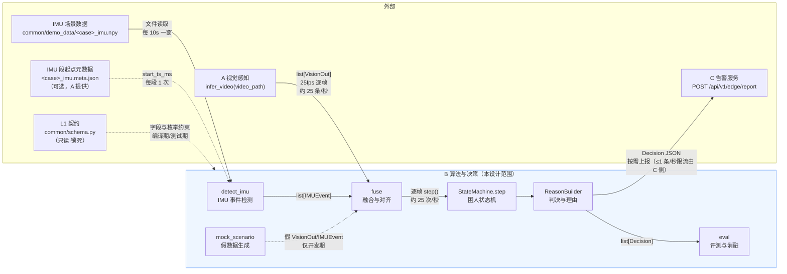
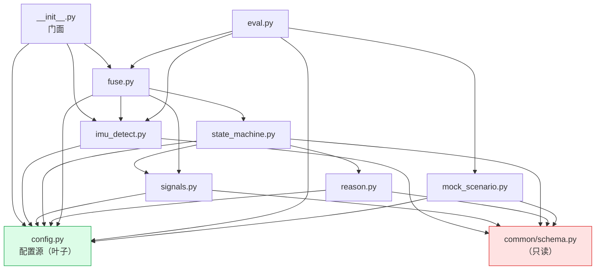
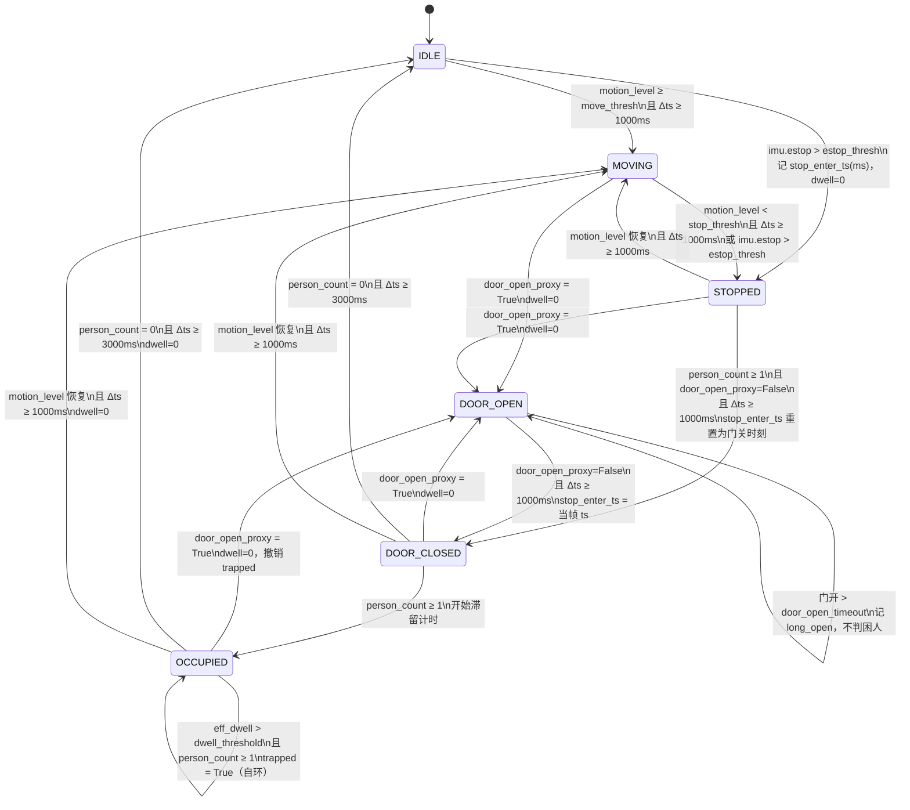
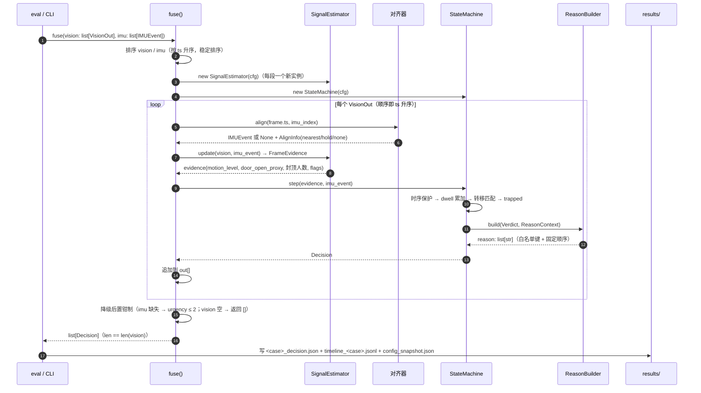
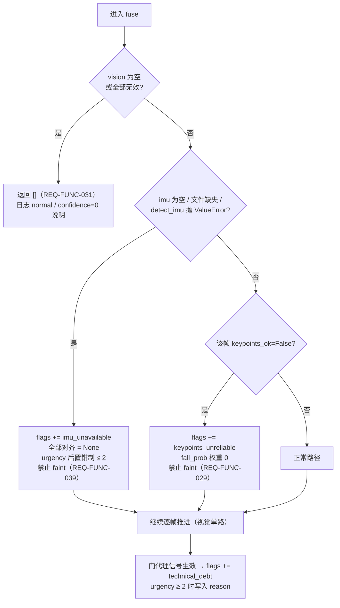

# B · 算法与决策模块 —— 技术实现方案设计

| 项目 | 内容 |
|---|---|
| 文档编号 | DESIGN-ELEV-RESCUE-B-001 |
| 文档名称 | 「电梯困人预警」B 侧（算法与决策）技术实现方案设计 |
| 版本 | v1.0（对应需求基线 SPEC-ELEV-RESCUE-001 **v1.1**） |
| 编写日期 | 2026-11-17 |
| 责任人 | B（算法与决策） |
| 评审人 | A（数据与感知）、C（云服务与交付） |
| 上游需求 | `docs/spec/requirement.md`（SPEC-ELEV-RESCUE-001 v1.1，123 条需求） |
| 上游契约 | `common/schema.py`（`CONTRACT_VERSION = "L1-1.0"`）、`tests/test_schema_contract.py`（11 项通过）、`requirements.lock.txt`（`LOCK-1.0`） |
| 团队权威契约 | `00_协作总览与接口契约.md` 第 6/7 节、`B_算法与决策_任务卡.md` |
| 设计范围 | 仅 B 侧：`model/`、`results/`、`docs/spec/`、仓库既有 `tests/`（仅追加 B 侧用例） |
| 明确不做 | 不设计/改动 `vision/`、`service/`、`dashboard/`、`scripts/`、`common/schema.py` |

---

## 0. 阅读约定

### 0.1 文档定位

本文档回答"**如何构建**"：把 `requirement.md` 的 123 条需求（WHAT）翻译成可落地的模块、接口、数据结构、算法口径与工程结构（HOW）。

本文档**不含**函数体实现、不含可运行的完整代码。所有接口以签名 + 契约约束描述，算法以公式、规则表与数据流描述。

### 0.2 设计文档位置说明

仓库既有约定为"所有规格类文档集中于 `docs/spec/`"（`requirement.md` 即位于此处，任务卡亦要求 B 只碰 `model/`、`results/`、`docs/spec/`）。因此本设计文档落位：

- `docs/spec/design.md`（本文档）
- 若后续流程要求 `.codeartsdoer/specs/<feature>/design.md`，以其为软链接/副本，**正本仍为 `docs/spec/design.md`**，避免双份事实源。

### 0.3 追溯约定

- 每条设计决策末尾以 `→ REQ-XXX-NNN` 标注对应需求编号。
- 只引用 `requirement.md` v1.1 已存在的编号，**不新增、不改写、不复用**任何需求编号。
- 标识「MVP 必做」/「P1 应当」/「可选扩展点（P2）」，与需求中的 `P0/P1/P2` 严格对齐。

### 0.4 术语对齐

`dwell`（滞留时长）、`urgency`（紧急度 0–3）、`event_type`（五类事件）、`VisionOut` / `IMUEvent` / `Decision`（三个契约对象）、`ts`（Unix epoch 毫秒）等术语，含义与 `requirement.md` 第 2 章完全一致，不另立别称。

---

# 一、需求与存量功能关系分析

本章目的：明确"新需求"与"现有代码"的关系，作为增量设计的基础。

**关键事实**：本仓库当前处于「契约先行、算法未起」状态 —— `model/` 目录**尚不存在**，`common/demo_data/` 仅有 `.gitkeep`。因此存量功能集中在**契约层与工程基线**（`common/schema.py`、`tests/test_schema_contract.py`、`requirements.lock.txt`、`docs/spec/requirement.md`），而算法侧全部功能均为**新增**。

## 1.1 需求功能与存量功能对比

### 1.1.1 已实现功能

下列能力在存量代码中已**完全可用**，B 侧只能消费、不能修改（`REQ-CONST-002`、`REQ-CONST-003`）。

| 需求功能 | 存量功能 | 代码位置 | 匹配度 |
|---|---|---|---|
| `VisionOut` 六字段结构与类型（`REQ-DATA-001`、`REQ-FUNC-041`） | `@dataclass VisionOut`：`ts:int / person_count:int / fall_prob:float / door_approach:float / crowded:float / keypoints_ok:bool`，注释含 `person_count` 封顶 8 | `common/schema.py:43-52` | 100% |
| `IMUEvent` 五字段结构与类型（`REQ-DATA-001`、`REQ-FUNC-005`） | `@dataclass IMUEvent`：`ts:int / estop:float / vibration:float / idle:float / window_sec:float`，`ts` 注释为"窗口结束的毫秒时间戳" | `common/schema.py:55-63` | 100% |
| `Decision` 九字段结构与类型（`REQ-DATA-001`、`REQ-FUNC-024`） | `@dataclass Decision`：`ts:int / device_id:str / trapped:bool / urgency:int / location:str / people_count:int / event_type:str / confidence:float / reason:List[str]` | `common/schema.py:66-78` | 100% |
| `urgency ↔ event_type` 合法映射（`REQ-FUNC-032`、DEC-01） | `URGENCY_EVENT_MAP = {0:(normal), 1:(estop), 2:(trapped,pry), 3:(faint)}`；`trapped` 不在 `1` 的合法集合内 | `common/schema.py:28-33` | 100% |
| 五类事件枚举（`REQ-FUNC-052`） | `EVENT_TYPES = ("normal","estop","trapped","pry","faint")` | `common/schema.py:25` | 100% |
| IMU 输入形状/采样率常量（`REQ-FUNC-001`、`REQ-FUNC-005`） | `IMU_STEPS=200 / IMU_HZ=20 / IMU_CHANNELS=3 / IMU_WINDOW_SEC=10.0 / PERSON_COUNT_MAX=8` | `common/schema.py:19-23` | 100% |
| 契约字段零漂移回归（`REQ-DATA-001`、`REQ-QUAL-005`） | 11 项快照测试：字段名+类型逐项比对、无多余 dataclass、形状常量、事件枚举、`urgency` 配对合法、`trapped` 永不为 `urgency=1`、可构造性 | `tests/test_schema_contract.py:64-129` | 100% |
| 依赖版本锁定（`REQ-DATA-010`、`REQ-CONST-001`） | `numpy==1.26.4` / `scikit-learn==1.5.2` / `matplotlib==3.9.2`，Python 3.10/3.11 | `requirements.lock.txt:13-16` | 100% |
| 契约版本标识（`REQ-DATA-002` 追溯） | `CONTRACT_VERSION = "L1-1.0"` 且有断言 | `common/schema.py:15`、`tests/test_schema_contract.py:65-66` | 100% |
| 需求基线文档（`REQ-ACC-001`） | 123 条 EARS 需求 + 附录 A–E + DEC-01/02/03 裁决 | `docs/spec/requirement.md:1-1245` | 100% |
| B 侧目录边界基线（`REQ-CONST-003`） | 仅存在 `common/`、`docs/`、`tests/`；无 `model/`、无越界目录 | 仓库根目录树 | 50% |

> 说明：最后一行标 50%，原因是"边界基线成立"但"B 侧目录尚未建立"，属于 1.1.2/1.1.3 的过渡态，不构成可复用功能。

### 1.1.2 需要扩展的功能

下列能力在存量代码中**部分存在**，需在既有基础上补齐可执行部分。**扩展一律发生在 B 侧（`model/`、`tests/`），不得改动 `common/schema.py`**。

| 需求功能 | 存量功能 | 差异说明 | 扩展方向 |
|---|---|---|---|
| `ts` 毫秒语义的可执行保障（`REQ-DATA-002`、`REQ-FUNC-005`、`REQ-FUNC-020`、DEC-03） | `schema.py` 三个 `ts` 字段均标注"毫秒时间戳"，`IMUEvent.ts` 标注"窗口结束" | ① 契约仅有**注释**，无机器断言；② 现有测试用 `ts=0`、`ts=10000`，**未断言 13 位量级**；③ 无"同段内相邻 `IMUEvent.ts` 差恒为 10000ms"的断言 | ① B 侧新增 `tests/test_time_semantics.py`（毫秒量级、单调性、相邻差 10000ms、`dwell_ms/1000.0` 换算）；② `model/` 内部统一以 `_ms` 后缀命名整型时间量，禁止裸 `dwell` 浮点秒参与比较；③ 不改 `schema.py` |
| `person_count` 封顶 8 的执行（`REQ-FUNC-041`） | `PERSON_COUNT_MAX = 8` 常量；注释写明"数不清就填 8" | 常量存在但**无任何封顶逻辑**，`VisionOut.person_count` 允许传入 12 | 在 `model/fuse.py` 的入参归一化阶段执行 `min(person_count, PERSON_COUNT_MAX)`，并写 `raw_person_count` 到结构化日志；`Decision.people_count` 取封顶值 |
| `urgent ↔ event_type` 组合的运行时校验（`REQ-FUNC-032`） | `URGENCY_EVENT_MAP` 存在，测试校验配对表本身合法 | 有表**无执行**：任何代码路径都可能产出非法组合 | 在 `model/reason.py` 的判决落地处调用 `assert_pair_legal(urgency, event_type)`（`ValueError` + 日志），作为最后一道闸门 |
| 门状态信号（`REQ-FUNC-030`、`REQ-FUNC-013`、DEC-02） | `VisionOut` **不含**门状态字段；`door_approach` 为"贴门程度" | 需求要求 `door_open_signal`，但契约里没有该信号，且不允许新增字段 | 在 `model/signals.py` 内从 `VisionOut` 时序**派生** `door_open_proxy`（技术债），并把 `technical_debt=door_signal_proxy` 写入 `reason`/日志 |
| 运动量信号（`REQ-FUNC-011`、`REQ-FUNC-012`） | `VisionOut` **不含** `motion_level`；`IMUEvent.idle` 可反推静止 | 状态机需要 `motion_level` 与 `move_thresh`/`stop_thresh` 比较，但无直接来源 | `model/signals.py` 派生：有 IMU 时 `motion ≈ 1 - idle`（振动提升），无 IMU 时用视觉变化量代理，并标记 `imu_unavailable` |
| 假数据联调（`REQ-FUNC-042`、`REQ-ACC-002`） | `common/demo_data/` 仅有 `.gitkeep`，无任何样本 | 需要"不依赖真实视频/npy 推进状态机"的能力，当前完全不具备 | `model/mock_scenario.py` 合成 5 类场景的 `VisionOut` 序列 + 可选合成 IMU，供 D2–D3 验收与单测 |
| 结构化日志（`REQ-QUAL-003`、`REQ-CFG-005`） | 无日志设施 | 需求要 JSON Lines + 配置快照 + `case/ts/state/decision/reason/阈值` | `model/config.py` 提供 `config_snapshot()`；`model/*` 统一用 `logging` + JSON formatter 写 `results/run_<ts>.jsonl` |
| 评测产物（`REQ-EVAL-004`、`REQ-ACC-007`） | `results/` 目录不存在 | 需指标表、混淆矩阵、四项消融图 | `model/eval.py` + `results/` 目录，产物清单见 2.9 |
| 工程规范静态检查（`REQ-CONST-010`、`REQ-DATA-006/007`） | 仓库暂无检查脚本，`scripts/` 属 C | 需要"无绝对路径、无中文文件名、依赖锁"的机器校验 | B 侧在 `tests/test_engineering_rules.py` 内实现只读扫描（不碰 `scripts/`），失败即红 |

### 1.1.3 需要新增的功能或接口

下列功能在存量代码中**完全没有**对应实现，全部为新增。按业务模块分组，每组给出功能点、输入、输出、核心逻辑与依赖关系。

#### A 组 · IMU 事件检测（`model/imu_detect.py`）

| 功能点 | 输入 | 输出 | 核心逻辑 | 依赖 |
|---|---|---|---|---|
| 窗口切分 `REQ-FUNC-001` | `.npy` 路径，`(N,200,3) float32` | `list[IMUEvent]`，条数 `= N // 200` | 严格整窗切分，尾部不足 200 步丢弃并 WARN；`N<200` 返回 `[]` + "insufficient window" WARN（`REQ-FUNC-008`） | `numpy` |
| 输入合法性校验 `REQ-FUNC-006` | 同上 | `ValueError`（含文件名+实际形状） | 校验 `ndim==3`、`shape[1:]==(200,3)`、`dtype==float32`、`np.isfinite().all()` | `common/schema`（常量） |
| `estop` 计算 `REQ-FUNC-002`、`REQ-FUNC-048` | 单窗 `(200,3)` | `float ∈ [0,1]` | 模长序列 → 相邻差/`dt`（0.05s）→ 0.5s（10 步）滑窗峰值变化率 → sigmoid 映射 | 配置（`estop_rate_center`/`estop_rate_gain`） |
| `vibration` 计算 `REQ-FUNC-003` | 单窗 `(200,3)` | `float ∈ [0,1]` | 去均值 → `rfft` → 2–8 Hz 频段能量 / 总能量（去 DC）→ 线性/分段归一化裁剪 | 配置（频段上下限、`vib_ratio_low/high`） |
| `idle` 计算 `REQ-FUNC-004`、`REQ-FUNC-028` | 单窗 `(200,3)` | `float ∈ [0,1]` | 三通道方差均值 → sigmoid 反向映射（方差越小分数越高） | 配置（`idle_var_center`/`idle_var_gain`） |
| `window_sec` 与 `ts` 恒定 `REQ-FUNC-005` | 窗序号 `i`、段起点 `t0_ms` | `window_sec=10.0`、`ts = t0_ms + (i+1)*10000` | 窗口结束时刻 = 起点 + 一个窗长；相邻差恒 10000ms | `model/config.py`（`ImuConfig.start_ts_ms`）或 sidecar |
| 职责隔离 `REQ-FUNC-007` | — | — | 本模块**不**导入 `vision/`、**不**导入 `state_machine`/`fuse`，**不**产出 `trapped`/`urgency` | 静态 import 检查（`REQ-QUAL-005`） |
| CLI `REQ-DATA-009` | `--npy <path>`、`--out`、`--start-ts-ms` | 控制台摘要 + 可选 JSON | `python model/imu_detect.py --npy <path>`，`--help` 完整说明 | `argparse` |

#### B 组 · 困人状态机（`model/state_machine.py`）

| 功能点 | 输入 | 输出 | 核心逻辑 | 依赖 |
|---|---|---|---|---|
| 六态集合与初始态 `REQ-FUNC-009` | 构造参数 | `ElevatorState` 枚举 | 仅 6 个枚举值，默认 `IDLE` | `model/config.py` |
| 转移表完备 `REQ-FUNC-010` | `FrameEvidence` | 下一状态 | 规则表覆盖"运动恢复/停稳/门开/门关/有人/无人/超时"全部组合；未命中 → 自环 + WARN | A 组派生信号 |
| 进入 `MOVING` `REQ-FUNC-011` | `motion_level ≥ move_thresh` 持续 ≥1000ms | `MOVING` | 基于 **`ts` 毫秒差**的持续计时器 | `signals.motion_level` |
| 停稳记时 `REQ-FUNC-012` | `motion_level < stop_thresh` 持续 ≥1000ms **或** `imu.estop > estop_thresh` | `STOPPED` | 记录 `stop_enter_ts`（毫秒），`dwell` 归零；急停优先 | 同上 |
| 门开/关门转移 `REQ-FUNC-013/015/017` | `door_open_signal` 真/假持续 ≥1000ms | `DOOR_OPEN`/`DOOR_CLOSED` | 门开即 `dwell=0`、撤销 `trapped` | `signals.door_open_proxy` |
| 门开期间清零 `REQ-FUNC-014` | 驻留 `DOOR_OPEN` | `dwell_sec == 0` 恒成立 | 转移动作中重置基准时间 | 内部 |
| 进入 `OCCUPIED` `REQ-FUNC-016` | `DOOR_CLOSED` + `person_count ≥ 1` | `OCCUPIED` | 开始滞留计时（`stop_enter_ts` 重置为门关时刻） | 内部 |
| 空梯退出 `REQ-FUNC-018`、`REQ-FUNC-045` | `person_count == 0` 持续 ≥3000ms | `IDLE` | `dwell=0`，撤销 `trapped` | 内部 |
| 困人判决 `REQ-FUNC-019`、`REQ-FUNC-023`、`REQ-FUNC-049` | 当前状态 + 有效 `dwell_sec` + `person_count` | `trapped: bool` | `state==OCCUPIED ∧ eff_dwell > th ∧ person_count ≥ 1`；其余五态恒 `False`；严格大于 | `config` |
| `dwell` 毫秒定义 `REQ-FUNC-020` | `now_ts`、`stop_enter_ts` | `dwell_ms`、`dwell_sec` | `dwell_ms = now_ts - stop_enter_ts`；`dwell_sec = dwell_ms/1000.0`；门开后基准重置为门关时刻 | 内部 |
| 时序保护 `REQ-FUNC-021` | `ts` 回退/重复 | 丢弃该帧推进 + WARN | 判决沿用上一有效帧，`dwell` 单调不减 | 内部 |
| IMU 缺帧推进 `REQ-FUNC-022` | `imu_event=None` | 正常 `Decision` | 仅靠视觉与派生信号推进；`dwell` 仍按毫秒差累加 | `signals` 降级分支 |
| 逐帧 `Decision` `REQ-FUNC-024` | 一次推进 | 完整九字段 `Decision` | `reason` 非空；字段与 `schema` 严格一致 | `reason` |

#### C 组 · 融合与对齐（`model/fuse.py`）

| 功能点 | 输入 | 输出 | 核心逻辑 | 依赖 |
|---|---|---|---|---|
| 逐帧融合输出 `REQ-FUNC-025` | `list[VisionOut]` × `list[IMUEvent]` | `list[Decision]`（条数 = 输入视觉帧数） | 排序 → 对齐 → 逐帧 `step` → 汇总 | B 组 |
| 毫秒最近邻对齐 `REQ-FUNC-026` | 两侧 `ts` | `IMUEvent` 或 `None` | `abs(Δts) ≤ 500ms` 取最近邻；否则前向保持（`frame_ts - event_ts ≤ 10000ms`）；否则 `None` | `numpy.searchsorted` |
| 急停加速计时 `REQ-FUNC-027` | 对齐事件的 `estop` | 有效 `dwell` 加速系数 2.0 | 命中窗口 `estop > th` 后 latch 加速；直到出现非急停对齐事件或空档 > 10000ms | `config.dwell_accel_factor` |
| 静止确认 `REQ-FUNC-028` | `imu.idle > idle_thresh` | 判决上下文 + `reason` | 作为"电梯确实停着不动"的辅助证据 | `config.idle_thresh` |
| 关键点降级 `REQ-FUNC-029`、`REQ-EXPL-005` | `keypoints_ok=False` | `fall_prob` 权重 0 + `keypoints_unreliable` | 禁止据 `fall_prob` 判 `faint` | `reason` |
| 门信号代理 `REQ-FUNC-030` | 视觉时序 | `door_open_signal` + `technical_debt=door_signal_proxy` | 见 2.4 派生规则 | `signals` |
| 空视觉输入 `REQ-FUNC-031` | `vision=[]` 或全无效 | `[]` | **不得**凭 IMU 伪造 `trapped=True` | 内部 |

#### D 组 · 分级、解释与降级（`model/reason.py`）

| 功能点 | 需求 | 核心逻辑 |
|---|---|---|
| 紧急度/事件推导 | `REQ-FUNC-032`～`037` | 五级判决树，输出必须落在 `URGENCY_EVENT_MAP` 内（见 2.5.4） |
| 置信度与楼层 | `REQ-FUNC-038` | `confidence` 为已触发证据的加权归一聚合 ∈[0,1]，6 位舍入；`location` 无来源时填 `"?"` |
| 理由非空/只列触发项 | `REQ-EXPL-001`、`REQ-EXPL-002` | `len(reason) ≥ 1`；`normal` ≤ 2 条；不罗列未触发项 |
| 数值化格式与键白名单 | `REQ-EXPL-003`、`REQ-EXPL-004` | `<key>=<value> <op> <threshold>` 或 `<key>=<value>`；键限于白名单 13 个 |
| 降级与技术债可见 | `REQ-EXPL-005`、`REQ-FUNC-043` | `keypoints_unreliable` / `imu_unavailable` / `technical_debt=door_signal_proxy` 只写 `reason`/日志，**不新增字段** |
| 演示参数显式 | `REQ-EXPL-006`、`REQ-CFG-003`、`REQ-CONST-007` | 演示模式强制 `demo_threshold=true` 并附阈值数值 |
| 禁空话 | `REQ-EXPL-007` | 每条 `reason` 必须含 `=` 与数值，纯文字条目判失败 |

#### E 组 · 配置（`model/config.py`）

`REQ-CFG-001`～`005`、`REQ-CONST-004`、`REQ-DATA-010`：单一配置源、CLI 覆盖、生产/演示双默认、参数合法性拒绝启动、配置留痕。详见 2.7。

#### F 组 · 评测与消融（`model/eval.py` + `results/`）

`REQ-EVAL-001`～`012`、`REQ-DATA-004`、`REQ-PERF-002`：批量评测入口、指标集、混淆矩阵、四项消融、口径声明。详见 2.9。

#### G 组 · 假数据与工具（`model/mock_scenario.py`）

`REQ-FUNC-042`、`REQ-ACC-002`：合成五类场景的 `VisionOut` 序列（含正常乘梯、困人、扒门、倒地、急停）与可选合成 IMU（急停脉冲/5Hz 正弦/近零方差/运动），供 D2–D3 与单测使用。详见 2.10。

## 1.2 存量功能详细分析

### 1.2.1 `common/schema.py` —— 接口契约维度

**接口契约**
- 三个不可变语义的数据对象：`VisionOut`（A→B）、`IMUEvent`（B 内部）、`Decision`（B→C）。字段名、顺序、类型均为快照测试覆盖范围。
- 模块级常量：`IMU_STEPS=200`、`IMU_HZ=20`、`IMU_CHANNELS=3`、`IMU_WINDOW_SEC=10.0`、`PERSON_COUNT_MAX=8`；`EVENT_TYPES` 五元组；`URGENCY_EVENT_MAP` 与 `URGENCY_MEANING`。
- **无副作用、无 I/O、无第三方依赖**（仅 `dataclasses`、`typing`）。

**业务规则（以常量的形式固化）**
1. `IMU_WINDOW_SEC = 10.0` 是物理秒，**不是** `ts` 单位；`ts` 为毫秒。
2. `URGENCY_EVENT_MAP[1]` 不含 `trapped` —— 这是 DEC-01 的机器可读表达，B 侧判决不得违反。
3. `PERSON_COUNT_MAX = 8` 是**输出封顶**，不是输入校验拒绝。

**扩展点**
- 契约本身**不提供**任何扩展点（`test_no_extra_dataclasses` 断言除三个 dataclass 外无其他 dataclass）。因此 B 侧所有新数据结构（配置、状态载体、证据、判定中间态）**必须定义在 `model/` 内**，绝不能回写 `common/`。

**约束（对 B 侧的硬约束）**
| 约束 | 影响 | 出处 |
|---|---|---|
| 字段零漂移 | 降级信息只能进 `reason`/日志 | `REQ-DATA-001`、`REQ-FUNC-043` |
| 禁止新增 dataclass | 配置/状态对象放 `model/` | `tests/test_schema_contract.py:77-83` |
| `reason: List[str]` | 可解释性只能靠字符串表达，不能塞结构化字段 | `schema.py:78` |
| `urgency: int` 且值域 0–3 | 判决必须收敛到 4 档 | `schema.py:28-33`、`REQ-FUNC-032` |
| `ts: int` 毫秒 | 所有时间差按毫秒算后换算 | `REQ-FUNC-020`、DEC-03 |

### 1.2.2 `tests/test_schema_contract.py` —— 可测试性维度

**已覆盖（11 项）**：契约版本、三个 dataclass 的 `(字段名, 类型)` 逐项签名、无多余 dataclass、五个形状常量、事件枚举、映射表配对合法、`trapped` 永不 `urgency=1`、`Decision` 可构造且 `event_type ∈ URGENCY_EVENT_MAP[urgency]`、`VisionOut`/`IMUEvent` 可构造。

**未覆盖（B 侧需补，不改本文件）**
1. `ts` 的**毫秒量级**：现有用例使用 `ts=0`、`ts=10000`，未断言 13 位量级（`REQ-DATA-002`）。
2. `IMUEvent.ts` 相邻差恒为 `10000ms`（`REQ-FUNC-005`）。
3. `dwell_ms = now_ts - stop_enter_ts` 的换算示例（`REQ-FUNC-020` 验收值 `190000ms → 190.0s`）。
4. `reason` 键白名单与数值格式（`REQ-EXPL-003/004`）。
5. 判决层 `urgency/event_type` 组合的**运行时**校验（表存在但无人执行）。

> 补测落点：`tests/test_time_semantics.py`、`tests/test_reason.py`（2.10 节）。这些是**追加**文件，`test_schema_contract.py` 保持字节级不变（`REQ-CONST-002`）。

### 1.2.3 `requirements.lock.txt` —— 依赖边界维度

- B 侧可用：`numpy 1.26.4`、`scikit-learn 1.5.2`、`matplotlib 3.9.2`。
- `onnxruntime` 虽在 lock 中，但归属 A（视觉/可选昇腾），**B 侧不得导入**（`REQ-CONST-001`）。
- 无 PyTorch/TensorFlow/PaddlePaddle：`REQ-OPT-001` 的 1D-CNN 若启用，只能以"可选开关 + 不阻塞主路径"的形态存在，且需另行评审（本文档只在 2.12 记为扩展点）。
- 冷启动 ≤3s（`REQ-PERF-004`）：`matplotlib` 必须**延迟导入**，不得出现在 `model/__init__.py` 的导入链上。

### 1.2.4 存量约束对增量设计的强制影响（结论）

1. **信号缺失 → 必须派生**：`door_open_signal`、`motion_level` 在契约中不存在，但状态机 6 条转移依赖它们 → 必须有 `model/signals.py` 承载派生，并把近似登记为技术债（`REQ-FUNC-030`）。
2. **时间基准 → 必须显式解析**：`detect_imu(npy_path)` 只有一个路径参数，而 `IMUEvent.ts` 要求 epoch 毫秒 → 必须有"段起点时间戳"解析策略（sidecar / 配置 / CLI），否则 A 的 `VisionOut.ts` 与 B 的 `IMUEvent.ts` 无法对齐（`REQ-FUNC-026`）。
3. **字段锁死 → 解释只能走 `reason`**：所有降级、技术债、演示标记都必须拼进字符串列表，因此 `reason` 生成必须是**独立可测模块**，而不是散落在状态机里。
4. **目录边界 → 测试放 `tests/`**：`tests/` 是仓库既有共用测试目录（契约测试已在此），B 侧只**追加**用例文件，不修改既有文件。

---

# 二、增量设计方案

组织原则：先整体后局部（上下文 → 架构 → 接口 → 数据 → 算法），每个决策必须附选择理由与需求追溯；不罗列"多方案并列"。

## 2.1 实现模型

### 2.1.1 上下文视图

B 侧在系统中的位置：上游只有 A 的 `VisionOut` 与 IMU 文件；下游只有 C 的告警服务；契约由锁死的 `common/schema.py` 单向约束。



**通信协议**：全部为**进程内函数调用**，无网络、无消息队列、无缓存中间件（`REQ-PERF-004` 离线可运行）。C 侧的 HTTP 交互发生在 B 之外，B 只产出 JSON。

**调用频率**：
| 边 | 频率 | 说明 |
|---|---|---|
| A → `fuse` | 25 次/秒（帧率） | 与视频帧率一致 |
| 磁盘 → `detect_imu` | 1 次/段（内部 10s/窗） | 批处理 |
| `fuse` → `step` | 25 次/秒 | 严格 1:1，无跳帧 |
| `step` → `ReasonBuilder` | 25 次/秒 | 同帧合成 |
| `eval` → 全链路 | 5 次/评测 | 每段一次 |

→ `REQ-FUNC-025`、`REQ-FUNC-026`、`REQ-PERF-004`、`REQ-QUAL-005`

### 2.1.2 服务/组件总体架构

#### 模块清单与职责

```
model/
├── __init__.py          # 公开门面：只导出 L2 契约函数与配置入口（不导入 matplotlib）
├── config.py            # 单一配置源：ThresholdConfig / ImuConfig / RuntimeConfig / 预设 / CLI / 校验
├── signals.py           # 派生信号：motion_level、door_open_proxy、person_count 归一化（技术债承载点）
├── imu_detect.py        # detect_imu()：窗口切分 + estop/vibration/idle + CLI
├── state_machine.py     # ElevatorState / MachineContext / TransitionRule / StateMachine.step()
├── reason.py            # ReasonBuilder：紧急度与事件推导、confidence、reason 拼接、键白名单校验
├── fuse.py              # fuse()：对齐 + 逐帧驱动 + 降级钳制 + CLI
├── eval.py              # 指标、混淆矩阵、四项消融、产物落盘（延迟导入 matplotlib）
├── mock_scenario.py     # 五类场景假数据生成（D2–D3 与单测）
└── MODEL_CARD.md        # 数据来源/判据/指标口径/局限/演示参数声明（REQ-ACC-008）
```

**与任务卡建议清单的差异（2 个新增模块，需说明）**

| 新增模块 | 理由 | 可合并的退路 |
|---|---|---|
| `signals.py` | `door_open_signal` / `motion_level` 在契约中不存在，必须从视觉时序派生；若塞进 `fuse.py` 会让"对齐"与"信号构造"两个关注点耦合，且状态机将反向依赖 `fuse`（违反依赖方向） | 若 D12 前需压缩文件数，可并入 `fuse.py` 的 `_build_evidence()`，**契约与行为不变** |
| `reason.py` | `reason` 有 13 个白名单键、固定拼接顺序、5 类标记、数值格式与组合合法性校验，是独立可测单元；若留在状态机内会使 `step` 超 300 行并难以单独断言（`REQ-EXPL-001~007` 大量验收点在此） | 可并入 `state_machine.py` 尾部，**行为不变** |

→ `REQ-QUAL-004`、`REQ-QUAL-005`、`REQ-EXPL-001`

#### 依赖方向（单向、无环）



**层级规则（硬约束，用 import 图测试固化）**

| 层级 | 模块 | 允许依赖 |
|---|---|---|
| L0 叶子 | `config.py` | 仅标准库 |
| L1 契约/派生 | `signals.py`、`imu_detect.py` | L0 + `common.schema` |
| L2 判决 | `state_machine.py`、`reason.py` | L0 + `signals` + `common.schema` |
| L3 编排 | `fuse.py` | L0/L1/L2 + `common.schema` |
| L4 工具 | `eval.py`、`mock_scenario.py` | 全部下层 |

**禁止的反向依赖（逐条列出，便于 grep 审查）**
1. `imu_detect.py` **不得**导入 `state_machine` / `fuse` / `reason` / `eval`（`REQ-FUNC-007`）。
2. `signals.py`、`state_machine.py`、`reason.py` **不得**导入 `fuse` / `eval`。
3. `config.py` **不得**导入任何 `model/` 内其他模块（保持叶子），不得导入 `common.schema`（避免配置层感知契约，便于独立测试）。
4. 任何 `model/*` **不得**导入 `vision/`、`service/`、`dashboard/`、`scripts/`（`REQ-QUAL-005`、`REQ-CONST-003`）。
5. 任何 `model/*` **不得**写入 `common/`（含 `schema.py` 与 `demo_data/`）。
6. `model/__init__.py` **不得**在导入期加载 `matplotlib`（冷启动 ≤3s，`REQ-PERF-004`）。

→ `REQ-QUAL-005`、`REQ-CONST-003`、`REQ-FUNC-007`、`REQ-PERF-004`

#### 核心类与职责（不含实现）

| 类型 | 模块 | 职责 | 生命周期 |
|---|---|---|---|
| `ThresholdConfig`（frozen dataclass） | `config.py` | 业务阈值集合（10 项） | 进程级不可变 |
| `ImuConfig`（frozen dataclass） | `config.py` | IMU 标定参数 + 段起点时间戳策略 | 进程级不可变 |
| `RuntimeConfig`（frozen dataclass） | `config.py` | 模式/设备/楼层 + 两个子配置 + 消融开关 | 每次运行一份 |
| `SignalEstimator`（有状态类） | `signals.py` | 逐帧派生 `motion_level`、`door_open_proxy`、封顶人数 | **每段视频一个实例** |
| `FrameEvidence`（frozen dataclass） | `signals.py` | 单帧归一化后的判决输入 | 每帧新建 |
| `ElevatorState`（str Enum） | `state_machine.py` | 六态枚举 | 常量 |
| `MachineContext`（可变 dataclass） | `state_machine.py` | 唯一状态载体（见 2.3） | 每段视频一个实例 |
| `TransitionRule`（frozen dataclass） | `state_machine.py` | 一条"状态+条件→动作"规则 | 模块级常量表 |
| `StateMachine` | `state_machine.py` | `step(vision, imu_event) -> Decision` | 每段视频一个实例 |
| `Verdict`（frozen dataclass） | `reason.py` | 判决中间态（trapped/urgency/event_type/confidence/证据） | 每帧 |
| `ReasonBuilder` | `reason.py` | `Verdict → list[str]` | 无状态，可复用 |

**关键取舍：为什么 `StateMachine` 是实例而不是模块级全局** —— `fuse` 处理 5 段必须互不串扰，且 `REQ-QUAL-001` 要求确定性；全局单例会引入跨段状态泄漏。L2 要求的**模块级函数** `step(vision, imu_event)` 保留为"单帧调试入口"，内部懒创建默认实例，并在文档中标注"不用于批处理"。→ `REQ-QUAL-001`、`REQ-QUAL-004`、`REQ-DATA-008`

#### 配置项与取值策略

见 2.7（阈值载体形式、生产/演示双默认、CLI 覆盖、校验）。此处只声明原则：**业务代码中零阈值字面量**，全部经 `RuntimeConfig` 注入（`REQ-CFG-001`）。

### 2.1.3 实现设计文档

#### (1) 状态机数据模型与转移实现

**状态载体（`MachineContext`）字段设计**

| 字段 | 类型 | 语义 | 重置时机 |
|---|---|---|---|
| `state` | `ElevatorState` | 当前状态 | 转移时 |
| `last_ts` | `int \| None` | 上一有效帧的毫秒 `ts`（时序保护基准） | 不重置 |
| `stop_enter_ts` | `int \| None` | 进入 `STOPPED` 的毫秒时刻 = dwell 基准 | 进入 `STOPPED` / 门关（`DOOR_CLOSED`）时置为当帧 `ts`；`DOOR_OPEN` 时置 `None` |
| `raw_dwell_ms` | `int` | 严格按 `now_ts - stop_enter_ts` 的差值（`REQ-FUNC-020` 可测值） | 门开/空梯/运动恢复时清零 |
| `accel_extra_ms` | `int` | 因急停加速而**额外**累加的毫秒（`effective = raw + extra`） | 同上 |
| `estop_latch` | `bool` | 急停加速是否生效 | 见 (3) |
| `estop_latch_ts` | `int \| None` | latch 最近一次被确认的毫秒时刻 | — |
| `door_open_hold_ts` | `int \| None` | 门开代理信号的保持起点 | 代理信号为假时置 `None` |
| `motion_run` | `_RunClock` | "运动"持续计时器（毫秒） | 条件不满足即重置 |
| `stop_run` | `_RunClock` | "停稳"持续计时器（毫秒） | 同上 |
| `door_closed_run` | `_RunClock` | "门关闭"持续计时器（毫秒） | 同上 |
| `empty_run` | `_RunClock` | "人数=0"持续计时器（毫秒） | 同上 |
| `fall_run` | `_RunClock` | "倒地"持续计时器（毫秒，`REQ-FUNC-046`） | 同上 |
| `move_recover_run` | `_RunClock` | "运动恢复"持续计时器（防止抖动） | 同上 |
| `last_person_count` | `int \| None` | 上一帧人数（门开代理与 motion 派生需要） | 不重置 |
| `alarmed` | `bool` | 已产出过 `trapped=True` 的标记（用于首次告警时刻与响应时长统计） | 门开/空梯/运动恢复时撤销 |
| `first_alarm_ts` | `int \| None` | 首次 `trapped=True` 的毫秒时刻 | 同上 |
| `flags` | `set[str]` | 当前生效的降级/技术债标记（`imu_unavailable` / `keypoints_unreliable` / `technical_debt`） | 逐帧刷新 |
| `dropped_frames` | `int` | 时序保护丢弃帧计数（仅日志与评测） | 不重置 |
| `transition_count` | `dict[tuple[ElevatorState, ElevatorState], int]` | 转移计数（评测/单测观测轨迹用） | 不重置 |

**`_RunClock` 语义（关键）**：内部只保存 `since_ts: int | None`。`update(cond, now_ts)` 在 `cond=True` 时若 `since_ts is None` 则置为 `now_ts`，返回 `now_ts - since_ts`；`cond=False` 时置 `None` 并返回 0。**持续判定一律用返回的毫秒数**，不用帧计数。

**为什么用毫秒而不是帧计数**：需求中出现"1 s / 3 s 持续"，而帧率由 A 决定（当前约定 25fps，但 `VisionOut` 契约**不携带帧率**）。若用固定帧数（25 帧），一旦 A 抽帧/跳帧就会失准。→ `REQ-FUNC-011`、`REQ-FUNC-015`、`REQ-FUNC-018`、`REQ-FUNC-046`
（`REQ-FUNC-011` 的验收"注入连续 25 帧"在 25fps 下等价于 `Δts ≥ 1000ms`，用毫秒实现可同时满足该验收与真实帧率漂移。）

**转移表的实现方式**：**有序规则表**（`tuple[TransitionRule, ...]`，模块级常量，**顺序即优先级**），每条规则声明 `from_states`、`match(evidence, ctx, cfg) -> bool`、`action(ctx, evidence, cfg) -> None`、`to_state`。`step` 的推进顺序固定为：

```text
1) 时序保护：若 ts 回退/重复 → 记 WARN、last_decision 复用，直接返回（不推进）
2) 归一化：person_count 封顶、keypoints 降级、派生信号更新、flags 刷新
3) dwell 累加：raw_dwell_ms = now_ts - stop_enter_ts（若基准存在）；accel_extra_ms 按 latch 追加
4) 转移匹配：按规则表顺序命中第一条 → 执行 action → 置新状态
5) 判决：仅当 state == OCCUPIED 时计算 trapped（其余五态强制 False）
6) 分级与解释：Verdict → confidence → reason → Decision
7) 记录：state 轨迹、告警标记、日志
```

未命中任何规则 → **自环 + WARN `undefined_transition`**（不抛异常），满足 `REQ-FUNC-010` 的"未覆盖组合保持原状态并记录 WARN"。

**规则表与附录 B 的逐格对应**（转移图见下）：



**优先级说明（三处必须写死的顺序，否则语义不确定）**
1. **急停优先于停稳**：`MOVING` 中 `estop>th` 与 `stop_run≥1000ms` 同时成立时，因 `estop` 先匹配，`stop_enter_ts` 取当帧 → 加速计时立刻生效（`REQ-FUNC-012`、`REQ-FUNC-027`）。
2. **门开优先于一切滞留**：`STOPPED`/`DOOR_CLOSED`/`OCCUPIED` 中门开规则排在"人数/滞留"规则之前 → `REQ-FUNC-013`、`REQ-FUNC-017`、`REQ-FUNC-044`。
3. **OCCUPIED 的撤离（门开/空梯/运动）优先于自环判决** → 保证门一开当帧 `trapped=False`（`REQ-FUNC-017` 验收："`OCCUPIED` 持续 300 s 后门开 → 当帧 `trapped=False`"）。

→ `REQ-FUNC-009`、`REQ-FUNC-010`、`REQ-FUNC-011`~`019`、`REQ-FUNC-049`

#### (2) 毫秒时间基准设计（DEC-03）

**统一模型**
| 量 | 单位 | 定义 | 命名约定 |
|---|---|---|---|
| `ts` | 毫秒（13 位） | Unix epoch | 契约字段，直接用 |
| `raw_dwell_ms` | 毫秒整数 | `now_ts - stop_enter_ts` | `_ms` 后缀 |
| `accel_extra_ms` | 毫秒整数 | 加速追加量 | `_ms` 后缀 |
| `effective_dwell_ms` | 毫秒整数 | `raw_dwell_ms + accel_extra_ms` | `_ms` 后缀 |
| `dwell_sec` | 秒浮点 | `effective_dwell_ms / 1000.0` | 仅在**比较阈值**与**拼 reason** 时生成 |
| `window_sec` | 物理秒 | 恒 `10.0` | 与 `ts` 无关 |
| `fall_persist_sec` | 物理秒 | `3.0` → 比较时用 `Δms ≥ 3000` | 配置值 |

**设计机制**：**内部一律毫秒整数运算，浮点秒只出现在"比较阈值"和"格式化为 reason"的两个出口**。
- 比较：`effective_dwell_ms > round(dwell_threshold * 1000)`，避免 `0.1+0.2` 类浮点误差导致的边界抖动（`REQ-FUNC-049` 要求"严格大于"）。
- 展示：`dwell_sec = effective_dwell_ms / 1000.0`，`reason` 里再按 1 位/0 位小数格式化（2.6）。
- **禁止**：把 `ts` 直接与秒阈值比较；在 `Decision` 中做任何单位变换后写回（DEC-03 明确禁止）。

→ `REQ-FUNC-020`、`REQ-DATA-002`、`REQ-FUNC-005`、`REQ-FUNC-049`

**加速计时的精确语义（`REQ-FUNC-027` 与 `REQ-FUNC-020` 的张力处理）**

两条需求存在张力：`REQ-FUNC-020` 把 `dwell` 定义为纯时间差，而 `REQ-FUNC-027` 要求 `estop` 触发时 `dwell` 计时"加速"，验收值"真实 100 s → 有效约 200 s"。设计裁决：

- **保留两个量**：`raw_dwell_ms`（严格符合 `REQ-FUNC-020`，可被单测按 `1763300190000 - 1763300000000 = 190000` 精确断言）+ `accel_extra_ms`（`REQ-FUNC-027` 的加速贡献）。
- **判决与 reason 使用 `effective_dwell_ms = raw + extra`**。因此 `REQ-FUNC-020` 的验收公式依然成立（`raw` 字段与日志可验证），`REQ-FUNC-027` 的"有效 dwell 约 200 s"也成立。
- **增量累加规则**：`accel_extra_ms += round(Δms × (dwell_accel_factor - 1))`，仅当 `estop_latch == True` 且 `state ∈ {STOPPED, DOOR_CLOSED, OCCUPIED}`。
- **latch 的开关语义（必须固化，否则加速覆盖不到 100 s）**：
  | 条件 | 动作 |
  |---|---|
  | 对齐到 `IMUEvent` 且 `estop > estop_thresh` | `latch=True`，`estop_latch_ts = now_ts` |
  | 对齐到 `IMUEvent` 且 `estop ≤ estop_thresh` | `latch=False` |
  | 无对齐事件（`None`）且 `now_ts - estop_latch_ts ≤ 10000ms` | 保持 `latch`（前向保持期延续） |
  | 无对齐事件且 `now_ts - estop_latch_ts > 10000ms` | `latch=False` |
  
  即：每 10 s 有一次急停确认即可持续加速，中断超过一个窗口自动解除，避免"一次性急停永久加速"的失真。

→ `REQ-FUNC-027`、`REQ-FUNC-020`、`REQ-FUNC-049`

**时序回退/重复帧保护（`REQ-FUNC-021`）**

判定：`vision.ts <= ctx.last_ts`（重复或回退）。处理：

| 步骤 | 行为 |
|---|---|
| 1 | `dropped_frames += 1`，写 WARN（`event=ts_regression`, `prev_ts`, `cur_ts`） |
| 2 | **不推进状态**、不累加 `dwell`、不更新任何 `_RunClock` |
| 3 | 输出一条 `Decision`：`ts` 取 `ctx.last_ts`（不前进），其余字段沿用上一有效判决 |
| 4 | `raw_dwell_ms` / `effective_dwell_ms` **单调不减**（由步骤 2 保证） |

**为什么"丢弃帧仍输出 Decision"**：`REQ-FUNC-025` 要求输出条数 = 有效视觉帧数，`REQ-FUNC-021` 要求丢弃回退帧。二者兼容的解释是"**推进语义丢弃、输出语义保留**"——被丢弃的帧不产生新证据，其 `Decision` 是上一有效判决的定格复制。若不这样处理，C 侧按帧对齐的看板会出现条数缺口。此裁定写入 `MODEL_CARD.md`。

→ `REQ-FUNC-021`、`REQ-FUNC-025`、`REQ-QUAL-001`

#### (3) 融合驱动的数据流时序



**对齐算法（`REQ-FUNC-026` 的精确口径）**

设视觉帧时刻 `f`，事件时刻数组 `E`（升序）：

| 步骤 | 判定 | 结果 |
|---|---|---|
| ① 最近邻 | `e* = argmin\|e - f\|`，若 `\|e* - f\| ≤ 500ms` | 取 `e*`，`match=nearest` |
| ② 前向保持 | 取 `e_prev = max{e ∈ E : e ≤ f}`，若 `f - e_prev ≤ 10000ms` | 取 `e_prev`，`match=hold`（标记该事件已"过期但仍在窗口内"） |
| ③ 否则 | — | `None`，`match=none` |

**为什么 ①② 的顺序是这样**：`IMUEvent.ts` 是**窗口结束时刻**，因此"未来事件"（`e > f`）只可能刚结束不超过 500ms（覆盖当前帧的窗口刚闭合）；一旦 `e > f + 500`，该事件描述的是尚未结束的窗口，不可用。反之"过去事件"可以前向保持一个窗口长（10 s），因为电梯状态在 10 s 内可视为持续。→ `REQ-FUNC-026`、`REQ-FUNC-022`、DEC-03

验收对照：事件 `ts` = 10000/20000/30000…，视觉帧 `f = 31000`（比 30000 晚 11000ms）→ ① 最近邻 `Δ=11000 > 500` 失败；② 前向保持 `31000-30000=11000 > 10000` 失败 → `None` ✅ 与 `REQ-FUNC-026` 验收一致。

**降级路径（按优先级，越靠前越优先）**



- **降级不破坏契约**：所有降级信息只进 `reason` 与日志，`Decision` 字段集合不变（`REQ-FUNC-043`）。
- **视觉单路可达成判决**：`imu=None` 全程时，`motion_level`/`door_open_proxy` 由视觉代理生成，仍可推进到 `OCCUPIED` 并判 `trapped`（`REQ-FUNC-022` 验收），但 `urgency` 上限 2（`REQ-FUNC-039`）。

→ `REQ-FUNC-022`、`REQ-FUNC-029`、`REQ-FUNC-031`、`REQ-FUNC-039`、`REQ-FUNC-043`

#### (4) 扩展点设计

| 扩展点 | 接口（内部） | 默认实现 | 说明 |
|---|---|---|---|
| 判决后处理 | `post_process: Callable[[Decision, Verdict], Decision]` | 恒等 | 预留给"多云/多品牌差异适配"，MVP 不使用 |
| IMU 检测后端 | `ImuDetector` 协议（`score_window(win) -> tuple[float,float,float]`） | `RuleBasedImuDetector` | `REQ-OPT-001` 1D-CNN 只作为可切换实现（P2，见 2.12） |
| 派生信号 | `SignalEstimator` 可被子类替换 | 视觉+IMU 默认派生 | 若 OPN-04 后续为 `VisionOut` 增加门缝/运动字段（需 L1 评审），只需替换本类 |
| 阈值来源 | `RuntimeConfig` 由 `from_cli()` / `from_dict()` 构造 | CLI | 便于 D8–D10 网格搜索批量注入 |

→ `REQ-OPT-001`、`REQ-OPT-003`、`REQ-CFG-001`

## 2.2 接口设计

设计原则：**L2 契约面签名逐字不可变**；B 侧内部扩展接口与契约面严格分层，避免"为了好测而改签名"。

### 2.2.1 总体设计

| 分组 | 接口 | 稳定性 | 契约面 | 出处 |
|---|---|---|---|---|
| L2 契约（对外） | `detect_imu(npy_path: str) -> list[IMUEvent]` | **稳定（锁死）** | 是 | `REQ-DATA-008`、L2-B |
| L2 契约（对外） | `fuse(vision: list[VisionOut], imu: list[IMUEvent]) -> list[Decision]` | **稳定（锁死）** | 是 | `REQ-DATA-008`、L2-B |
| L2 契约（对外） | `step(vision: VisionOut, imu_event: IMUEvent \| None) -> Decision` | **稳定（锁死）** | 是 | `REQ-DATA-008` |
| CLI | `python model/imu_detect.py --npy <path>` | 稳定 | 是（运行命令） | `REQ-DATA-009` |
| CLI | `python model/eval.py --cases all` | 稳定 | 是（运行命令） | `REQ-DATA-009`、`REQ-EVAL-001` |
| 内部扩展 | `detect_imu_with_config(npy_path, cfg: ImuConfig)` | 实验（B 内部） | 否 | 供 eval/fuse 注入配置 |
| 内部扩展 | `build_runtime_config(argv: Sequence[str]) -> RuntimeConfig` | 实验 | 否 | CLI 解析 |
| 内部扩展 | `fuse_with_config(...)`、`StateMachine(cfg)` | 实验 | 否 | 批量/单测 |
| 内部扩展 | `render_reason(verdict, ctx) -> list[str]` | 实验 | 否 | 单测 reason |
| 内部扩展 | `generate_scenario(spec) -> ScenarioBundle` | 实验 | 否 | `--mock`、单测 |

**接口变更策略**：
1. L2 契约面**零变更**（`REQ-DATA-008`）。如需新增必填参数，只能走 L1/L2 评审 → 本文档不预埋。
2. 内部扩展接口可演进，但**不得被 `vision/`、`service/`、`dashboard/` 引用**（静态 import 检查固化）。
3. ���弃接口：先用 `warnings.warn(DeprecationWarning)` 一个迭代，再删除；MVP 内不预期发生。

→ `REQ-DATA-008`、`REQ-QUAL-005`

### 2.2.2 接口清单

#### B-1 `detect_imu`

```python
def detect_imu(npy_path: str) -> list[IMUEvent]: ...
```

- **业务说明**：把一个 `(N,200,3)` 的 IMU 序列切成 `N//200` 个 10 秒窗口，为每窗输出一条 `IMUEvent`。**只回答"是否异常停机/异常振动/静止"，绝不回答"是否困人"**。
- **前置条件**：`.npy` 存在、`dtype=float32`、`ndim=3`、`shape[1:]==(200,3)`、全有限值；能解析到段起点毫秒 `t0_ms`（sidecar → 配置默认值）。（`REQ-FUNC-001`、`REQ-FUNC-006`）
- **后置条件**：返回条数 `= N // 200`；每条 `window_sec == 10.0`；`ts` 严格递增且相邻差 `10000ms`（`REQ-FUNC-005`）。不写任何文件、不改全局状态。
- **异常映射**：
  | 情形 | 行为 | 需求 |
  |---|---|---|
  | `N < 200` | 返回 `[]`，WARN `insufficient window` | `REQ-FUNC-008` |
  | `N % 200 != 0` | 返回整窗结果 + WARN `tail_dropped=N%200` | `REQ-FUNC-001` |
  | dtype/形状/NaN/Inf 非法 | `raise ValueError(f"{filename}: expect (N,200,3) float32 finite, got {shape}/{dtype}")` | `REQ-FUNC-006` |
  | 文件不存在 / 不可读 | `raise FileNotFoundError`（由 `fuse` 捕获后降级，见 B-2） | `REQ-FUNC-039` |
  | 无法解析 `t0_ms` | 使用配置默认 `imu_epoch_base_ms`，WARN `ts_base_fallback`，**不抛异常** | `REQ-FUNC-005` |
- **副作用**：仅日志（WARN/INFO）。
- **调用示例**：

```python
from model.imu_detect import detect_imu
events = detect_imu("common/demo_data/demo_trapped_imu.npy")
assert all(e.window_sec == 10.0 for e in events)
```

#### B-2 `fuse`

```python
def fuse(vision: list[VisionOut], imu: list[IMUEvent]) -> list[Decision]: ...
```

- **业务说明**：按毫秒 `ts` 对齐两路信号，逐帧驱动状态机，产出可直接被 C 消费的 `Decision` 序列。
- **前置条件**：`vision` 中每条满足 `0 ≤ person_count ≤ 8`（超限按 8 封顶，不报错）、`fall_prob/door_approach/crowded ∈ [0,1]`（越界裁剪并 WARN）、`ts > 0`；`imu` 可为空列表（触发降级）。
- **后置条件**：`len(返回值) == len(vision)`（视觉为空时返回 `[]`）；每条 `Decision` 满足 `event_type ∈ URGENCY_EVENT_MAP[urgency]`；`reason` 非空；`ts` 与对应 `VisionOut.ts` 一致（除 `REQ-FUNC-021` 丢弃帧沿用上一有效 `ts`）。
- **异常映射**：
  | 情形 | 行为 | 需求 |
  |---|---|---|
  | `vision == []` | 返回 `[]`，日志 `normal/confidence=0` 说明 | `REQ-FUNC-031` |
  | `imu == []` 或缺少该段 npy | 视觉单路，`reason` 加 `imu_unavailable`，`urgency ≤ 2` | `REQ-FUNC-039` |
  | `person_count > 8` | `people_count=8`，日志 `raw_person_count` | `REQ-FUNC-041` |
  | 概率越界（如 1.3 / -0.2） | 裁剪到 `[0,1]` + WARN `field_clipped` | `REQ-QUAL-002` |
  | 单帧构造失败（内部 bug） | 该帧输出 `normal/confidence=0` + ERROR，不中断整段 | `REQ-QUAL-002` |
- **调用示例**：

```python
from model.imu_detect import detect_imu
from model.fuse import fuse
events = detect_imu("common/demo_data/demo_trapped_imu.npy")
decisions = fuse(vision_list, events)          # vision_list 来自 A
```

#### B-3 `step`

```python
def step(vision: VisionOut, imu_event: IMUEvent | None) -> Decision: ...
```

- **业务说明**：单帧推进入口，推进模块级默认状态机并返回该帧 `Decision`。**仅用于单帧调试/演示**；批处理必须用 `fuse`（每段独立实例，避免串扰）。
- **前置条件**：与 B-2 相同；调用者需保证单调递增的 `ts`（回退/重复会被丢弃并 WARN）。
- **后置条件**：返回完整九字段 `Decision`；内部状态被推进。
- **异常映射**：`vision.ts <= 上一帧 ts` → 不推进 + 返回上一有效判决（`REQ-FUNC-021`）；`imu_event=None` → 仅视觉推进（`REQ-FUNC-022`）。
- **调用示例**：

```python
from model.state_machine import step
d = step(vision_frame, imu_event_if_any)
print(d.ts, d.event_type, d.urgency, d.reason[:2])
# 注意：Decision 不含 state 字段（REQ-FUNC-043），状态只能从日志 / MachineContext 观测
```

> 注意：`Decision` 契约**不含** `state`，状态只能从日志/`MachineContext` 观测（`REQ-FUNC-043` 禁止加字段）。上例中 `state` 属内部调试视图，不得进入 `Decision`。

#### B-4 `imu_detect` CLI

```text
python model/imu_detect.py --npy <path> [--start-ts-ms <int>] [--out <json>] [--verbose]
```

- **业务**：打印每窗 `ts/estop/vibration/idle` 摘要表，可选落盘 JSON；`--help` 完整说明。
- **前置/后置/异常**：同 B-1；CLI 层额外把 `ValueError` 转为**退出码 2 + 明确错误文本**（不打印 traceback）。
- **需求**：`REQ-DATA-009`、`REQ-FUNC-006`、`REQ-QUAL-002`

#### B-5 `eval` CLI

```text
python model/eval.py --cases all|comma,separated [--demo] [--labels results/labels.json]
                     [--out results/] [--seed 0] [--ablation] [--mock]
```

- **业务**：对 5 段逐一 `detect_imu → fuse`，落盘 `<case>_decision.json`，计算指标、混淆矩阵、四项消融，生成 `metrics.*` / `confusion_matrix.png` / `ablation.*`。
- **前置条件**：`common/demo_data/<case>_imu.npy` 与 A 的 `VisionOut` 序列可读（或 `--mock` 用合成数据）；`labels.json` 存在（缺省时自动生成"仅结构校验"模式并明确 WARN 不可出指标）。
- **后置条件**：产物清单见 2.9；控制台打印汇总表；退出码 0。
- **异常映射**：单段失败 → 记录失败段、其余继续，退出码 0 但汇总表标注 `FAILED`；全部失败 → 退出码 1。
- **需求**：`REQ-EVAL-001`、`REQ-DATA-004`、`REQ-DATA-009`、`REQ-QUAL-002`

#### B-6 内部扩展：配置构造

```python
def build_runtime_config(argv: Sequence[str] | None = None) -> RuntimeConfig: ...
def validate_config(cfg: RuntimeConfig) -> None: ...     # 非法即 raise ConfigError
def config_snapshot(cfg: RuntimeConfig) -> dict[str, object]: ...
```

- **业务**：解析 CLI → 选预设（生产/演示）→ 覆盖 → 校验 → 生成不可变配置；快照用于日志首行与 `results/config_snapshot.json`。
- **后置条件**：`snapshot` 至少含 10 项阈值 + `mode` + `demo_threshold` + `device_id`（`REQ-CFG-005`）。
- **需求**：`REQ-CFG-001`~`005`

#### B-7 内部扩展：reason 渲染

```python
def render_reason(verdict: Verdict, ctx: ReasonContext) -> list[str]: ...
```

- **业务**：按固定顺序拼装白名单键的数值化条目。
- **后置条件**：`len ≥ 1`；`normal` 时 `len ≤ 2`；每条匹配 `^[a-z_.]+=...`（键在白名单内）；`assert_pair_legal(verdict.urgency, verdict.event_type)` 通过。
- **需求**：`REQ-EXPL-001`~`007`、`REQ-FUNC-032`

#### B-8 内部扩展：假数据生成

```python
def generate_scenario(kind: Literal["normal","estop","trapped","pry","faint"],
                      cfg: RuntimeConfig, seed: int = 0) -> ScenarioBundle: ...
```

- **返回**：`ScenarioBundle(vision: list[VisionOut], imu: list[IMUEvent], expected: ScenarioExpectation)`。
- **需求**：`REQ-FUNC-042`、`REQ-ACC-002`

### 2.2.3 接口与契约的一致性自检（设计期）

| 检查项 | 设计约束 | 落点 |
|---|---|---|
| 三个 L2 函数签名逐字一致 | 签名中只出现 `str` / `list[VisionOut]` / `list[IMUEvent]` / `IMUEvent \| None` / `Decision` | 2.2.2 |
| `model/` 不导入 `vision/`/`service/`/`dashboard/` | import 图测试 | 2.10 |
| 不修改 `common/schema.py` | `git diff` 检查 + 契约测试保持字节不变 | 2.11 |
| `Decision` 字段零增删 | 由 `dataclasses.asdict()` 直接序列化，无包装 | 2.3 |
| 运行命令可直接执行 | B-4/B-5 CLI 形态与 L2 完全一致 | `REQ-DATA-009` |

---

## 2.3 数据模型

### 2.3.1 设计目标

1. **与 L1 契约零摩擦**：`Decision` 直接用 `dataclasses.asdict()` 序列化，不引入中间包装层、不做字段改名（否则 C 侧要写映射，`REQ-DATA-011` 失效）。
2. **领域对象优先**：先定义"状态载体 / 证据 / 判决"这些领域概念，再考虑日志与落盘形态；避免把"数据库行"思维带进 B 侧（B 侧不拥有任何库表）。
3. **支持确定性**：所有可变状态集中在一个 `MachineContext` 实例内，且每段视频新建；不存在跨段/跨进程共享的可变对象。→ `REQ-QUAL-001`
4. **支持可测试性**：状态载体的每个字段都能被单测直接读写断言；不通过私有闭包藏状态。→ `REQ-QUAL-004`
5. **与存量数据兼容**：`person_count` 封顶常量复用 `schema.PERSON_COUNT_MAX`；`window_sec` 恒用 `schema.IMU_WINDOW_SEC`，不另造常量。→ `REQ-FUNC-041`、`REQ-FUNC-005`

### 2.3.2 模型实现

```plantuml
@startuml
skinparam classAttributeIconSize 0

package "common/schema.py（锁死·只读）" {
  class VisionOut {
    ts : int
    person_count : int
    fall_prob : float
    door_approach : float
    crowded : float
    keypoints_ok : bool
  }
  class IMUEvent {
    ts : int
    estop : float
    vibration : float
    idle : float
    window_sec : float
  }
  class Decision {
    ts : int
    device_id : str
    trapped : bool
    urgency : int
    location : str
    people_count : int
    event_type : str
    confidence : float
    reason : List[str]
  }
}

package "model/config.py" {
  class ThresholdConfig <<frozen>> {
    dwell_threshold : float
    fall_thresh : float
    door_thresh : float
    estop_thresh : float
    idle_thresh : float
    move_thresh : float
    stop_thresh : float
    dwell_accel_factor : float
    fall_persist_sec : float
    door_open_timeout : float
  }
  class ImuConfig <<frozen>> {
    start_ts_ms : int | None
    estop_rate_center : float
    estop_rate_gain : float
    estop_rate_win_steps : int
    vib_band_low_hz : float
    vib_band_high_hz : float
    vib_ratio_low : float
    vib_ratio_high : float
    idle_var_center : float
    idle_var_gain : float
  }
  class AblationSwitch <<frozen>> {
    enable_fall : bool
    enable_imu : bool
    enable_temporal : bool
  }
  class RuntimeConfig <<frozen>> {
    mode : str
    device_id : str
    location : str
    demo_threshold : bool
    thresholds : ThresholdConfig
    imu : ImuConfig
    ablation : AblationSwitch
    align_tolerance_ms : int
    align_hold_ms : int
    reasoning : ReasonConfig
  }
  class ReasonConfig <<frozen>> {
    crowded_reason_thresh : float
    vib_reason_thresh : float
    conf_weights : dict
  }
}

package "model/signals.py" {
  class SignalEstimator {
    + update(vision, imu_event) : FrameEvidence
    + reset() : void
  }
  class FrameEvidence <<frozen>> {
    ts : int
    person_count : int
    fall_prob : float
    door_approach : float
    crowded : float
    keypoints_ok : bool
    motion_level : float
    door_open_signal : bool
    imu_estop : float | None
    imu_idle : float | None
    imu_vibration : float | None
    imu_present : bool
    flags : frozenset
  }
}

package "model/state_machine.py" {
  enum ElevatorState {
    IDLE
    MOVING
    STOPPED
    DOOR_OPEN
    DOOR_CLOSED
    OCCUPIED
  }
  class RunClock {
    since_ts : int | None
    + update(cond, now_ts) : int
    + reset() : void
  }
  class MachineContext {
    state : ElevatorState
    last_ts : int | None
    stop_enter_ts : int | None
    raw_dwell_ms : int
    accel_extra_ms : int
    estop_latch : bool
    estop_latch_ts : int | None
    door_open_hold_ts : int | None
    last_person_count : int | None
    alarmed : bool
    first_alarm_ts : int | None
    flags : set
    dropped_frames : int
    + effective_dwell_ms() : int
    + dwell_sec() : float
  }
  class TransitionRule <<frozen>> {
    name : str
    from_states : tuple
    to_state : ElevatorState
    + matches(ev, ctx, cfg) : bool
    + apply(ev, ctx, cfg) : void
  }
  class StateMachine {
    ctx : MachineContext
    + step(vision, imu_event) : Decision
    + step_evidence(ev, imu_event) : Decision
    + reset() : void
  }
}

package "model/reason.py" {
  class Verdict <<frozen>> {
    trapped : bool
    urgency : int
    event_type : str
    confidence : float
  }
  class ReasonContext <<frozen>> {
    dwell_sec : float
    dwell_threshold : float
    person_count : int
    fall_prob : float
    door_approach : float
    crowded : float
    motion_level : float
    imu_estop : float | None
    imu_idle : float | None
    imu_vibration : float | None
    keypoints_ok : bool
    imu_present : bool
    demo_mode : bool
    door_proxy_used : bool
  }
  class ReasonBuilder {
    + build(verdict, ctx) : List[str]
    + assert_pair_legal(urgency, event_type) : void
  }
}

package "model/fuse.py" {
  class AlignInfo <<frozen>> {
    match : str
    delta_ms : int | None
  }
  class FusionRunner {
    + run(vision, imu) : List[Decision]
  }
}

package "model/mock_scenario.py" {
  class ScenarioBundle <<frozen>> {
    vision : List[VisionOut]
    imu : List[IMUEvent]
    expected : ScenarioExpectation
  }
  class ScenarioExpectation <<frozen>> {
    event_type : str
    urgency : int
    trapped : bool
  }
}

RuntimeConfig *-- ThresholdConfig : 1..1
RuntimeConfig *-- ImuConfig : 1..1
RuntimeConfig *-- AblationSwitch : 1..1
RuntimeConfig *-- ReasonConfig : 1..1

SignalEstimator ..> FrameEvidence : 产出 1
FrameEvidence ..> VisionOut : 源自 1
FrameEvidence ..> IMUEvent : 可选 0..1

StateMachine *-- MachineContext : 1..1
MachineContext *-- ElevatorState : 1..1
MachineContext *-- RunClock : 0..6
MachineContext *-- TransitionRule : 0
StateMachine ..> FrameEvidence : 消费 1
StateMachine ..> Verdict : 产出 1
StateMachine ..> Decision : 产出 1

ReasonBuilder ..> Verdict : 消费 1
ReasonBuilder ..> ReasonContext : 消费 1
ReasonBuilder ..> Decision : 注入 reason 1

FusionRunner *-- SignalEstimator : 每段 1
FusionRunner *-- StateMachine : 每段 1
FusionRunner ..> IMUEvent : 对齐 0..n
FusionRunner ..> Decision : 产出 n
FusionRunner *-- AlignInfo : 临时 1

ScenarioBundle *-- VisionOut : n
ScenarioBundle *-- IMUEvent : n
ScenarioBundle *-- ScenarioExpectation : 1
@enduml
```



**关系与多重性说明**
| 关系 | 多重性 | 生命周期 |
|---|---|---|
| `RuntimeConfig` — `ThresholdConfig`/`ImuConfig`/`AblationSwitch`/`ReasonConfig` | 1..1 组合 | 配置不可变，随进程存活 |
| `StateMachine` — `MachineContext` | 1..1 组合 | **每段视频新建**，段结束即弃 |
| `MachineContext` — `RunClock` | 0..6 组合 | 与段同生命周期 |
| `FusionRunner` — `SignalEstimator` / `StateMachine` | 各 1..1 | 每段视频新建 |
| `FusionRunner` — `IMUEvent` | 0..n 依赖（只读） | 调用方提供 |
| `ReasonBuilder` | 无状态 | 可跨段复用 |
| `ScenarioBundle` — 契约对象 | 1..n 聚合 | 开发期临时对象 |

**对象创建/销毁策略**：`fuse` 每次调用 `new SignalEstimator()` + `new StateMachine()`；**禁止**在任何模块定义模块级可变状态机实例（`step()` 的模块级默认实例除外，且仅用于单帧调试）。→ `REQ-QUAL-001`

**持久化策略**：B 侧**不持有数据库**。落盘仅限 `results/` 下的 JSON/JSONL/CSV/PNG：
| 产物 | 内容 | 需求 |
|---|---|---|
| `results/<case>_decision.json` | `list[Decision]` 的直接 `asdict()` 序列化，`ensure_ascii=False`、UTF-8 | `REQ-DATA-004`、`REQ-DATA-005` |
| `results/timeline_<case>.jsonl` | 每行 `{ts, state, trapped, urgency, event_type, dwell_ms, raw_dwell_ms, flags}` | `REQ-EVAL-008`、`REQ-QUAL-003` |
| `results/config_snapshot.json` | `config_snapshot()` 输出 | `REQ-CFG-005` |

### 2.3.3 时间模型（毫秒）与数值确定性

| 关注点 | 设计 |
|---|---|
| 整数时间 | 所有 `*_ms` 为 `int`（Python 无溢出）；禁止 `float` 毫秒 |
| 浮点秒 | **只在** `dwell_sec()`、阈值比较、`reason` 格式化三处产生 |
| 阈值比较 | 毫秒 vs `round(th * 1000)`，规避浮点边界 |
| 浮点确定性 | `confidence` 用 `round(x, 6)`；`estop/vibration/idle` 保留全精度但仅参与比较与 `round(x, 6)` 输出 |
| JSON 浮点 | 序列化前统一 `round(x, 6)`，保证同输入两次运行逐字节一致（`REQ-QUAL-001`、`REQ-EVAL-007`） |
| 排序稳定性 | `vision`/`imu` 用 `sorted(key=ts)`（Python 稳定排序），同 `ts` 保持输入顺序 |

→ `REQ-FUNC-020`、`REQ-QUAL-001`、`REQ-DATA-005`、`REQ-EVAL-007`

---

## 2.4 IMU 事件检测的算法设计

### 2.4.1 前提：IMU 层不做困人判定

`model/imu_detect.py` 的**返回值里只有 `estop/vibration/idle` 三个分数**，没有 `trapped`、没有 `urgency`、不读视频、不导入视觉或状态机。这是需求明令的职责隔离（`REQ-FUNC-007`），也是架构上的"单向阀"：IMU 只能提供**事件**，"困人"必须由状态机 + 长时间 `dwell` 累积得出（10 秒窗口 与 180 秒判据差 18 倍，量级上不可能是同一层）。

→ `REQ-FUNC-007`、`REQ-CONST`（非目标第 8 条）

### 2.4.2 窗口切分

```text
输入 arr: (N, 200, 3) float32
n_win = N // 200
tail  = N - n_win * 200
若 n_win == 0 → 返回 [] + WARN "insufficient window: N=199 < 200"
若 tail > 0    → WARN "tail_dropped: 50 steps"
第 i 窗 (0-based) = arr[i]
ts_i = t0_ms + (i + 1) * 10000      # 窗口结束时刻
window_sec = 10.0                   # 恒定常量，不随输入变化
```

**为什么 `ts` 取"窗口结束"而不是"窗口起点/中心"**：`IMUEvent.ts` 契约注释即为"窗口结束的毫秒时间戳"（`schema.py:59`），且 `REQ-FUNC-005` 的验收要求相邻差恒 10000ms。窗口结束时点的物理含义是"这个 10 秒窗口刚刚观测完毕，因此可以下结论"，与"因果可用性"一致（不能用尚未观测完的窗口做判决）。

**`t0_ms`（段起点）解析策略** —— 这是本设计最关键的接口黏合点：

| 优先级 | 来源 | 说明 |
|---|---|---|
| 1 | sidecar `<case>_imu.meta.json` 的 `start_ts_ms` | A 侧可提供，与视频首帧 `ts` 同源；**不改 L2 签名**（sidecar 由路径推导） |
| 2 | `ImuConfig.start_ts_ms`（`--start-ts-ms` 注入） | 运维/调试手动指定 |
| 3 | 配置默认 `imu_epoch_base_ms` | 演示固定基线，与 L1 样例 `1763300000000` 同量级；同时 WARN `ts_base_fallback` |

**为什么必须这样设计**：`.npy` 只含加速度，不含任何时间信息，而 `IMUEvent.ts` 要求 epoch 毫秒且必须与 `VisionOut.ts` 可对齐（`|Δts| ≤ 500ms`）。若两侧各用不同基线，对齐将 100% 失败并静默退化为"视觉单路"，这是**最隐蔽的失败模式**。因此：基线必须显式解析 + 打日志 + 在 `MODEL_CARD.md` 声明，并列为需 A 确认的开放问题（见 2.14 Q-01）。

→ `REQ-FUNC-001`、`REQ-FUNC-005`、`REQ-FUNC-008`、`REQ-FUNC-026`、`REQ-DATA-002`

### 2.4.3 `estop`：模长变化率 + sigmoid

**计算链路（单窗 200 步 @20Hz，`dt = 0.05s`）**

1. 模长：`a[t] = sqrt(ax² + ay² + az²)`，`t = 0..199`（输入归一化到 `[-1,1]`，模长上界 `√3 ≈ 1.732`）。
2. 变化率：`r[t] = |a[t] - a[t-1]| / 0.05`，`t = 1..199`（单位：归一化单位/秒）。
3. 短时峰值：`peak = max(r[t] for t in 长度为 10 的滑窗)`（10 步 = 0.5 s）。**取滑窗内峰值而非均值**，因为急停是"突变"，平均会稀释。
4. sigmoid 映射：`estop = 1 / (1 + exp(-gain * (peak - center)))`，结果裁剪到 `[0,1]`。

**为什么用 sigmoid 而不是线性裁剪**：`estop` 需要作为"软证据"参与 `confidence` 聚合（2.5.6），线性裁剪在阈值附近没有梯度（0.79 vs 0.81 的差异被压平），sigmoid 在中心附近最敏感，正好对齐 `estop_thresh=0.8` 的判决边界。

**初值与标定方式**

| 参数 | 初值 | 标定方法 |
|---|---|---|
| `estop_rate_win_steps` | `10`（0.5 s） | 需求固定（`REQ-FUNC-002`、`REQ-FUNC-048`），不标定 |
| `estop_rate_center` | 先取"正常段 `peak` 的 `P99` × 1.0"，初始化占位 `0.55` | D4：在 5 段上统计正常段 `peak` 分布，取 `P99` 作为 `center` |
| `estop_rate_gain` | `6.0` | 使 `peak = 3 × 基线` 时 `estop ≥ 0.8`：若基线 `b = center`，则要求 `sigmoid(6·(3b−b)) ≥ 0.8 → 12b ≥ 1.386`；D8 用 `b` 实测值反解 `gain` 并存配置 |

**验收对照**（`REQ-FUNC-002`）：注入"0.5 s 内模长变化 > 3 倍基线"的脉冲 → `peak ≥ 3b` → `estop ≥ 0.8` ✅；平稳段 `peak ≈ b` → `estop ≈ sigmoid(0) = 0.5 < 0.8` ✅。

**误报抑制落点（轻微晃动，`REQ-FUNC-048`）**：由"0.5 s 短时窗峰值 + `center` 取正常段 `P99` + `estop_thresh=0.8`"三重保证。日常晃动幅值低、变化率平缓，其 `peak` 落在 `center` 附近 → `estop ≈ 0.5`，远低于 0.8。**这是"不把 `estop_thresh` 设低"的直接体现**。

→ `REQ-FUNC-002`、`REQ-FUNC-048`、`REQ-FUNC-027`

### 2.4.4 `vibration`：2–8 Hz 频段能量占比

**计算链路（单窗 200 步 @20Hz，`fs = 20Hz`）**

1. 逐通道去均值：`x_c[t] -= mean(x_c)`（消除重力/静态偏置对 DC 的影响）。
2. 单边幅度谱：`P_c = |rfft(x_c)|²`，`N=200` → 频率分辨率 `Δf = fs/N = 0.1 Hz`。
3. 频段掩码：`[2.0, 8.0] Hz` → `bin` 索引 `[20, 80]`（含端点，按 `floor(2/0.1)=20`、`ceil(8/0.1)=80`）。
4. 比值：`ratio_c = Σ P_c[20:81] / Σ P_c[1:100]`（分母剔除 DC `bin 0`，覆盖 0.1–9.9 Hz 的可用带宽）。
5. 三通道取最大：`ratio = max(ratio_ax, ratio_ay, ratio_az)`（任一轴出现异常振动即视为异常）。
6. 归一化：分段线性 `vibration = clip((ratio - vib_ratio_low) / (vib_ratio_high - vib_ratio_low), 0, 1)`。

**为什么用"能量占比"而不是"绝对能量"**：绝对能量随安装位置、量程、归一化方式变化极大（换一台电梯就失效）；占比是**无量纲量**，对幅值缩放/增益差异免疫，符合"单一型号也要留出跨型号余量"的工程考虑（对应风险 R-03）。

**初值与标定**

| 参数 | 初值 | 标定 |
|---|---|---|
| `vib_band_low_hz` / `vib_band_high_hz` | `2.0` / `8.0` | 需求固定（`REQ-FUNC-003`） |
| `vib_ratio_low` | `0.25` | D4 取正常段 `ratio` 的 `P95` |
| `vib_ratio_high` | `0.60` | D4 取异常振动段 `ratio` 的中位数 |
| `vib_reason_thresh` | `0.60` | 仅当 `vibration ≥ 0.60` 才写入 `reason`（避免刷屏） |

**验收对照**（`REQ-FUNC-003`）：注入 5 Hz 单频 → 能量几乎全落在 `bin 50` → `ratio → 1.0` → `vibration = 1.0`，显著高于平稳段 ✅；输出裁剪保证不越界 ✅。

→ `REQ-FUNC-003`

### 2.4.5 `idle`：窗口方差反向映射

**计算链路**
1. 逐通道方差：`var_c = mean((x_c - mean(x_c))²)`。
2. 三通道合并：`var = mean(var_ax, var_ay, var_az)`。
3. sigmoid 反向：`idle = 1 / (1 + exp(gain * (var - center)))` —— 方差越小 → 指数项越负 → `idle → 1`。

**为什么与 `estop` 用同一函数族**：两者都是"证据强度"信号，需要落在 `[0,1]` 且阈值附近灵敏，统一用 sigmoid 便于在 `confidence` 中做同尺度加权聚合（2.5.6）。

**初值与标定**

| 参数 | 初值 | 标定 |
|---|---|---|
| `idle_var_center` | `0.020`（归一化加速度方差） | D4 取正常"运行段"与"静止段"方差分布的中点 |
| `idle_var_gain` | `120.0` | 使 `var ≈ 0` 时 `idle ≥ 0.95`、`var ≥ 0.05` 时 `idle ≤ 0.05` |

**验收对照**（`REQ-FUNC-004`）：全零/近零方差 → `idle ≥ 0.9` ✅；持续运动 → `idle ≤ 0.2` ✅。

**与状态机的关系**：`idle` 不直接驱动状态转移，只通过 `signals.motion_level`（`1 - idle`）间接影响 `MOVING`/`STOPPED`；同时在 `reason` 中作为"确实停着不动"的辅助证据（`REQ-FUNC-028`）。

→ `REQ-FUNC-004`、`REQ-FUNC-028`、`REQ-FUNC-012`

### 2.4.6 三分数与"窗口聚合"边界

| 分数 | 聚合方式 | 理由 |
|---|---|---|
| `estop` | 窗内峰值（保留极端值） | 急停是瞬态事件，需要"峰值保持" |
| `vibration` | 整窗 FFT（天然是窗口统计量） | 振动是持续现象 |
| `idle` | 整窗方差（天然是窗口统计量） | 静止是持续现象 |

**不做跨窗口平滑**：`IMUEvent` 已经是 10 s 粒度的统计量，再做平滑会引入额外滞后，而在融合层已有"最近邻 + 前向保持"的对齐机制承担时间平滑职责，双处平滑会导致响应时长指标失真（`REQ-EVAL-003` 的告警延迟）。

→ `REQ-FUNC-002`~`005`、`REQ-EVAL-003`

---

## 2.5 融合与判决

### 2.5.1 逐帧驱动流程

`fuse` 的编排（伪代码级，不含实现）：

```text
1  按 ts 升序稳定排序 vision 与 imu（防御性排序，不信任外部顺序）
2  若 vision 为空 → 返回 []，日志说明（REQ-FUNC-031）
3  构建 ImuConfig：若 imu 为空或文件缺失 → imu_present=False
4  runner = FusionRunner(cfg)；每段一个 SignalEstimator + 一个 StateMachine
5  for v in vision:
6      ev, info = align(v.ts)                 # ① 最近邻 ② 前向保持 ③ None
7      evidence = estimator.update(v, ev)     # 封顶 / 派生 / flags
8      decision = machine.step_evidence(evidence, ev)
9      out.append(decision)
10 后置钳制：imu_present=False → 全序列 urgency = min(urgency, 2)（REQ-FUNC-039）
11 返回 out（len == len(vision)）
```

**注意第 10 步的位置**：钳制在**逐帧判决之后、返回之前**执行，而不是在判决内部 —— 这样 `ReasonBuilder` 先按证据给出完整 `faint` 分级，再由"IMU 缺失"事实把等级压下，同时 `reason` 里 `imu_unavailable` 已存在，可解释性不丢。若在判决内部提前压制，日志将无法反映"本应判 faint 但被降级"这一事实，评审复核时会难以解释。

→ `REQ-FUNC-025`、`REQ-FUNC-039`、`REQ-FUNC-043`

### 2.5.2 毫秒最近邻对齐

口径见 2.1.3(3)。实现要点：

| 要点 | 设计 |
|---|---|
| 索引结构 | 预先把 `imu` 的 `ts` 转成 `numpy.ndarray[int64]`，用 `searchsorted` 二分，`O(log W)` 每帧 |
| 相等情形的取舍 | `abs(Δts)` 相同时取**较早**的事件（`searchsorted(side="left")` 后比较左右邻居），保证确定性 |
| 未来事件容忍 | `e - f ≤ align_tolerance_ms(=500)` 才允许取 `e > f` |
| 前向保持上限 | `f - e_prev ≤ align_hold_ms(=10000)` |
| 对齐状态记录 | 每帧记录 `AlignInfo(match ∈ {nearest, hold, none}, delta_ms)` 进 timeline 日志，供人工复核 |

→ `REQ-FUNC-026`、`REQ-FUNC-022`、`REQ-QUAL-001`

### 2.5.3 关键点降级路径

| 触发 | 处理 | 后果 |
|---|---|---|
| `keypoints_ok == False` | `FrameEvidence.fall_prob = 0.0`（权重降为 0，而非"忽略该字段"）；`flags += keypoints_unreliable` | `fall` 判据不可能成立 → `event_type ≠ faint`；`urgency` 上限 2（因为 faint 是唯一 3 档） |
| `keypoints_ok == True` 但 `fall_prob` 未持续 ≥3 s | 同上（不成立） | 防"蹲下捡东西"误报 |
| `keypoints_ok == True` 且 `fall_prob > fall_thresh` 且持续 ≥3 s | 成立 | 可判 `faint`（还需 `trapped=True`） |

**为什么是"置 0"而不是"跳过判断"**：`REQ-FUNC-029` 明确"将 `fall_prob` 权重降为 0（或配置的降权值）"。置 0 意味着该通道在 `confidence` 聚合中贡献恒为 0，但**仍然占位**，保证 `confidence` 公式结构不随降级改变（否则同一场景在生产/降级下的置信度不可比）。

→ `REQ-FUNC-029`、`REQ-EXPL-005`、`REQ-FUNC-046`

### 2.5.4 紧急度分级与 `event_type` 推导（判决树）

**严格按优先级自上而下匹配第一条成立的规则**（顺序即优先级，避免多条件同时成立时的歧义）：

```text
V1  if trapped and keypoints_ok and fall_persist_ms >= 3000 and fall_prob > fall_thresh
        → urgency=3, event_type="faint"
V2  elif trapped and door_approach > door_thresh
        → urgency=2, event_type="pry"
V3  elif trapped
        → urgency=2, event_type="trapped"
V4  elif imu_estop is not None and imu_estop > estop_thresh
        → urgency=1, event_type="estop"
V5  else
        → urgency=0, event_type="normal"
```

**四道硬性约束（必须同时满足，否则判决非法）**
1. `trapped=True` ⟹ `urgency ≥ 2`（`DEC-01`、`REQ-FUNC-035`）；
2. `urgency=1` ⟹ 只能是 `estop`（`REQ-FUNC-036`、`schema.URGENCY_EVENT_MAP[1]`）；
3. `urgency=3` ⟹ 只能是 `faint`，且必须 `trapped=True`（`REQ-FUNC-033`）；
4. `imu_present=False` ⟹ `urgency ≠ 3`（`REQ-FUNC-039`，由 2.5.1 第 10 步钳制实现）。

**为什么 `faint` 优先于 `pry`**：需求未显式规定"同时倒地且贴门"的优先级。按"公共安全优先、越紧急越优先"原则，倒地不起（3）高于扒门求助（2）。此项为设计裁定，写入 `MODEL_CARD.md`，并列为 Q-04 供需求侧确认。

**为什么 `estop` 排在 `trapped` 之后**：`DEC-01` 与附录 A 明确 `estop` 是"未形成困人时的异常停机"。若 `estop` 与 `trapped` 同时成立，业务上困人更严重 → `trapped` 优先（V3 先于 V4 命中）。这样绝不出现"困人被降级为关注"（`DEC-01` 的核心诉求）。

→ `REQ-FUNC-032`、`REQ-FUNC-033`、`REQ-FUNC-034`、`REQ-FUNC-035`、`REQ-FUNC-036`、`REQ-FUNC-037`、DEC-01

### 2.5.5 `location` 与 `people_count`

| 字段 | 来源 | 缺失处理 |
|---|---|---|
| `people_count` | `min(vision.person_count, PERSON_COUNT_MAX=8)` | 无缺失（契约必填）；日志记 `raw_person_count`（`REQ-FUNC-041`） |
| `location` | 场景元数据（`<case>_meta.json` 的 `location`）或 `RuntimeConfig.location`；A 侧若提供楼层识别结果则优先 | **无法估计时填 `"?"`**，禁止编造楼层（`REQ-FUNC-038`） |

**为什么 `location` 不做推断**：B 侧没有画面，无法识别楼层；`VisionOut` 也不含楼层字段。任何"从人数/时间推测楼层"的行为都是编造，会破坏 `REQ-FUNC-038` 与 `REQ-EVAL-006`（指标诚实）。因此楼层只能来自"输入参数/场景标注"，否则 `"?"`。

→ `REQ-FUNC-038`、`REQ-FUNC-041`、`REQ-CONST-006`

### 2.5.6 `confidence` 的计算口径

**设计目标**：`confidence ∈ [0,1]`，由"已触发证据的归一化强度"聚合得出（`REQ-FUNC-038`），且满足：
- 同一场景在降级前后**结构可比**（不能因为少一路信号就系统性偏低）；
- 单调性：证据越强，`confidence` 不下降；
- 确定性：同输入两次运行一致（`round(·,6)`）。

**通道强度定义（各 ∈ [0,1]）**

| 通道 | 强度 `s_i` | 可用条件 |
|---|---|---|
| `dwell` | `s_dwell = clip((dwell_sec / max(dwell_threshold,1e-6) - 1) / 1.0, 0, 1)`（超阈值 1 倍时达 1.0） | `state == OCCUPIED` |
| `person` | `s_person = 1.0 if person_count ≥ 1 else 0.0`，再乘拥挤折扣 `(1 - 0.5 × crowded)` | 恒可用 |
| `imu` | `s_imu = max(estop, idle)`（`estop` 与 `idle` 均可为 0） | `imu_present == True` |
| `fall` | `s_fall = fall_prob`（`keypoints_ok=False` 时为 0） | 恒可用（降级时贡献 0） |
| `door` | `s_door = door_approach` | 恒可用 |

**聚合公式（按可用通道做权重归一，避免降级导致系统性偏低）**

```text
W = Σ_{i ∈ 可用} w_i
confidence = clip( Σ_{i ∈ 可用} w_i · s_i / W , 0, 1 )

默认权重 w：dwell=0.40, person=0.25, imu=0.20, fall=0.10, door=0.05
```

**按判决类型的落地口径**

| 判决 | `confidence` 取法 | 理由 |
|---|---|---|
| `trapped / pry / faint` | 上式（`dwell` 通道为主，占 0.40） | 困人判据本质是"时长+有人"，时长应主导置信度 |
| `estop` | `clip(0.6 × estop + 0.4 × (1 - s_dwell), 0, 1)` | 未形成困人时，急停分数是主证据，`dwell` 越低越可信 |
| `normal` | `clip(1 - max(s_dwell, estop_or_0), 0.05, 1.0)`，下界 0.05 | 正常判决也必须有非零置信（C 侧看板需要显示） |
| `version` 降级（`imu_present=False`） | 走 `normal`/`trapped` 分支，但 `imu` 通道**不参与** `W` | 缺失通道不拉低也不抬高置信度 |

**为什么 `normal` 也给非零置信度**：`REQ-FUNC-038` 要求输出 `[0,1]` 的 `confidence`，且 `Decision` 每帧都有该字段；给 0 会让 C 侧误以为"判决不可用"。设下界 0.05 并与 `REQ-FUNC-031` 的"空输入 `confidence=0`"区分开（后者是显式的"无判决"语义）。

→ `REQ-FUNC-038`、`REQ-FUNC-039`、`REQ-FUNC-047`、`REQ-QUAL-001`

---

## 2.6 `reason` 生成器

### 2.6.1 设计目标与硬约束

| 约束 | 设计要求 | 需求 |
|---|---|---|
| 非空 | 任何判决（含 `normal`）`len(reason) ≥ 1` | `REQ-EXPL-001` |
| 只列触发项 | 未触发的判据不出现；`normal` 时 `len ≤ 2` | `REQ-EXPL-002` |
| 数值化 | 每条形如 `<key>=<value> <op> <threshold>` 或 `<key>=<value>` | `REQ-EXPL-003` |
| 键白名单 | 仅允许 13 个标准键 | `REQ-EXPL-004` |
| 降级可见 | `keypoints_unreliable`、`imu_unavailable` 必须出现 | `REQ-EXPL-005`、`REQ-FUNC-039` |
| 演示显式 | 演示阈值必须含 `demo_threshold=true` + 阈值数值 | `REQ-EXPL-006`、`REQ-CONST-007` |
| 禁空话 | 禁止"检测到异常""疑似困人""请及时处理"作为唯一理由 | `REQ-EXPL-007` |

**白名单（13 键，不可扩展）**：`dwell`、`person_count`、`fall_prob`、`door_approach`、`crowded`、`motion_level`、`imu.estop`、`imu.idle`、`imu.vibration`、`keypoints_unreliable`、`technical_debt`、`demo_threshold`、`imu_unavailable`。

> **注意**：白名单**不含** `state`、`door_state`。虽然 `requirement.md` 附录 C 与 L1 契约 6.5 的示例中出现过 `state=DOOR_OPEN`、`door_state=closed`，但 `REQ-EXPL-004` 是唯一权威的键集合，且明确"新增键须先更新本节"。本设计**按白名单执行**，并把该冲突列入开放问题 Q-03，由需求侧决定是否扩充。→ `REQ-EXPL-004`

### 2.6.2 标记型条目的格式裁定

白名单中有 4 个"标记型"键（`keypoints_unreliable`、`technical_debt`、`demo_threshold`、`imu_unavailable`），它们没有天然数值。`REQ-EXPL-003` 要求"每条文本必须包含具体数值"，`REQ-EXPL-006` 又明确要求写成 `demo_threshold=true`。

**裁定：标记型统一写成 `<key>=<value>`，其中布尔标记取 `true`，技术债取枚举字符串**：
- `keypoints_unreliable=true`
- `imu_unavailable=true`
- `demo_threshold=true`
- `technical_debt=door_signal_proxy`

**理由**：① 满足 `REQ-EXPL-003` 的"键=值"结构，可被正则 100% 抽检；② 与 `REQ-EXPL-006` 的规范写法一致；③ 附录 C 的裸词写法（`"keypoints_unreliable"`）与本裁定冲突，生成端**不输出裸词**，校验端**容忍裸词**（只警告不失败），以便兼容历史材料与 C 侧解析器。

→ `REQ-EXPL-003`、`REQ-EXPL-006`、`REQ-FUNC-030`

### 2.6.3 拼接顺序（固定 pipeline，顺序即代码结构）

`ReasonBuilder.build(verdict, ctx)` 按 9 个阶段顺序追加，**空阶段不产出**：

| 序 | 阶段 | 产出条件 | 条目模板 |
|---|---|---|---|
| 1 | `dwell` | **总是**（唯一的强制条目） | 触发：`dwell={sec:.1f}s > {th}s`；未触发：`dwell={sec:.1f}s <= {th}s` |
| 2 | `person` | `trapped` 判决、`estop` 判决、或 `normal` 且 `person_count ≥ 1` | `person_count={n} >= 1`；空梯时为 `person_count=0` |
| 3 | `fall` / `keypoints` | `fall_prob > fall_thresh` 且 `keypoints_ok` → `fall_prob=... > ...`；`keypoints_ok=False` → `keypoints_unreliable=true` | 见左 |
| 4 | `door_approach` | `door_approach > door_thresh`（仅触发时） | `door_approach={v:.2f} > {th:.2f}` |
| 5 | `imu` | `estop > estop_thresh` → `imu.estop`；`idle > idle_thresh` → `imu.idle`；`vibration ≥ vib_reason_thresh` → `imu.vibration`（各自独立判定，可同时出现，顺序 estop→idle→vibration） | `imu.estop={v:.2f} > {th:.2f}`；`imu.idle={v:.2f} > {th:.2f}`；`imu.vibration={v:.2f}` |
| 6 | `crowded` | `crowded ≥ crowded_reason_thresh(0.60)` | `crowded={v:.2f}` |
| 7 | `imu_unavailable` | `imu_present == False` | `imu_unavailable=true` |
| 8 | `technical_debt` | `door_proxy_used == True` **且** `urgency ≥ 2` | `technical_debt=door_signal_proxy` |
| 9 | `demo_threshold` | `demo_mode == True` **且** reason 已含 `dwell` 比较 | `demo_threshold=true` |

**三处关键取舍**

1. **`dwell` 永远排第 1 且必然出现**：滞留时长是本作品的核心判据（"困人=停梯+门未开+有人+超时"），把它放在首位能让物业人员第一眼看到"被困多久"。同时它天然满足 `REQ-EXPL-001` 的非空要求，任何判决都不会出现空 `reason`。
2. **`technical_debt` 只在 `urgency ≥ 2` 时写**：`REQ-FUNC-030` 的验收是"任一门开相关判决的 `reason` 含该标记**或**日志含该字段"。若在每帧 `normal` 都写，会让 `normal` 的 `reason` 条数突破 `REQ-EXPL-002` 的 ≤2 上限。因此：**告警级写入 `reason`，正常帧写入结构化日志**（`flags` 字段），两处都留痕。
3. **`motion_level` 只在"运动恢复/异常运动"解释时需要**：MVP 仅在 `normal` 且 `motion_level ≥ move_thresh`（电梯在跑）时写一条 `motion_level={v:.2f}`，用于解释"为什么没有困人"。其余情况不写，避免噪声。

**数值格式规范**

| 键 | 小数位 | 说明 |
|---|---|---|
| `dwell` / 阈值 | `0` 位若为整数秒，否则 `1` 位 | `412s`、`95s`、`8.4s`、`180s`、`8s` |
| `fall_prob` / `door_approach` / `crowded` | `2` 位 | `0.87`、`0.82`、`0.90` |
| `imu.estop` / `imu.idle` / `imu.vibration` | `2` 位 | `0.92`、`0.91`、`0.68` |
| `motion_level` | `2` 位 | `0.42` |
| `person_count` | 整数 | `1`、`2` |
| 标记型 | 固定串 | `true` / `door_signal_proxy` |

**单位唯一性规则**：`reason` 中 `dwell` **只用秒**，且必须由毫秒换算（`effective_dwell_ms / 1000.0`）；**禁止**出现原始毫秒 `ts` 值（`1763300000000`）或毫秒与秒混排。这一条由 `tests/test_reason.py` 的正则断言强制。→ `REQ-EXPL-003`、附录 C 单位说明、DEC-03

### 2.6.4 三条完整示例（可直接作为单测期望值）

**示例 1 · `trapped`（生产阈值、IMU 正常）**

```text
输入证据：dwell=412s、dwell_threshold=180、person_count=1、fall_prob=0.31、door_approach=0.22、
          imu.estop=0.12、imu.idle=0.91、imu.vibration=0.20、crowded=0.15、keypoints_ok=True
判决：trapped=True, urgency=2, event_type="trapped"
reason：
[
  "dwell=412s > 180s",
  "person_count=1 >= 1",
  "imu.idle=0.91 > 0.80",
  "technical_debt=door_signal_proxy"
]
```

**示例 2 · `pry`（演示阈值 8s）**

```text
输入证据：dwell=95s、dwell_threshold=8（--demo）、person_count=2、door_approach=0.82、
          fall_prob=0.40、keypoints_ok=True、crowded=0.35、imu 缺失
判决：trapped=True, urgency=2, event_type="pry"
reason：
[
  "dwell=95s > 8s",
  "person_count=2 >= 1",
  "door_approach=0.82 > 0.60",
  "imu_unavailable=true",
  "technical_debt=door_signal_proxy",
  "demo_threshold=true"
]
```

**示例 3 · `faint`（生产阈值、关键点可靠、倒地持续 ≥3s）**

```text
输入证据：dwell=212s、dwell_threshold=180、person_count=1、fall_prob=0.87（持续 4200ms）、
          door_approach=0.35、imu.estop=0.92、imu.idle=0.88、keypoints_ok=True
判决：trapped=True, urgency=3, event_type="faint"
reason：
[
  "dwell=212s > 180s",
  "person_count=1 >= 1",
  "fall_prob=0.87 > 0.70",
  "imu.estop=0.92 > 0.80",
  "imu.idle=0.88 > 0.80",
  "technical_debt=door_signal_proxy"
]
```

**辅助示例 4 · `normal`（正常到站，≤2 条）**

```text
判决：trapped=False, urgency=0, event_type="normal"
reason：["dwell=3s <= 180s", "person_count=2 >= 1"]
```

**辅助示例 5 · `estop`（未形成困人）**

```text
判决：trapped=False, urgency=1, event_type="estop"
reason：["dwell=12s <= 180s", "person_count=1 >= 1", "imu.estop=0.92 > 0.80"]
```

→ `REQ-EXPL-001`~`007`、`REQ-FUNC-035`、`REQ-FUNC-036`、`REQ-FUNC-037`、附录 C

### 2.6.5 生成器的机器校验（防回归）

`ReasonBuilder` 内部在返回前执行四道自检（失败即 `AssertionError`，并打出完整 `reason` 便于定位）：

| 自检 | 规则 | 失败含义 |
|---|---|---|
| C1 非空 | `len(reason) >= 1` | 违反 `REQ-EXPL-001` |
| C2 条数 | `event_type == "normal"` 时 `len(reason) <= 2` | 违反 `REQ-EXPL-002` |
| C3 键白名单 + 结构 | 每条匹配 `^([a-z_]+(\.[a-z_]+)?)=.+$`，且左侧键 ∈ 白名单 | 违反 `REQ-EXPL-003/004` |
| C4 组合合法 | `event_type ∈ URGENCY_EVENT_MAP[urgency]` | 违反 `REQ-FUNC-032`、DEC-01 |

→ `REQ-EXPL-001`~`004`、`REQ-FUNC-032`

---

## 2.7 阈值配置方案

### 2.7.1 载体形式：三层不可变 dataclass

**为什么用 `frozen dataclass` 而不是 dict/JSON/`argparse.Namespace`**：
- 相比 dict：字段名有 IDE/类型检查，拼写错误在构造期暴露；`REQ-CFG-001` 要求"业务代码不得散落魔法数"，属性访问比 `cfg["x"]` 更易被静态检索。
- 相比 `Namespace`：`frozen=True` 保证**运行期不可变**，避免 `step()` 内部意外改写阈值导致同一输入不同结果（直接威胁 `REQ-QUAL-001` 确定性）。
- 相比 pydantic：`pydantic` 不在 `LOCK-1.0` 里，不能引入（`REQ-DATA-010`）。

```python
@dataclass(frozen=True)
class ThresholdConfig:
    dwell_threshold: float = 180.0        # 秒
    fall_thresh: float = 0.70
    door_thresh: float = 0.60
    estop_thresh: float = 0.80
    idle_thresh: float = 0.80
    move_thresh: float = 0.15
    stop_thresh: float = 0.05
    dwell_accel_factor: float = 2.0
    fall_persist_sec: float = 3.0
    door_open_timeout: float = 120.0
```

**全部业务阈值清单与出处**

| 参数 | 生产默认 | 演示默认 | 出处 | 初值性质 |
|---|---|---|---|---|
| `dwell_threshold` | 180 s | **8 s** | `REQ-CONST-004`、`REQ-CFG-003` | 已定 |
| `fall_thresh` | 0.70 | 0.70 | `REQ-CONST-004` | 已定 |
| `door_thresh` | 0.60 | 0.60 | `REQ-CONST-004` | 已定 |
| `estop_thresh` | 0.80 | 0.80 | `REQ-CONST-004`、`REQ-FUNC-048` | 已定 |
| `idle_thresh` | 0.80 | 0.80 | 阈值基线表 | 本文档初值（D8–D10 标定） |
| `move_thresh` / `stop_thresh` | 0.15 / 0.05 | 同 | 阈值基线表 | 本文档初值 |
| `dwell_accel_factor` | 2.0 | 2.0 | `REQ-FUNC-027` | 本文档初值 |
| `fall_persist_sec` | 3.0 | 3.0 | `REQ-FUNC-046` | 已定 |
| `door_open_timeout` | 120.0 | 120.0 | 阈值基线表 | 本文档初值 |
| `align_tolerance_ms` / `align_hold_ms` | 500 / 10000 | 同 | `REQ-FUNC-026` | 已定 |

**IMU 标定参数（`ImuConfig`）不属于"业务阈值"，但同样集中在 `config.py`**（满足 `REQ-CFG-001` 的"单一配置源"）：`estop_rate_center/gain/win_steps`、`vib_band_low/high_hz`、`vib_ratio_low/high`、`idle_var_center/gain`、`start_ts_ms`。见 2.4.3–2.4.5 的初值与标定法。

**推理参数（`ReasonConfig`）**：`crowded_reason_thresh=0.60`、`vib_reason_thresh=0.60`、`conf_weights`（2.5.6 的五通道权重）。

### 2.7.2 生产/演示双默认与"只改配置不改逻辑"

| 项 | 生产 `PRODUCTION` | 演示 `DEMO` |
|---|---|---|
| `dwell_threshold` | 180 s | 8 s |
| `demo_threshold` | `False` | `True` |
| 其余 9 项阈值 | 相同 | 相同 |
| 代码路径 | **完全相同** | **完全相同**（无 `if demo:` 分支进入算法内部） |

**实现方式**：`PRESET_PRODUCTION` / `PRESET_DEMO` 为两套 `ThresholdConfig + RuntimeConfig` 常量；`--demo` 仅做 `preset = PRESET_DEMO` 的替换。`demo_threshold` 只是一个**传给 `ReasonBuilder` 的布尔上下文**，不参与任何判决计算（判决只看 `dwell_threshold` 的数值）。

**为什么强调"只改配置不改逻辑"**：演示参数被误读是已登记风险 R07（`REQ-CONST-007`）。若代码里出现 `if demo:` 分叉，就会产生"演示路径未覆盖生产路径"的测试盲区，D12 冻结后无法保证生产模式行为。用纯配置切换，可让**同一套单测**跑两遍（生产/演示）即可覆盖全部路径。

→ `REQ-CFG-003`、`REQ-CONST-007`、`REQ-EXPL-006`

### 2.7.3 CLI 覆盖

| CLI 参数 | 覆盖字段 | 示例 |
|---|---|---|
| `--demo` | 切 `PRESET_DEMO` | `--demo` |
| `--dwell-threshold <float>` | `thresholds.dwell_threshold` | `--dwell-threshold 8` |
| `--fall-thresh <float>` | `fall_thresh` | `--fall-thresh 0.65` |
| `--door-thresh <float>` | `door_thresh` | `--door-thresh 0.60` |
| `--estop-thresh <float>` | `estop_thresh` | `--estop-thresh 0.80` |
| `--idle-thresh <float>` | `idle_thresh` | `--idle-thresh 0.80` |
| `--accel-factor <float>` | `dwell_accel_factor` | `--accel-factor 2.0` |
| `--device-id <str>` | `device_id` | `--device-id demo_elev_01` |
| `--location <str>` | `location` | `--location 3F` |
| `--start-ts-ms <int>` | `imu.start_ts_ms` | `--start-ts-ms 1763300000000` |
| `--seed <int>` | 评测/合成随机种子 | `--seed 0` |

**覆盖顺序（唯一确定，不可颠倒）**：`PRESET_*` → CLI 显式参数 → `validate_config()` → 冻结。**禁止**环境变量参与阈值覆盖（`REQ-CFG-001` 的"单一配置源"要求 + 演示现场环境不可控）。

→ `REQ-CFG-002`、`REQ-CFG-001`、`REQ-DATA-009`

### 2.7.4 参数合法性校验（拒绝启动）

`validate_config(cfg)` 在 CLI 启动阶段同步执行，失败 → `raise ConfigError(msg)` → CLI 打印字段名与合法区间 → **退出码 2**（不进入任何推理）。

| # | 非法输入 | 判定 | 错误文本要点 |
|---|---|---|---|
| 1 | `dwell_threshold <= 0` | 合法性 | `dwell_threshold=0.0 must be > 0` |
| 2 | `idle_thresh > 500`（明显不可能的滞留秒数） | 合理性 | `dwell_threshold=... is implausible (> 500s)` + WARN 不阻塞？→ 设计为**拒绝**，防误输 |
| 3 | `fall_thresh ∉ [0,1]` | 概率域 | `fall_thresh=1.3 not in [0,1]` |
| 4 | `door_thresh ∉ [0,1]` | 概率域 | 同上 |
| 5 | `estop_thresh ∉ [0,1]` | 概率域 | 同上 |
| 6 | `dwell_accel_factor < 1.0` | 语义（加速不能减速） | `dwell_accel_factor=0.5 must be >= 1.0` |
| 7 | `move_thresh <= stop_thresh` | 语义（运动阈值必须高于停稳阈值，否则状态机抖动） | `move_thresh(0.05) must be > stop_thresh(0.15)` |
| 8 | `device_id` 为空 | 契约（`REQ-DATA-003`） | `device_id must be non-empty` |

> 需求验收要求"注入 6 类非法配置均被拒绝"（`REQ-CFG-004`），本设计提供 8 类检查，覆盖有余。

→ `REQ-CFG-004`、`REQ-QUAL-002`、`REQ-DATA-003`

### 2.7.5 配置留痕

| 落点 | 内容 | 需求 |
|---|---|---|
| 日志首行（JSON Lines） | `{"event":"run_start","config":config_snapshot(cfg)}` | `REQ-CFG-005`、`REQ-QUAL-003` |
| `results/config_snapshot.json` | 同上完整快照（含 10 阈值 + IMU 参数 + 消融开关 + 模式） | `REQ-CFG-005` |
| 每条 timeline 行 | `mode`（production/demo）+ `demo_threshold` 布尔 | `REQ-CONST-007` |
| `Decision` | **不新增任何字段**（严禁把配置塞进 `Decision`） | `REQ-DATA-001`、`REQ-FUNC-043` |

→ `REQ-CFG-005`、`REQ-CONST-007`、`REQ-DATA-001`

---

## 2.8 误报抑制的落点映射

**原则**：以"正常场景零误报"为第一优先级（`REQ-FUNC-050`、`REQ-CONST-005`）。每条抑制规则必须在代码注释中写明"针对哪个误报场景"，本节即注释的权威来源；代码实现后，注释以 `# suppress: <场景> -> <需求编号>` 的固定前缀标注，便于 `grep` 反查。

| # | 误报场景 | 拦截模块 | 拦截函数/位置 | 判定规则（可测） | 需求 |
|---|---|---|---|---|---|
| M1 | **正常到站停车** | `model/state_machine.py` | 规则表 `DOOR_OPEN` / `OCCUPIED→DOOR_OPEN` 的 `apply()` → `_reset_dwell()` | 门开信号为真时：`stop_enter_ts=None`、`raw_dwell_ms=0`、`accel_extra_ms=0`、`alarmed=False`、当帧 `trapped=False` | `REQ-FUNC-044`、`REQ-FUNC-017`、`REQ-FUNC-014` |
| M2 | **检修停梯 / 空梯** | `model/state_machine.py` + `model/reason.py` | 判决树前置门控 `_judge()` + `OCCUPIED→IDLE`（`empty_run ≥ 3000ms`） | `person_count == 0` ⟹ `trapped=False`（**无论 `dwell` 多长**）；持续 3 s 后回 `IDLE` 并清零 | `REQ-FUNC-045`、`REQ-FUNC-018` |
| M3 | **蹲下捡东西** | `model/state_machine.py`（持续性）+ `model/reason.py`（门控） | `fall_run` 计时器 + 判决树 V1 | 必须同时满足 `fall_prob > fall_thresh` **且** `fall_run ≥ fall_persist_sec×1000`（3 s）；单帧/2 s 弯腰不成立 | `REQ-FUNC-046`、`REQ-FUNC-033` |
| M3' | 髋部高度条件 | **A 侧**（`fall_prob` 内部已含几何约束） | B 侧仅消费 `fall_prob` | 契约无髋部字段，B 侧无法独立校验；需 A 保证 `fall_prob` 内含髋高条件（Q-05） | `REQ-FUNC-046` |
| M4 | **人多拥挤** | `model/reason.py`（置信度）+ `model/signals.py`（人数封顶） | `_confidence()` 的 `s_person` 拥挤折扣 `(1 - 0.5×crowded)`；`reason` 写 `crowded=...` | `crowded` 升高时**只降 `confidence`、不改 `trapped`**；`people_count` 仍封顶 8 | `REQ-FUNC-047`、`REQ-FUNC-041` |
| M5 | **轻微晃动** | `model/imu_detect.py` | `_estop_score()` | ① 0.5 s（10 步）短窗峰值而非全窗；② `estop_rate_center` 取正常段 `P99`；③ 必须 `estop > estop_thresh(0.8)` 才算急停。轻微晃动 `peak ≈ center` → `estop ≈ 0.5` | `REQ-FUNC-048`、`REQ-FUNC-002` |
| M6 | **门长开被误判为困人** | `model/state_machine.py` | `DOOR_OPEN` 自环分支 | 门开超过 `door_open_timeout(120s)` 只记 `long_open` 标志，`dwell` 恒 0，**不判困人** | 附录 B、`REQ-FUNC-014` |
| M7 | **时序抖动造成的重复告警** | `model/state_machine.py` | `step()` 第 1 步时序保护 | `ts` 回退/重复帧不推进、不累加 `dwell`、`alarmed` 不变 | `REQ-FUNC-021` |

**落点分布的架构意义**：五类误报分别落在三个不同层（IMU 检测层 M5、信号层 M4、状态机层 M1/M2/M3/M6/M7），这说明"误报抑制不是单一开关，而是分层防御"。若某类误报在评测中仍出现，可按本表定位到具体模块，而不是全链路盲调。→ `REQ-FUNC-050`、`REQ-EVAL-012`

**双保险的显式说明（防答辩被追问）**：M3 的"3 秒持续性"在 B 侧、髋部高度在 A 侧，属**跨模块双约束**。B 侧单测只能验证"持续性"这一半；"髋部高度"需在 A 的 `DATA_DICT.md` 中说明并由 A 的规则保证。本设计在 `MODEL_CARD.md` 的"已知局限"中如实声明，不把 A 的约束算作 B 的功劳（`REQ-EVAL-006`、`REQ-CONST-006`）。

---

## 2.9 评测与消融的工程结构

### 2.9.1 `model/eval.py` 的输入与输出

**输入**

| 来源 | 内容 | 必需 |
|---|---|---|
| `common/demo_data/<case>_imu.npy` | 5 段 IMU 序列 | 是（缺失则该段降级但仍评测） |
| A 的 `VisionOut` 序列 | JSONL（`ts/person_count/...`）或由 `--vision-dir` 指定 | 是（`--mock` 时可省） |
| `results/labels.json` | 人工真值（见 2.9.2） | 是（缺省则只做结构校验，不出指标） |
| `RuntimeConfig` | `--demo` / 阈值覆盖 / `--seed` | 是 |
| `--ablation` | 是否执行四项消融（默认执行） | 否 |

**输出（控制台 + 文件）**

```text
控制台：
  [1/5] demo_normal   ... 300 frames  event=normal   trapped_frames=0    OK
  [2/5] demo_estop    ... 500 frames  event=estop    trapped_frames=0    OK
  ...
  汇总：见 results/metrics.md（口径：在自建场景库（5 段/5 类）上测得）
退出码：0（全部成功）/ 1（全部失败）/ 2（配置非法）
```

**函数结构（内部）**

| 函数 | 职责 |
|---|---|
| `load_case(case, cfg)` | 读 npy（`mmap_mode='r'`，控制内存）+ 读 VisionOut 序列 |
| `run_case(case, cfg)` | `detect_imu` → `fuse` → 返回 `list[Decision]` + `MachineContext` 轨迹 |
| `materialize(case, decisions)` | 落盘 `<case>_decision.json`、`timeline_<case>.jsonl`（`REQ-DATA-004`、`REQ-EVAL-008`） |
| `segment_level(decisions, label)` | 段级事件判定（见 2.9.3） |
| `compute_metrics(rows)` | Precision/Recall/F1/漏报/误报/响应时长 |
| `plot_confusion(rows, out)` | 5×5 + 2×2 混淆矩阵（延迟 `import matplotlib`） |
| `run_ablation(cases, cfg)` | 四项消融（见 2.9.4） |
| `plot_ablation(rows, out)` | 柱状图 + delta 标注（`REQ-EVAL-011`） |
| `write_claims(metrics, out)` | 数字出处 + 口径字符串（见 2.9.5） |

→ `REQ-EVAL-001`、`REQ-EVAL-004`、`REQ-DATA-004`、`REQ-PERF-002`

### 2.9.2 `results/labels.json` 结构与段级真值

```text
{
  "demo_normal":  {"expected_event": "normal",  "expected_urgency": 0, "observed_ms": 20000,
                   "stop_enter_ts": null, "note": "normal arrival, door opens at 12s"},
  "demo_estop":   {"expected_event": "estop",   "expected_urgency": 1, "observed_ms": 20000,
                   "stop_enter_ts": 1763300000000},
  "demo_trapped": {"expected_event": "trapped", "expected_urgency": 2, "observed_ms": 20000,
                   "stop_enter_ts": 1763300000000},
  "demo_pry":     {"expected_event": "pry",     "expected_urgency": 2, "observed_ms": 20000,
                   "stop_enter_ts": 1763300000000},
  "demo_faint":   {"expected_event": "faint",   "expected_urgency": 3, "observed_ms": 20000,
                   "stop_enter_ts": 1763300000000}
}
```

- `observed_ms` 用于"次/天"换算的分母（`REQ-EVAL-003`）。
- `stop_enter_ts` 用于计算响应时长的起点（若为 `null` 则该段不参与响应时长统计）。
- **`labels.json` 是人工标注产物，必须纳入版本管理**，禁止评测时自动生成（否则指标无意义，`REQ-EVAL-006`）。

→ `REQ-EVAL-003`、`REQ-EVAL-006`、`REQ-EVAL-008`

### 2.9.3 指标定义（含单位换算依据）

**① 段级事件判定（主指标口径）**

每段输出一个预测事件类型：

```text
pred_event(段) = 段内优先级最高的 event_type
优先级：faint > pry > trapped > estop > normal
（等价于 urgency 最大者；urgency 相同时按上述顺序）
```

**为什么用段级而非纯帧级**：5 段场景每段承载一个"业务事件"，评审关心"这段视频有没有被认成困人"，而不是"第 137 帧是不是 normal"。纯帧级会让"`trapped` 出现 1 帧但其余 749 帧 normal"被判为高误报，与实际业务价值不符。帧级作为**辅助指标**保留（用于定位误报位置，`REQ-EVAL-008`）。

**② 指标定义表**

| 指标 | 定义 | 备注 |
|---|---|---|
| `Precision_c` | `TP_c / (TP_c + FP_c)`，段级、按类 `c` | 分母为 0 时输出 `0.0` 并标 `n/a(no positive)`，**不得省略行**（`REQ-EVAL-003` 要求空值数 0） |
| `Recall_c` | `TP_c / (TP_c + FN_c)` | 同上 |
| `F1_c` | `2PR/(P+R)`，`P+R=0` 时取 `0.0` | 同上 |
| `trapped_precision/recall` | 二分类（`trapped=True` 为正类） | 段级 + 帧级各一份 |
| **漏报率** | `FN_nonnormal / N_nonnormal` = `1 - Recall_非normal`，按"任一类非 normal 段被漏"计 | 5 段中 4 段为异常，故分母为 4 |
| **误报率（段级）** | `FP_normal_segments / N_normal`（`normal` 段中出现过 `trapped=True` 即计 1） | 分母为 1（5 段中 1 段 normal） |
| **误报率（帧级）** | `normal 段中 trapped=True 帧数 / normal 段总帧数` | 辅助口径，用于定位 |
| **误报次数/天（换算）** | `fp_episodes / observed_hours × 24` | 见 ③ |
| **平均响应时长（秒）** | `mean( first_alarm_ts - (stop_enter_ts + round(dwell_threshold×1000)) ) / 1000`，仅统计检出段 | 同帧触发记 `0.0` |
| **告警延迟（秒）** | 同"平均响应时长"的逐段值 | `REQ-EVAL-003` |

→ `REQ-EVAL-003`、`REQ-EVAL-002`、`REQ-ACC-005`

**③ "次/天"的换算依据（必须与数字同时输出，否则视为违规）**

```text
observed_hours = Σ observed_ms / 3_600_000          # 5 段合计
fp_per_day     = fp_episodes / observed_hours × 24
```

**依据与约束**：这是**纯量纲换算**，前提假设是"误报以匀速发生"。5 段合计观测约 100 秒（`≈0.028 h`），因此任何 1 次误报都会换算成 **≥ 800 次/天** 的荒谬数字。这恰恰是设计要强调的：该指标**只能作为"量纲统一"的桥梁，绝不能作为结论**。

**固化规则**：
1. `metrics.md` 中该列标题必须写成 `误报次数/天（基于 X 秒观测换算，仅示意，不可外推）`；
2. `results/claims.json` 中该数字必须带 `"extrapolated": true` 与 `"observed_hours": 0.0278`；
3. `tests/test_eval.py` 断言该列的标题字符串包含"仅示意"；
4. 任何材料引用该数字时必须同时引用 `observed_hours`（`REQ-EVAL-005`、`REQ-EVAL-006`、`REQ-CONST-006`）。

→ `REQ-EVAL-003`、`REQ-EVAL-005`、`REQ-EVAL-006`、`REQ-CONST-006`

### 2.9.4 四项消融的工程实现

通过 `AblationSwitch` 开关注入，**不改任何算法代码分支之外的结构**（避免"消融版本"与"主版本"代码分叉）：

| 消融项 | 开关 | 实现方式 | 预期观察 |
|---|---|---|---|
| `baseline`（完整系统） | 全部 `True` | — | 基准行 |
| `no_fall`（去倒地判据） | `enable_fall=False` | `FrameEvidence.fall_prob` 强制 0（等价 `keypoints_ok=False` 的降级路径） | `faint` 类 Recall 降至 0；`pry/trapped` 不受影响 |
| `no_imu`（去 IMU 通道） | `enable_imu=False` | `imu=[]` 注入 → 走 `imu_unavailable` 降级；`urgency` 钳制 ≤2 | `faint` 全失；`estop` 类 Recall 降至 0；错误可能上升（无停稳辅助） |
| `no_temporal`（去时序滤波） | `enable_temporal=False` | ① `fall_persist_sec=0`；② 所有 `_RunClock` 最短持续置 `0`（单帧即转移）；③ 门开清零保留（属业务规则非滤波器） | 误报次数上升（正常到站/蹲下/轻微晃动开始误报），`faint` Recall 可能虚高 |

**"去时序滤波"口径的固化（对应 OPN-06）**：本设计把"时序滤波"定义为**三类持续时间约束**：`fall_persist_sec`、`_RunClock` 的最短持续（1 s / 3 s）、`estop` 的 0.5 s 短窗峰值保持。关闭时三者同时置为"单帧生效"。**门开清零不在此列**（它是业务语义，关掉会变成"正常到站必误报"，失去可比性）。该口径写入 `MODEL_CARD.md`，并列为开放问题 Q-06 供确认。

**消融产物**：`ablation.csv`（4 行 × `{precision, recall, f1, fp_count, delta_*}`）+ `ablation.png`（分组柱状图，标注相对 baseline 的 delta）。`REQ-EVAL-010` 要求"四行 × 四项指标全部有数值"，因此每格必填，`n/a` 不下沉为空白。

→ `REQ-EVAL-009`、`REQ-EVAL-010`、`REQ-EVAL-011`、`REQ-EVAL-012`

### 2.9.5 措辞约束如何固化为代码（防"编造指标"）

**三道机制**

| 机制 | 实现 | 强制点 |
|---|---|---|
| ① 口径常量 | `SCOPE_STATEMENT = "在自建场景库（5 段/5 类）上测得"`，由 `model/eval.py` 定义并在 `metrics.md` 头部、`claims.json` 每个数字旁强制拼接 | 代码级，无法绕过 |
| ② 出处映射 | `results/claims.json` 为每个指标数字记录 `{metric, value, source_file, source_line, scope, extrapolated}` | 每个数字必须可定位到 `results/` 中的一行（`REQ-EVAL-006` 验收） |
| ③ 禁用词扫描 | `tests/test_eval.py` 对 `metrics.md` / `MODEL_CARD.md` / `results/*.json` 执行黑名单正则：`准确率\s*\d+\s*%`、`商用级`、`SOTA`、`state-of-the-art`、`95%`、`99%`、`高精度` | 命中即测试失败（`REQ-EVAL-006`、`REQ-CONST-006`） |

**`metrics.md` 头部强制模板（由代码生成，不允许手写）**

```text
# 指标表

> 口径：在自建场景库（5 段/5 类）上测得；样本量 5 段、5 类事件各 ≥1 段；
> 观测总时长 X 秒。本表不构成真实电梯环境的准确率承诺。
> 生成命令：python model/eval.py --cases all --seed 0
> 配置快照：results/config_snapshot.json
```

**为什么用"代码生成模板"而不是"文档规范"**：需求反复强调不许编造指标（`REQ-CONST-006`、`REQ-EVAL-006`、风险 R05），而文档规范依赖人的自觉。把口径字符串做成**常量拼进产物**，任何人手工改 `metrics.md` 都会被下一次 `eval.py` 覆盖；禁用词扫描则把"美化措辞"变成测试红灯。

→ `REQ-EVAL-005`、`REQ-EVAL-006`、`REQ-CONST-006`、`REQ-ACC-007`

### 2.9.6 `results/` 产物清单

| 产物 | 内容 | 需求 |
|---|---|---|
| `results/<case>_decision.json` | `list[Decision]`（直接 `asdict`），UTF-8，恰 5 份 | `REQ-DATA-004`、`REQ-ACC-004` |
| `results/labels.json` | 人工真值（含 `observed_ms`、`stop_enter_ts`） | `REQ-EVAL-003` |
| `results/metrics.csv` + `results/metrics.md` | 指标表（含口径头 + 换算说明） | `REQ-EVAL-003`、`REQ-EVAL-004` |
| `results/confusion_matrix.png` | 5×5 事件矩阵 + 2×2 `trapped` 矩阵 | `REQ-EVAL-002` |
| `results/ablation.csv` + `results/ablation.png` | 四行 × 四指标 + delta 图 | `REQ-EVAL-009`~`011` |
| `results/timeline_<case>.jsonl` | 逐帧 `{ts, state, trapped, urgency, event_type, dwell_ms, raw_dwell_ms, flags}` | `REQ-EVAL-008`、`REQ-QUAL-003` |
| `results/config_snapshot.json` | 生效配置全量快照 | `REQ-CFG-005` |
| `results/claims.json` | 数字 → 出处 → 口径（机器可核） | `REQ-EVAL-005/006` |
| `results/EVAL_REPORT.md` | 数据集说明、指标、消融、失败案例、技术债 | 任务卡 D11–D12 |

**命名规范**：全部 `<case>` 为英文小写（`^[a-z0-9_]+$`），无中文文件名（`REQ-DATA-006`）；路径一律相对项目根（`REQ-DATA-007`）。

→ `REQ-EVAL-004`、`REQ-DATA-004`、`REQ-DATA-006`、`REQ-DATA-007`、`REQ-ACC-007`

---

## 2.10 测试策略

### 2.10.1 测试分层与文件布局

沿用仓库既有 `tests/` 目录（契约测试已在此），B 侧**只追加文件**，`tests/test_schema_contract.py` 字节级不变（`REQ-DATA-001`、`REQ-CONST-002`）。

| 层 | 文件 | 被测对象 | 是否需要真实视频/npy |
|---|---|---|---|
| L0 契约（已有） | `tests/test_schema_contract.py` | `common/schema.py` | 否 |
| L0 时间语义 | `tests/test_time_semantics.py` | `ts` 毫秒量级、`IMUEvent.ts` 相邻差、`dwell` 换算 | 否 |
| L1 配置 | `tests/test_config.py` | `config.py` 预设/覆盖/校验/快照 | 否 |
| L1 派生信号 | `tests/test_signals.py` | `signals.py` 派生 `motion_level`/`door_proxy`/封顶 | 否 |
| L2 状态机 | `tests/test_state_machine.py` | `step` 六态与全部转移、时序保护、边界 | 否（假数据） |
| L2 判决与解释 | `tests/test_reason.py` | 判决树、`confidence`、`reason` 白名单与格式 | 否 |
| L1 IMU | `tests/test_imu_detect.py` | 合成信号、非法 npy、窗口切分 | 否（合成 npy） |
| L3 融合 | `tests/test_fuse.py` | 对齐、条数、降级、空输入 | 否（假数据） |
| L3 端到端 | `tests/test_end_to_end.py` | `--mock` 5 段全链路 → 5 份 JSON | 否（合成） |
| L3 评测 | `tests/test_eval.py` | 指标手算校验、措辞常量、禁用词 | 否（小样本 labels） |
| L3 工程规范 | `tests/test_engineering_rules.py` | import 图、无绝对路径、无中文名、依赖锁、`schema.py` 未改 | 否 |
| 验收 | `tests/test_acceptance.py` | D2–D3 可达 `OCCUPIED` + `trapped=True`；`REQ-ACC-002/003/005` | 否 |

**运行入口**：`python -m pytest tests -q`（或 `python -m unittest discover -s tests`）。**全部测试不依赖网络、不依赖 GPU、不依赖真实样本**（对应 `REQ-PERF-004`、`REQ-QUAL-004`）。

### 2.10.2 各层测试的输入构造方式与断言点

#### T1 `test_time_semantics.py`

| 用例 | 输入构造 | 断言点 |
|---|---|---|
| `test_ts_millisecond_scale` | 构造 `IMUEvent(ts=1763300000000, ...)` 与 `Decision(ts=1763300000000, ...)` | `10**12 <= ts < 10**13`（13 位量级）；`isinstance(ts, int)` |
| `test_imu_ts_adjacent_gap` | 合成 600 步 npy（全零）→ `detect_imu` | `len == 3`；`ts[1]-ts[0] == 10000`；`ts[2]-ts[1] == 10000` |
| `test_dwell_ms_conversion` | `stop_enter_ts=1763300000000`、`now=1763300190000` | `raw_dwell_ms == 190000`；`dwell_sec == 190.0`（浮点 `1e-9` 容差） |
| `test_no_second_scale_leak` | 构造 `dwell_threshold=180` | `180*1000` 与 `raw_dwell_ms` 同量级；若误用秒会差 1000 倍（用"差 3 个数量级"断言反向验证） |

→ `REQ-DATA-002`、`REQ-FUNC-005`、`REQ-FUNC-020`、`REQ-FUNC-049`

#### T2 `test_config.py`

| 用例 | 输入构造 | 断言点 |
|---|---|---|
| `test_production_defaults` | `build_runtime_config([])` | `dwell_threshold == 180.0`、`fall/door/estop == 0.70/0.60/0.80`、`demo_threshold is False` |
| `test_demo_preset` | `build_runtime_config(["--demo"])` | `dwell_threshold == 8.0`、`demo_threshold is True`，其余 9 项与生产**逐项相等** |
| `test_cli_override` | `["--dwell-threshold","8"]` | 覆盖生效且 `reason` 中将出现 `> 8s`（与 T5 联动） |
| `test_invalid_configs_rejected`（参数化 8 例） | `dwell_threshold=0`、`dwell=600`、`fall_thresh=1.3`、`door_thresh=-0.1`、`estop_thresh=2`、`accel=0.5`、`move<=stop`、`device_id=""` | 全部 `ConfigError`；错误文本含**字段名** |
| `test_snapshot_completeness` | 任一配置 | `snapshot` 含 10 阈值键 + `mode` + `demo_threshold` + `device_id`；不含 `Decision` 字段 |
| `test_config_immutable` | 尝试 `cfg.thresholds.dwell_threshold = 1` | `FrozenInstanceError`（保证确定性） |

→ `REQ-CFG-001`~`005`、`REQ-CONST-004`、`REQ-QUAL-001`

#### T3 `test_signals.py`

| 用例 | 输入构造 | 断言点 |
|---|---|---|
| `test_motion_from_idle` | `IMUEvent(idle=0.9)` | `motion_level ≈ 0.1 < move_thresh`（静止） |
| `test_motion_visual_proxy_when_no_imu` | `imu_event=None`，连续帧 `person_count` 2→3 | `motion_level > 0`（人数变化产生运动代理） |
| `test_person_count_capped` | `VisionOut(person_count=12)` | `evidence.person_count == 8`；日志含 `raw_person_count=12` |
| `test_door_proxy_on_person_change` | 连续 3 帧 `person_count` 2→1→1 | 变化帧起 `door_open_signal=True` 保持 `align` 时长后转 `False` |
| `test_door_proxy_flags_technical_debt` | 任一门开帧 | `flags` 含 `technical_debt` |

→ `REQ-FUNC-041`、`REQ-FUNC-030`、`REQ-FUNC-011/012`

#### T4 `test_state_machine.py`（核心）

**假数据构造器**（放在 `model/mock_scenario.py` 的 `make_frames()`，测试直接调用）：

```text
normal_sequence():   IDLE 静止 2s → 运行 3s（motion 高）→ 停稳 1s → 门开 3s → 门关 1s → 人数 2 → 门开
trapped_sequence():  IDLE → 运行 2s → 停稳 1s → 门关（person=1）→ 静置 200s（1 帧/s）
```

| 用例 | 输入构造 | 断言点 | 需求 |
|---|---|---|---|
| `test_initial_state_idle` | 新建 `StateMachine` | `ctx.state == IDLE`；枚举成员数 `== 6` | `REQ-FUNC-009` |
| `test_six_states_reachable` | 三段假数据 + 定向注入 | 六个状态均被访问过（用 `transition_count` 断言） | `REQ-FUNC-009/010` |
| `test_transition_table_complete` | 遍历 6 状态 × 8 类输入组合（表驱动） | 每种组合有确定下一状态（无异常、无 `None`） | `REQ-FUNC-010` |
| `test_idle_to_moving` | 连续 25 帧 `ts` 步长 40ms、`motion_level=0.3` | 第 25 帧后 `MOVING`（`Δts=1000ms`） | `REQ-FUNC-011` |
| `test_moving_to_stopped_records_ts` | 运动 2s → `motion=0.01` 持续 1s | `STOPPED`；`stop_enter_ts == 当帧 ts`；`raw_dwell_ms == 0` | `REQ-FUNC-012` |
| `test_estop_forces_stopped` | `MOVING` + `estop=0.95` | 当帧 `STOPPED`；`stop_enter_ts` 记当帧 | `REQ-FUNC-012`、`REQ-FUNC-027` |
| `test_door_open_resets_dwell` | `OCCUPIED` 且 `dwell=300s` → 门开 | 当帧 `DOOR_OPEN`、`trapped=False`、`raw_dwell_ms=0`、`effective_dwell_ms=0` | `REQ-FUNC-017`、`REQ-FUNC-044` |
| `test_door_open_hour_zero_dwell` | `DOOR_OPEN` 连续 60s | 每帧 `dwell_sec == 0.0` | `REQ-FUNC-014` |
| `test_door_open_to_closed` | `DOOR_OPEN` 3s → 门关 1s | `DOOR_CLOSED` | `REQ-FUNC-015` |
| `test_closed_to_occupied` | `DOOR_CLOSED` + `person_count=2` | `OCCUPIED` | `REQ-FUNC-016` |
| `test_occupied_empty_exits` | `OCCUPIED` + `person=0` 连续 3s | `IDLE`；`dwell=0` | `REQ-FUNC-018` |
| `test_trapped_judgement` | `OCCUPIED`、`dwell=9s`、`th=8s`、`person=1` | `trapped=True`、`urgency=2`、`event_type="trapped"` | `REQ-FUNC-019` |
| `test_trapped_boundary_equal` | `dwell=8.000s`、`th=8s` | `trapped=False`（严格大于） | `REQ-FUNC-049` |
| `test_non_occupied_never_trapped` | `STOPPED` 且 `dwell=500s`、`person=1` | `trapped=False`（五态逐一遍历） | `REQ-FUNC-023` |
| `test_empty_car_no_alarm` | `OCCUPIED` + `person=0` + `dwell=600s` | `trapped=False`，全部 `normal` | `REQ-FUNC-045` |
| `test_ts_regression_dropped` | `ts = [1763300000000, 1763300000000, 1763299999000, 1763300001000]` | 仅首/末帧生效；`raw_dwell_ms` 单调不减；`dropped_frames==2`；WARN 出现 | `REQ-FUNC-021` |
| `test_imu_none_still_advances` | 全序列 `imu_event=None` | 可达 `OCCUPIED` 且 `trapped=True` | `REQ-FUNC-022` |
| `test_decision_fields_complete` | 任一帧 | 九字段齐全、类型正确、`reason` 非空 | `REQ-FUNC-024` |
| `test_estop_latch_accelerates` | `estop=0.92` 每 10s 一次、真实 100s | `raw_dwell_ms≈100000`；`effective_dwell_ms≈200000`（±5%） | `REQ-FUNC-027` |
| `test_estop_latch_expires` | `estop` 一次后 12s 无事件 | `latch=False`；`effective ≈ raw` | `REQ-FUNC-027` |

→ `REQ-FUNC-009`~`024`、`REQ-FUNC-044/045/049`、`REQ-QUAL-004`

#### T5 `test_reason.py`

| 用例 | 输入构造 | 断言点 | 需求 |
|---|---|---|---|
| `test_unique_trapped_reason` | 示例 1 的 `Verdict + ReasonContext` | 逐条 `==` 期望列表（顺序敏感） | `REQ-EXPL-002/003` |
| `test_pry_demo_reason` | 示例 2 | 含 `demo_threshold=true` 且 `dwell=95s > 8s` | `REQ-EXPL-006` |
| `test_faint_reason` | 示例 3 | 含 `fall_prob=0.87 > 0.70`；`urgency==3` | `REQ-FUNC-033` |
| `test_normal_reason_max_two` | 正常帧 | `1 <= len <= 2` | `REQ-EXPL-002` |
| `test_whitelist_only` | 遍历 5 类判决 | 每个键 ∈ 13 键白名单 | `REQ-EXPL-004` |
| `test_no_naked_words` | 遍历产物 | 每条匹配 `^[a-z_.]+=.+$`；无 `检测到异常/疑似困人/请及时处理` | `REQ-EXPL-003/007` |
| `test_no_millisecond_leak` | 含 `dwell=412s` 的条目 | 正则 `\d{10,}` 不命中（无毫秒泄漏） | DEC-03、附录 C |
| `test_keypoints_unreliable_written` | `keypoints_ok=False`、`fall_prob=0.99` | 含 `keypoints_unreliable=true`；`event_type != "faint"` | `REQ-FUNC-029`、`REQ-EXPL-005` |
| `test_imu_unavailable_written` | `imu_present=False` | 含 `imu_unavailable=true`；`urgency <= 2` | `REQ-FUNC-039` |
| `test_pair_legal_raises` | 构造 `urgency=1, event_type="trapped"` | `ValueError` | `REQ-FUNC-032`、DEC-01 |
| `test_crowded_reduces_confidence` | 同证据、`crowded=0.1 vs 0.9` | `confidence` 单调下降；`trapped` 不变 | `REQ-FUNC-047` |

→ `REQ-EXPL-001`~`007`、`REQ-FUNC-029/032/033/039/047`

#### T6 `test_imu_detect.py`（合成信号）

| 用例 | 输入构造（numpy 合成，无外部文件） | 断言点 | 需求 |
|---|---|---|---|
| `test_estop_pulse` | 200 步中第 100–110 步模长突变（幅值 `3×` 基线） | `estop >= 0.8` | `REQ-FUNC-002` |
| `test_estop_quiet` | 200 步平稳（±5% 噪声） | `estop < 0.8`；且 `< 0.6`（留余量） | `REQ-FUNC-002/048` |
| `test_vibration_5hz` | 5 Hz 正弦 + 低噪 | `vibration > 0.7`，且显著高于平稳段（差值 `> 0.4`） | `REQ-FUNC-003` |
| `test_vibration_bounds` | 任意输入（含强噪声） | `0.0 <= vibration <= 1.0` | `REQ-FUNC-003` |
| `test_idle_zero` | 全零 200 步 | `idle >= 0.9` | `REQ-FUNC-004` |
| `test_idle_moving` | 持续运动信号 | `idle <= 0.2` | `REQ-FUNC-004` |
| `test_window_count` | `N=600` / `N=650` / `N=199` | `3` / `3`+WARN / `[]`+WARN | `REQ-FUNC-001/008` |
| `test_window_sec_const` | 任一输出 | 全部 `== 10.0` | `REQ-FUNC-005` |
| `test_invalid_npy`（5 例） | `NaN` / `Inf` / `float64` / `(N,199,3)` / `(N,200,2)` | 全部 `ValueError`，文本含文件名与形状 | `REQ-FUNC-006` |
| `test_no_vision_import` | `sys.modules` 检查 | `model.imu_detect` 未导入 `vision`；返回类型 annotation 不含 `trapped` | `REQ-FUNC-007` |

→ `REQ-FUNC-001`~`008`

#### T7 `test_fuse.py`

| 用例 | 输入构造 | 断言点 | 需求 |
|---|---|---|---|
| `test_count_equals_vision` | 750 条 `VisionOut` + 非空 `imu` | `len(out) == 750` | `REQ-FUNC-025` |
| `test_align_nearest_500` | 事件 `ts=10000`，帧 `ts=10400` | 对齐到该事件 | `REQ-FUNC-026` |
| `test_align_nearest_over_500` | 事件 `ts=10000`，帧 `ts=10600`（且无更早事件） | 回落到前向保持或 `None`（按实现口径断言具体分支） | `REQ-FUNC-026` |
| `test_align_hold_10000` | 事件 `ts=30000`，帧 `ts=40000` | 命中（`mode=="hold"`，`Δ=10000`） | `REQ-FUNC-026` |
| `test_align_hold_over_10000` | 事件 `ts=30000`，帧 `ts=41000`（无 40000 事件） | `None` | `REQ-FUNC-026` |
| `test_empty_vision` | `vision=[]` + 强 `estop` | `out == []`，无 `trapped` | `REQ-FUNC-031` |
| `test_missing_imu_degrade` | `imu=[]` | 全部 `reason` 含 `imu_unavailable=true`；无 `urgency==3` | `REQ-FUNC-039` |
| `test_person_cap` | `person_count=12` | `people_count==8` | `REQ-FUNC-041` |
| `test_degrade_keeps_schema` | 降级运行输出 | `dataclasses.asdict` 键集合 == 契约 9 键 | `REQ-FUNC-043`、`REQ-DATA-001` |

→ `REQ-FUNC-025`~`031`、`REQ-FUNC-039/041/043`

#### T8 `test_end_to_end.py`

| 用例 | 输入构造 | 断言点 | 需求 |
|---|---|---|---|
| `test_mock_five_cases` | `--mock` 生成 5 类场景 → `fuse` | 5 组输出均非空、字段合法、`reason` 非空 | `REQ-FUNC-042`、`REQ-FUNC-051` |
| `test_five_event_types_covered` | 5 类场景 | `{d.event_type}` 覆盖 5 类 | `REQ-FUNC-052` |
| `test_json_roundtrip` | 输出写盘再 `json.load` | 字段缺失 0、无 `NaN/Infinity` | `REQ-DATA-005` |
| `test_determinism_three_runs` | 同输入跑 3 次 | 三次 JSON 深度相等（浮点 `1e-6`） | `REQ-QUAL-001`、`REQ-FUNC-054` |

→ `REQ-FUNC-042/051/052/054`、`REQ-DATA-005`、`REQ-QUAL-001`

#### T9 `test_eval.py`

| 用例 | 输入构造 | 断言点 | 需求 |
|---|---|---|---|
| `test_metrics_hand_computed` | 3 段小样本 `labels`（正/负混合）+ 手工构造 `Decision` | Precision/Recall/F1 与手算值一致（`1e-9`） | `REQ-EVAL-003` |
| `test_confusion_labels` | 5 类 + 二分类 | 行列标签为五类事件名 / `trapped/non_trapped` | `REQ-EVAL-002` |
| `test_ablation_four_rows` | `--ablation` | 4 行且每行 4 指标非空 | `REQ-EVAL-009/010` |
| `test_scope_statement_present` | 生成 `metrics.md` | 含 `SCOPE_STATEMENT` 原文 | `REQ-EVAL-005` |
| `test_fp_per_day_label` | 同上 | 列标题含"仅示意"与 `observed_hours` | `REQ-EVAL-003/006` |
| `test_banned_words` | 扫描产物 | 无 `准确率 X%` / `商用级` / `SOTA` / `95%` | `REQ-EVAL-006`、`REQ-CONST-006` |
| `test_claims_traceable` | `claims.json` | 每个数字有 `source_file` + `source_line`(或 `key_path`) | `REQ-EVAL-006` |

→ `REQ-EVAL-001`~`012`

#### T10 `test_engineering_rules.py`

| 用例 | 检查方式 | 断言点 | 需求 |
|---|---|---|---|
| `test_no_cross_boundary_import` | AST 解析 `model/*.py` 的 `Import`/`ImportFrom` | 无 `vision`/`service`/`dashboard`/`scripts` | `REQ-QUAL-005` |
| `test_dependency_direction` | 同上 | `imu_detect` 不导入 `state_machine`/`fuse`；`config` 不导入任何 `model` 内模块 | 2.1.2 层级规则 |
| `test_no_absolute_path` | 正则扫描 `model/`、`results/` | 无盘符（`[A-Za-z]:\\`）、无用户目录前缀 | `REQ-DATA-007` |
| `test_ascii_filenames` | 遍历 `model/`、`results/`、`common/demo_data/` | 文件名匹配 `^[a-z0-9_.]+$` | `REQ-DATA-006` |
| `test_schema_untouched` | `git diff --stat common/schema.py` | 输出为空 | `REQ-CONST-002`、`REQ-DATA-001` |
| `test_lock_pinned` | 解析 `requirements.lock.txt` | B 侧三依赖为 `==` 精确版本；不含 DL 框架 | `REQ-DATA-010`、`REQ-CONST-001` |

→ `REQ-QUAL-005`、`REQ-DATA-006/007/010`、`REQ-CONST-001/002/003`

### 2.10.3 D2–D3 验收测试（`tests/test_acceptance.py`）

**这是全项目最早的关键闸门**（任务卡 D2–D3："假数据能跑到 OCCUPIED 并报警"），对应 `REQ-ACC-002` 与 `REQ-QUAL-004`。

```text
test_acceptance_state_machine_reaches_occupied():
    1  用 mock_scenario 生成 trapped 场景 VisionOut 序列（1 帧/秒，共 ~220 帧，ts 毫秒递增）
    2  逐帧调用 StateMachine.step()
    3  收集 state 轨迹
    断言：
      a) "IDLE" in 轨迹 且 "MOVING" in 轨迹 且 "STOPPED" in 轨迹
         且 "DOOR_CLOSED" in 轨迹 且 "OCCUPIED" in 轨迹
      b) 存在帧满足 trapped == True
      c) 首个 trapped=True 帧的 urgency == 2 且 event_type == "trapped"
      d) 首个 trapped=True 帧的 dwell_sec > 8.0（演示阈值）且 >= 8.0（异常下限）
      e) 全部 Decision 通过九字段校验且 reason 非空
    证据：打印状态轨迹 + 首个告警帧 JSON 到 results/d2_acceptance.log
```

**第二条验收测试**（`REQ-ACC-002` 的"并输出 `trapped=True`"）：

```text
test_acceptance_imu_five_cases_nonempty():
    对 mock 生成的 5 段合成 npy（600 步）分别 detect_imu
    断言：每段 len >= 3、window_sec 全 10.0、ts 相邻差 10000
```

**为什么这两条测试必须在 D3 前就存在**：它们是 `REQ-ACC-002` 与 `REQ-ACC-003` 的唯一机器证据，也是"契约先行、算法后补"路径的验证点。若 D3 时这两条不绿，说明状态机语义理解有偏差，越晚发现代价越大（任务卡"坑"清单第一条即为此类）。

→ `REQ-ACC-002`、`REQ-ACC-003`、`REQ-QUAL-004`

### 2.10.4 测试与需求的覆盖校验（防漏测）

| 需求组 | 覆盖测试 | 覆盖度说明 |
|---|---|---|
| `REQ-FUNC-001`~`008` | T6 | 逐条对应用例 |
| `REQ-FUNC-009`~`024` | T4 | 逐条对应用例 |
| `REQ-FUNC-025`~`031` | T7 | 逐条对应用例 |
| `REQ-FUNC-032`~`038` | T5 + T4 | 判决树与 `confidence` |
| `REQ-FUNC-039`~`043` | T7 + T5 | 降级路径 |
| `REQ-FUNC-044`~`050` | T4 + T6 | 误报抑制 |
| `REQ-FUNC-051`~`054` | T8 | 端到端与复现 |
| `REQ-EXPL-001`~`007` | T5 | 逐条对应用例 |
| `REQ-DATA-001`~`011` | T1 + T10 + T8 | 契约与工程 |
| `REQ-EVAL-001`~`012` | T9 | 指标与消融 |
| `REQ-CFG-001`~`005` | T2 | 逐条对应用例 |
| `REQ-QUAL-001`~`006` | T4/T8/T10 | 确定性、日志、边界、跨平台 |
| `REQ-CONST-001`~`010` | T10 + T9 | 静态检查 |
| `REQ-ACC-002/003/005` | T3（`test_acceptance`） | D2–D3 闸门 |

> **未覆盖项**：`REQ-PERF-001`~`004` 需真实 5 段数据才能测（D7 后），本设计把性能验收放在 `eval.py` 的 `--timing` 开关中输出 `单窗 P95 / 总耗时 / RSS 峰值`，作为 D7–D10 的补充证据；`REQ-OPT-001`~`003` 见 2.12。

---

## 2.11 风险与技术债

**登记原则**：每条风险必须写明"影响 / 缓解 / 残留 / 关联需求"，并在 `MODEL_CARD.md` 的"已知局限"与 `results/EVAL_REPORT.md` 的"技术债清单"中同步出现。答辩时主动说明，不藏（任务卡：主动说比被问出来好）。

### 2.11.1 必要登记的五项（需求侧已识别）

| # | 风险 / 技术债 | 影响面 | 缓解措施（本设计的落点） | 残留风险 | 关联需求 |
|---|---|---|---|---|---|
| **R-01** | **门状态无真实信号**，用画面门缝区域变化近似 `door_open_signal`（DEC-02） | 门开/关门是状态机 6 条转移的触发条件；代理失真会直接导致"该清零没清零"（误报）或"该进 `OCCUPIED` 没进"（漏报） | ① `signals.py` 用**多重证据**（人数变动 + `door_approach` 骤降 + `motion` 恢复）联合判定，而非单条件；② 门开代理命中后有 `hold` 保持期，抑制抖动；③ 所有 `urgency ≥ 2` 的 `reason` 写 `technical_debt=door_signal_proxy`，`flags` 进 timeline 日志 | 代理信号在"门关着但有人贴门徘徊"的帧可能误触发门开 → 该帧 `dwell` 清零，造成**漏报**（宁可漏不可误报，符合 `REQ-CONST-005`）；残余可用"门开持续时间 ≥1 s 才转移"部分抵消 | `REQ-FUNC-030`、`REQ-FUNC-013`、`REQ-FUNC-014`、DEC-02、R01 |
| **R-02** | **5 段样本量**（每类 1 段） | 所有指标的分母极小：`normal` 段仅 1 段 → 段级误报率只有 0% 或 100% 两种取值；Precision/Recall 不具统计意义 | ① 口径字符串**代码级强制**（2.9.5 的 `SCOPE_STATEMENT`）；② `claims.json` 为每个数字记 `observed_hours`；③ 禁用词正则拦截"准确率 X%"；④ 帧级指标作为辅助口径补足分辨率 | 评审仍可能追问"5 段能说明什么" → 预案：讲场景覆盖逻辑（5 类各 1 段恰好覆盖判决树 5 条出口）+ 后续采集方案，不外推 | `REQ-EVAL-005`、`REQ-EVAL-006`、`REQ-CONST-006`、R05 |
| **R-03** | **单一电梯型号** | `estop` 的 `rate_center`、`idle` 的 `var_center`、`vibration` 的频段占比阈值都依赖该型号的加速度量级与安装位置；换型号后可能整体偏移 | ① 三个信号全部做成**无量纲/相对量**（变化率、能量占比、方差中心化）；② 全部参数集中在 `ImuConfig`，单点改配置即可重标，无需改代码（`REQ-CFG-001`）；③ `MODEL_CARD.md` 声明"标定基于单一型号"，不承诺跨型号精度 | 跨型号的 `estop` 可能系统性偏移 → 表现是"某型号正常晃动被误判急停"或"急停检不出"；需新样本重标（`estop_rate_center` 取新机型 `P99`） | `REQ-FUNC-002`、`REQ-CONST-006` |
| **R-04** | **`IMUEvent.ts` 取"窗口结束时刻"带来的对齐基准风险**（需 A 确认） | 若 A 提供的 `VisionOut.ts` 与 B 推断的窗口结束时刻存在**系统偏移**（例如 A 用"帧采集时刻"、B 假设"窗口观测完毕时刻"），`abs(Δts) ≤ 500ms` 的最近邻几乎必然失效 → **静默退化为视觉单路**，指标与演示都会"看起来正常但 IMU 全部无效" | ① `t0_ms` 三级解析（sidecar/CLI/默认）并写日志 `ts_base_fallback`（2.4.2）；② 对齐结果逐帧记录 `AlignInfo(match, delta_ms)`，`eval.py` 统计 `hold/none` 占比并**在汇总表打印**；③ 若 `none` 占比 > 50%，评测输出显式 WARN `imu_alignment_degraded` | **最隐蔽的失败模式**：指标表面正常、IMU 实际全废。缓解只能"早暴露"不能"消除"，故必须列为需 A 在 D2 确认的开放问题（Q-01） | `REQ-FUNC-026`、`REQ-FUNC-005`、`REQ-DATA-002`、DEC-03 |
| **R-05** | **契约测试缺 `ts` 毫秒量级断言** | 现有 11 项用 `ts=0` / `ts=10000`，无法捕捉"把 `ts` 写成相对秒"的回归（DEC-03 曾出现过该错误）；一旦 A 或 B 任一侧误用秒，对齐与 `dwell` 会整体差 1000 倍 | ① B 侧新增 `tests/test_time_semantics.py`（13 位量级、相邻差 10000ms、`dwell` 换算）（2.10.2 T1）；② `model/` 内部强制 `_ms` 命名后缀；③ 若发现 `raw_dwell_ms < 0` 或 `> 86_400_000`（>24h）即报 "suspicious time unit" | 契约文件本身仍无断言（B 不能改 `common/schema.py`）→ 需在群内同步建议 A/C 的测试也补同类断言；本设计只保证 B 侧与产物侧不泄漏秒制 | `REQ-DATA-002`、`REQ-FUNC-020`、DEC-03、R12 |

### 2.11.2 设计过程中新识别的问题与处置

| # | 问题 | 性质 | 本设计的处置 | 关联 |
|---|---|---|---|---|
| **R-06** | **`IMUEvent.ts` 的段起点无来源**：`.npy` 不含任何时间信息，而契约要求 epoch 毫秒 | 契约与数据形态的缺口 | sidecar → CLI → 配置默认的三级解析 + WARN；转换为开放问题 Q-01 | `REQ-FUNC-005` |
| **R-07** | **`reason` 键白名单不含 `state`/`door_state`**，但附录 C 与 L1 6.5 示例中出现 | 需求内部不一致 | 以 `REQ-EXPL-004` 白名单为准，生成端不输出这两个键；登记 Q-03 | `REQ-EXPL-004` |
| **R-08** | **髋部高度条件在 B 侧不可实现**（`VisionOut` 无该字段） | 依赖 A 的派生 | 明确 B 侧只做"3 s 持续性"，髋高由 A 的 `fall_prob` 内含；登记 Q-05 与 `MODEL_CARD` 局限 | `REQ-FUNC-046` |
| **R-09** | **`dwell` 加速与"`dwell = ts 差"定义冲突**（`REQ-FUNC-027` vs `REQ-FUNC-020`） | 需求张力 | 拆成 `raw_dwell_ms` + `accel_extra_ms`，判决用 `effective`，日志与单测可分别验证；登记 Q-10 | `REQ-FUNC-020`、`REQ-FUNC-027` |
| **R-10** | **时序保护"丢弃帧"与"逐帧输出"条数冲突**（`REQ-FUNC-021` vs `REQ-FUNC-025`） | 需求张力 | 裁定"推进丢弃、输出保留"：丢弃帧输出上一有效判决的定格复制，`ts` 不前进；登记 Q-07 | `REQ-FUNC-021`、`REQ-FUNC-025` |
| **R-11** | **`normal` 段只有 1 段**，段级误报率分母为 1，任一误报即 100% | 统计意义 | 段级 + 帧级双口径并列呈现；帧级作为主要定位手段（`REQ-EVAL-008` timeline） | `REQ-EVAL-003`、`REQ-ACC-005` |
| **R-12** | **`MODEL_CARD.md` 路径冲突**：`requirement.md` 写 `model/MODEL_CARD.md`，任务卡写 `docs/MODEL_CARD.md` | 文档位置 | 采用 `model/MODEL_CARD.md`（需求基线优先，且 `docs/` 下 B 只允许 `spec/`）；登记 Q-08 | `REQ-ACC-008`、`REQ-CONST-009` |

**技术债总账（答辩逐条可讲）**：门状态代理（R-01，永久性）、样本量（R-02，不可消除）、单一型号标定（R-03，可重标）、IMU 对齐基准（R-04，需 A 确认）、髋高归属（R-08，跨模块）。五项均写入 `MODEL_CARD.md` 第 5 节"已知局限与技术债"。

→ `REQ-CONST-009`、`REQ-ACC-008`、`REQ-EVAL-006`

---

## 2.12 可选扩展点（P2，不进 MVP 主路径）

**总原则**：三项可选能力（`REQ-OPT-001/002/003`）在 **D12 前不进入主路径**；开关关闭时行为与 MVP **完全一致**；失败可整体回退，不影响 L1 契约与验收（`REQ-OPT-003`、`REQ-CONST-008`）。

| 扩展点 | 需求 | 接入方式（本设计预留的缝） | 明确边界 |
|---|---|---|---|
| **1D-CNN IMU 事件检测对比** | `REQ-OPT-001` | `ImuDetector` 协议（`score_window(win) -> (estop, vibration, idle)`）的实现替换；`RuleBasedImuDetector` 恒为默认值，CNN 走 `--imu-backend cnn` 实验开关 | ① **不引入 DL 框架到主依赖**（`REQ-CONST-001`）：若启用需单独环境，且 `requirements.lock.txt` 不改动；② 必须有独立对比表，指标无提升则记录"未采用"并**不上线**；③ 关闭时行为与 MVP 字节级一致 |
| **昇腾 NPU 适配一致性** | `REQ-OPT-002` | B 侧只保证**可移植性**：纯 numpy、无全局可变状态、无随机性、`round(·,6)` 确定性输出；提供"同输入 CPU vs NPU 的 `Decision` 关键字段一致性比对"能力（比对脚本落在 `model/eval.py --compare-runs A.json B.json`） | 昇腾适配本身**只由 A 负责**（分工约束）；B 不引入 CANN/ATC 依赖；一致性判据：`trapped/urgency/event_type` 完全一致、分数误差 ≤ `1e-3` |
| **多路扩展** | `REQ-OPT-003` | `FusionRunner` 每段独立实例，天然支持"多电梯并行"（进程内顺序处理即可） | MVP **不做**多设备联动/调度（非目标第 6 条）；不新增任何 `Decision` 字段（设备区分靠 `device_id`） |

**为什么在模型中预留而不实现**：三项都属于"锦上添花"，而 MVP 的死亡线是 D7 端到端与 D12 冻结（任务卡"/总览"第 10 节）。预留接口的成本几乎为零（一个协议 + 一个 CLI 开关），却能避免"临时加需求要重构"的风险。**但设计明确拒绝在本文档展开它们**，防止主次颠倒。

→ `REQ-OPT-001`、`REQ-OPT-002`、`REQ-OPT-003`、`REQ-CONST-001`、`REQ-CONST-008`

---

## 2.13 B 侧需求追溯矩阵

> 用途：D1 评审与 D12 冻结时逐行核对"每条需求都有设计落点、每个落点都有需求出处"。

| 设计章节 | 覆盖需求 | 验证方式 | 层级 |
|---|---|---|---|
| 2.1.2 模块架构 / 2.2 接口 | `REQ-DATA-008`、`REQ-QUAL-005`、`REQ-CONST-003` | T10 import 图 + `git diff` | MVP |
| 2.1.3(1) 状态机 / 2.3 数据模型 | `REQ-FUNC-009`~`024`、`REQ-QUAL-004` | T4 状态机用例 + `REQ-ACC-002` | MVP |
| 2.1.3(2) 毫秒基准 | `REQ-FUNC-020/021/027/049`、`REQ-DATA-002`、DEC-03 | T1 + T4 | MVP |
| 2.1.3(3) 融合时序 / 2.5.2 对齐 | `REQ-FUNC-025/026`、`REQ-FUNC-022` | T7 对齐用例 | MVP |
| 2.2.2 B-1 / 2.4 IMU 算法 | `REQ-FUNC-001`~`008`、`REQ-PERF-001` | T6 + `--timing` | MVP |
| 2.5.3 关键点降级 | `REQ-FUNC-029`、`REQ-EXPL-005` | T5 `test_keypoints_unreliable_written` | MVP |
| 2.5.4 判决树 | `REQ-FUNC-032`~`038`、DEC-01 | T4 + T5 `test_pair_legal_raises` | MVP |
| 2.5.6 置信度 | `REQ-FUNC-038/047` | T5 `test_crowded_reduces_confidence` | MVP |
| 2.6 reason 生成器 | `REQ-EXPL-001`~`007`、`REQ-FUNC-030/043` | T5 全组 | MVP |
| 2.7 阈值配置 | `REQ-CFG-001`~`005`、`REQ-CONST-004/007` | T2 全组 | MVP |
| 2.8 误报抑制 | `REQ-FUNC-044`~`050`、`REQ-CONST-005` | T4 + T6 + `REQ-ACC-005` | MVP |
| 2.9 评测与消融 | `REQ-EVAL-001`~`012`、`REQ-DATA-004`、`REQ-PERF-002` | T9 + `REQ-ACC-007` | MVP |
| 2.9.5 措辞固化 | `REQ-EVAL-005/006`、`REQ-CONST-006` | T9 `test_banned_words` | MVP |
| 2.10 测试策略 | `REQ-QUAL-001`~`006`、`REQ-ACC-002/003/005` | 全部测试 | MVP |
| 2.11 风险技术债 | `REQ-CONST-009`、`REQ-ACC-008` | `MODEL_CARD.md` 核对 | MVP |
| 2.12 可选扩展 | `REQ-OPT-001`~`003` | 开关关闭回归 | P2 |
| 2.2.3 契约自检 | `REQ-DATA-001/009/011` | T8 + T10 | MVP |

**未被本文档覆盖的需求（明确归属他人或阶段）**

| 需求 | 归属 | 说明 |
|---|---|---|
| `REQ-FUNC-040`（视频规格防护） | **A** | 视频解码在 `vision/`；B 只消费 `VisionOut`，无法校验分辨率/编码/帧率。B 侧仅在其上游抛错时接受空 `vision` 并走 `REQ-FUNC-031` 路径 |
| `REQ-DATA-011`（HTTP 负载对齐） | **B 提供契约 / C 实现** | B 保证 `Decision` 可直接作为请求体字段集合（`asdict` 输出），无外层信封；信封由 C 加 |
| `REQ-PERF-001`~`004` | B（D7 后实测） | 设计期给出测量开关与红线，实测数据在 D7–D10 产出 |
| `REQ-ACC-001`、`REQ-ACC-006`、`REQ-ACC-009`、`REQ-ACC-010` | B（材料/文档） | 设计已提供落点（本章 + `MODEL_CARD`+ 代码解读两段选 `step` 与 `ReasonBuilder`） |

---

## 2.14 需要需求侧确认的开放问题

**分级**：`阻塞`（不定就没法写代码）→ `高`（影响指标可信度）→ `中`（影响文档/答辩口径）。

| # | 问题 | 影响 | 本设计的临时裁定 | 需谁确认 | 建议截止 |
|---|---|---|---|---|---|
| **Q-01** | **IMU 段起点 `t0_ms` 从哪来？** `.npy` 不含时间信息，而 `IMUEvent.ts` 要求 epoch 毫秒且必须与 `VisionOut.ts` 对齐 | **阻塞**：基线不一致会让对齐 100% 失败且静默退化（R-04） | 三级解析：sidecar `<case>_imu.meta.json` 的 `start_ts_ms` → CLI `--start-ts-ms` → 配置默认 `imu_epoch_base_ms`（并 WARN） | A（能否提供 sidecar）+ C（是否需要统一基线） | **D2** |
| **Q-02** | **门缝代理信号的字段与验收口径**（`requirement.md` OPN-02）：A 是否会在 `VisionOut` 之外另给"门缝区域变化"派生值？ | 高：决定 `door_open_proxy` 是"多证据联合派生"还是"直接消费 A 的派生值" | 由 B 从 `VisionOut` 时序联合派生（人数变动 + `door_approach` 骤降 + `motion` 恢复） | A（OPN-02 已有登记） | D2 |
| **Q-03** | **`reason` 键白名单与示例冲突**：`REQ-EXPL-004` 白名单无 `state`/`door_state`，但附录 C 与 L1 6.5 示例用了 | 中：影响 `reason` 是否允许出现状态说明 | 严格按白名单（13 键），不输出 `state`/`door_state` | 需求侧（是否扩充白名单，需改 `REQ-EXPL-004`） | D3 |
| **Q-04** | **`faint` 与 `pry` 同时成立时谁优先？** 需求未规定（同时"倒地"与"贴门"） | 中：影响紧急度取值 | `faint`（3）优先于 `pry`（2），按"公共安全优先" | 需求侧 | D5 |
| **Q-05** | **"髋部高度低于阈值"由谁实现？** `VisionOut` 无该字段（`REQ-FUNC-046` 要求，但 B 侧不可见） | 高：影响 `faint` 判据的完整性 | B 只做"3 s 持续性"；髋高由 A 的 `fall_prob` 内含，`MODEL_CARD` 如实声明 | A（`DATA_DICT.md` 是否说明 `fall_prob` 含髋高条件） | D4 |
| **Q-06** | **消融"去时序滤波"的口径**（`requirement.md` OPN-06） | 高：影响四项消融可比性与结论 | 关闭 `fall_persist_sec` + 全部 `_RunClock` 最短持续 + `estop` 0.5 s 峰值保持；**门开清零不算滤波器** | 需求侧 + 团队 | D8 |
| **Q-07** | **时序保护丢弃帧是否仍输出 `Decision`？**（`REQ-FUNC-021` 丢弃 vs `REQ-FUNC-025` 条数 = 帧数） | 中：影响 C 侧按帧对齐 | "推进丢弃、输出保留"：输出上一有效判决的定格复制，`ts` 不前进 | 需求侧 + C | D3 |
| **Q-08** | **`MODEL_CARD.md` 位置**：`requirement.md` 记 `model/MODEL_CARD.md`，任务卡记 `docs/MODEL_CARD.md` | 中：影响交付清单核对 | 采用 `model/MODEL_CARD.md`（需求基线优先；`docs/` 下 B 仅允许 `spec/`） | 队长 / C（统稿） | D11 |
| **Q-09** | **`idle_thresh` / `move_thresh` / `stop_thresh` 初值**（`requirement.md` OPN-03） | 高：影响状态机进入条件 | 初值 `0.80 / 0.15 / 0.05`，D4 用假数据 + 5 段标定后回写需求文档与 `MODEL_CARD` | B 自标定，D4 报团队 | **D4** |
| **Q-10** | **`estop` 加速与 `dwell` 严格定义的取舍**（`REQ-FUNC-027` vs `REQ-FUNC-020`） | 中：影响 `dwell` 数值在评审时的解释 | 双量并存：`raw_dwell_ms`（严格定义，可测）+ `accel_extra_ms`（加速贡献），判决用 `effective = raw + extra` | 需求侧 | D5 |

**已闭环（无需再确认）**：`OPN-01`（DEC-01 `trapped` 最低 2）由 `requirement.md` v1.1 第 0.5 节裁决，本设计 2.5.4 的四道硬约束已落地；`OPN-05`（C 侧信封）由 C 侧负责，B 只保证 `Decision` 字段集合可直接 POST（2.13 表）。

---

## 2.15 设计 → 实现 → 验收 的节奏映射

| 阶段 | 本设计已就绪的内容 | 该阶段产出 | 验收锚点 |
|---|---|---|---|
| **D1** | 全文（本文档） | 三方评审签字 | `REQ-ACC-001`、`REQ-ACC-011` |
| **D2–D3** | 2.1.3(1)(2)、2.3、2.10.3 | `config.py` / `signals.py` / `state_machine.py` / `reason.py` / `mock_scenario.py` + T2/T3/T4/T5 绿 | **`REQ-ACC-002`**（假数据到 `OCCUPIED` + `trapped=True`） |
| **D4** | 2.4、2.7 | `imu_detect.py` + T6 绿 + 标定记录（Q-09 回填） | `REQ-ACC-003`、`REQ-FUNC-001`~`008` |
| **D5–D6** | 2.5、2.8 | `fuse.py` + T7 绿 + 五类误报逐条抑制注释 | `REQ-FUNC-044`~`050` |
| **D7** | 2.9.1–2.9.3 | `eval.py` 首版 + 5 份 JSON + `metrics.md` | **`REQ-ACC-004`**、`REQ-ACC-005` |
| **D8–D10** | 2.9.4、2.9.5、2.7 | 四项消融 + `ablation.png` + `MODEL_CARD.md` + 阈值标定 | `REQ-ACC-007`、`REQ-ACC-008` |
| **D11–D12** | 2.6、2.9.6 | `EVAL_REPORT.md` + 关键代码解读 2 段（`step` + `ReasonBuilder`） | `REQ-ACC-006`、`REQ-ACC-009` |
| **D12 冻结** | 2.12 | 关闭全部 P2 开关后回归绿 | `REQ-CONST-008`、`REQ-ACC-010` |

---

## 附：本设计的关键取舍一览（便于评审快速定位）

| # | 取舍 | 选择的理由 | 放弃的方案 | 需求 |
|---|---|---|---|---|
| K1 | **毫秒整数运算 + 双 dwell 量** | `REQ-FUNC-020` 要求可精确断言的差值；`REQ-FUNC-027` 要求加速；单量无法同时满足 | 只用浮点秒 `dwell`（会破坏确定性且无法兼顾加速） | `REQ-FUNC-020/027` |
| K2 | **`IMUEvent.ts` 锚定"窗口结束"** | 契约注释即如此；"观测完毕才可下结论"符合因果；相邻差恒 10000ms | 锚定窗口中心（需额外假设、且与契约注释不符） | `REQ-FUNC-005` |
| K3 | **对齐 = 最近邻 500ms + 前向保持 10s** | 允许"刚结束的窗口"覆盖当前帧，同时限制"过期事件"不超过一个窗长 | 纯最近邻（10s 粒度下会大面积 `None`）；纯前向保持（会用未来信息） | `REQ-FUNC-026` |
| K4 | **判决树顺序：faint > pry > trapped > estop > normal** | 越紧急越优先；`trapped` 恒 ≥2（DEC-01）；`estop` 是"未困人"语义 | 按条件叠加/按固定优先级混合（会导致组合歧义） | `REQ-FUNC-032`~`037`、DEC-01 |
| K5 | **降级钳制在"判决之后、返回之前"** | 保留完整判决证据供日志与人工复核，同时满足"IMU 缺失不得输出 urgency=3" | 在判决内部提前压制（丢失"本应判 faint"的事实） | `REQ-FUNC-039/043` |
| K6 | **`keypoints_ok=False → fall_prob=0` 而非跳过** | 保证 `confidence` 公式结构不变，生产/降级结果可比 | 跳过 fall 通道（`W` 分母变化导致置信度跳变） | `REQ-FUNC-029/038` |
| K7 | **标记型 `reason` 用 `key=true` 而非裸词** | 满足 `REQ-EXPL-003` 的"键=数值"可正则抽检；与 `REQ-EXPL-006` 的 `demo_threshold=true` 一致 | 附录 C 的裸词（无法机器校验，且与 003 冲突） | `REQ-EXPL-003/006` |
| K8 | **口径字符串由代码生成，不靠文档规范** | 编造指标是硬红线，唯一可靠手段是"产物里就带着口径" | 人工在 `metrics.md` 手写（易被删除/美化） | `REQ-EVAL-005/006`、`REQ-CONST-006` |
| K9 | **`model/config.py` 用 frozen dataclass** | 运行期不可变保证确定性；字段名可静态检索；不引入 lock 之外的依赖 | dict（易拼错、可误改）、pydantic（不在 `LOCK-1.0`） | `REQ-CFG-001`、`REQ-QUAL-001` |
| K10 | **演示切换 = 换预设，零逻辑分叉** | 同一套测试跑两遍即覆盖两模式；避免演示路径成为测试盲区 | `if demo:` 分支（会导致生产路径未测） | `REQ-CFG-003`、`REQ-CONST-007` |

---

## 文档结束

- 本文档为 **B 侧技术实现方案设计**，不含任务拆解（`tasks.md` 由下一阶段负责），不含可运行代码实现。
- 所有接口签名以 `requirement.md` 的 L2 契约为准；所有数据结构以 `common/schema.py` 为准；所有阈值以 `requirement.md` 第 9 节阈值基线表为准。
- 变更规则：任何对契约面（L1/L2）、阈值基线、判决树顺序的修改，都需回到 `requirement.md` 更新后再同步本文档，并在群内同步 A/C。