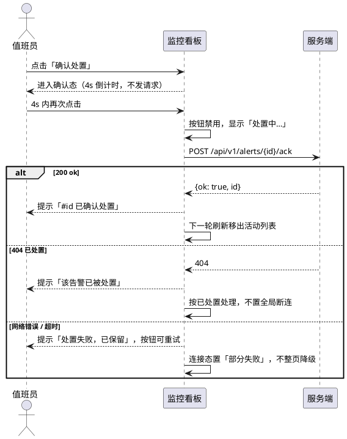
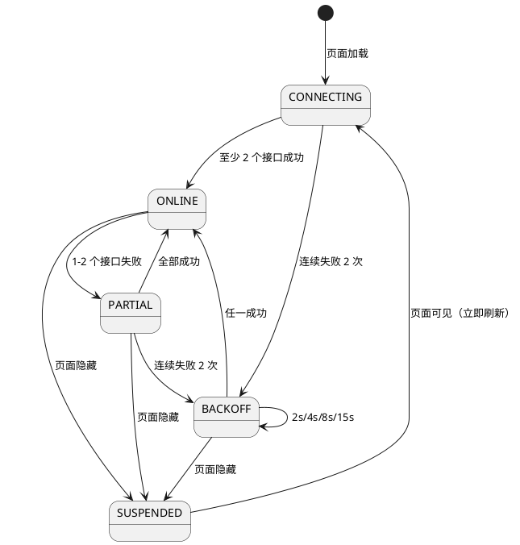
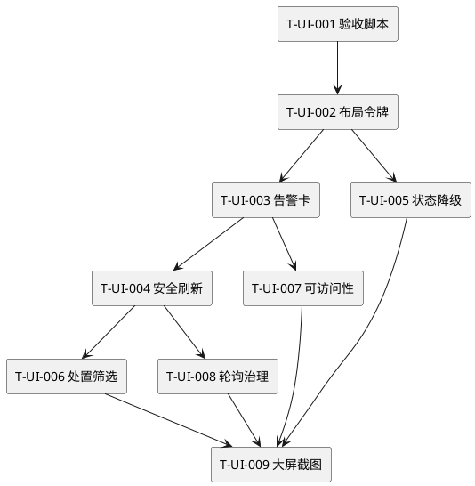

# 监控看板前端优化需求规格（EARS）

> 本文档只定义「监控看板（`dashboard/index.html`）应该长成什么样、在什么条件下必须怎样表现」，不定义实现方式，也不修改任何代码。
> 本轮不产生 `dashboard/` 改动，不产生 `service/` 改动，不提交 git。

## 0. 阅读指南

### 0.1 目的与范围

本文档把用户原始诉求「前端的页面做的不是很好优化一下」拆成可验收的工程条目，覆盖：

- 现状缺陷的可核实盘点（每条指向 `dashboard/index.html` 的具体行号）；
- 目标形态与硬约束（零构建、离线可用、接口零改动）；
- 视觉与交互规格（布局、告警卡字段、状态语义、处置交互、可访问性）；
- 以 `REQ-UI-001` 起编号的 EARS 需求条目；
- 以 `T-UI-001` 起编号的任务拆解与验收命令；
- 风险、回滚与「本轮能验什么 / 必须换环境验什么」的边界。

**不在范围内**：`service/` 任何改动、接口新增、数据库结构、A/B 侧算法、部署脚本、评测产物。

### 0.2 与既有文档的关系

| 文档 | 关系 | 本文档的引用方式 |
|---|---|---|
| `docs/spec/requirement.md` | 123 条既有基线（`REQ-FUNC/…`），**编号一律不改写、不复用** | 只引用其「`ts` 为毫秒」「`urgency` 四档语义」「`reason` 必须可追溯」等口径 |
| `docs/spec/integration.md` | 第 3 章 `REQ-INT-001~024`、第 4 章 `CMD-01~13`、第 6 章首轮实测 | 引用 `REQ-INT-015/016/017/018`（字段直通、去重、服务不可用、统计口径）与 `R6-02`（沙箱端口限制） |
| `docs/spec/supplement_ac.md` | 第 7 章实测（五类 5/5、C 侧直通 11/11）、第 3 章 C 侧接口口径 | 引用 7.3「11 项服务端验收 11/11」与 7.3「真实端口需换环境」 |
| `docs/spec/design.md` | B 侧设计口径 | 只用于核对 `Decision` 九字段语义，**不作为前端设计依据** |
| `docs/spec/tasks.md` | 既有 `T-B-*`、`T-INT-*`、`T-AC-*` | 仅在文末追加一行指针，不改既有条目 |

### 0.3 编号与优先级

- 需求编号：`REQ-UI-001` 起三位序号，本文件内唯一；不复用 `REQ-XXX-NNN`、`REQ-INT-NNN`、`REQ-SUP-NNN`。
- 问题编号：`UI-ISS-01` 起；任务编号：`T-UI-001` 起；验收命令：`CMD-UI-01` 起；风险：`R-UI-01` 起。
- 优先级沿用项目口径：`P0` 缺失即演示不可用；`P1` 应当实现、允许降级但不允许缺失；`P2` 可选加分。
- EARS 类型沿用 `requirement.md` 0.2 的五类：普遍 / 事件驱动 / 状态驱动 / 非期望 / 可选。

### 0.4 事实与证据口径

本文档「现状」部分的每条结论均可在仓库内用 `grep` / `wc` / 阅读行号复现，命令见第 7 章 `CMD-UI-01~12`。

## 1. 现状盘点与问题清单

### 1.1 基线快照

| 项 | 实测值 | 证据 |
|---|---|---|
| 前端文件数 | **1**（`dashboard/index.html`，另有目录内无其它文件） | `ls dashboard` |
| 规模 | **239 行 / 9884 字节** | `wc -l -c dashboard/index.html` |
| 技术形态 | 原生 HTML + 内联 `<style>` + 内联 `<script>`，无框架、无构建、无包管理 | 文件结构 |
| 外部资源 | **0** 个（无 `<link>`、无 `<script src>`、无 ``、无 http(s) 引用） | `grep -n "http://\|https://\|<link\| 关键约束：`/api/v1/alerts` 的 `limit` 上限为 500（`main.py:172`），前端固定 50（行 217）；`status` 支持 `active|acked|all`（`main.py:171`），前端固定 `active`。

### 1.3 问题清单

> 「级别」= 是否阻断演示主路径。每条只描述现象与影响，不给实现建议（实现建议在第 3、5 章）。

#### 1.3.1 视觉层级

| 编号 | 现象 | 行号 | 影响 | 级别 |
|---|---|---|---|---|
| UI-ISS-01 | 标题 26px 与指标数值 40px 层级过近；四张指标卡等权，最需要行动的「未处理」与「今日告警」同权重 | 33、40–44、97–102 | 大屏 3 m 外视线第一落点不在未处理数上 | P2 |
| UI-ISS-02 | 紧急度图例放在页脚（列表之后），演示讲解需滚到页底；页脚文字色 `#5f6b78` 对 `#0b0f14` 对比度约 **3.54:1** | 87、113–116 | 评审不知道四档含义；小字不达 4.5:1 | P1 |
| UI-ISS-03 | 无独立设备区：设备只以一张统计卡（在线数）和一个离线胶囊呈现 | 101、104–108、152–159 | 无法在评审追问时展示「哪台设备、多久没心跳」 | P1 |

#### 1.3.2 信息密度

| 编号 | 现象 | 行号 | 影响 | 级别 |
|---|---|---|---|---|
| UI-ISS-04 | 告警卡缺 `device_id`、`trapped`、`status`；`trapped` 与「困人」文案的对应关系只能靠推断 | 174–187 | 多设备/多楼层演示时无法判断告警归属 | P1 |
| UI-ISS-05 | `reason` 全部平铺为 `<code>` 胶囊，条数多时卡片无限增高，楼层/人数/时间被挤压 | 66–71、184 | 5 条判据时卡片高度约为 2 条时的 1.8 倍，首屏只能看到 1–2 条告警 | P1 |
| UI-ISS-06 | 列表按 `(urgency, ts)` 排序后整体重排，最新告警混在中间，无「新」标识 | 168 | 现场新增告警时视线无处落脚 | P1 |

#### 1.3.3 告警卡可读性

| 编号 | 现象 | 行号 | 影响 | 级别 |
|---|---|---|---|---|
| UI-ISS-07 | `urgency` 仅由 6px 色条 + 彩色描边文字表达，**颜色单独承载语义**；无图标、无形状差异；U3 用 1.1s 脉冲闪烁 | 54、59、172–180、81–82 | 灰度打印/投影色偏/色觉障碍下四档不可分；闪烁对光敏不适 | **P0** |
| UI-ISS-08 | 时间只显示绝对 `HH:MM:SS`，无日期、无相对时间；跨天/隔夜回放时直接误导 | 132–136、182 | 无法判断「多久之前」，讲解需口算 | P1 |
| UI-ISS-09 | 静默截断 `limit=50`，无「共 N 条 / 仅显示 50 条」提示 | 217 | 活动告警 >50 时数据看似完整，实为截断 | P1 |
| UI-ISS-10 | `location="?"`、`people_count=0`、`confidence=0` 直接渲染为「? / 0 人 / 0%」，与真实 0 人混淆 | 178、181–182 | 评审会误判为「检测到 0 人」 | P1 |
| UI-ISS-11 | 颜色与文案映射在 CSS 变量（`--gray` 等）与 JS 常量（`URG`/`EVT`）中**各存一份** | 8–20、119–127 | 改主题需两处改，后续必然漂移 | P2 |
| UI-ISS-12 | `event_type` 映射表只有五类，未知值回退为原始英文（如 `unknown_event`） | 125–127、179 | 契约外取值会让大屏出现英文下划线串 | P2 |

#### 1.3.4 状态反馈

| 编号 | 现象 | 行号 | 影响 | 级别 |
|---|---|---|---|---|
| UI-ISS-13 | 连接态只有 10px 圆点 + 文案，圆点靠颜色区分；失败后才从「实时在线」跳到「连接断开」，无重试倒计时 | 36–38、94、138–141 | 断连时观众先看到「红色圆点」而非明确原因 | P1 |
| UI-ISS-14 | **断连仅给列表整体加 45% 透明度**；四张数字卡仍显示旧值且无「已过期」标注；「无告警」与「请求失败」共用同一视觉 | 229–232、84–86、163–167 | 断连时看板静默展示过期数据，评审无法察觉（**演示事故高风险**） | **P0** |
| UI-ISS-15 | `ack` 失败一律改成「重试」并 `setConn(false)`：404（已被处置）、网络错误、500 三种结果同待遇；无任何全局提示 | 200–212 | 已被他人处置的告警会一直显示重试，且误报全局断连 | P1 |
| UI-ISS-16 | 降级状态只靠 tag 文案（「SQLite 兜底」「内存兜底」），无颜色/图标区分，与正常态视觉一致 | 146–149、104–108 | 「降级中」这一演示叙事被淹没 | P1 |

#### 1.3.5 响应式

| 编号 | 现象 | 行号 | 影响 | 级别 |
|---|---|---|---|---|
| UI-ISS-17 | **全文无媒体查询**；指标卡固定 4 列、告警卡固定「色条/内容/按钮」三列、页面左右内边距固定 32px | 27、40、52–54 | 768px 下卡片挤压成两行、按钮压住人数；375px 下横向溢出 | P1 |
| UI-ISS-18 | 按钮最小高度约 36–38px、字号 15px，无 44px 触控目标保证 | 73–77 | 窄屏（评审用平板/手机）误触 | P2 |

#### 1.3.6 可访问性

| 编号 | 现象 | 行号 | 影响 | 级别 |
|---|---|---|---|---|
| UI-ISS-19 | 0 个 `aria-*`/`role`；列表无 `aria-live`；状态点无文字化的角色说明；按钮无 `aria-label`（「确认处置」未带告警编号/楼层） | 94、111、186 | 读屏用户无法获知新增告警；按钮语义不完整 | P1 |
| UI-ISS-20 | 无 `:focus-visible` 样式，深色底上浏览器默认焦点环不明显；无跳转主内容的入口 | 73–79 | 键盘操作时不知焦点在哪 | P2 |

#### 1.3.7 错误与断连处理

| 编号 | 现象 | 行号 | 影响 | 级别 |
|---|---|---|---|---|
| UI-ISS-21 | **三个 `fetch` 均无超时**；服务端「接受连接但不返回」时 `refresh` 永不返回，`setTimeout(refresh, 2000)` 永不执行 → 轮询彻底停摆，UI 冻结在最后一帧 | 216–233 | 演示中服务卡住时看板「假死」，只能刷新页面 | **P0** |
| UI-ISS-22 | `Promise.all` 任一失败即整体丢弃已成功响应（如 `stats` 成功、`alerts` 失败则三区都不更新） | 216–225 | 单接口抖动放大为全页不更新 | P1 |
| UI-ISS-23 | 无失败退避：离线下每 2 秒仍打 3 个请求；页面隐藏（切后台）仍持续轮询 | 233 | 演示机多标签页时形成轮询风暴 | P1 |

#### 1.3.8 长时间运行性能

| 编号 | 现象 | 行号 | 影响 | 级别 |
|---|---|---|---|---|
| UI-ISS-24 | **每 2 秒整列 `innerHTML` 重建**（含空态分支）；滚动位置、`reason` 展开态、hover 与焦点全部丢失；`slide` 动画每周期重放；按钮监听每周期重建 | 161–194、233 | 长时演示时列表闪烁、滚回顶部、无法展开判据（**交互不可用**） | **P0** |
| UI-ISS-25 | `lastIds` 写入 3 处、读取 0 处（无 `.has/.add/.delete`），新告警识别逻辑实际不存在 | 130、165、193 | 「新增告警」无高亮、无差异、无播报 | P1 |
| UI-ISS-26 | 无轮询并发保护与最大条数控制：`limit` 固定 50，列表 DOM 节点数随 `reason` 条数线性膨胀 | 217、66–71 | 8 小时演示后 DOM 节点与内存缓慢增长 | P2 |

#### 1.3.9 演示大屏场景

| 编号 | 现象 | 行号 | 影响 | 级别 |
|---|---|---|---|---|
| UI-ISS-27 | 无大屏模式/全屏入口；最大字号 40px（指标）/34px（楼层），3 m 外偏小；无页面时钟，「现在几点/数据多新」不可读 | 43、62、97–111 | 答辩投屏时评委需前倾辨认 | P2 |
| UI-ISS-28 | 页脚三行说明（紧急度图例、轮询与去重口径、降级说明）排在列表之后 | 113–116 | 讲解「去重 30 秒」「断网降级」时必须离开首屏滚动 | P2 |

### 1.4 三个 P0（本轮必须先解决）

1. **UI-ISS-07｜紧急度语义只靠颜色（行 54、59、81–82、172–180）**：色觉障碍、灰度投影或色彩失真时四档不可分，且 U3 用闪烁表达「更紧急」，既有可访问性风险也有光敏风险。
2. **UI-ISS-14 + UI-ISS-21｜断连处理缺失且无请求超时（229–233、216–233）**：断连时静默展示过期数字；服务挂起时轮询永久停摆，看板「假死」。
3. **UI-ISS-24｜每 2 秒全量重建列表（161–194）**：判据无法展开、滚动被打断、动画闪烁，属于「演示现场交互不可用」。

> 其余 P0 需求（`REQ-UI-001~003`、`005`、`007~009`、`018~019`、`029`）见第 4 章；`1.3` 中标注 P0 的仅是「现状最痛的三处」，两者口径不同，不矛盾。

### 1.5 已知风险与未决项

| 编号 | 事项 | 影响 | 建议 |
|---|---|---|---|
| R1-UI-01 | 本机沙箱无法起真实端口（`supplement_ac.md` 7.3：`OSError: [WinError 10051]`） | 所有渲染/网络态验收只能静态检查 + 人工 | 渲染与网络态列入「必须换环境」 |
| R1-UI-02 | 现有 239 行是单文件；优化后可能显著变长 | 可维护性下降 | 超过 40 KB 允许拆 `app.css`/`app.js`（约束 C-03 已预留） |
| R1-UI-03 | 演示机浏览器版本未知 | 新 CSS（`:focus-visible`、`prefers-reduced-motion`）可能不生效 | 均按「渐进增强」处理，缺失时退化为可用状态 |
| R1-UI-04 | 前端展示的 `avg_ack_seconds` 会随演示而变 | 评审可能质疑数字 | 沿用接口口径，前端**不得自行计算**（见 `REQ-UI-002`） |

---

## 2. 目标与约束

### 2.1 目标

| 编号 | 目标 | 可度量判据 |
|---|---|---|
| G-UI-01 | **首屏即结论**：1920×1080、100% 缩放、不滚动即可看到「现在是否有人被困、几楼、几人、多久之前、是否已处置」 | 人工截图核对；见 `REQ-UI-029` |
| G-UI-02 | **四档紧急度在灰度下仍可分**：颜色不是唯一编码 | 灰度截图 4 档可区分；见 `REQ-UI-008` |
| G-UI-03 | **数据新鲜度始终可见**：在线/断连/过期秒数三态常驻 | 断连 5 秒内出现「数据已过期 N 秒」；见 `REQ-UI-014/015` |
| G-UI-04 | **交互不因轮询中断**：展开、滚动、焦点、二次确认均跨周期保持 | 连续 3 个周期 DOM 节点引用不变；见 `REQ-UI-021` |
| G-UI-05 | **零依赖、离线可开**：断网、无 CDN、无构建仍能完整渲染（除接口数据外） | 断网打开无空白、无外链；见 `REQ-UI-001` |
| G-UI-06 | **接口面零变化**：路径、方法、查询参数、字段、错误码一律沿用 | `git diff service/` 为空；见 `REQ-UI-002/003` |

### 2.2 硬约束

| 编号 | 约束 | 判定方式 |
|---|---|---|
| C-01 | **零构建**：不得引入 npm/node/打包器；`dashboard/` 内不得出现 `package.json`、`node_modules`、`.map` | `ls dashboard` + 目录扫描 |
| C-02 | **无外部 CDN / 远程字体 / 图标库 / 图片**：不得出现 `http(s)://` 资源引用；图标用内联 SVG 或字符；字体用系统字体栈 | `grep -nE "https?://\|<link\|<script[^>]*src\| 本章给「规格值」，不给实现代码。所有数值为设计目标，允许 ±4px / ±2px 偏差，但不得破坏信息层级与对比度红线。

### 3.1 信息架构

自上而下四层，层级关系固定：

1. **全局状态层**：产品名 + 页面时钟 + 连接态（连接中/在线/断连 + 最后成功时间）+ 数据层/缓存层降级胶囊 + 离线条。
2. **关键指标层**：4 张指标卡（今日告警、未处理、平均响应、设备在线），「未处理」为第一视觉权重（数值最大、最亮；`active_count>0` 时加左侧 3px 提示条）。
3. **主体层**：左侧「告警列表」（主内容，占 8/12 宽）+ 右侧「设备区」（次内容，占 4/12 宽）。
4. **口径层**：紧急度图例上移到指标层下方常驻；判据说明、轮询口径、降级说明收进页脚或「说明」折叠区。

```text
┌───────────────────────────────────────────────────────────────────────┐
│ 电梯困人主动预警   [14:32:05]      ● 实时在线 · 2s 前更新   [SQLite兜底] │
├───────────────────────────────────────────────────────────────────────┤
│ [今日告警 12] [未处理 3 ▲] [平均响应 48s] [设备在线 4/5]                │
│ 紧急度：○正常  ◆关注  ▲告警  ■紧急        筛选：活动 | 已处置 | 全部    │
├─────────────────────────────────────────────┬─────────────────────────┤
│ ■ 3F  人员被困   2 人 · 置信 91% · 3 分钟前  │ 设备区                  │
│   ELEV-DEMO-001  [dwell=412s > 180s] …展开   │ ELEV-DEMO-001 ● 2s 前    │
│                                    [确认处置] │ ELEV-DEMO-002 ● 12s 前   │
│ ▲ 5F  扒门求助   1 人 · 置信 78% · 6 分钟前  │ ELEV-DEMO-003 ○ 离线 4m  │
│ …                                           │                          │
└─────────────────────────────────────────────┴─────────────────────────┘
```

### 3.2 桌面大屏布局（1920×1080）

| 区域 | 尺寸规格 | 说明 |
|---|---|---|
| 页面内边距 | 上下 20px、左右 32px | 1920 下左右留白对称，避免投影裁边 |
| 状态条 | 高 64px，粘性固定在顶部（滚动时保持） | 产品名 22–24px/500；时钟 18px 等宽；连接态 15px |
| 指标区 | 高 132px，4 列等宽、间距 16px | 数值 48–56px/500；标签 15px；单位 15px 基线对齐 |
| 图例 + 筛选条 | 高 44px | 图例左、筛选右；筛选为分段控件（tab） |
| 主体区 | 剩余高度；左 8/12（≥ 1180px 可用宽）、右 4/12 | 两列顶部对齐，设备区可独立滚动 |
| 告警卡 | 行高 ≥ 88px，卡片间距 12px，圆角 10px | 左色条 6–8px；紧急卡整卡描边 2px |
| 设备行 | 行高 56px | 设备 ID（等宽 14px）+ 心跳相对时间 + 在线点 |
| 页脚 | 高 40px，13px | 说明折叠，默认单行 |

**字号下限（投影 3 m 可读）**：正文 15px、次要 13px、卡片楼层 40px、指标数值 48px、标题 22px。任何正文不得小于 13px。

### 3.3 窄屏布局（≤768px、≤480px）

| 断点 | 规格 |
|---|---|
| ≤768px | 指标卡 2×2；主体区改为单列（告警列表在上、设备区折叠为一行「设备 4/5 在线 ▾」）；页面内边距 16px；不出现横向滚动 |
| ≤480px | 指标卡 2×2（数值 34px）；告警卡由「左条/内容/按钮」三列改为「左条 + 内容」两列，按钮下移为整行 44px 高；筛选条可横向滚动 |
| 触控 | 所有可点击元素最小 44×44px；相邻可点击元素间距 ≥8px |
| 字体缩放 | 浏览器 200% 缩放时不得出现文字重叠或被裁切（允许纵向滚动） |

### 3.4 告警卡字段规格

| 字段（接口来源） | 展示形式 | 缺省/边界规则 | 证据来源 |
|---|---|---|---|
| `urgency`(0–3) | **三重编码**：① 左色条（○灰/◆黄/▲橙/■红）② 等级文字胶囊「正常/关注/告警/紧急」 ③ 内联 SVG 形状图标 | 越界值按 0 处理并标「未知等级」 | `models.py:21`、`requirement.md` 紧急度表 |
| `event_type` | 中文事件名（正常乘梯/电梯急停/人员被困/扒门求助/有人倒地） | 未知值显示「其他事件（原文）」并截断 12 字符 | `models.py:24`、行 125–127 |
| `location` | 楼层大字（34–40px），如「3F」；与事件并排 | `"?"`/空 → 「位置未知」，不得显示 `?` 单字符 | `models.py:22`、`db_local.py:78` |
| `people_count`(0–8) | 「2 人」；=1 用「1 人」不写「1 人被困」 | 0 → 「人数待定」；8 → 「8 人（封顶）」 | `models.py:23` |
| `confidence`(0–1) | 「置信度 91%」（整数） | 0 → 「置信度待定」；<0.5 → 追加「低置信」弱标记 | `models.py:25` |
| `reason`(list[str]) | 默认显示前 **2** 条；其余折叠为「+N 条判据」；展开显示全部（最多 20 条，超出显示「…共 N 条」） | 空数组 → 不渲染该行，不占位 | `models.py:26-32` |
| `ts`(ms) | **相对时间**主显（刚刚 / N 秒前 / N 分钟前 / N 小时前），悬停与聚焦显示绝对时间；超过 24h 显示「MM-DD HH:MM」 | 未来时间（时钟漂移）显示「刚刚」并加「时钟异常」弱标记 | `requirement.md` DEC-03（毫秒） |
| `device_id` | 等宽小字，≤16 字符，超出省略并 `title` 全文 | 空 → 「未知设备」 | `db_local.py:23` |
| `trapped` | 布尔转为「困人/未困人」标签，与 `event_type` 并列；`trapped=true` 时卡片必须与 `urgency>=2` 一致（不一致则显示「数据异常」标记） | 缺失按 false | `models.py:20`、DEC-01 |
| `status` | 仅在「已处置/全部」视图显示「已处置」胶囊 | active 不显示胶囊 | `db_local.py:31` |
| `ack_ts` | 已处置视图显示「处置于 HH:MM:SS · 用时 Ns」 | 空 → 不渲染 | `db_local.py:32` |

**卡片布局规格**：第一行 = 楼层 + 事件 + 困人标签 + 等级胶囊；第二行 = 人数 · 置信度 · 相对时间 · 设备 ID；第三行 = 判据（可展开）；右侧固定操作区（仅 active 显示按钮）。

### 3.5 状态语义矩阵

| 状态 | 触发 | 视觉（不得只用颜色） | 文案 | 行为 |
|---|---|---|---|---|
| 连接中 | 首次加载 / 无历史数据 | 空心圆 + 呼吸（可关闭） | 「连接中…」 | 显示骨架屏；不显示「–」以外的数字 |
| 在线 | 本轮三接口至少 2 个成功 | 实心绿点 + 文字「实时在线」+ 更新秒数 | 「实时在线 · 2s 前更新」 | ack 可用；每秒更新「N 秒前」 |
| 部分失败 | 1–2 个接口失败 | 黄色三角 + 文字 | 「部分数据获取失败 · 正在重试」 | 成功部分照常渲染；失败区域保留旧值并标「已过期」 |
| 断连 | 连续失败 ≥2 次或超时 | 红色方块（非圆点）+ 文字 + 条纹底 | 「连接断开 · 数据已过期 N 秒」 | 禁用 ack；列表降饱和但不消失；退避重试 |
| 数据层降级 | `/stats.db_mode == "sqlite"` | 橙色胶囊 + 「兜底」字样 | 「数据层：SQLite 兜底」 | 与正常态在同一位置，不弹窗 |
| 缓存层降级 | `/stats.cache_mode == "memory"` | 橙色胶囊 | 「缓存层：内存兜底」 | 同上 |
| 设备离线 | `/devices` 中 `online=false` | 灰点 + 「离线 N 分钟」 | 「1 台设备离线：ELEV-DEMO-003」 | 离线条置顶；设备行置灰 |
| 告警已处置 | `status=acked` | 绿色对勾 + 「已处置」胶囊 | 「已处置 · 用时 47s」 | 不在活动列表出现；已处置视图可见 |

### 3.6 交互规格

#### 3.6.1 确认处置（二次确认）

1. 首次点击「确认处置」→ **不发请求**；按钮进入确认态，文案「再点一次确认」，持续 **4 秒**；同时显示「4 秒后自动取消」。
2. 4 秒内第二次点击 → 发 1 次 `POST /api/v1/alerts/{id}/ack`；按钮禁用并显示「处置中…」；请求超时 5 秒。
3. `Esc`、点击卡片其它区域、切换筛选 → 取消确认态，按钮复原且不产生请求。
4. 同一时刻只允许一个告警处于确认态；进入新确认态时上一个自动取消。



#### 3.6.2 轮询与降级状态机

- 基准间隔 **2000ms**；单轮超时 **3000ms**（三请求并发，总超时 3s）。
- 页面 `hidden` 时暂停；恢复可见立即刷新一次，然后回到基准间隔。
- 连续失败 ≥2 次进入 `BACKOFF`：间隔 2s → 4s → 8s → 15s（上限）；成功一次立即回到 2s。
- 单轮最多 3 个请求、并发 ≤3；上一轮未结束不得发起下一轮。
- 三接口用「全部结束再渲染」策略，但**逐个落地**：任一成功即可更新对应区块（对应 `UI-ISS-22`）。



#### 3.6.3 安全刷新

1. 以告警 `id` 为键维护节点映射：已存在则**只更新变化的文本/属性**，不存在则插入，消失则移除。
2. 刷新不得改变：滚动位置、`reason` 展开态、当前焦点元素、确认态按钮、筛选选择。
3. 新出现的告警：插入到列表顶部（列表按「未处置 + 紧急度 + 时间」排序），并高亮 **3 秒**；高亮用描边/背景渐变，不用缩放。
4. 刷新期间不得出现空白列表：旧节点保留到新节点就位。
5. 数字卡使用等宽数字（`font-variant-numeric: tabular-nums`），避免数值变化时布局跳动。

#### 3.6.4 筛选

- 三个分段：活动（默认）/ 已处置 / 全部，分别对应 `status=active|acked|all`。
- 切换筛选不整页刷新、不清空已渲染节点；筛选状态仅存于内存（可选 `sessionStorage`，但不得存告警内容）。
- 「已处置」视图显示 `ack_ts` 与响应时长；「全部」视图按状态分组或加状态胶囊。
- 列表为空时按当前筛选给不同空态文案（「当前无活动告警 · 系统运行正常」/「暂无已处置记录」），并区分「加载失败」态。

### 3.7 可访问性规格

| 编号 | 规格 | 判据 |
|---|---|---|
| A-01 | 正文与小字对比度 ≥ **4.5:1**；大字（≥24px 或 ≥18.66px 加粗）≥ **3:1** | 脚本核算（见下表） |
| A-02 | 颜色不单独承载语义：紧急度同时有形状 + 文字；连接态同时有形状 + 文字；降级同时有「兜底」字样 | 灰度截图核对 |
| A-03 | 键盘可达：Tab 顺序 = 筛选 → 告警卡操作 → 展开控件 → 设备区；`:focus-visible` 2px 描边、对比度 ≥3:1 | 人工键盘走查 |
| A-04 | `aria-live="polite"` 播报新增告警；2 秒内多条合并为「新增 N 条告警」，单次播报 ≤30 字 | 读屏人工核对 |
| A-05 | 图标全部 `aria-hidden="true"`；按钮可访问名包含告警楼层与编号（如「确认处置 3F #12」） | DOM 断言 |
| A-06 | 尊重 `prefers-reduced-motion`：关闭 pulse/slide，仅保留颜色与描边变化 | 系统设置切换核对 |
| A-07 | 200% 文本缩放不重叠、不裁切；窄屏无横向滚动 | 人工核对 |

**对比度核算（WCAG 2.1 相对亮度公式，两位小数）**：

| 前景 / 背景 | 当前值 | 结论 | 目标 |
|---|---|---|---|
| `#e8eef5` / `#0b0f14`（主文本） | 16.45:1 | 通过 | 保持 |
| `#8b97a5` / `#141b23`（次要文本） | 5.84:1 | 通过 | 保持 |
| `#5f6b78` / `#0b0f14`（页脚 13px） | **3.54:1** | **不通过** | 改用 `#8b97a5`（6.47:1） |
| `#8b97a5` / `#141b23`（U0 正常） | 5.84:1 | 通过 | 保持 |
| `#d29922` / `#141b23`（U1 关注） | 6.88:1 | 通过 | 保持 |
| `#e8712b` / `#141b23`（U2 告警） | 5.63:1 | 通过 | 保持 |
| `#f85149` / `#141b23`（U3 紧急） | 5.17:1 | 通过（余量小） | 建议提亮至 `#ff6b63`（6.22:1） |
| `#3fb950` / `#141b23`（在线） | 6.83:1 | 通过 | 保持 |

### 3.8 演示大屏参数

| 项 | 规格 |
|---|---|
| 视距 | 3 m 处 15px 正文可读（对应 1920×1080 投 100 英寸） |
| 首屏必须出现 | 连接态、4 个指标、**至少 1 条紧急告警的楼层/人数/相对时间/等级**、设备在线概况 |
| 时钟 | 顶部显示本地时间 `HH:MM:SS`，每秒更新；与「数据 N 秒前」分开，避免混淆 |
| 全屏 | `F` 键切换全屏（可选，`REQ-UI-030`）；失败时静默忽略并保留按钮入口 |
| 告警聚焦 | 出现 `urgency=3` 时，该卡自动置顶并高亮 3 秒，但不抢滚动、不弹窗、不播放声音（P2 才考虑声音） |
| 颜色 | 保留深色底（非纯黑）；投影仪色偏时以形状 + 文字兜底 |

---

## 4. EARS 需求条目

> 共 **31 条**，`REQ-UI-001~031`。每条给出类型、优先级、陈述、验收（标 `[机器]` 可命令检查 / `[人工]` 需人眼或换环境）与追溯。
> 优先级分布：P0 = 12 条（001、002、003、005、007、008、009、014、015、018、019、029），P1 = 16 条，P2 = 3 条。

### 4.1 资产与边界

**REQ-UI-001｜普遍｜P0｜零依赖离线可用**
看板必须仅依赖 `dashboard/` 内的静态文件即可完整渲染，不得引用任何外部 CDN、远程字体、图标库或图片。
- 验收：`[机器]` `grep -nE "https?://|<link|<script[^>]*src|<img" dashboard/index.html` 无输出；`[人工]` 断网打开页面，骨架与空态正常显示、无浏览器 404 资源报错。
- 追溯：G-UI-05、C-01/C-02。

**REQ-UI-002｜普遍｜P0｜接口白名单与只读口径**
看板必须只调用 `GET /api/v1/alerts`、`GET /api/v1/stats`、`GET /api/v1/devices`、`POST /api/v1/alerts/{id}/ack` 四个路径，不得新增或额外调用其它接口（含 `/api/v1/health`），不得改写查询参数名与取值域，且所有数字必须直接取自返回字段。
- 验收：`[机器]` 提取全部请求目标，与白名单逐项比对无差异；`[机器]` 代码审查确认无前端自行统计（如自行求平均）。
- 追溯：C-05/C-10、`integration.md` REQ-INT-015/018、UI-ISS-04。

**REQ-UI-003｜普遍｜P0｜路径不冲突**
看板资产不得占用 `/api/*`，且不得导致 `/docs` 与 `/openapi.json` 不可用。
- 验收：`[机器]` `dashboard/` 下无 `api/`、`docs/` 同名目录或文件；`[人工/换环境]` 服务启动后 `/docs` 返回 200、页面可交互，`/api/v1/health` 返回 JSON。
- 追溯：C-06/C-07、`service/main.py:198-202`、R-UI-01。

**REQ-UI-004｜普遍｜P1｜体积与可维护性**
看板资产必须控制在 `dashboard/` 下 ≤3 个文件、合计 ≤120 KB；不得出现构建产物（`package.json`、`node_modules`、`.map`），颜色与文案映射必须单一来源。
- 验收：`[机器]` `ls dashboard` 与 `wc -c` 统计；`[机器]` `grep -c "package.json\|node_modules"` 为 0；`[人工]` 代码审查颜色常量只有一处定义。
- 追溯：C-01/C-03、UI-ISS-11。

### 4.2 布局与信息架构

**REQ-UI-005｜普遍｜P0｜桌面三区同屏**
在 1920×1080、浏览器 100% 缩放下，页面必须不滚动即可同时看到全局状态条、4 张指标卡、至少 1 条完整告警卡（含楼层/人数/相对时间/等级）与设备在线概况。
- 验收：`[人工]` 截图并标注四区边界；`[机器/换环境]` `document.scrollingElement.scrollHeight <= innerHeight`（首屏无纵向滚动）或关键区块 `getBoundingClientRect().bottom <= innerHeight`。
- 追溯：G-UI-01、3.2、REQ-UI-029。

**REQ-UI-006｜事件驱动｜P1｜窄屏自适应**
当视口宽度 ≤768px 时，页面必须切换为单列布局（指标 2×2、设备区折叠），且不出现横向滚动；当视口 ≤480px 时，告警操作按钮必须下移为整行且高度 ≥44px。
- 验收：`[机器]` `grep -c "@media"` ≥2；`[人工]` 375×667、768×1024 下 `scrollWidth <= innerWidth` 且按钮不遮挡文字。
- 追溯：C-01、3.3、UI-ISS-17/18。

### 4.3 告警呈现

**REQ-UI-007｜普遍｜P0｜九字段完整呈现**
每条告警卡必须呈现 `urgency`、`event_type`、`location`、`people_count`、`confidence`、`reason`、`ts` 七个 Decision 字段，并额外呈现 `device_id`、`trapped`、`status` 三个服务端记录字段；不得出现 `undefined`、`null`、`NaN`、裸 `?`。
- 验收：`[人工]` 在活动/已处置视图逐卡核对字段；`[机器]` `grep -c "device_id"` ≥1 且 `grep -c "trapped"` ≥1；页面文本扫描无 `undefined|null|NaN`。
- 追溯：`models.py:17-26`、`db_local.py:20-33`、3.4、UI-ISS-04/10。

**REQ-UI-008｜普遍｜P0｜紧急度三重编码**
紧急度必须同时用「颜色 + 形状图标 + 等级文字」编码，禁止以颜色作为唯一区分手段；等级文字必须为「正常/关注/告警/紧急」。
- 验收：`[人工]` 灰度截图（去色）能区分 4 档；`[机器]` 每卡存在等级文字节点与内联 SVG/字符图标，图标带 `aria-hidden="true"`。
- 追溯：A-02、3.4、UI-ISS-07。

**REQ-UI-009｜事件驱动｜P0｜新告警 2 秒内可见**
当新告警入库后，看板必须在 1 个轮询周期（≤2.5 秒）内使其出现在列表顶部，并以描边/背景方式高亮 3 秒，同时把该条加入 `aria-live` 播报队列。
- 验收：`[人工/换环境]` 用 `play_case.py` 推 1 条新告警，计时 ≤2.5s 出现且高亮 3s；`[机器]` 存在对上一周期告警 id 集合的**读取**比较（非只写不读）。
- 追溯：G-UI-01、UI-ISS-25、REQ-UI-024。

**REQ-UI-010｜状态驱动｜P1｜判据折叠与状态保持**
在告警卡展示 `reason` 时，默认必须只显示前 2 条，其余折叠为「+N 条判据」；展开状态下跨轮询周期必须保持展开，且不得因刷新而收起。
- 验收：`[人工]` 展开第 3 条判据，等待 3 个轮询周期仍展开；`[人工]` 展开状态在筛选切换后按同一 `id` 恢复或明确重置为收起（须在页面上有可见规则，不得静默变化）。
- 追溯：3.4/3.6.3、UI-ISS-05/24。

**REQ-UI-011｜普遍｜P1｜相对时间**
告警时间必须以相对时间为主显（「刚刚/N 秒前/N 分钟前/N 小时前」），超过 24 小时显示「MM-DD HH:MM」，并且悬停/聚焦可查看绝对时间 `HH:MM:SS`；相对时间每 30 秒自更新一次。
- 验收：`[人工]` 三条不同时距告警文案正确；`[机器]` 页面存在相对时间格式函数且无跨天丢日期。
- 追溯：`requirement.md` DEC-03、UI-ISS-08。

**REQ-UI-012｜非期望｜P1｜截断必须可见**
如果活动告警数量超过当前 `limit=50` 的返回条数，则页面必须显示「仅显示最近 50 条，共 N 条」，其中 N 取 `/stats.active_count`；不得静默截断。
- 验收：`[人工]` 造 60 条活动告警后出现该提示且数字与 `/stats` 一致；`[机器]` 提示文案存在且读取 `active_count`。
- 追溯：`main.py:172`、UI-ISS-09。

**REQ-UI-013｜普遍｜P1｜缺省值语义化**
当 `location` 为 `"?"`、`people_count` 为 0、`confidence` 为 0、`device_id` 为空、`event_type` 为五类之外取值时，页面必须分别显示「位置未知」「人数待定」「置信度待定」「未知设备」「其他事件」，不得显示原始占位符或英文枚举。
- 验收：`[人工]` 注入边界数据逐项核对；`[机器]` 文案常量齐全。
- 追溯：`models.py:22-26`、3.4、UI-ISS-10/12。

### 4.4 状态与降级

**REQ-UI-014｜状态驱动｜P0｜连接三态可辨识**
在任意时刻，全局状态必须处于「连接中 / 在线 / 断连（含部分失败）」之一，且同时以形状、文字与颜色表达；状态切换必须在 5 秒内反映到界面。
- 验收：`[人工]` 断服务后 ≤5s 状态变为「连接断开」，文案含原因；`[人工]` 灰度截图三态可区分。
- 追溯：G-UI-03、3.5、UI-ISS-13。

**REQ-UI-015｜非期望｜P0｜断连不得伪装成正常**
如果连续 2 次刷新失败或单轮超时，则看板必须保留最后一次数据但明确标注「数据已过期 N 秒」，同时禁用所有「确认处置」按钮；不得整页白屏、不得显示 `undefined/NaN`、不得静默展示过期数字。
- 验收：`[人工/换环境]` 停服务 ≥30s：出现过期秒数递增、按钮全部 disabled、列表仍可见；`[机器]` 存在 `` `数据已过期` `` 文案与按钮 `disabled` 逻辑。
- 追溯：G-UI-03、R-UI-03、UI-ISS-14/21。

**REQ-UI-016｜状态驱动｜P1｜降级状态常驻可见**
当 `/stats.db_mode` 为 `sqlite` 或 `cache_mode` 为 `memory` 时，页面必须在状态条显示橙色「兜底」胶囊，文案分别为「数据层：SQLite 兜底」「缓存层：内存兜底」；恢复为 `rds`/`redis` 时胶囊在 1 个周期内转回中性态。
- 验收：`[人工/换环境]` 默认 `DB_MODE=sqlite` 下胶囊为橙色且含「兜底」；与 `/stats` 字段一致。
- 追溯：`db_local.py:148-149`、`main.py:188-189`、3.5、UI-ISS-16。

**REQ-UI-017｜状态驱动｜P1｜离线设备可见**
当 `/devices` 中至少 1 台设备 `online=false` 时，页面必须在状态条下方显示离线条（数量 + 设备 ID，可展开），并在设备区对应行标注「离线 N 分钟」；设备恢复在线后 1 个周期内离线条消失。
- 验收：`[人工/换环境]` 停某设备心跳 ≥ `DEVICE_OFFLINE_MS` 后出现；恢复后 ≤2.5s 消失。
- 追溯：`main.py:193-195`、`config.DEVICE_OFFLINE_MS`、UI-ISS-03。

### 4.5 交互

**REQ-UI-018｜事件驱动｜P0｜确认处置二次确认**
当操作者首次点击「确认处置」时，系统不得发出请求，必须进入 4 秒确认态；仅当 4 秒内第二次点击才发出一次 `POST /api/v1/alerts/{id}/ack`。`Esc` 或点击其它区域必须取消确认态且不产生请求。
- 验收：`[人工/换环境]` Network 面板确认首次点击 0 请求、二次点击 1 请求、4s 未确认自动回退；`[人工]` `Esc` 取消。
- 追溯：3.6.1、C-05、UI-ISS-15。

**REQ-UI-019｜事件驱动｜P0｜处置结果分型反馈**
当确认处置返回 200、404、网络错误/超时三种结果时，页面必须分别提示「已确认处置」「该告警已被处置」「处置失败，已保留」；404 必须按已处置处理并从活动列表移除，且不得把全局状态置为断连。
- 验收：`[人工/换环境]` 对已处置 id 再确认 → 出现 404 文案且卡片移出活动列表；断网确认 → 失败文案且卡片保留、按钮可重试、连接态为「部分失败」。
- 追溯：`main.py:177-182`、3.6.1、UI-ISS-15。

**REQ-UI-020｜事件驱动｜P1｜筛选切换**
当操作者切换「活动/已处置/全部」时，系统必须分别以 `status=active|acked|all` 请求，并保持当前筛选到下次切换；不得整页刷新，切换响应必须 ≤1 个轮询周期。
- 验收：`[人工/换环境]` Network 请求参数正确；切换后表格不闪烁、筛选控件保持选中。
- 追溯：`main.py:170-174`、3.6.4。

**REQ-UI-021｜状态驱动｜P1｜安全刷新**
在轮询刷新期间，系统必须按告警 `id` 复用已有 DOM 节点，仅更新变化内容；刷新不得改变滚动位置、判据展开态、当前焦点与确认态按钮。
- 验收：`[人工/换环境]` `MutationObserver` 观察连续 3 个周期，已存在卡片节点未被替换；滚动到列表中部后刷新位置不变。
- 追溯：G-UI-04、3.6.3、UI-ISS-24。

### 4.6 可访问性

**REQ-UI-022｜普遍｜P1｜文本对比度**
页面所有正文与小字的前景/背景对比度必须 ≥4.5:1，大字 ≥3:1；页脚当前 3.54:1 必须修正。
- 验收：`[机器]` 对比度脚本对全部令牌组合核算，最小正文比值 ≥4.5；`[人工]` 灰度截图核对。
- 追溯：A-01、3.7、UI-ISS-02。

**REQ-UI-023｜普遍｜P1｜键盘可达与焦点可见**
所有交互元素必须可通过 Tab 到达、Enter/Space 激活、Esc 取消；`:focus-visible` 必须为 2px 描边且对比度 ≥3:1；Tab 顺序必须与视觉顺序一致。
- 验收：`[人工]` 不用鼠标完成筛选、展开、确认处置全流程；焦点环在深色底上清晰可见。
- 追溯：A-03、UI-ISS-20。

**REQ-UI-024｜事件驱动｜P1｜新增告警播报**
当新告警进入列表时，系统必须通过 `aria-live="polite"` 区域播报一次，内容包含楼层、事件、等级；2 秒内多条合并为「新增 N 条告警」，单条播报 ≤30 字。
- 验收：`[机器]` `grep -c 'aria-live'` ≥1；`[人工]` 读屏（NVDA）验证播报内容与合并行为。
- 追溯：A-04、`REQ-UI-009`。

**REQ-UI-025｜可选｜P2｜减少动效**
如果系统启用 `prefers-reduced-motion: reduce`，则页面必须关闭 pulse/slide 动画，仅保留颜色与描边变化。
- 验收：`[人工]` 开启系统「减少动态效果」后无闪烁动画；`[机器]` 存在该媒体查询。
- 追溯：A-06、UI-ISS-07。

### 4.7 长时间运行

**REQ-UI-026｜状态驱动｜P1｜后台暂停轮询**
当页面处于隐藏状态（`document.hidden`）时，系统必须暂停轮询；页面恢复可见时必须立即刷新一次，然后恢复 2 秒基准间隔。
- 验收：`[机器]` `grep -c visibilitychange` ≥1；`[人工]` 切后台 60 秒内 Network 无新请求，切回后 2 秒内出现一次刷新。
- 追溯：3.6.2、UI-ISS-23。

**REQ-UI-027｜非期望｜P1｜失败退避**
如果连续刷新失败，则系统必须按 2s→4s→8s→15s 退避（上限 15s），并在任一成功后退回 2s；退避期间状态必须为「连接断开/正在重试」，不得反复闪回「在线」。
- 验收：`[人工/换环境]` 停服务 1 分钟，Network 请求间隔递增且 ≤15s；恢复后首个成功即回 2s。
- 追溯：R-UI-02、UI-ISS-23。

**REQ-UI-028｜普遍｜P1｜单轮请求与超时约束**
单轮刷新必须最多发出 3 个请求、并发 ≤3、单请求超时 ≤3 秒；上一轮未结束不得发起下一轮；不得引入额外轮询定时器。8 小时连续运行后 JS 堆不得单调增长（允许周期性波动）。
- 验收：`[人工]` Network 面板核对请求数与并发；DevTools Memory 8 小时快照对比；`[机器]` 代码中仅一处轮询定时器。
- 追溯：R-UI-02、UI-ISS-26。

### 4.8 演示大屏

**REQ-UI-029｜普遍｜P0｜首屏信息完备**
在 1920×1080 首屏（不滚动）必须同时存在：连接态与「N 秒前更新」、4 个指标、至少 1 条 `urgency=3` 告警的楼层/事件/人数/相对时间/等级、设备在线数。
- 验收：`[人工]` 用 `play_case.py --case demo_faint` 触发 U3 后截图核对五项齐全；`[机器/换环境]` 关键区块矩形均在视口内。
- 追溯：G-UI-01、3.2/3.8、UI-ISS-03/27。

**REQ-UI-030｜可选｜P2｜大屏模式与页面时钟**
若实现大屏模式，则 `F` 键必须可进入/退出全屏并放大告警区，且顶部必须显示每秒更新的本地时钟 `HH:MM:SS`；全屏 API 不可用时必须静默降级为普通视图并保留按钮入口。
- 验收：`[人工]` 按 `F` 切换；时钟秒级跳动；禁用全屏 API 后页面无报错。
- 追溯：3.8、UI-ISS-27。

**REQ-UI-031｜可选｜P2｜演示静音与暂停**
若提供静音/暂停入口，则暂停期间不得出现新的闪烁与播报，但数据刷新与「已过期」判定必须继续；恢复后状态必须与当前数据一致。
- 验收：`[人工]` 暂停 30 秒内无闪烁、无播报；恢复后列表与计数一致。
- 追溯：R2-UI-03、UI-ISS-07。

### 4.9 需求 → 问题 → 任务追溯矩阵

| 需求组 | 覆盖编号 | 对应问题 | 对应任务 |
|---|---|---|---|
| 资产与边界 | REQ-UI-001~004 | UI-ISS-01/11 | T-UI-001、T-UI-002 |
| 布局与信息架构 | REQ-UI-005~006 | UI-ISS-03/17/18 | T-UI-002 |
| 告警呈现 | REQ-UI-007~013 | UI-ISS-04~12 | T-UI-003、T-UI-004 |
| 状态与降级 | REQ-UI-014~017 | UI-ISS-13~16 | T-UI-005 |
| 交互 | REQ-UI-018~021 | UI-ISS-15/24/25 | T-UI-004、T-UI-006 |
| 可访问性 | REQ-UI-022~025 | UI-ISS-02/07/19/20 | T-UI-007 |
| 长时间运行 | REQ-UI-026~028 | UI-ISS-21~23/26 | T-UI-008 |
| 演示大屏 | REQ-UI-029~031 | UI-ISS-27/28 | T-UI-009 |

### 4.10 已知风险与未决项

| 编号 | 事项 | 影响 | 建议 |
|---|---|---|---|
| R4-UI-01 | `REQ-UI-009` 的「2.5 秒内」依赖服务端 2 秒轮询 + 网络往返 | 弱网下可能超时 | 验收以本地环回为准，弱网列为 P1 观察项 |
| R4-UI-02 | `REQ-UI-021` 的「节点未替换」需 MutationObserver，属人工手段 | 无法纳入 CI | 作为人工回归项写入第 7 章 |
| R4-UI-03 | `REQ-UI-017` 依赖 `DEVICE_OFFLINE_MS` 取值 | 若阈值过长，离线演示等待久 | 演示前用环境变量缩短等待，不改代码 |
| R4-UI-04 | `REQ-UI-030` 全屏 API 在部分浏览器需用户手势 | 键盘 `F` 可能被拦截 | 提供按钮入口并静默降级 |

---

## 5. 任务拆解（T-UI-NNN）

> 共 **9 条**，按依赖串行/并行；「阻断主路径」= 不完成则答辩演示不可用。

### 5.1 任务表

| 编号 | 任务 | 依赖 | 产物（可验收） | 阻断主路径 |
|---|---|---|---|---|
| **T-UI-001** | 基线与验收脚本：固化现状快照、接口白名单检查、对比度核算、DOM/aria 断言 | 无 | `scripts/check_frontend.py`（只读，不改 `dashboard/`） | 否 |
| **T-UI-002** | 布局与设计令牌：三区栅格、状态条、指标卡权重、图例上移、两档断点 | T-UI-001 | `dashboard/index.html` 的 `:root`、布局与 `@media` 段 | **是** |
| **T-UI-003** | 告警卡重建：九字段、三重编码、判据折叠、相对时间、缺省值语义 | T-UI-002 | `dashboard/index.html` 告警渲染段 | **是** |
| **T-UI-004** | 安全刷新内核：按 id 复用节点、展开态/滚动/焦点保持、新告警高亮 | T-UI-003 | `dashboard/index.html` 渲染内核 | 否（长时演示相关） |
| **T-UI-005** | 状态与降级：连接三态、过期秒数、降级胶囊、离线条、部分失败 | T-UI-002 | `dashboard/index.html` 状态区 | **是** |
| **T-UI-006** | 处置与筛选：二次确认、结果分型、筛选 tab、超时与重试 | T-UI-003、T-UI-004 | `dashboard/index.html` 交互段 | **是** |
| **T-UI-007** | 可访问性与动效：对比度修正、aria-live、键盘焦点、reduced-motion | T-UI-002、T-UI-003 | `dashboard/index.html` 语义与样式段 | 否 |
| **T-UI-008** | 轮询治理：可见性暂停、退避、单轮并发与超时 | T-UI-004 | `dashboard/index.html` 轮询段 | 否（但影响断连演示） |
| **T-UI-009** | 大屏模式与截图验收：全屏、时钟、首屏五项核对、截图留档 | T-UI-002~008 | 截图集 `docs/ui/*.png` + 人工核对记录 | 否（P2） |

### 5.2 每条任务的验收三步

所有任务统一按三步验收，缺一不可：

1. **静态检查脚本**：`py scripts/check_frontend.py --strict`，退出码 0（检查外部资源、接口白名单、文件数/体积、必要 DOM 与 aria 属性、对比度阈值）。
2. **grep 断言**：按任务对应的 `grep -c` / `grep -n` 断言逐条通过（见 5.3）。
3. **人工截图**：1920×1080 与 375×667 各一张，存入 `docs/ui/`，按 `REQ-UI-029` 五项逐条打勾。

### 5.3 每任务验收明细

| 任务 | ① 脚本断言（脚本参数） | ② grep 断言 | ③ 人工截图要点 |
|---|---|---|---|
| T-UI-001 | `--baseline` 输出 239 行/9884 字节/0 外链/0 media/0 aria 快照 | `grep -c "@media"` = 0、`grep -c "aria-\|role="` = 0（基线登记） | 优化前基线截图（1920、375） |
| T-UI-002 | `--layout`：三区元素存在且宽度比 8:4 | `grep -c "@media"` ≥2、`grep -c "prefers-reduced-motion"` ≥1 | 三区同屏、窄屏单列、无横向滚动 |
| T-UI-003 | `--alert-card`：7+3 字段文案存在、折叠控件存在 | `grep -c "device_id"` ≥1、`grep -c "trapped"` ≥1、`grep -c "位置未知"` ≥1 | 4 档告警各 1 条、灰度截图可区分 |
| T-UI-004 | `--refresh`：渲染函数不使用整块 innerHTML 替换（AST/正则白名单） | `grep -c "lastIds"` 中至少 1 处**读取**（`grep -c "lastIds\.\(has\|delete\)"` ≥1） | 展开判据后 3 个周期仍展开、滚动位置保持 |
| T-UI-005 | `--status`：三态文案 + 过期文案 + 降级文案齐全 | `grep -c "数据已过期"` ≥1、`grep -c "兜底"` ≥2 | 停服务后的断连态、降级胶囊 |
| T-UI-006 | `--ack`：二次确认态存在、超时与 404 文案存在 | `grep -c "再点一次确认"` ≥1、`grep -c "该告警已被处置"` ≥1 | 确认态、成功提示、失败保留 |
| T-UI-007 | `--a11y`：每个按钮有可访问名、图标 `aria-hidden`、对比度全通过 | `grep -c "aria-live"` ≥1、`grep -c "focus-visible"` ≥1 | 键盘走查、焦点环、读屏播报 |
| T-UI-008 | `--polling`：仅一个定时器、存在超时与退避常量 | `grep -c "visibilitychange"` ≥1、`grep -c "AbortController"` ≥1 | Network 请求间隔、切后台无请求 |
| T-UI-009 | `--stage`：时钟/highlight 元素存在 | `grep -c "requestFullscreen"` ≥1（若实现） | 首屏五项、全屏放大、3 m 可读 |

### 5.4 依赖与关键路径



**关键路径**：`T-UI-001 → T-UI-002 → T-UI-003 → T-UI-004 → T-UI-006 → T-UI-009`。
**并行点**：`T-UI-005`（依赖 002）与 `T-UI-007`（依赖 003）可插空并行。
**唯一阻断点**：`T-UI-002/003/005/006` 未完成前，不建议进入演示彩排。

### 5.5 已知风险与未决项

| 编号 | 事项 | 影响 | 建议 |
|---|---|---|---|
| R5-UI-01 | 9 条任务全部改同一文件，并行修改必冲突 | 合并成本 | 串行改 `index.html`；脚本与截图另存 |
| R5-UI-02 | `T-UI-001` 的对比度断言需固化颜色令牌 | 若颜色散落会导致误判 | 先统一令牌（`T-UI-002` 内完成） |
| R5-UI-03 | `T-UI-009` 需答辩投影设备 | 色彩/字号在现场可能仍需微调 | 现场彩排时保留一次快速调参窗口 |
| R5-UI-04 | 卡内 `reason` 条数上限未定 | 20 条判据卡片可能过高 | 超过 3 条即折叠，展开区限高并可滚动 |

---

## 6. 风险与回滚

### 6.1 风险登记

| 编号 | 风险 | 触发条件 | 影响 | 缓解措施 |
|---|---|---|---|---|
| **R-UI-01** | **改前端导致 `/docs` 不可用** | 在 `dashboard/` 下新建 `docs/` 目录；或改动 `main.py` 的 mount 顺序；或用绝对路径重写 | 评审打不开 Swagger，接口叙事断链 | 不动 `service/`；不建同名目录；把「`/docs` 返回 200」列为发布前必检（`CMD-UI-13`，换环境） |
| **R-UI-02** | **轮询风暴** | 演示机开多个看板标签页；页面隐藏后仍轮询；失败后不退避 | 服务端 CPU 升高、接口响应变慢、告警去重窗口被挤压 | 页面隐藏暂停（`REQ-UI-026`）+ 退避上限 15s（`REQ-UI-027`）+ 单定时器（`REQ-UI-028`）+ 演示规范：只开 1 个标签页 |
| **R-UI-03** | **断连时 UI 卡死** | 服务进程 hang（不返回、不断连）；`fetch` 无超时；`Promise.all` 整体阻塞 | 看板冻结、`setTimeout` 不再触发、需手动刷新 | 3s 超时（`REQ-UI-028`）+ 分区块落地 + `Promise.allSettled` 语义 + 过期提示（`REQ-UI-015`） |
| R-UI-04 | 安全刷新引入注入 | 用 `innerHTML` 拼接 `reason`/`location`/`device_id` | XSS 或页面结构被破坏 | 一律 `textContent`；`reason` 只作文本；`id` 作为键不作 HTML 输出 |
| R-UI-05 | 演示机加载旧页面 | 浏览器复用旧标签页；文件被外部编辑器占用 | 演示看到的仍是旧 UI | 彩排前关闭旧标签/硬刷新；页脚保留构建时间戳（可选） |
| R-UI-06 | 单文件膨胀 | 优化后超过 40 KB | 后续维护成本上升 | 允许拆 `app.css`/`app.js`，仍满足 C-03；拆分后需复验 `StaticFiles` 可服务 |
| R-UI-07 | 沙箱不能端到端 | 本机 `OSError: [WinError 10051]`（`supplement_ac.md` 7.3） | 渲染/网络态只能人工 | 验收口径严格区分「静态可验」与「换环境验」（第 7 章） |
| R-UI-08 | 投影色差与字体缺失 | 投屏偏色、演示机无「Microsoft YaHei」 | 紧急度颜色失真、字号跳变 | 形状+文字兜底（`REQ-UI-008`）；字体栈回退到 `system-ui`/`sans-serif`；避免依赖单一字体度量 |
| R-UI-09 | 前端自行统计口径漂移 | 为「更好看」自行算平均响应/去重 | 与 `/stats` 数字不一致，评审质疑 | C-10 + `REQ-UI-002`；数字只读接口 |
| R-UI-10 | 可访问性改动影响视觉 | 加大字号/描边导致首屏溢出 | 首屏信息不完整 | `REQ-UI-005/029` 与 `REQ-UI-022` 同时验收，冲突时优先保证首屏五项 |

### 6.2 回滚策略

| 触发条件 | 回滚动作 | 验证 |
|---|---|---|
| 任一 P0（`REQ-UI-001/002/003/005/007/008/009/014/015/018/019/029`）未过 | `git checkout -- dashboard/index.html` 回到 HEAD 版本 | `wc -l -c dashboard/index.html` 恢复 239 行/9884 字节 |
| 首屏出现空白或脚本异常 | 同上；若已拆文件，删除 `dashboard/app.css`、`dashboard/app.js` | 打开页面骨架可见、控制台无报错 |
| `/docs` 或 `/api/*` 不可用 | 回滚 `dashboard/` 改动；检查并删除 `dashboard/docs/`、`dashboard/api/` | `/docs` 200、`/api/v1/health` 返回 JSON |
| 演示前 30 分钟仍不稳定 | 回滚到 HEAD，使用原版页面完成演示 | 第 7 章基线命令全部复现 |
| 可访问性改动导致视觉不可用 | 仅回滚样式段，保留「三重编码」与「断连提示」两项 P0 | 灰度截图仍可区分、断连仍有过期提示 |

### 6.3 回滚操作规约

1. `dashboard/index.html` 已在 git 跟踪（`git ls-files` 可证），回滚无需备份文件；不得用「另存为 index.bak.html」的方式留存（会作为静态资源暴露在 `/`）。
2. 回滚只作用于 `dashboard/`；**不得**回滚 `common/demo_data/`、`results/`、`results_integration/`（属 A/B 冻结产物）。
3. 回滚后必须重跑第 7 章的基线命令，确认「239 行 / 9884 字节 / 0 外链 / 0 media」复原。
4. 不回滚 `service/`——本轮不应有 `service/` 改动；若出现，先 `git checkout -- service/` 再排查。
5. 任何回滚都不得提交 git（本轮约定）。

---

## 7. 验收清单

### 7.1 本轮（沙箱内）可执行命令

> 全部在项目根执行；「本轮实测」为本文档编写时的真实结果，未修改任何代码。

| 编号 | 命令 | 预期 | 本轮实测 |
|---|---|---|---|
| CMD-UI-01 | `wc -l -c dashboard/index.html` | 基线：239 行 / 9884 字节（优化后另行登记） | **239 / 9884** |
| CMD-UI-02 | `grep -c "@media" dashboard/index.html` | 优化后 ≥2；基线为 0 | **0** |
| CMD-UI-03 | `grep -c "aria-\|role=" dashboard/index.html` | 优化后 ≥6；基线为 0 | **0** |
| CMD-UI-04 | `grep -n "http://\|https://\|<link\| 本章回填 `T-UI-001~009` 的实现结果。所有命令在项目根执行。

### 8.1 交付物

| 文件 | 变化 | 规模 |
|---|---|---|
| `dashboard/index.html` | 重写为三区看板（保留单文件、零构建、零外链） | 239 行 / 9,884 B → **672 行 / 25,276 B** |
| `scripts/check_frontend.py` | 新增只读验收脚本（`--baseline` / `--strict`） | 约 170 行 |

`service/` 零改动；`dashboard/` 仍只有 `index.html`，无 `api/`、`docs/` 子目录。

### 8.2 关键实现

| 需求组 | 实现 |
|---|---|
| 三重编码（REQ-UI-008） | 紧急度 = 色条 + 形状（● ▲ ◆ ✚）+ 文字标签，灰度和色弱下仍可分 |
| 九字段卡片（REQ-UI-007~013） | 楼层/事件/人数/置信度/相对时间/`device_id`/`trapped`/`reason` 折叠/紧急度；`location` 缺失显示「位置未知」 |
| 安全刷新（REQ-UI-018~021） | 按 `id` 复用 DOM 节点，`lastIds.has/delete` 判新；`reason` 展开态、滚动位置与焦点跨轮询保留；新告警高亮 3 s |
| 状态与降级（REQ-UI-014~017） | 连接四态（连接中/在线/部分失败/断连）、「数据已过期 · N 秒前」、`SQLite 兜底`/`内存兜底` 橙色胶囊、离线设备条 |
| 处置（REQ-UI-018/019） | 首次点击仅进入「再点一次确认」（0 请求），二次点击才 POST；404 显示「该告警已被处置」，超时显示「超时，请重试」 |
| 轮询治理（REQ-UI-026~028） | `AbortController` 3 s 超时、`Promise.allSettled` 分区块落地、`visibilitychange` 暂停、失败退避 2→4→8→15 s、单循环调度器 |
| 可访问性（REQ-UI-022~025） | `aria-live` 播报新告警、`aria-expanded`/`aria-selected`/`aria-label`、`focus-visible` 焦点环、`prefers-reduced-motion` |
| 大屏（REQ-UI-029~031） | 时钟、全屏按钮、1920 档 `overflow:hidden` + 面板内滚动、768 档单列 |

### 8.3 验收结果

| 命令 | 结果 |
|---|---|
| `python scripts/check_frontend.py --baseline` | 672 行 / 25,276 B / 外链 0 / `@media` 4 / aria 30 / `innerHTML` 0 |
| `python scripts/check_frontend.py --strict` | **25/25 通过**，退出码 0（含四组对比度：8.22~17.36:1） |
| `node -e "...new Function(script)..."` | `JS syntax OK` |
| `python -m unittest discover -s tests -t . -p "test_*.py"` | 168 项全绿 |
| `python scripts/passthrough_test.py` | 11/11 通过（接口口径未变） |

### 8.4 实现期发现并修复的两个真实缺陷

1. **空态节点单例污染**：列表与设备区共用同一个 `emptyNode`，一方空态会挡住另一方渲染 → 拆为 `listEmpty` / `devEmpty` 两套。
2. **设备时间字段不匹配**：`/devices` 实际返回 `last_seen`（毫秒），原实现读取 `last_seen_ts/last_ts` → 恒显示「心跳未知」，已按 `last_seen` 优先。

另：筛选切 tab 时会先清空设备区 DOM 再重建，避免 `devNodes` 清空后旧节点残留。

### 8.5 未覆盖项（必须换环境/人工）

- 真实端口渲染与 `/docs` 200（`CMD-UI-13/14`）：本机沙箱 `socketpair` 受限。
- 1920 首屏、375/768 响应式、灰度四档、键盘走查、读屏播报、断连退避、二次确认「首次 0 请求」、8 小时内存：见 `MAN-UI-01~10`。
- `CMD-UI-05` 的 `fetch` 计数由基线 3 处收敛为 **2 处**（三个接口统一走 `getJson`，ack 单独），属实现改进，不影响接口白名单。

### 8.6 结论

静态可验部分全部通过（25/25 + 168 + 11/11）；页面从「单列 + 纯色条」升级为「三区 + 三重编码 + 安全刷新 + 断连兜底」。渲染效果仍需按 `MAN-UI-01~10` 在普通环境人工确认。