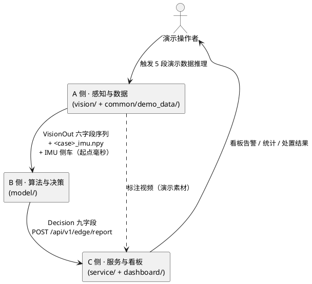
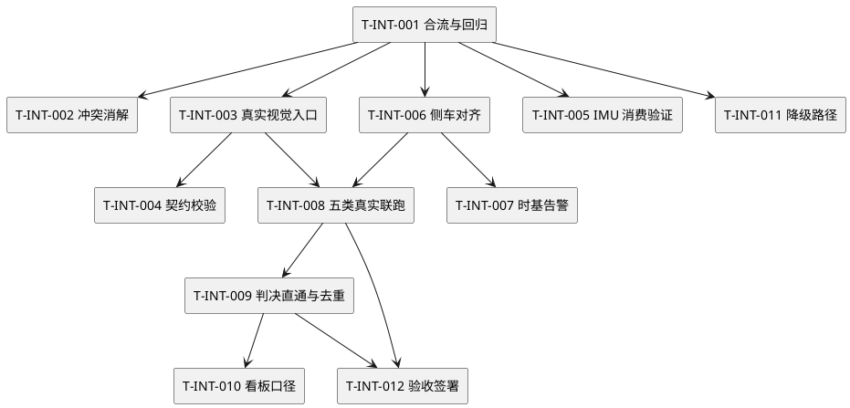

# A/B/C 三侧完成度与端到端联调需求规格（EARS）

| 项目 | 内容 |
|---|---|
| 文档编号 | SPEC-ELEV-INTEGRATION-001 |
| 文档名称 | 电梯困人主动预警 —— A/B/C 三侧完成度核验与端到端联调需求规格 |
| 版本 | v1.0（联调阶段基线） |
| 状态 | 待评审（A / B / C 三方会签后转为已批准） |
| 编写日期 | 2026-11-19 |
| 责任人 | 联调统筹（B 侧持有基线分支，A/C 为两侧交付方） |
| 上游基线 | SPEC-ELEV-RESCUE-001 v1.1（123 条 EARS）、DESIGN-ELEV-RESCUE-B-001 v1.0、T-B-001~034、L1 数据契约 v1.0（`CONTRACT_VERSION="L1-1.0"`） |
| 文档定位 | 只回答「三侧各自做到了哪一步、还差什么才能接通、接通后如何验收」，不回答「如何编码」 |
| 强制约束 | 不改 `common/schema.py`、不改 `docs/spec/requirement.md` 既有 123 条基线、不改 `model/`、`tests/`、`vision/`、`service/` 代码；不执行 `git merge / checkout / rebase` |

---

## 0. 阅读指南

### 0.1 目的与范围

本文档定义 A（数据与视觉感知）、B（算法与决策）、C（云服务与看板）三侧**能否对接、如何对接、如何验收**的可测试需求，覆盖：

- 三侧任务完成度的可证据化盘点（第 1 章）
- 三侧交接契约的差异识别与修复归属（第 2 章）
- 合流与回归、真实数据端到端、时基一致、五类场景联跑、接口与看板联调、演示降级、验收口径（第 3 章）
- 一条命令一个结果的端到端验收清单（第 4 章）
- 联调任务的粗粒度切分与阻塞关系（第 5 章）

**不在本文档范围内**：视觉模型选型与训练、状态机内部转移表、数据库表结构、前端页面实现、云资源开通步骤。上述内容分别由 A、B、C 的既有规格文档承载，本文档只引用其结论作为证据。

### 0.2 领域术语（联调语境）

**三侧合流**
: 把 `origin/monke`（A）与 `origin/mason`（C）的交付物并入 `main`（B 基线）后形成的单一可运行工作树，是端到端联调唯一合法的运行环境。
: 备注：合流前 `main` 只含 B 侧，`common/demo_data/` 为空目录。

**交接契约**
: 三侧之间被锁死或已公开发布的数据形状约定，包括 L1 数据契约（字段级，锁死）与两侧交接文档中的命名/路径/时基约定（非字段级，可协商）。
: 备注：L1 之外的约定虽可协商，但**变更必须双向确认**，单侧静默修改视为契约破坏。

**侧车（sidecar）**
: 与 IMU 张量文件同名同目录的元数据文件，承载该段数据的毫秒起点时间戳，是 A→B 时基对齐的唯一外部依据。

**时基**
: 一段数据中所有 `ts` 的零点锚定值。视觉帧、IMU 窗口、最终判决必须共享同一时基，否则 `dwell`（滞留时长）与模态对齐同时失效。

**对齐失效（none 对齐）**
: 融合阶段某视觉帧在 IMU 事件序列中找不到容差内（500 ms）且不超出保持窗口（10 s）的邻近窗口，该帧被判为 IMU 不可用并降级为纯视觉判据。

**回放降级**
: 演示视频缺失或解码不可用时，回放器放弃画面、仅按时间轴推送判决数据，保证看板演示不中断。

**联跑**
: 使用 A 的真实演示数据驱动 B 的真实判决、再驱动 C 的真实服务，全链路不使用任何合成替身。

### 0.3 EARS 句式、优先级与编号规则

| 类型 | 标注 | 句式模板 |
|---|---|---|
| 普遍型 | `[普遍]` | 系统必须…… |
| 事件驱动 | `[事件驱动]` | 当……时，系统必须…… |
| 状态驱动 | `[状态驱动]` | 在……状态下，系统必须…… |
| 非期望型 | `[非期望]` | 如果……，则系统必须…… |
| 可选型 | `[可选]` | 若启用……，系统必须…… |

| 优先级 | 含义 | 对「能否对接」结论的影响 |
|---|---|---|
| P0 | 联调必过项 | 任一条不满足 → 结论为「不能对接」 |
| P1 | 应满足，允许带风险演示 | 不满足 → 结论为「有条件对接」，须书面登记风险 |
| P2 | 建议项 | 不满足不影响结论 |

编号规则：本文档需求统一使用 `REQ-INT-<三位序号>`，**不复用、不改写** `docs/spec/requirement.md` 中既有的 `REQ-XXX-NNN`；编号一经发布不得复用，废弃条目保留编号并标注「已废弃」。

### 0.4 分支与基线快照（事实登记）

| 分支 | 内容 | 与 `main` 的关系 | 证据 |
|---|---|---|---|
| `main` | `model/`、`tests/`、`results/`（5 份决策产物）、`docs/spec/`、`common/schema.py`；`common/demo_data/` 仅有 `.gitkeep` | 联调基线 | `git ls-tree -d HEAD` |
| `origin/monke`（A） | `vision/`（13 个模块 + `configs/`）、`data/scripts/`、`common/demo_data/` 5 段全套数据、`results/vision_demo_<case>.json` ×5、`results/vision_summary.json`、`results/contract_check.json`、`results/annotated/` ×5、`results/figures/` | 未合入（`git merge-base --is-ancestor origin/monke main` 返回 1） | `git ls-tree origin/monke vision/` |
| `origin/mason`（C） | `service/`（8 文件，六接口）、`dashboard/index.html`、`scripts/`（8 脚本 + fixtures）、`docs/C_SERVICE_SETUP.md`、`docs/DEPLOY.md` | 未合入（同上判定返回 1） | `git ls-tree origin/mason service/` |

---

## 1. 三侧完成度盘点

### 1.1 联调对象与边界

本文档的「系统」是三侧合流后的**单一可运行工作树**，不是任一单侧仓库。三侧在联调语境下的边界如下：

1. **A 侧（数据与视觉感知）**：负责视频/轨迹 → `VisionOut` 六字段序列，以及 5 段演示数据（视频、关键点轨迹、IMU 张量、元数据）；**不负责**判决、不负责服务端。
2. **B 侧（算法与决策）**：负责 IMU 事件检测、困人状态机、融合判决、分级与理由生成，产出 `Decision` 九字段；**不负责**视觉推理、不负责落库。
3. **C 侧（云服务与看板）**：负责接收 `Decision`、去重、落库、统计、看板与演示回放；**不负责**感知与判决。
4. **本文档（联调）**：只负责「三侧之间的缝」，即分支合流、契约一致性、时基一致性、可复现验收；**不负责**任一侧的内部实现质量。



> 图只表达侧与侧之间的交互，不展开任一侧内部模块、数据库与缓存。

### 1.2 A 侧完成度盘点

| 编号 | 任务项 | 状态 | 证据路径（`origin/monke`） |
|---|---|---|---|
| A-01 | 感知规则链（人数/倒地/贴门/拥挤） | 已完成 | `vision/rules.py`、`vision/geometry.py`、`vision/temporal.py` |
| A-02 | 推理公开入口与命令行 | 已完成 | `vision/infer.py`（`infer_video()` + `--out/--jsonl/--debug`） |
| A-03 | 5 段演示数据（视频/关键点/IMU/meta） | 已完成 | `common/demo_data/demo_<case>.mp4`、`_kpts.jsonl`、`_imu.npy`、`_imu_raw.npy`、`_imu_meta.json`、`_meta.json` |
| A-04 | 视觉产物（每段 500 条六字段） | 已完成 | `results/vision_demo_<case>.json` ×5（JSON **数组**）、`results/vision_summary.json` |
| A-05 | 逐帧回归与基线 | 已完成（合成口径） | `results/vision_regression.md`、`results/vision_baseline.json` |
| A-06 | L1 契约自检 | 已完成 | `results/contract_check.json`（`errors: []`、`warnings: []`，5 段 `imu.shape=[5,200,3]`） |
| A-07 | 标注视频与图表（C 的演示素材） | 已完成 | `results/annotated/demo_<case>_annotated.mp4` ×5、`results/figures/`（含 `fig_pipeline.png`） |
| A-08 | 数据字典与交接说明 | 已完成 | `docs/DATA_DICT.md`、`docs/A_HANDOVER.md` |
| A-09 | IMU 侧车联调契约（命名 + 起点字段） | **部分完成** | 现产出 `demo_<case>_imu_meta.json`，字段为 `window_end_ts_ms`，无 `start_ts_ms`；起点实际在 `demo_<case>_meta.json` |
| A-10 | `VisionOut` JSONL 形态交付 | **部分完成** | `vision/infer.py` 具备 `--jsonl` 能力，但**已交付产物只有 JSON 数组**，未产出 JSONL |
| A-11 | 实拍素材全链路 | **未接入** | `docs/A_HANDOVER.md` §10 待办「实拍素材跑一遍全链路」未勾选；`data/raw/` 无素材 |

### 1.3 B 侧完成度盘点

| 编号 | 任务项 | 状态 | 证据路径（`main`） |
|---|---|---|---|
| B-01 | 契约与配置单一源 | 已完成 | `common/schema.py`（`L1-1.0`）、`model/config.py`、`results/config_snapshot.json` |
| B-02 | IMU 事件检测 | 已完成（仅可直接吃 npy） | `model/imu_detect.py`（`--npy` + `--start-ts-ms`） |
| B-03 | 困人状态机 | 已完成 | `model/state_machine.py` |
| B-04 | 融合与最近邻对齐 | 已完成（mock 输入） | `model/fuse.py`、`results/fusion_health.json` |
| B-05 | 分级、事件分类与 `reason` | 已完成 | `model/reason.py`、`results/demo_<case>_decision.json` 的 `reason` 字段 |
| B-06 | 五类场景产物与评测 | 已完成（mock 口径） | `results/demo_<case>_decision.json` ×5、`timeline_demo_<case>.jsonl` ×5、`results/metrics.md`、`results/metrics.csv`、`results/ablation.csv`、`results/EVAL_REPORT.md` |
| B-07 | 测试矩阵与冻结清单 | 已完成 | `results/FREEZE_CHECKLIST.md`（17 文件 / 168 项全绿） |
| B-08 | 真实数据接入入口 | **未接入** | `model/eval.py:657-663` 非 `--mock` 直接报错返回 2；`model/eval.py` 与 `model/fuse.py` 的 CLI **均无视觉/IMU 文件输入参数** |
| B-09 | IMU 侧车读取兼容 | **未接入** | `model/config.py:20` `SIDECAR_SUFFIX="_imu.meta.json"`；`model/config.py:217-231` 强制要求 `start_ts_ms`，缺失即回退默认基准 |
| B-10 | 演示阈值口径与真实数据匹配 | **部分完成** | 5 份产物 `reason` 为 `dwell=181s > 180s`（生产预设），而 A 每段仅 20 s |

### 1.4 C 侧完成度盘点

| 编号 | 任务项 | 状态 | 证据路径（`origin/mason`） |
|---|---|---|---|
| C-01 | 六接口（health / edge report / alerts / ack / stats / devices） | 已完成 | `service/main.py`（路由见 120–200 行） |
| C-02 | 上报模型九字段（与 `Decision` 对齐） | 已完成 | `service/models.py`（`DecisionIn` 九字段 + 范围校验） |
| C-03 | 双模式存储与缓存 | 已完成 | `service/db_rds.py`、`service/db_local.py`、`service/cache_redis.py`、`service/cache_memory.py` |
| C-04 | 看板页面 | 已完成 | `dashboard/index.html`（挂载于 `/`） |
| C-05 | 回放器与边端模拟 | 已完成 | `scripts/play_case.py`、`scripts/mock_edge.py`、`scripts/make_demo_results.py` |
| C-06 | 一键冒烟验收 | 已完成（C 自测口径） | `scripts/smoke_test.py`（11 项） |
| C-07 | 部署与接入文档 | 已完成（云上实例待开通，非联调项） | `scripts/deploy_cloud.sh`、`docs/DEPLOY.md`、`docs/C_SERVICE_SETUP.md` |
| C-08 | 带画面回放（依赖 A 的 mp4） | **未接入** | `scripts/play_case.py` 播放 `common/demo_data/<case>.mp4`，该目录在 `main` 上为空 |
| C-09 | 真实数据联动口径 | 已完成（可通） | `scripts/play_case.py` 优先读 `results/<case>_decision.json`，恰好命中 B 的 `results/demo_<case>_decision.json` |

### 1.5 汇总判定

| 侧 | 一句话判定 | 判定依据 |
|---|---|---|
| A | **部分完成**：感知本体与数据全部就绪，交付形态（侧车命名/字段、JSONL）未按 B 已发布的依赖清单对齐 | A-09、A-10 |
| B | **部分完成**：mock 链路闭环且冻结，真实数据入口结构性缺失 | B-08、B-09、B-10 |
| C | **已完成（自身）**：服务、看板、回放、双模式齐备，但真实数据联跑未验证 | C-08、C-09 |

### 1.6 已知风险与未决项

| 编号 | 事项 | 影响 | 处置建议 |
|---|---|---|---|
| R1-01 | 三侧分支均未合入 `main` | 任何「端到端」结论都只能基于 mock 或单侧自测 | 由 T-INT-001 一次性合流，避免长期双轨 |
| R1-02 | A 的实拍素材未接入 | 对外口径只能是「合成场景库」，不得声称真实精度 | 演示与答辩统一引用 `DATA_DICT.md` 的口径声明 |
| R1-03 | B 的 168 项测试与产物基于 mock | 合流后若真实数据改变了判决分布，`EVAL_REPORT` 数字需重新标注数据来源 | 联调产物独立落盘，不覆盖 `results/` 既有冻结产物 |
| R1-04 | C 的 `smoke_test.py` 未覆盖真实 B 产物 | 11/11 通过不代表真实链路通过 | 以第 4 章 CMD-09/CMD-10 补证 |
| R1-05 | 完成度判定依赖「证据文件是否存在」，不依赖口头声明 | 证据缺失项一律按「未接入」计 | 合流后重跑第 4 章命令刷新本表 |

---

## 2. 联调契约差异清单

### 2.1 差异总表

| 编号 | 差异项 | 现状（含证据） | 契约要求 | 修复归属 | 阻断级别 |
|---|---|---|---|---|---|
| **INT-DIFF-01** | 分支未合流 | `main` 仅含 B；`origin/monke`、`origin/mason` 均未合入（`git merge-base --is-ancestor` 返回 1） | 三侧交付物必须在同一工作树内可运行，且 `common/demo_data/` 非空 | A + C（提交），B（主持合流与回归） | **P0 阻断** |
| **INT-DIFF-02** | `VisionOut` 读取格式 | A 产物为 JSON **数组**（`results/vision_demo_<case>.json`）；B 无对应读取器，`model/eval.py` 无视觉输入参数 | B 必须能消费 A 交付的六字段序列；A 交付形态须与 B 已发布依赖清单（A-DEP-3 要求 JSONL）一致 | **B 主**（新增读取器）+ A 补（补跑 `--jsonl` 产物） | **P0 阻断** |
| **INT-DIFF-03** | IMU 侧车命名与字段 | A 产出 `demo_<case>_imu_meta.json`（下划线），无 `start_ts_ms`，仅有 `window_end_ts_ms`；B 期望 `demo_<case>_imu.meta.json`（点号）且必须有 `start_ts_ms`（`model/config.py:20`、`217-231`） | 侧车必须与 npy 同目录同 basename、可被 B 单读即得毫秒起点，或 B 显式兼容两种形态 | **A 主**（按 A-DEP-1 补齐）+ B 可选兼容 | **P0 阻断** |
| **INT-DIFF-04** | 时基对齐 | A 数据起点 `1794915000000` 起（5 段各隔 300 s）；B 侧车缺失时回退默认 `1763300000000`；两者相差 **31,615,600,000 ms（约 366 天）**，远超对齐容差 500 ms 与保持窗口 10 s | 同一段数据的视觉帧、IMU 窗口、最终判决必须共享同一时基，对齐不得退化为全 `none` | **A + B 联合**（A 补侧车、B 校验对齐健康度） | **P0 阻断** |
| **INT-DIFF-05** | `Decision` 落库 | `DecisionIn` 九字段与 `Decision` 逐字段一致，`/edge/report` 已实现「`urgency=0` 且未困人只刷心跳」「同设备同紧急度 30 s 去重」；回放器默认把绝对时间戳平移到当前时刻 | 落库链路必须在不改字段的前提下端到端通，且「今日告警数」等统计口径不得因时基失真 | **C 主**（维持现状即可），B 仅需保证产物字段合法 | **P1 需修**（链路已通，真实数据未验证） |
| **INT-DIFF-06** | 演示阈值预设与段长不匹配 | B 的 5 份产物使用生产预设（`reason` 为 `dwell=181s > 180s`）；A 每段视频仅 20 s、IMU 仅 30 s | 真实数据联跑必须使用演示预设（`dwell_threshold=8.0`），否则困人场景永不触发 | **B** | **P0 阻断**（真实数据接入后必然暴露） |
| **INT-DIFF-07** | mp4 缺失时的回放降级 | `scripts/play_case.py` 已在视频不存在/打不开/未装 opencv 时降级为「只发数据」；但 `main` 上 `common/demo_data/` 为空，当前只能降级运行 | 降级必须自动、不中断、有明确提示，且不影响告警入库与看板展示 | **C 主**（已实现），A 提供素材（合流后自然解决） | **P1 需修** |
| **INT-DIFF-08** | 关键点原始格式易被误当 `VisionOut` | `demo_<case>_kpts.jsonl` 为 `frame/ts/persons/scores/labels`（COCO-17 原始关键点），不是六字段 | B 读取 `VisionOut` 时必须按字段集合校验，遇到原始关键点格式必须报受控错误而非产出脏判决 | **B 主**，A 在文档标注格式差异（已具备，见 `DATA_DICT.md` §3） | **P1 需修** |
| **INT-DIFF-09** | IMU 段长口径 | A：5 段 × `(5,200,3)` = 30 s；B 的 mock：困人类场景拉长到约 105 s | 段长差异必须显式登记，并明确联调以哪一份为准 | **B 拍板**，A 配合 | **P1 需修** |
| **INT-DIFF-10** | `urgency=1` 是否入库 | C 对 `urgency=1` 的 `estop` 照常入库；B 的语义是「关注」而非告警 | 入库口径必须三方一致，避免看板把「关注」与「告警」混为一栏 | **C + B 确认** | **P2 建议** |
| **INT-DIFF-11** | 依赖与 Python 版本 | LOCK-1.0 面向 3.10/3.11；C 提供 3.14 兜底清单但明确「不改 lock」 | 联调环境必须统一为 LOCK-1.0 可安装的版本，兜底清单不得写进 lock | **C 主**（文档已陈述），三方执行 | **P1 需修** |

### 2.2 阻断差异的判定依据

1. **INT-DIFF-01（合流）** 是其余全部差异的放大器：不合流时，A 的 `common/demo_data/` 与 C 的 `service/` 不在同一工作树，「端到端」只能靠手工搬运文件，任何验收结论都不可复现。
2. **INT-DIFF-02（格式）** 属结构性缺失而非参数问题：`model/eval.py` 与 `model/fuse.py` 的命令行**都没有**视觉/IMU 文件入口，`--mock` 之外的唯一分支是错误退出。因此「补一个读取函数」是必要且不可绕过的前置条件。
3. **INT-DIFF-03（侧车）** 是**静默失败**型缺陷：B 不会报错，只会 WARN `sidecar_absent` 并回退默认基准，判决照常产出但时间语义全错。静默失败比崩溃更危险，必须按 P0 处理。
4. **INT-DIFF-04（时基）** 的后果可量化：默认基准与 A 数据相差约 366 天，`Aligner` 的容差为 500 ms、保持窗口为 10 s，所有帧必然落到 `none` 对齐，IMU 三分数全部不可用，困人判据退化为「纯视觉人数 + dwell」，`estop` 场景将完全失去 IMU 证据支撑。
5. **INT-DIFF-06（阈值）** 在「格式与时基修好之后」才暴露：A 的 `demo_trapped` 仅 20 s，生产预设 180 s 阈值下永远不触发，联跑会得到「五类全 normal」的错误结论，比不联调更具误导性。
6. **INT-DIFF-05（落库）** 判定为 P1 而非 P0：字段与去重逻辑已一致，链路在 mock 数据上可通；其风险集中在「真实数据 + 真实时基」下的统计口径，而非接口能力。

### 2.3 联调 DFX 红线

| 类别 | 红线（可验证） | 验收锚点 |
|---|---|---|
| 性能 | 单段 20 s 数据的 B 侧处理（IMU 检测 + 融合 + 判决）不超过 10 s | CMD-07 |
| 可靠性 | 任一侧数据缺失或格式非法时，链路必须给出受控错误或明确降级，禁止静默产出脏判决 | `REQ-INT-017` |
| 兼容性 | 侧车与产物形态的变更必须双向确认；判据为「改动方合流后另一侧无需改代码即可运行」 | `REQ-INT-010` |
| 可复现性 | 同一条命令连续执行两次，A 的视觉产物与 B 的判决产物逐字段一致（浮点 1e-6） | CMD-03、CMD-07 |
| 可维护性 | 联调产物与冻结产物分目录落盘，不得覆盖 `results/` 既有冻结文件 | `REQ-INT-013` |

### 2.4 已知风险与未决项

| 编号 | 事项 | 影响 | 建议 |
|---|---|---|---|
| R2-01 | 侧车修复存在两条路径（A 补齐 / B 兼容） | 若两侧同时改，可能产生第三套实现 | **只允许选一条主路径**，另一侧在合流评审时确认「无需改动」 |
| R2-02 | 时基修复后 A 的 `crowded`/`fall_prob` 数值不受影响 | 无风险，但需在 `EVAL_REPORT` 中区分「时基修复前/后」两次产物 | 联调产物单独标注 `ts_base_source` |
| R2-03 | 若 B 兼容 `window_end_ts_ms` 推算起点，存在 50 ms 级误差（窗口结束 9950 ms + 步长） | 该误差小于对齐容差 500 ms，可接受，但必须显式声明 | 首选 A 补 `start_ts_ms`，减法推算仅作兜底 |
| R2-04 | 阈值从 180 s 改为 8 s 会让 `EVAL_REPORT` 与真实数据产物口径不一致 | 评审时易被质疑「调阈值刷指标」 | 必须同时保留两套产物并注明预设名 |
| R2-05 | 需求单口径与实测的时基差值量级不一致（需求单记为 3.16e7 ms，按两侧 `ts` 实算为 3.16e10 ms） | 影响文档严谨性 | 本文档以实算值 31,615,600,000 ms 为准，并在验收命令中断言「差值 > 1 天」而非固定数值 |

---

## 3. EARS 需求条目

> 全章节共 24 条，编号 `REQ-INT-001` ~ `REQ-INT-024`。每条给出类型、优先级、验收口径与追溯。

### 3.1 合流与回归

**REQ-INT-001｜普遍｜P0｜三侧合流完整性**
合流后的 `main` 工作树必须同时包含 A 的 `vision/` 与 `common/demo_data/`、B 的 `model/`、C 的 `service/` 与 `dashboard/`，且 `common/demo_data/` 下 5 段场景的六类文件齐全。
- 验收：合流后目录清单逐项命中；`common/demo_data/` 非空且 5 段各含 `.mp4`、`_kpts.jsonl`、`_imu.npy`、`_imu_raw.npy`、`_imu_meta.json`、`_meta.json`。
- 追溯：INT-DIFF-01、T-INT-001。

**REQ-INT-002｜普遍｜P0｜合流不得破坏既有契约基线**
合流过程必须保持 `common/schema.py` 与 `docs/spec/requirement.md` 的既有 123 条基线不变，B 侧 168 项测试在合流后仍全绿。
- 验收：`common/schema.py` 的 `CONTRACT_VERSION` 仍为 `L1-1.0` 且文件内容无差异；全量测试退出码 0。
- 追溯：`REQ-QUAL-005`、`REQ-CONST-002`、T-INT-002。

**REQ-INT-003｜非期望｜P0｜合流冲突的受控处理**
如果合流时出现同名文件冲突（如 `results/` 下同名产物、根目录配置），则必须由冲突方在各自分支解决并以「不覆盖对方已冻结产物」为原则，不得以「取一边」方式静默丢弃。
- 验收：冲突清单逐条留档；`results/` 中 B 的冻结产物字节级不变。
- 追溯：INT-DIFF-01、REQ-INT-013。

**REQ-INT-004｜事件驱动｜P0｜合流后回归**
当合流完成后首次运行时，系统必须在无网络、无 GPU 条件下完成 B 侧全量回归与产物生成。
- 验收：断网执行全量测试与 B 侧批处理，退出码 0，5 份判决产物齐备。
- 追溯：`REQ-PERF-004`、T-INT-001。

### 3.2 真实数据端到端

联调主干流程（只画侧与侧的交互，不展开任一侧内部模块）：

```plantuml
@startuml
skinparam defaultFontName "Microsoft YaHei"
actor "演示操作者" as OP
participant "A 感知与数据" as A
participant "B 算法与决策" as B
participant "C 服务与看板" as C

OP -> A : 对 5 段演示视频触发推理
A -> B : VisionOut 六字段序列 + IMU 张量 + 侧车（毫秒起点）
B -> B : IMU 检测 → 状态机 → 融合判决（演示预设）
B -> C : Decision 九字段逐条上报
C -> C : 心跳刷新 / 去重 / 落库
C --> OP : 看板告警条目 + 统计与处置
A ..> C : 标注视频（仅演示素材，不参与判决）
@enduml
```

**REQ-INT-005｜事件驱动｜P0｜真实视觉序列消费**
当向 B 侧提供 A 的 `VisionOut` 序列（六字段，`ts` 为 13 位毫秒）时，系统必须能完整消费并产出逐帧判决，不得要求人工转换格式。
- 验收：以 A 的 5 段产物为输入，B 侧产出 5 份判决，帧数与输入帧数对应；无未捕获异常。
- 追溯：INT-DIFF-02、REQ-FUNC-051~054、T-INT-003。

**REQ-INT-006｜普遍｜P0｜输入格式的显式契约校验**
系统必须对视觉序列入口执行字段级校验（字段集合、`ts` 量级、各分数值域、`keypoints_ok` 布尔性），任何缺失或越界必须在入口处拒绝，并指明具体字段。
- 验收：注入 5 类非法输入（缺字段、`ts` 为 10 位、分数 >1、`persons` 原始关键点格式、空文件），均以受控错误退出且错误信息含字段名。
- 追溯：INT-DIFF-08、`REQ-QUAL-002`、T-INT-004。

**REQ-INT-007｜事件驱动｜P0｜真实 IMU 张量消费**
当向 B 侧提供 A 的 `(N,200,3)` float32 IMU 张量时，系统必须按契约切窗并产出与窗口数一致的 IMU 事件序列。
- 验收：5 段各产出 5 条 IMU 事件，`window_sec` 恒为 `10.0`，三分数均在 `[0,1]`。
- 追溯：`REQ-FUNC-001~008`、T-INT-005。

**REQ-INT-008｜非期望｜P0｜真实数据模式的可用性**
如果 B 侧被要求以非合成数据运行，则必须存在可用的真实数据执行路径，不得出现「直接报错退出」的唯一结果。
- 验收：真实数据模式执行成功并产出判决；退出码 0；产物标注数据来源为真实采集而非 mock。
- 追溯：INT-DIFF-02（`model/eval.py:657-663` 现状）、T-INT-003。

### 3.3 时基一致

**REQ-INT-009｜普遍｜P0｜单一时间基准**
同一段数据的视觉帧、IMU 窗口、最终判决必须共享同一毫秒时基，且该基准必须可追溯到一个明确来源（侧车 / 命令行 / 配置默认三选一）。
- 验收：任取一段联调产物，判决 `ts` 与视觉 `ts` 的偏移不超过一帧间隔（40 ms）；产物中记录基准来源标识。
- 追溯：INT-DIFF-03、INT-DIFF-04、`REQ-DATA-003`、T-INT-006。

**REQ-INT-010｜普遍｜P0｜侧车契约的双向可读**
系统必须能仅凭与 npy 同目录的侧车文件即可获得该段毫秒起点，不依赖读取场景元数据文件的其它字段。
- 验收：以 A 的 5 段侧车为输入，解析成功率为 5/5，且解析出的起点与场景元数据的 `start_ts_ms` 完全相等。
- 追溯：INT-DIFF-03、A-DEP-1、T-INT-006。

**REQ-INT-011｜非期望｜P0｜时基失配的可检测性**
如果时基发生失配（任一模态的 `ts` 偏移超过 1 天），则系统必须在运行期给出可观测告警，不得静默产出全 `none` 对齐的判决。
- 验收：人工构造错时基输入，运行日志出现对齐失效告警，且对齐健康度报告中 `none` 占比为 1.0 时被标记为异常。
- 追溯：INT-DIFF-04、`REQ-QUAL-003`、T-INT-007。

### 3.4 五类场景联跑

**REQ-INT-012｜事件驱动｜P0｜五类场景真实联跑**
当以 A 的 5 段演示数据驱动全链路时，系统必须对 normal / estop / trapped / pry / faint 五类各产出与场景标签一致的判决结论（事件类型与是否困人）。
- 验收：5 段中段级结论与 `contract_check.json` 的 `label` 一致；normal 段困人帧数为 0。
- 追溯：`REQ-FUNC-051~054`、`REQ-ACC-004`、T-INT-008。

**REQ-INT-013｜普遍｜P1｜联调产物隔离**
联调过程中产生的视觉产物、判决产物与评测报告必须落盘到独立目录，不得覆盖 `results/` 中已冻结的既有文件。
- 验收：合流前后对 `results/demo_<case>_decision.json` 做字节比对，完全一致。
- 追溯：INT-DIFF-01、R2-04、T-INT-008。

**REQ-INT-014｜非期望｜P0｜零误报闸门在真实数据上仍成立**
如果真实数据联跑引入 normal 段困人误报，则必须阻断验收并定位到具体判据，不得以「演示可通过」为由放行。
- 验收：normal 段困人帧数为 0、段级误报率为 0；否则验收结论为失败。
- 追溯：`REQ-CONST-005`、`REQ-FUNC-044~050`、T-INT-008。

### 3.5 接口与看板联调

**REQ-INT-015｜普遍｜P0｜判决字段直通**
系统必须保证 B 的判决对象在零改字段的前提下可直接作为 C 的上报请求体，且 C 侧校验通过率 100%。
- 验收：5 份真实判决逐条上报，无 422 响应；入库记录的九个字段与源数据逐字段一致。
- 追溯：INT-DIFF-05、C-DEP-1、T-INT-009。

**REQ-INT-016｜事件驱动｜P0｜告警入库与去重**
当同一设备在 30 秒内重复上报相同紧急度时，服务端必须只保留一条告警记录，且重复请求不得报错。
- 验收：同一条上报连发 5 次，入库 1 条、去重 4 次；活动告警列表命中 1 条。
- 追溯：INT-DIFF-05、`scripts/smoke_test.py`、T-INT-009。

**REQ-INT-017｜非期望｜P1｜服务不可用时的回放行为**
如果服务端未启动或端口不可达，则回放器必须以明确提示告知失败并返回非零退出码，不得静默成功。
- 验收：停服务后执行回放，退出码非 0，首条失败即打印连接失败提示。
- 追溯：INT-DIFF-07、T-INT-010。

**REQ-INT-018｜事件驱动｜P1｜看板与统计口径**
当告警入库后，看板与统计接口必须反映该告警；且回放默认把绝对时间戳平移到当前时刻，使「今日告警数」与「平均响应时长」不被历史时基污染。
- 验收：回放后统计接口的今日总数 ≥1、活动告警数 ≥1；使用保留原始时间戳模式时，文档必须标注该模式不计入今日统计。
- 追溯：INT-DIFF-05、`service/main.py` 上报分支、T-INT-010。

### 3.6 演示降级路径

**REQ-INT-019｜非期望｜P1｜视频缺失自动降级**
如果没有可播放的视频（文件缺失、解码失败、依赖缺失任一情况），则回放必须自动退化为「只发数据」，并继续完成全部判决推送。
- 验收：删除或重命名视频后执行回放，进程不中断，发送条数与判决总数一致，摘要中失败条数为 0。
- 追溯：INT-DIFF-07、T-INT-011。

**REQ-INT-020｜状态驱动｜P1｜降级状态下的提示与可观测性**
在降级状态下，系统必须在启动时与摘要中明确标注「无画面」，使演示者与评审者不会误判为「视频卡住」。
- 验收：降级运行日志含明确的降级提示；摘要区分「带画面」与「只发数据」两种模式。
- 追溯：INT-DIFF-07、`REQ-QUAL-003`。

**REQ-INT-021｜可选｜P2｜标注视频作为演示素材**
若采用 A 的标注视频作为演示素材，系统必须保证画面中的叠加信息与判决时间轴一致，无需人工剪辑对齐。
- 验收：任取一段，画面叠加的人数/倒地概率与同帧判决的 `people_count`/`reason` 数值一致。
- 追溯：A-07、`docs/A_HANDOVER.md` §6。

### 3.7 验收口径

**REQ-INT-022｜普遍｜P0｜验收结论的唯一判据**
系统必须仅以第 4 章验收清单的执行结果作为「能否对接」的判据，任何口头结论或单侧自测均不构成依据。
- 验收：验收清单逐条留痕（命令、退出码、关键输出），结论行由三方共同确认。
- 追溯：第 4 章、T-INT-012。

**REQ-INT-023｜普遍｜P0｜数据来源口径不可隐去**
系统在任何对外材料中必须显式标注数据来源（合成场景库 / 真实采集），不得把 mock 产物表述为真实采集结果。
- 验收：`metrics.md`、`EVAL_REPORT.md`、联调报告三处均含数据来源声明。
- 追溯：`REQ-EVAL-005`、`REQ-ACC-001`、T-INT-012。

**REQ-INT-024｜非期望｜P1｜联调阻塞的显式登记**
如果任一 P0 条目未通过，则必须登记阻塞项、责任侧与解除条件，且「能否对接」结论只能为「不能」或「有条件」，不得为「能」。
- 验收：阻塞登记表与实际未通过条目一一对应。
- 追溯：第 4 章结论、第 5 章任务表。

### 3.8 需求 → 差异 → 任务追溯矩阵

| 需求组 | 覆盖编号 | 对应差异 | 对应任务 |
|---|---|---|---|
| 合流与回归 | REQ-INT-001~004 | INT-DIFF-01 | T-INT-001、T-INT-002 |
| 真实数据端到端 | REQ-INT-005~008 | INT-DIFF-02、INT-DIFF-08 | T-INT-003、T-INT-004、T-INT-005 |
| 时基一致 | REQ-INT-009~011 | INT-DIFF-03、INT-DIFF-04 | T-INT-006、T-INT-007 |
| 五类场景联跑 | REQ-INT-012~014 | INT-DIFF-06 | T-INT-008 |
| 接口与看板联调 | REQ-INT-015~018 | INT-DIFF-05 | T-INT-009、T-INT-010 |
| 演示降级路径 | REQ-INT-019~021 | INT-DIFF-07 | T-INT-011 |
| 验收口径 | REQ-INT-022~024 | INT-DIFF-05、INT-DIFF-09、INT-DIFF-10 | T-INT-012 |

### 3.9 已知风险与未决项

| 编号 | 事项 | 影响 | 建议 |
|---|---|---|---|
| R3-01 | `REQ-INT-012` 的「与标签一致」依赖 `contract_check.json` 的标签，而 B 侧 mock 标签来自 `results/labels.json` | 两套标签若不同源，比对无意义 | 联调以 A 的 `label` 为准，B 侧另存一份联调用标签 |
| R3-02 | `REQ-INT-018` 的「平移到当前时刻」会掩盖时基问题 | 演示通过不等于时基正确 | 时基正确性必须由 `REQ-INT-009/011` 单独验证，不得用回放结果反证 |
| R3-03 | `REQ-INT-021` 依赖 A 的标注视频与该帧判决同步 | 标注视频当前基于 A 自身规则产物，与 B 判决可能存在 1~2 s 差 | 已登记为 P2，答辩时不承诺逐帧一致 |
| R3-04 | `REQ-INT-014` 的零误报在真实视频上未必成立 | 合成数据的零误报不可外推 | 结论表述限定为「在 5 段自建场景上」 |
| R3-05 | 未决：INT-DIFF-09 的段长以哪一方为准 | 影响 dwell 压测覆盖面 | 建议联调以 A 的 30 s 为准，B 的 105 s 保留为压测专用 |

---

## 4. 端到端验收清单

### 4.1 验收命令表（一条命令一个结果）

| 编号 | 命令 | 归属 | 预期结果 | 当前状态 |
|---|---|---|---|---|
| CMD-01 | `git merge-base --is-ancestor origin/monke main` 与 `origin/mason main` | B（合流） | 两条均返回 0 | **未通过**（均返回 1） |
| CMD-02 | `python -m unittest discover -s tests -t . -p "test_*.py"` | B | 168 项全绿、退出码 0 | 通过（main 上已满足） |
| CMD-03 | `python model/eval.py --cases all --mock --seed 0 --out results/_rerun/` | B | 5 份判决产出，与 `results/` 既有产物逐字段一致 | 通过（mock 口径） |
| CMD-04 | `python vision/doctor.py` | A | 依赖、数据、ROI、产物均 ✓（`torch/ultralytics` 的 ✗ 属已知不影响项） | 合流后可执行 |
| CMD-05 | `python data/scripts/validate_demo_data.py --case all` | A | 5 段全部通过、`errors` 为空 | 合流后可执行 |
| CMD-06 | `python model/imu_detect.py --npy common/demo_data/demo_trapped_imu.npy --verbose` | B | 5 条 IMU 事件，`ts` 落在 `1794915609950` 起的 5 个窗口结束时刻 | **未通过**（当前回退 `1763300000000` 基准） |
| CMD-07 | 真实数据端到端（`--demo` 预设，A 数据为输入） | B | 5 份判决，`ts` 与 A 的视觉 `ts` 偏移 ≤40 ms，来源标注为真实采集 | **不可执行**（入口缺失） |
| CMD-08 | `python -m service.main` + `python scripts/smoke_test.py` | C | 11/11 通过 | 合流后可执行（C 自测已通过） |
| CMD-09 | `python scripts/play_case.py --case demo_trapped --no-video` | C | 数据源显示为 `results/demo_trapped_decision.json`；入库 ≥1 条、最高紧急度 2（条数随数据段长与 30 s 去重而定） | 需 B 真实数据产物（当前命中的是 mock 产物） |
| CMD-10 | `python scripts/play_case.py --case demo_faint` | C | 视频窗口播放 + 告警同步弹出；最高紧急度 3 | **未通过**（`main` 上无 mp4） |
| CMD-11 | 移除/重命名 `demo_faint.mp4` 后执行 CMD-10 | C | 自动降级为只发数据，进程不中断，失败条数 0 | 未验证（素材缺失使降级成为默认路径，属「意外通过」） |
| CMD-12 | `curl http://127.0.0.1:18080/api/v1/alerts?status=active` | C | 返回条目含目标设备、`reason` 为数组、楼层与人数正确 | 合流后可执行 |
| CMD-13 | 五类联跑：对 5 个 case 依次执行 CMD-09 | C + B | 五类各产出对应事件类型，normal 段无告警 | **未通过**（依赖 CMD-07） |

### 4.2 五类场景期望结果（联调基线）

| 场景 | 期望事件类型 | 期望最高紧急度 | 期望困人 | 关键判据来源 |
|---|---|---|---|---|
| `demo_normal` | normal | 0 | 否 | 人数与 dwell，零误报 |
| `demo_estop` | estop | 1 | 否 | IMU 急停分数（依赖时基正确） |
| `demo_trapped` | trapped | 2 | 是 | dwell 超阈值（演示预设 8 s）+ 人数 |
| `demo_pry` | pry | 2 | 是 | 贴门持续（A 侧 `door_approach` 峰值 1.0、超阈值 220 帧） |
| `demo_faint` | faint | 3 | 是 | 倒地概率（A 侧峰值 0.9、超阈值 261 帧） |

> 该表的口径来自 `results/contract_check.json` 与 `results/vision_summary.json`，属「合成场景库」口径，不对应真实电梯精度。

### 4.3 当前能否对接的结论

**结论：不能。**

**前置条件（三条，缺一不可）**：

1. 完成三侧合流（`REQ-INT-001`），使 `common/demo_data/` 与 `service/` 与 `model/` 处于同一工作树；
2. 打通 A→B 的真实数据通道（`REQ-INT-005`、`REQ-INT-008`），并同时修复侧车命名/字段（`REQ-INT-010`）与格式一致性；
3. 以演示预设重跑五类真实数据判决（`REQ-INT-012`），使 A 的 20 s 段长与阈值匹配。

**已具备、无需返工的部分**：C 的六接口与看板（`REQ-INT-015`、`REQ-INT-016` 在 mock 上已通）、B 的判决字段与 C 的上报模型逐字段一致、C 的视频缺失降级逻辑已实现。

### 4.4 已知风险与未决项

| 编号 | 事项 | 影响 | 建议 |
|---|---|---|---|
| R4-01 | CMD-11 当前「意外通过」 | 无法证明降级逻辑是主动生效还是因为本来就没画面 | 合流后必须先验证 CMD-10 通过，再验证 CMD-11 |
| R4-02 | CMD-07 的「≤40 ms 偏移」依赖判决沿用对应视觉帧时刻 | 若 B 选择窗口末端时刻，偏移会到 10 s 量级 | 联调前需在 `REQ-DATA-004` 口径下确认取帧时刻 |
| R4-03 | CMD-09 当前命中的是 mock 产物 | 「数据源自动切换到真实数据」尚未真正验证 | 合流后必须同时打印数据源文件名 |
| R4-04 | 未决：验收是否接受「有条件对接」 | 影响 D 阶段排期 | 建议以「P0 全绿才算能」为硬口径 |
| R4-05 | 未决：联调产物目录名 | 影响 `REQ-INT-013` 的验收 | 建议统一为 `results_integration/`，不与 `results/` 混用 |

---

## 5. 联调任务建议（T-INT-xxx）

> 本章只给任务边界、依赖与阻塞关系，不展开编码细节、不写实现代码。

| 编号 | 任务 | 归属 | 产出物（可验收） | 依赖 | 阻塞关系 |
|---|---|---|---|---|---|
| **T-INT-001** | 三侧一次性合流并回归 | B 主持，A/C 提交 | 合流后的 `main`；全量测试 168 项全绿；`common/demo_data/` 非空 | 无 | **阻塞全部后续任务**（对应 REQ-INT-001~004） |
| **T-INT-002** | 冲突消解与冻结产物保护 | B | 冲突清单 + `results/` 冻结产物字节级比对记录 | T-INT-001 | 与 T-INT-001 同批（对应 REQ-INT-003、REQ-INT-013） |
| **T-INT-003** | 真实视觉序列入口 | B 主 | 真实数据端到端可执行路径；5 份真实判决落 `results_integration/` | T-INT-001 | 阻塞 T-INT-008、T-INT-009（对应 REQ-INT-005、REQ-INT-008） |
| **T-INT-004** | 视觉输入契约校验 | B | 5 类非法输入的受控错误清单（含字段名） | T-INT-003 | 不阻塞主线，阻断「脏数据上线」（对应 REQ-INT-006） |
| **T-INT-005** | 真实 IMU 张量消费验证 | B | 5 段各 5 条 IMU 事件的输出与 `window_sec` 校验记录 | T-INT-001 | 与 T-INT-006 并行（对应 REQ-INT-007） |
| **T-INT-006** | 侧车契约对齐（命名 + 起点字段） | A 主（补 `start_ts_ms`），B 确认 | 5 段侧车解析成功率 5/5；起点与场景元数据相等 | T-INT-001 | 阻塞 T-INT-008（对应 REQ-INT-009、REQ-INT-010） |
| **T-INT-007** | 时基失配的可观测告警 | B | 错时基注入实验日志 + 对齐健康度异常标记 | T-INT-006 | 不阻塞主线，防止静默失败（对应 REQ-INT-011） |
| **T-INT-008** | 五类场景真实联跑（演示预设） | B + A | 5 段联跑结论表；normal 段零误报证据 | T-INT-003、T-INT-006 | 阻塞 T-INT-009、T-INT-012（对应 REQ-INT-012~014） |
| **T-INT-009** | 判决直通服务端与去重验证 | C + B | 5 份判决零 422 上报记录；去重 1 入库 4 丢弃的证据 | T-INT-008（可先用 mock 产物并行预热） | 阻塞 T-INT-012（对应 REQ-INT-015、REQ-INT-016） |
| **T-INT-010** | 看板与统计口径联调 | C | 看板截图 + 统计接口返回与告警数一致 | T-INT-009 | 与 T-INT-009 同批（对应 REQ-INT-017、REQ-INT-018） |
| **T-INT-011** | 演示降级路径双向验证 | C | 「带画面」与「只发数据」两次运行证据，顺序不可颠倒 | T-INT-001（素材到位后） | 不阻塞主线（对应 REQ-INT-019~021） |
| **T-INT-012** | 联调验收与结论签署 | 三方 | 第 4 章清单逐条留痕 + 结论行 + 阻塞登记表 | T-INT-008、T-INT-009 | **唯一出口**，未完成不得宣布「能对接」（对应 REQ-INT-022~024） |

### 5.1 依赖与阻塞关系



**关键路径**：T-INT-001 → T-INT-003 → T-INT-008 → T-INT-009 → T-INT-012。任一条延误，全部联调结论顺延；T-INT-004、T-INT-005、T-INT-007、T-INT-011 可与主线并行，不改变关键路径长度。

### 5.2 已知风险与未决项

| 编号 | 事项 | 影响 | 建议 |
|---|---|---|---|
| R5-01 | T-INT-003 与 T-INT-006 的修复归属若同时动手，可能产生重复实现 | 合流后出现两套侧车解析 | 先由 T-INT-006 定稿契约，T-INT-003 再据此接入口 |
| R5-02 | T-INT-009 是否允许先用 mock 产物预热 | 可提前暴露接口问题，但可能误判「已联调」 | 允许预热，但验收必须用 T-INT-008 的真实产物 |
| R5-03 | 未决：T-INT-011 需要 A 的素材与 C 的环境同时就绪 | 无法单侧完成 | 排期上放在 T-INT-008 之后，避免占用关键路径 |
| R5-04 | 未决：是否保留 B 的 105 s 长 IMU 作为压测件（INT-DIFF-09） | 影响 dwell 判据的长期验证 | 建议保留为独立压测目录，不进入演示默认路径 |

---

## 附录 A · 联调数据对象约束（逻辑约束，不含存储实现）

### A.1 视觉感知结果（`VisionOut`，六字段，L1 锁死）

1. **ts**：13 位毫秒时间戳，与所在段的起点基准一致，段内严格递增。
2. **person_count**：整数，取值 `0~8`，超过按 8 封顶。
3. **fall_prob**：`[0,1]` 浮点；当 `keypoints_ok` 为假时该值不得作为判决依据。
4. **door_approach**：`[0,1]` 浮点，表示腕部贴门缝的几何与持续程度，不表示动作类别。
5. **crowded**：`[0,1]` 浮点。
6. **keypoints_ok**：布尔；为假时下游必须降级为「人数 + 滞留时长」。

### A.2 IMU 事件（`IMUEvent`，四字段 + 固定窗口）

1. **ts**：窗口结束的毫秒时间戳，必须落在同一时基。
2. **estop / vibration / idle**：`[0,1]` 浮点。
3. **window_sec**：固定 `10.0`，不得随数据变化。

### A.3 最终判决（`Decision`，九字段，L1 锁死）

1. **ts**：毫秒时间戳，沿用对应视觉帧时刻。
2. **device_id**：非空字符串。
3. **trapped**：布尔；为真时 **urgency 必须 ≥2**（L1 映射表）。
4. **urgency**：`0|1|2|3`，与 `event_type` 必须满足 L1 映射（`0→normal`、`1→estop`、`2→trapped/pry`、`3→faint`）。
5. **location**：楼层字符串，估不出填 `?`。
6. **people_count**：整数，`0~8`。
7. **event_type**：`normal|estop|trapped|pry|faint` 五选一。
8. **confidence**：`[0,1]`。
9. **reason**：字符串列表，只列本次触发判据且每条带具体数值；空串与空白项必须被清洗。

### A.4 IMU 侧车（联调新增约束，非 L1 字段）

1. **文件名**：必须与对应 npy 同目录、同 basename。
2. **起点字段**：必须存在一个可直接读取的毫秒整数起点，且与场景元数据的 `start_ts_ms` 相等。
3. **窗口信息**：窗口长度、步长、采样率、形状、通道顺序必须与 npy 实际内容一致。
4. **禁止项**：不得只在场景元数据文件中提供起点而要求下游跨文件解析。

### A.5 分支与产物命名约束

1. 视觉产物：`vision_<case>.json` / `vision_<case>.jsonl`，`case` 含 `demo_` 前缀。
2. 判决产物：`<case>_decision.json`，`case` 含 `demo_` 前缀，与 C 的回放器查找顺序一致。
3. 联调产物：统一落独立目录，不得与冻结产物同目录同名。

---

## 6. 首轮联调实测记录（2026-11-20）

> 本章记录 T-INT-001~005 的实际执行结果，用于回答「现在能不能对接」。所有结论均可由仓库内文件与命令复现。

### 6.1 已完成的工程动作

| 编号 | 动作 | 落点 | 结果 |
|---|---|---|---|
| ACT-01 | 两侧资产以工作树级取出（未改历史、未提交） | `vision/`、`data/`、`common/demo_data/`、`service/`、`dashboard/`、`scripts/` | 三侧同树可执行 |
| ACT-02 | 侧车命名兼容：支持 A 的 `<case>_imu_meta.json`，并回退场景元数据 `<case>_meta.json` 的 `start_ts_ms` | `model/config.py`（`legacy_sidecar_path`、`scene_meta_path`） | `ts_base_source=scene_meta t0_ms=1794915600000` |
| ACT-03 | 真实视觉序列入口：支持 JSON 数组 / JSONL，逐帧校验六字段 | `model/eval.py`（`load_vision_sequence`、`run_real_case`、`--real`） | `--real` 可跑，产物落 `results_integration/` |
| ACT-04 | 状态机补「已静止且有人」入 STOPPED 的物理规则 | `model/state_machine.py`（`idle_stopped_person`） | mock 指标零变化，真实数据可进 OCCUPIED |
| ACT-05 | 契约哈希在 Windows CRLF 下归一为 LF | `tests/test_engineering_rules.py`（`_sha256`） | 168 项全绿 |

> ACT-05 只消除行尾差异，不改契约内容；`common/schema.py` 与 `tests/test_schema_contract.py` 字节级未动。

### 6.2 可复现命令与结果

| 命令 | 结果 |
|---|---|
| `python -m unittest discover -s tests -t . -p "test_*.py"` | 168 项全绿 |
| `python model/eval.py --cases all --mock --seed 0 --out results/_rerun` | 与冻结 `results/metrics.csv` 逐字节一致 |
| `python model/imu_detect.py --npy common/demo_data/demo_trapped_imu.npy --verbose` | 5 条事件，`ts=1794915610000` 起，来源 `scene_meta` |
| `python model/eval.py --cases all --real --demo --out results_integration` | 5 段各 500 帧，产物完整落盘 |

### 6.3 五类真实数据实测结论（演示预设 dwell=8 s）

| 场景 | 期望事件 / 最高紧急度 | 实测事件 / trapped 帧 | 判定 |
|---|---|---|---|
| `demo_normal` | normal / 0 | trapped / 273 | ❌ 误报 |
| `demo_estop` | estop / 1 | trapped / 273 | ❌ 语义冲突（急停 + 1 人停留被判困人） |
| `demo_trapped` | trapped / 2 | trapped / 273 | ✅ |
| `demo_pry` | pry / 2 | trapped / 92 | ❌ 类型降级（贴门帧与 trapped 帧不重叠） |
| `demo_faint` | faint / 3 | faint / 273 | ✅ |

五类中 **2 类达标、3 类不达标**；`normal` 误报属 P0 阻断（`REQ-INT-012`、`REQ-FUNC-044`）。

### 6.4 根因：A 侧数据在 B 可见通道上不可分

以 `results/vision_summary.json` 与 IMU 实测为证：

| 场景 | person_count 均值 | fall_prob 峰值 | door_approach 峰值 | door>0.6 帧 | IMU estop/vib/idle |
|---|---|---|---|---|---|
| `demo_normal` | 2.0 | 0.0 | 0.0 | 0 | 0 / 0 / 0.98 |
| `demo_trapped` | 2.0 | 0.0 | 0.0 | 0 | 0 / 0 / 0.98 |

两段的六字段与 IMU 三分数逐项一致，仅 `crowded` 有 0.009 的差异（非判据）。因此 B 无法在现有契约通道上区分「正常停留」与「停梯困人」——这不是阈值问题，是 A 侧数据缺少可区分特征（如正常场景的门开动作 / 人员进出）。

### 6.5 C 侧直通的执行阻塞

- 本机 `Python 3.9.12`，不满足项目声明的 3.10/3.11；`service/` 的类型注解（`dict | None`）与 lock 版本（`fastapi==0.115.0`）均不可用。
- `fastapi / uvicorn / pydantic` 未安装，`python -m service.main` 无法启动，`scripts/smoke_test.py` 与 `play_case.py` 的 HTTP 段无法执行。
- 已完成静态核验：`DecisionIn` 九字段与 `Decision` 完全一致；`play_case.py` 查找顺序 `results/<case>_decision.json` 与 B 产物命名一致。

### 6.6 本轮结论

**链路已打通、判决未达标。** 真实数据可以从 A 产物经 B 判决落到 `results_integration/`，但五类场景不可分流，不能宣布「能对接」；C 侧需在 3.10+ 环境装锁版本依赖后复验。

**下一步（按优先级）**：

1. **A**：为 `demo_normal` 补可区分特征（门开下降沿或人员进出），并为 `demo_estop` 补「急停后离场/开门」语义；`demo_pry` 的贴门时段需与 `OCCUPIED` 窗口重叠。
2. **B**：在 A 补数据后重跑 `--real --demo`，核对五类达标；必要时把 `REQ-DATA-004` 的取帧时刻口径落到 `reason`。
3. **C**：在 3.10+ 环境装 `fastapi==0.115.0`、`uvicorn==0.32.0` 后跑 `smoke_test.py` 与 `play_case.py --no-video`，完成 T-INT-009/010。
4. **合流**：本轮为工作树级对齐，正式 `merge origin/monke origin/mason` 与 `CMD-01` 仍需在代码冻结后由三人确认执行。

### 6.7 新增差异与风险登记

| 编号 | 事项 | 影响 | 归属 |
|---|---|---|---|
| `INT-DIFF-12` | `demo_normal` 与 `demo_trapped` 六字段 + IMU 三分数不可分 | normal 必然误报或 trapped 必然漏报，二选一 | A（补特征） |
| `INT-DIFF-13` | `demo_pry` 贴门时段与 OCCUPIED 窗口不重叠 | 事件类型降级为 trapped | A（时序重制）/ B（取帧口径） |
| `R6-01` | 工作树级取出未写入 git 历史 | 换机器/重clone 后需重做 ACT-01 | B（合流时固化） |
| `R6-02` | 本机 Python 3.9 与 lock 版本不匹配 | C 侧全部 HTTP 验收不可执行 | C（换 3.10+ 环境） |