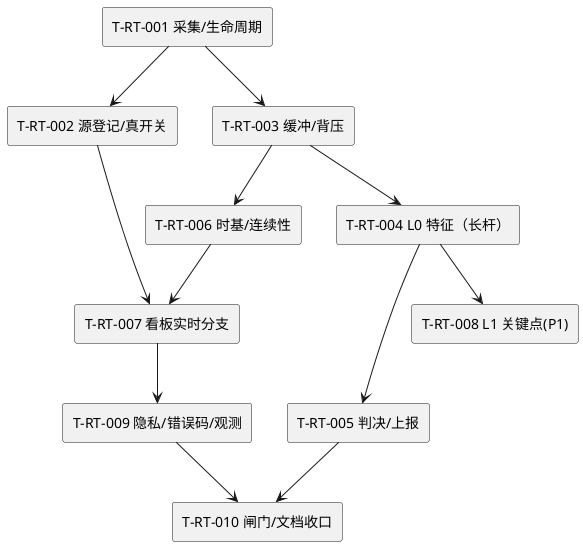
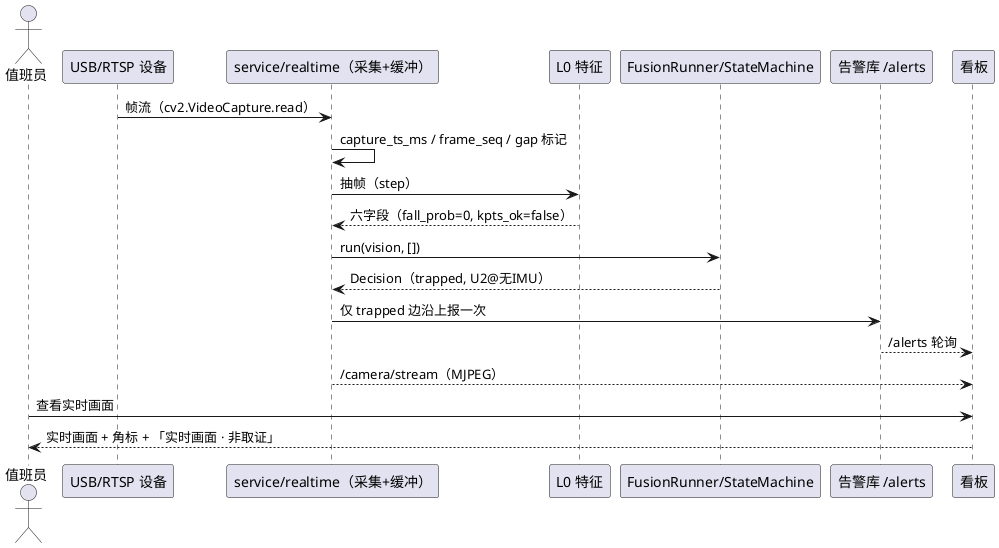

# 实时摄像头接入与人物动作识别需求规格（EARS）

> 本文件为**新增规格**，编号自成体系（`REQ-RT-*` / `T-RT-*` / `CMD-RT-*` / `DEC-RT-*` / `Q-RT-*` / `AMEND-RT-*`）。
> 不修改 `docs/spec/camera.md`、`docs/spec/upload_video.md`、`docs/spec/frontend.md`、`docs/spec/requirement.md`、`docs/spec/design.md`、`docs/spec/tasks.md` 的任何既有条目；
> 需要扩展既有契约时，一律以 `AMEND-RT-*` 声明登记（见 0.2.1）。本轮**只写文档，零代码改动，零既有文档改动**。

---

## 直接回答（先看这一节）

用户原始诉求（保真引用）：

> 可以打开事实摄像头然后判断人物动作吗

（"事实"即"实时"：打开真实摄像头，实时判断画面中人物动作，用于困人预警。）

### A. 今天能不能做

| 问题 | 结论 | 依据 |
|---|---|---|
| 能否打开真实摄像头并持续取流 | **能**（USB 本地 / 内网 RTSP 两条通道，技术前提已具备） | 本机 `cv2 5.1.0` 且 `FFMPEG: YES (prebuilt binaries)`（实测），`VideoCapture` 可读本地设备与 rtsp:// |
| 能否**实时**解码并按帧产出画面统计量 | **能** | 同上；`vision/sources.py:138-155` 已证明逐帧读取通路可用 |
| 能否据此判"困人"并告警 | **能**（仅"滞留型困人"） | 复用 `FusionRunner`（`model/fuse.py:114-192`）+ `StateMachine`（`model/state_machine.py:271-276`） |
| 能否**判断人物动作**（挥手 / 倒地 / 扒门 / 按按钮） | **今天不能** | `ultralytics`/`onnxruntime`/`mediapipe` 均未安装，`models/` 目录不存在（实测）；无关键点 ⇒ `fall_prob` 只能恒 0、`keypoints_ok=false` ⇒ U3 不可达（`model/reason.py:158-165`） |

**一句话**：**"开摄像头看人、数人、判滞留"今天就能做；"看懂人在做什么动作"今天做不了，缺的不是代码而是"模型运行环境 + 权重文件"。**

### B. 缺什么（按档位拆）

| 档位 | 能力 | 今天是否可达 | 缺的条件 |
|---|---|---|---|
| **L0 无动作识别** | 人数、门区占用、拥挤度 → 滞留型困人（U2 封顶） | ✅ 可达 | 只需"采集通路 + 复用既有判决"，不新增任何依赖 |
| **L1 姿态关键点** | 17 点骨架 → 倒地 / 挥手 / 扒门（几何规则判定） | ❌ 不可达 | ① 在本机装好 lock 内已授权的 `ultralytics==8.3.0` 或 `onnxruntime==1.19.0`；② 权重落 `models/`（约 6–13 MB，仓内没有）；③ 拍板允许"装依赖 + 权重入仓"（`Q-RT-01`） |
| **L2 动作分类模型** | 挥手/扒门/按按钮等**动作类别**（时序分类） | ❌ 不可达 | 训练数据、标注、权重、可能的**新依赖**（超出 `requirements.lock.txt` 授权范围）→ 本轮判"不做"，仅留档位（`REQ-RT-015`） |

### C. 三个硬前提（缺一不可）

1. **设备与网络**：一台真实 USB 摄像头（或内网可访问的 `rtsp://` 流），且服务进程有设备/网络访问权限；仅允许内网，禁止公网地址（`C-RT-03`）。
2. **判决口径**：实时无 IMU ⇒ 紧急度**封顶 U2**（沿用 `model/fuse.py:145-148`），且**不得**对外声称"倒地检测/动作识别"（`REQ-RT-016`）。
3. **开关与回退**：`CAMERA_SOURCE_MODE=usb|rtsp` 必须从"标签"升级为"真开关"，但**默认关闭**，任何失败都必须回退 demo 且告警区照常（`REQ-RT-003/032/033`）。

### D. 一句话话术（对外必须这么说）

> 本系统可接入真实摄像头做**实时人数与门区滞留判定**，用于"门闭 + 有人久留"的困人预警；
> **当前版本不做人物动作/倒地识别**；启用姿态模型后可在**同一判决链路上**增加倒地与扒门线索，但紧急度仍封顶 U2（无 IMU）。

---

## 0. 阅读指南

### 0.1 目的与范围

本文档定义「**接入真实摄像头（USB 本地设备 / 局域网 RTSP 流）→ 实时解码 → 人物动作识别 → 困人判定 → 告警与看板呈现**」的完整需求规格，并显式回答"能不能做、需要什么条件、当前项目差什么"。

范围（一句话）：只解决"真实设备持续取流 → 在线滑动窗口判定 → 告警可见"这条链路；不解决姿态模型训练、不解决取证留存、不解决公网推流。

**明确不在本文档范围内**：任何代码改动、模型训练、数据库结构、部署脚本、`common/demo_data/`、`results/`、`data/labels/` 的任何变更。

### 0.2 与既有文档的关系

| 文档 | 关系 | 本文档的引用方式 |
|---|---|---|
| `docs/spec/camera.md` | 并列能力（demo 回放链路）；本文档复用其源清单/时间基准/会话/看板面板 | 只引用 3.1/3.2/4.2/5.5/5.9；以 `AMEND-RT-01/03/05/07/08` 扩展 |
| `docs/spec/upload_video.md` | 并列能力（上传件离线批处理）；本文档不与之交叉 | 只引用 `C-UP-03`、`DEC-UP-01`、`NG-UP-01`、3.2 档位表、3.4 隔离表；以 `AMEND-RT-06` 声明边界 |
| `docs/spec/frontend.md` | 看板基线（`REQ-UI-002` 白名单、`REQ-UI-028` 轮询） | 以 `AMEND-RT-04` 扩展白名单（**不新增前缀**） |
| `docs/spec/requirement.md` | 123 条总基线、`DEC-02`（门状态无真实信号）、`DEC-03`（`ts` 毫秒） | 只引用 `REQ-FUNC-021`（时序保护）、`REQ-FUNC-045/046`（空梯/倒地持续） |
| `model/fuse.py`、`model/state_machine.py`、`model/reason.py` | 判决唯一实现 | **只调用，不复制**（`REQ-RT-022`） |
| `requirements.lock.txt` | 依赖唯一安装依据 | 引用 `:9` `ultralytics==8.3.0`、`:10` `opencv-python==4.10.0.84`、`:11` `onnxruntime==1.19.0` |

#### 0.2.1 本轮新增的修订声明（AMEND，不改原文）

| 编号 | 声明 | 影响的既有内容 | 是否改原文 |
|---|---|---|---|
| **AMEND-RT-01** | `CAMERA_SOURCE_MODE=usb/rtsp` 的语义由「返回空清单 + `mode` 标签」升级为「真采集」；未配置/未开启时仍返回空清单 + `degraded=true` | `camera.md` `REQ-CAM-010`、4.4 末行（原写 501，实测是空清单） | 否 |
| **AMEND-RT-02** | 实时源可出现在 `GET /api/v1/camera/sources` 的 `items` 中；「items 恰 5 条」断言条件化为「实时关闭时恰 5 条」 | `scripts/check_camera.py:100`；`camera.md` `REQ-CAM-005` | 否（脚本改写属实现轮） |
| **AMEND-RT-03** | `sources` 顶层键集合保持 4 个不变；实时能力位只追加在**单个 item** 内（`live`/`watermark`/`rt_state`），**禁止**新增顶层键 | `scripts/check_camera.py:130-135`（顶层键 = 4） | 否 |
| **AMEND-RT-04** | 实时流端点必须落在 `/api/v1/camera/` **前缀之内**（`/camera/live`、`/camera/stream`），不新增 API 前缀 | `frontend.md` `REQ-UI-002`；`scripts/check_frontend.py:19,124` | 否 |
| **AMEND-RT-05** | 水印按**源类型**选择：demo=`演示数据 · 非取证`、upload=`用户上传 · 非取证`、realtime=`实时画面 · 非取证`；顶层 `watermark` 仍返回 demo 文案不动 | `camera.md` `REQ-CAM-020`、5.8；`dashboard/index.html:241`（当前硬编码） | 否 |
| **AMEND-RT-06** | 看板体积上限由 48 KB 提升至 **64 KB**（其余断言一条不删，仍单文件、零外链、零构建） | `scripts/check_frontend.py:18` `MAX_BYTES`；`camera.md` `C-CAM-03` | 否（实现轮改一个常量） |
| **AMEND-RT-07** | 「依赖零新增」口径澄清：`requirements.lock.txt` 已含 `ultralytics`/`onnxruntime`，装它们**不属新增依赖**，但**禁止修改任何 `requirements*.txt`**；**权重文件**（`models/`）与 L2 依赖不在此授权内 | `camera.md` `C-CAM-05`；`upload_video.md` `C-UP-03`、`Q-UP-01` | 否 |
| **AMEND-RT-08** | `scripts/check_camera.py:925-926`「`service/camera.py` 无 numpy/onnxruntime/ultralytics 导入」保持不变；对新增实时模块追加**同一条**断言 | 同上 | 否 |

> 上述八条是本轮全部"触及既有约定"的位置，全部登记在案；其余既有文档一律只读。

### 0.3 编号与优先级

| 类型 | 编号 | 含义 |
|---|---|---|
| 需求 | `REQ-RT-001 ~ 036` | 36 条，含 EARS 类型、优先级、`[机器]/[人工]/[需设备]` 判据、追溯 |
| 任务 | `T-RT-001 ~ 010` | 拆解建议，本阶段不实现 |
| 命令 | `CMD-RT-01 ~ 16` | 验收命令（10.1 本轮可跑 / 10.2 实现后 / 10.3 需设备人工） |
| 缺口 | `GAP-RT-01 ~ 10` | 现状缺口 |
| 风险 | `R-RT-01 ~ 10` | 风险登记 |
| 决策 | `DEC-RT-01 ~ 05` | 本轮已拍板事项 |
| 未决 | `Q-RT-01 ~ 06` | 需拍板事项（Top3 见 9.3） |
| 修订 | `AMEND-RT-01 ~ 08` | 扩展声明（0.2.1） |

优先级沿用项目口径：**P0 = 缺此项则"实时→告警"链路不成立**；P1 = 影响可用性/可运维但不阻断主路径；P2 = 加分项，不作阻断。

### 0.4 事实与证据口径

1. 1.2 节「本轮实测」的每一行都在 `E:\云码道\Elevator-Trapped-Alert`、Python **3.9.12** 下真实执行，可复现（命令见 10.1）。
2. 凡未实测项一律标 `—`，不得写成"已验证"。
3. **本轮推翻了既有文档的一条前提**：`camera.md` `R-CAM-01` 与 `supplement_ac.md` 7.3 记录的"沙箱禁止 `socketpair`（`WinError 10051`）、无法起端口"在本机**已不成立**（实测 `socketpair OK`、`127.0.0.1` bind/listen/connect OK、`TestClient` 200）。本文档的三档验收按**新实测**划分：真实端口可验，**真实摄像头与真实 RTSP 流仍不可验**。

### 0.5 本轮交付边界

| 项 | 本轮（需求规格） | 下一轮（实现） |
|---|---|---|
| 本文档 | 新建 | 按任务回填实测 |
| `service/` | **零改动** | 新增 `service/realtime.py`，`main.py` 只追加 |
| `dashboard/index.html` | **零改动** | 追加实时分支（净增 ≤3 KB） |
| `scripts/` | 零改动 | 新增 `scripts/check_realtime.py`；改 `check_camera.py` 两处断言、`check_frontend.py` 一个常量 |
| `common/`、`results/`、`data/labels/` | **零改动、只读** | 仍只读 |
| `requirements*.txt` | **零改动** | 仍零改动（`AMEND-RT-07`） |

---

## 1. 现状盘点

### 1.1 基线快照（本轮实测）

| 项 | 实测值 | 证据 |
|---|---|---|
| Python | **3.9.12** | `python -V` |
| 单测 | **192 全绿** | `python -m unittest discover -s tests -t . -p "test_*.py"` |
| 看板闸门 | **29/29 通过**，`MAX_BYTES = 48*1024` | `python scripts/check_frontend.py --strict`；`scripts/check_frontend.py:18` |
| 画面闸门 | **14/14 通过** | `python scripts/check_camera.py --strict` |
| 看板规模 | **1,174 行 / 47,182 B** | `wc -l -c dashboard/index.html`；距 48 KB 仅剩 **1,722 B** |
| `cv2` | **5.1.0**（`FFMPEG: YES (prebuilt binaries)`，`GStreamer: NO`） | `cv2.getBuildInformation()` |
| 姿态依赖 | `ultralytics` / `onnxruntime` / `mediapipe` **均 MISSING** | 逐项 import |
| 权重 | `models/` **不存在** | `ls models` |
| 端口能力 | `socketpair OK`；`127.0.0.1:51612` bind/listen/connect **OK**；`TestClient` → `200` | 本轮探测脚本 |
| 摄像头设备 | **未验证**（本轮不打开设备，避免隐私副作用） | 见 `MAN-RT-01` |

### 1.2 已核实事实（行号可复查）

| # | 事实 | 位置 |
|---|---|---|
| F1 | `usb/rtsp` 目前**不采集**：`bootstrap()` 对 `mode not in ("demo","file")` 直接返回空清单并记 `mode_unsupported` | `service/camera.py:415-420` |
| F2 | 实测 `CAMERA_SOURCE_MODE=usb` → `sources=0`、`degraded=true`、`health.degraded=true`；**不返回 501**（与 `camera.md` 4.4/`REQ-CAM-010` 的 501 描述不符） | 本轮实测；`service/camera.py:455-467`、`:1096` |
| F3 | `SUPPORTED_MODES` 常量含 `usb/rtsp`，但仅供声明，未被 `bootstrap()` 使用 | `service/camera.py:34` |
| F4 | 顶层水印恒为 `演示数据 · 非取证`，单源无 `watermark` 字段 | `service/camera.py:35`、`:455-467` |
| F5 | 看板水印是**硬编码 HTML 文本**，不读接口字段 | `dashboard/index.html:241` |
| F6 | 看板已有 `<video>`+`<canvas>` 叠加、冻结 5 s 判定、退避 1/2/4 s（≤3 次）、1 s 定时器、25 fps 叠加、kpts 缓存 300 | `dashboard/index.html:238-241`、`:769-777`、`:1070-1089` |
| F7 | 媒体 `src` 必须是 `/api/v1/camera/...`（闸门断言） | `dashboard/index.html:1022`；`scripts/check_frontend.py:124` |
| F8 | `sources` 顶层键集合被断言为 **4 个**；`health` 键集合为 **6 个**；`ERROR_CODES` 长度断言 = **11**，且前端 `CAM_MSG` 键集合必须与之相等 | `scripts/check_camera.py:130-135`、`:425-426`、`:869-875` |
| F9 | 「items 恰 5 条」与「rtsp → items=[] + degraded=true」均被断言 | `scripts/check_camera.py:100`、`:137-146` |
| F10 | `service/camera.py` 被断言"无 numpy/onnxruntime/ultralytics 导入" | `scripts/check_camera.py:925-926` |
| F11 | 依赖锁**已授权** `ultralytics==8.3.0`、`onnxruntime==1.19.0`、`opencv-python==4.10.0.84` | `requirements.lock.txt:9-11` |
| F12 | 三处依赖声明**互相不一致**：lock `8.3.0/1.19.0` ↔ `requirements.txt:5-7` `>=8.3,<8.4 / >=1.19,<1.20` ↔ `vision/requirements-a.txt:25-26` `8.4.215/1.32.0` | 三文件 |
| F13 | 判决唯一实现：`FusionRunner.run`；无 IMU 时 `urgency>2 → 2` 且 `event_type` 改写为 `trapped` | `model/fuse.py:114-192`、`:145-148` |
| F14 | U3 需 `trapped && keypoints_ok && imu_present && fall_persist≥3 s && fall_prob>0.70` | `model/reason.py:158-165` |
| F15 | `trapped = state==OCCUPIED && person_count≥1 && dwell>th`；生产 `dwell=180 s`，demo 预设 `8 s` | `model/state_machine.py:271-276`；`model/config.py:33`、`:96` |
| F16 | 空梯复位是**唯一**复位通道：`person_count==0` 持续 `≥3000 ms` | `model/state_machine.py:144-145` |
| F17 | 上报语义：`urgency==0 && !trapped` 只刷心跳；同设备同紧急度 30 s 去重 | `service/main.py:136-171`；`service/config.py:58` |
| F18 | 路由追加块必须位于 `app.mount("/")` 之前，且 `main.py` 既有行零删除 | `service/main.py:203-305` |
| F19 | `vision/sources.py` 的 `VideoReader` 无 meta 时把基准**锚到当前整秒**（离线语义），非墙钟逐帧 | `vision/sources.py:116-128` |
| F20 | `make_backend(auto)` 顺序：侧车 → onnx → yolo；无可用后端即抛 `RuntimeError` | `vision/sources.py:430-465` |

### 1.3 缺口清单

| 编号 | 缺口 | 证据 | 影响 | 级别 |
|---|---|---|---|---|
| **GAP-RT-01** | 采集通道不存在：`usb/rtsp` 是"空清单标签"，无 `VideoCapture` 打开/重连/断流检测 | F1/F2/F3 | 「打开真实摄像头」无从谈起 | **P0** |
| **GAP-RT-02** | 无实时帧缓冲与在线窗口：现有能力是"整段离线读完"（`vision/sources.py:138-155`），不能在线滑动窗口 | F19/F20 | dwell 180 s 所需历史无处承载 | **P0** |
| **GAP-RT-03** | **无姿态模型运行环境与权重**：依赖未装、`models/` 不存在 | F11/F12 + 实测 | 「人物动作识别」完全不可达 | **P0** |
| **GAP-RT-04** | 实时源无登记身份：无 `rt_*` 前缀、无设备归属，`device_id` 仍是 `ELEV-DEMO-001` 单值 | `service/camera.py:32` | 告警无法区分"演示/上传/实时/哪台电梯" | **P0** |
| **GAP-RT-05** | 实时时基未定义：现有公式 `wall = offset + anchor + frame×frame_ms` 只适用于离线素材 | `camera.md` 3.2 | 直播按此公式必然漂移，dwell 失真 | **P0** |
| **GAP-RT-06** | 无断流语义：断流后 `person_count` 缺失会被当成"无人" → **误触发空梯复位** | F16 | 真实故障被误判为"已脱困"，漏报 | **P0** |
| **GAP-RT-07** | 看板无实时承载：`<video>` 只能播 mp4；水印硬编码；体积仅余 1,722 B | F5/F6、1.1 | 实时画面无处显示，或改崩体积预算 | P1 |
| **GAP-RT-08** | 既有闸门把"rtsp → 空清单"写死，把 `ERROR_CODES=11` 与顶层键集合写死 | F8/F9 | 真开关与新错误码必然撞红 | P1 |
| **GAP-RT-09** | 隐私口径只覆盖 demo/upload，实时画面（真实住户）未声明 | `camera.md` 5.8 | 合规质疑：真实画面是否出公网/留存 | P1 |
| **GAP-RT-10** | 真实设备、真实 RTSP 流在本机不可验；摄像头是否存在未知 | 1.1 | 端到端只能靠人工/换环境 | P1（验收口径） |

### 1.4 三个 P0 缺口（本轮必须先定性）

1. **GAP-RT-01（采集）**：没有"打开-重连-断流"这条通道，后面所有讨论都是空谈。必须先定义通道契约与失败语义。
2. **GAP-RT-03（特征）**：**这是"能不能判断动作"的唯一真阻断点**。结论必须写死：`cv2` 拿不到 17 点 ⇒ 今天只能做 L0；L1 需要"装 lock 内依赖 + 权重入 `models/`"（`Q-RT-01`）。
3. **GAP-RT-05/06（时基与断流）**：直播不能用离线公式；断流必须走"不确定"通道而**不是**"无人"通道，否则空梯复位会把真实困人清零。

---

## 2. 目标与约束

### 2.1 目标

| 编号 | 目标 | 可度量判据 |
|---|---|---|
| **G-RT-01** | 能打开真实设备并**持续**出帧 | USB 或 RTSP 任一开启后 10 s 内 `rt_state=LIVE`，帧率 ≥8 fps（L0），连续 60 s 无断流 |
| **G-RT-02** | 能在线判出"滞留型困人"并告警 | 构造「门闭 + 有人久留 > dwell」序列 → `/alerts` 出现该 `device_id` 的 `trapped=true, urgency=2`，且**只 1 条** |
| **G-RT-03** | 动作识别能力**诚实分档** | L0 时全帧 `fall_prob==0.0`、`keypoints_ok=false`、`reason` 含 `feature_mode=realtime_heuristic`；UI 不出现"倒地 0%"式伪值 |
| **G-RT-04** | 断流不等于"无人" | 断流 ≥3 s 时输出 `UNCERTAIN`，`person_count` **不得**置 0，dwell **不得**增长也不得复位 |
| **G-RT-05** | 既有三条链路零污染 | 实时关闭时：demo 5 条源字段与排序逐项不变、上传件行为不变、192 单测 + 29/29 + 14/14 全绿 |
| **G-RT-06** | 隐私红线 | 真实画面不出公网、不落盘、不人脸识别；水印常驻「实时画面 · 非取证」 |

### 2.2 硬约束

| 编号 | 约束 | 判定方式 |
|---|---|---|
| **C-RT-01** | **Python 3.9 兼容**：注解只用 `Optional/List/Dict/Any/Tuple`；数据结构 `@dataclass(frozen=True)`；禁止 `X \| Y` 与 `dict[str, Any]` | `python -c "import service.realtime"` 退出码 0；`grep -nE ": *[A-Za-z0-9_.\[\]]+ *\|"` 无输出 |
| **C-RT-02** | **依赖文件零改动**：`requirements*.txt` 一行不改；`ultralytics/onnxruntime` 只在**运行时探测**（`importlib.util.find_spec`），缺失即降级 L0，不得崩 | `git status --short requirements*` 为空；屏蔽依赖后仍出帧、仍判 L0 |
| **C-RT-03** | **只允许内网**：RTSP 主机必须是私有地址或白名单；**禁止**任何公网 IP/域名/云推流；USB 仅本地设备号 | 配置校验 + 单元测试（公网 → `403 RT_STREAM_PUBLIC_FORBIDDEN`） |
| **C-RT-04** | **默认关闭**：不设 `REALTIME_ENABLE=1` 时，服务启动**不得**打开任何设备；`CAMERA_SOURCE_MODE` 默认 `demo` | 默认启动 `GET /camera/live` → `state=DISABLED`；进程无设备占用 |
| **C-RT-05** | **判决零复制**：必须调用 `FusionRunner`/`StateMachine`；**禁止**在实时模块内实现第二套 dwell/复位 | `grep -c "def .*dwell\|empty_run"` 在 `service/realtime.py` = 0 |
| **C-RT-06** | **既有接口零变化**：既有 6 接口与 `/camera/*` 六接口的路径/参数/字段/错误体不变；`main.py` 既有行零删除 | `git diff --numstat service/main.py` 删除列 = 0；`passthrough_test.py` 11/11 |
| **C-RT-07** | **冻结区只读**：`common/demo_data/`、`results/`、`data/labels/` 不得写入；实时帧**不落盘** | `git status --short` 不含上述目录 |
| **C-RT-08** | **单文件零构建**：看板仍 1 个文件、零外链、零 CDN；体积 ≤**64 KB**（`AMEND-RT-06`） | `ls dashboard` = 1；`wc -c ≤65536` |
| **C-RT-09** | **端点前缀**：新增端点必须为 `/api/v1/camera/live`、`/api/v1/camera/stream`（`AMEND-RT-04`） | `check_frontend.py:124` 仍通过 |
| **C-RT-10** | **日志不记像素**：禁止记录帧内容、坐标数组、可复原画面的字段；单源 1 分钟同类 WARN 合并 | 日志样例审查 |

### 2.3 明确不做（Non-goals）

| 编号 | 不做的事 | 理由 |
|---|---|---|
| **NG-RT-01** | **不做人脸识别/身份比对/人员计数去重** | `camera.md` 5.8 红线 |
| **NG-RT-02** | **不做实时录像留存/回放归档/截图导出**（含事件前后片段） | 合规与 C-RT-07；若将来要做必须另立需求（`Q-RT-04`） |
| **NG-RT-03** | **不做公网/云推流/云台/音频对讲** | C-RT-03 |
| **NG-RT-04** | **不做转码/转封装/切片（HLS/DASH）** | 需 ffmpeg 外部进程，违反"零新增依赖" |
| **NG-RT-05** | **不做多路视频墙**（并发默认 1，上限 2，且第二路仅"登记不推理"） | CPU 预算；做则另立需求 |
| **NG-RT-06** | **不做 IMU 伪造**：实时链路无 IMU，不得为凑 U3 造假 | F13/F14 |
| **NG-RT-07** | **不做"动作类别"声称**：未达 L2 前，UI/文档/答辩话术不得出现"识别挥手/扒门/按按钮" | `REQ-RT-016` |
| **NG-RT-08** | **不改 `common/schema.py`**：`VisionOut` 六字段与 `Decision` 九字段形状不变 | `REQ-DATA-001` |
| **NG-RT-09** | **不做"实时源参与评测/校准"** | 无标注真值，会污染 `results/` |
| **NG-RT-10** | **不把实时源当 demo 使用**：不得写入 `common/demo_data/`、不得复用 `demo_*` 前缀 | `REQ-RT-001` |

---

## 3. 与既有两条链路的关系（必须显式区分，不得混写）

### 3.1 三条链路对照

| 维度 | ① demo 回放链路（`camera.md`） | ② 上传文件链路（`upload_video.md`） | ③ **实时链路（本文档）** |
|---|---|---|---|
| 触发 | 页面打开即播（预置 5 段 20 s） | 用户 `POST /upload/video` | 开关显式开启 + 设备就绪 |
| 数据来源 | `common/demo_data/*.mp4` + `_kpts.jsonl` | `data/raw/uploads/<id>/source.mp4` | USB 设备 / 内网 `rtsp://` |
| 源登记 | `source_id=demo_*`，从 `*_meta.json` 推导 | `source_id=up_<16hex>`，从 `upload.json` 推导 | `source_id=rt_<cam_id>`，从**配置**推导 |
| 时基基准 | `anchor_ts_ms = meta.start_ts_ms`（素材时间）+ `offset_ms` 回放平移 | `start_ts_ms` = **录制时间**（`DEC-UP-01`） | `anchor_ts_ms` = **首次成功取帧的墙钟**；逐帧 `ts` = **该帧采集墙钟** |
| 帧号来源 | `frame = round((ts−offset−anchor)/frame_ms)` | `ts(frame)=start_ts+round(frame*1000/fps)` | **帧号 ≠ 时间**：以 `ts` 为准，帧号仅作递增序号 |
| 特征产出 | 侧车 17 点（A 侧已生成） | 离线批处理（L1 pose / L2 heuristic） | **在线逐帧**（L0 启发式 / L1 关键点） |
| 判决复用 | `FusionRunner`（`play_case.py` 回放判决） | `FusionRunner.run(vision, [])` | `FusionRunner.run(vision, [])`（同 ②，无 IMU） |
| 告警 | 回放器 `rebase_ts` 后上报 | 边沿触发上报一次 | 边沿触发上报一次 + 30 s 去重 |
| 看板 | `<video>` 播 mp4 + canvas 叠加 + 按告警定位 | 同 ①（`/camera/video` 分发） | `` 接 MJPEG + canvas 叠加 + **禁用按告警定位** |
| 水印 | `演示数据 · 非取证` | `用户上传 · 非取证` | `实时画面 · 非取证` |
| 留存 | 无（素材预置） | 24 h 删原视频 | **零留存**（不落盘） |

### 3.2 隔离红线（违反任一即视为 P0 缺陷）

| 隔离项 | demo | upload | **realtime** | 判据 |
|---|---|---|---|---|
| `source_id` 前缀 | `demo_` | `up_` | **`rt_`** | 三前缀严格不重叠；长度 ≤20（`service/camera.py:269-273`） |
| `device_id` | `ELEV-DEMO-001` | 必带自有值，禁等于 demo | **必带自有值**（`RT_DEVICE_ID`），禁等于 demo | 三条链路的 `device_id` 集合两两不相交 |
| 目录写入 | 只读 | `data/raw/uploads/` | **不写盘** | `git status --short` 不含 `common/`、`results/`、`data/labels/` |
| 水印 | 演示 | 用户上传 | 实时 | 按 item 的 `watermark` 字段切换 |
| `vision` 语义 | 侧车直通 | 离线产出 | 在线产出 | 六字段形状不变，`feature_mode` 标注来源 |
| 源缓存 | `_BOOTSTRAPPED` 幂等 | 上传后显式失效 | 开关/设备变化时显式失效 | 三链路互不触发对方重建 |

### 3.3 共用与差异（一句话总结）

- **共用**：`CameraSource` 契约与 `sources` 清单、`FusionRunner` 判决、`/alerts` 上报与去重、看板面板与叠加层、错误体形状。
- **差异**：源身份（前缀/设备号）、时基公式（素材/录制/墙钟）、特征获取方式（侧车/离线/在线）、画面承载（mp4 / mp4 / MJPEG）。
- **禁止**：把实时帧写进 `results/`；把实时 `ts` 按素材公式回算帧号；用 `device_id=ELEV-DEMO-001` 上报实时告警；让实时断流触发空梯复位。

---

## 4. 数据模型与时间基准

### 4.1 数据模型（`@dataclass(frozen=True)`，字段即 JSON 契约）

| 结构 | 字段 | 类型 | 约束 |
|---|---|---|---|
| `RealtimeConfig` | `enabled` | `bool` | 来自 `REALTIME_ENABLE`，默认 `False` |
| | `source_kind` | `str` | `usb` \| `rtsp` |
| | `device_index` | `int` | `0 ~ 9`（仅 `usb`） |
| | `stream_url` | `str` | 仅 `rtsp`；必须通过 C-RT-03 校验；**不得**出现在任何响应里 |
| | `device_id` | `str` | `^[A-Z0-9][A-Z0-9-]{2,23}$`，禁止 `ELEV-DEMO-001` |
| | `location` | `str` | ≤8，缺省 `?` |
| | `target_fps` | `int` | `1 ~ 25`，默认 8 |
| | `step` | `int` | 抽帧步长 `1 ~ 10`，默认 2 |
| `RealtimeSource` | `source_id` | `str` | `rt_` + `[a-z0-9]{1,17}`，总长 ≤20 |
| | `device_id` / `location` | `str` | 同 `RealtimeConfig` |
| | `label` | `str` | 中文，≤24，如「实时 · 3F 轿厢」 |
| | `width` / `height` | `int` | 由首帧实测；≤1920×1080 |
| | `fps` | `float` | **实测有效帧率**（非名义值） |
| | `anchor_ts_ms` | `int` | 13 位毫秒＝首次成功取帧墙钟 |
| | `live` | `bool` | 恒 `True`（与 demo/upload 的 `False` 区分） |
| | `watermark` | `str` | `实时画面 · 非取证` |
| | `feature_mode` | `str` | `realtime_heuristic` \| `realtime_pose` |
| | `transport` | `List[str]` | 含 `"stream"`；L0 不含 `"keypoints"` |
| `RealtimeState` | `state` | `str` | `DISABLED`\|`OPENING`\|`LIVE`\|`RECONNECTING`\|`DROPPED`\|`FAILED` |
| | `since_ms` / `updated_ms` | `int` | 13 位毫秒 |
| | `frames_read` / `frames_dropped` | `int` | 单调不减；`dropped` 为背压丢弃数 |
| | `last_frame_ts_ms` | `int` | 最后一帧采集墙钟；`DROPPED` 时停止更新 |
| | `last_gap_ms` | `int` | 最近一次 gap 长度；无 gap 为 0 |
| | `reconnect_count` | `int` | ≤5（超过即 `FAILED`） |
| | `reason` | `Optional[str]` | 失败原因码（`RT_*` 之一） |
| `FrameHint` | `frame_seq` | `int` | 进程内自增（跨重连**不重置**） |
| | `capture_ts_ms` | `int` | 该帧**解码完成**墙钟 |
| | `gap_ms` | `int` | 与上一帧的超出部分；`>1000` 视为不连续 |
| | `uncertain` | `bool` | 断流/解码失败期间为 `True` |

> 说明：实时链路**不落盘**，以上结构均只在内存；`stream_url` 属敏感信息，`as_public()` 必须剔除（沿用 `service/camera.py:118-136` 的"内部字段不输出"口径）。

### 4.2 实时时基（唯一公式，禁止与离线公式混用）

实时链路的三条铁律：

```text
1) anchor_ts_ms  = 首次成功取帧的墙钟（13 位毫秒，单调不减）
2) ts(frame_i)   = 该帧解码完成时的墙钟 capture_ts_ms   ← 不是 anchor + i × frame_ms
3) frame_ms      = round(1000 / 实测有效 fps)            ← 只用于 UI 显示与容差，不用于反算帧号
```

**为什么不能用离线公式**：`camera.md` 3.2 的 `wall(frame) = offset + anchor + frame×frame_ms` 假设"每帧严格等间隔"。真实设备会抖、会丢帧、会被背压丢弃，按该式反算必然漂移，直接把 dwell 算错。

**与 `DEC-UP-01` 的区分**：

| | 上传链路（`DEC-UP-01`） | 实时链路（本文档） |
|---|---|---|
| `ts` 语义 | **录制时间**（可能是几个月前） | **此刻墙钟**（与服务端 `now_ms()` 同量级） |
| 来源 | 客户端头部/侧车，**必填，缺失即拒** | 服务端自己取（`capture_ts_ms`），**不接受客户端提供** |
| 是否平移 | 禁止平移（原样入库） | 无需平移（本身就是现在） |
| 落库影响 | 历史时间不计入"今日告警" | 计入"今日告警" |

**硬约束**：实时 `Decision.ts` 必须满足 `|ts − now_ms()| ≤ 5000 ms`（排除时钟跳变）；越界必须丢弃该帧并计 `clock_skew`（`REQ-RT-021`）。

### 4.3 断流与时间连续性

```text
gap_ms        = capture_ts_ms − prev_capture_ts_ms − frame_ms
不连续判据      = gap_ms > 1000（可配 GAP_THRESH_MS）
```

| 事件 | 服务端行为 | 对状态机的影响 | 对用户 |
|---|---|---|---|
| 单帧丢（`gap ≤ 1000 ms`） | 正常推进，`ts` 用真实采集时间 | dwell 按真实时间差累加（不补帧、不压缩） | 无感 |
| 断流（连续 3 s 无帧 / 读失败） | `state=DROPPED`，启动重连退避 1/2/4/8/16 s（≤5 次） | 输出 **`uncertain=True`** 的帧：`person_count` **保持上值**、dwell **冻结**、**不触发**空梯复位 | 「画面中断 · 重连中」 |
| 重连成功 | `state=LIVE`，`reconnect_count+1`，**不重置** `frame_seq`，**不重置**状态机 | dwell 从冻结值继续；本次 gap 记录到 `reason` | 「画面已恢复」 |
| 重连耗尽（5 次） | `state=FAILED`，`reason=RT_RECONNECT_EXHAUSTED`，源从 `items` 消失，回退 demo | 状态机置 `stale`，不再产出新判决 | 「实时画面不可用 · 已回退演示画面」 |

**红线**：**任何**断流、解码失败、`UNCERTAIN` 帧都**不得**让 `person_count` 变为 0 —— 否则会命中"空梯复位"这一唯一复位通道（`model/state_machine.py:144-145`），把真实困人判成"已脱困"。

### 4.4 人物动作识别档位（核心决策表）

| 档位 | 触发条件 | 产出能力 | `feature_mode` | `keypoints_ok` | `fall_prob` | 动作可判 |
|---|---|---|---|---|---|---|
| **L0**（默认，今天可达） | 仅 `cv2` | 人数、门区占用、拥挤度 | `realtime_heuristic` | `false` | **恒 `0.0`** | ❌ 无（只有"有人/在门区/拥挤"） |
| **L1**（需设备+依赖+权重） | `find_spec("ultralytics")` + `models/*-pose.pt` 可加载，或 `find_spec("onnxruntime")` + `models/*-pose.onnx` | 17 点骨架 → 倒地/挥手/扒门（**几何规则**，非分类模型） | `realtime_pose` | `true` | 由髋/膝高度 + 躯干角产出 | ⚠️ 仅"姿态线索"，不是"动作类别" |
| **L2**（本轮不做） | 时序动作分类权重（不在 lock 内） | 动作**类别**（挥手/扒门/按按钮…） | — | — | — | ✅ 但需另立需求 |

**每档的"不得声称"红线**：

| 档位 | 可以说 | **不得说** |
|---|---|---|
| L0 | 「实时人数」「门区滞留」「滞留型困人」 | 「动作识别」「倒地检测」「挥手识别」「AI 看懂了」 |
| L1 | 「姿态关键点」「倒地线索」「扒门线索」 | 「动作分类」「准确率 90%+」（无独立验证集前一律不许给数字） |
| L2 | 按 8.x 指标口径给数字（top-1 / mAP） | 未做独立测试集就报数字 |

**准确率口径**（必须写进验收，不许换算法）：

- L0 不给准确率，只给**混淆计数**：`tp/fp/fn` 于"滞留型困人"二分类（人工标注 30 段 ≥1 min 片段）。
- L1 的"倒地"用**事件级**指标：以"倒地开始时刻 ±2 s"为命中窗口，报 precision/recall，样本 ≥20 次。
- 任何数字必须注明：依赖哪一档、哪份权重、哪台设备、哪段素材、谁标注。

---

## 5. 接口契约（新增 2 条 + 扩展 1 条）

### 5.1 路由清单与冲突检查

| 方法 | 路径 | 用途 | 是否改既有接口 | 优先级 |
|---|---|---|---|---|
| GET | `/api/v1/camera/live` | 实时子系统状态（开关、通道、帧统计、错误原因） | 否（新） | P0 |
| GET | `/api/v1/camera/stream?source_id=` | MJPEG 实时帧流（`multipart/x-mixed-replace`） | 否（新） | P0 |
| GET | `/api/v1/camera/sources` | **扩展**：实时开启时 `items` 追加 `rt_*` 源；顶层键仍 4 个 | 追加字段（`AMEND-RT-02/03`） | P0 |

**不冲突判据（P0）**：

1. `service/main.py` 既有行零删除（`git diff --numstat` 删除列 = 0）；
2. 两条新路由必须定义在 `app.mount("/")` **之前**（`service/main.py:304-305`）；
3. 端点前缀必须是 `/api/v1/camera/`（`check_frontend.py:124`）；
4. `sources` 顶层键集合必须仍为 `{items, server_time_ms, mode, watermark}`（`check_camera.py:130-135`）；
5. 实时关闭时 `items` 恰 5 条（`check_camera.py:100` 原样通过）。

### 5.2 `GET /api/v1/camera/live`

```text
{
  "enabled": true,
  "state": "LIVE",
  "source_id": "rt_cabin3f",
  "feature_mode": "realtime_heuristic",
  "frames_read": 5120,
  "frames_dropped": 37,
  "fps_effective": 7.8,
  "last_frame_ts_ms": 1763300180120,
  "last_gap_ms": 40,
  "reconnect_count": 0,
  "since_ms": 1763300100000,
  "server_time_ms": 1763300180200,
  "reason": null,
  "note": "未启用姿态模型 · 仅按滞留与门区判定"
}
```

- `state` 必须是 4.1 的 6 态之一；`DISABLED` 时 `source_id=null`、`feature_mode=null`。
- `note` 必须随档位变化（L0 必须出现「未启用姿态模型」字样，`REQ-RT-013`）。
- **禁止**返回 `stream_url`、设备索引、绝对路径。
- 无实时配置时返回 `200` + `state="DISABLED"`，**不得** 404/501（看板要能区分"没开"与"坏了"）。

### 5.3 `GET /api/v1/camera/stream?source_id=`

| 项 | 规格 |
|---|---|
| 成功 | `200`，`Content-Type: multipart/x-mixed-replace; boundary=<随机>`，每帧 JPEG 带 `X-Camera-Ts` |
| 帧率 | 与 `target_fps` 同量级（默认 8 fps，上限 25 fps）；丢帧优先丢旧帧 |
| 缓存 | `Cache-Control: no-store`、`X-Accel-Buffering: no` |
| 首帧时限 | 连接后 ≤3 s 内必须出首帧，否则服务端主动断开（前端走降级） |
| 断开语义 | 客户端断开后 ≤1 s 内服务端停止推送，**不**继续解码（单路解码预算） |
| 不支持多路 | 同一 `source_id` 的第 2 个并发连接 → `409 RT_DEVICE_BUSY`（支持"最后写入者赢"以外的方案须登记） |
| 失败 | `404 RT_DEVICE_NOT_FOUND`（无设备）、`403 RT_DISABLED`（未开启）、`503 RT_STREAM_DROPPED`（断流中）、`503 RT_RECONNECT_EXHAUSTED`、`502 RT_DECODE_FAILED` |

**为什么选 MJPEG 而不是 HLS/WebRTC**：零新增依赖（`cv2.imencode` 已足够）、零前端解码器、零切片延迟（≤1 s），且天然落在 `/api/v1/camera/` 前缀内。代价是带宽高（8 fps × 1280×720 JPEG ≈ 4–8 Mbps），因此仅允许内网单路（`NG-RT-05`）。

### 5.4 `sources` 中的实时源（只追加 item 字段）

```text
{
  "source_id": "rt_cabin3f",
  "device_id": "ELEV-3F-001",
  "label": "实时 · 3F 轿厢",
  "event_type": "trapped",
  "fps": 7.8, "frames": 0, "width": 1280, "height": 720,
  "duration_ms": 0, "anchor_ts_ms": 1763300100000,
  "video": false, "keypoints": false, "vision": true,
  "transport": ["stream"],
  "demo": false,
  "live": true,
  "watermark": "实时画面 · 非取证",
  "rt_state": "LIVE",
  "feature_mode": "realtime_heuristic"
}
```

- `frames`/`duration_ms` 对实时源**恒为 0**（无终点）：前端**禁止**据此算进度条（`REQ-RT-027`）。
- `video=false` ⇒ 前端**不得**把 `rt_*` 源塞进 `<video src=/camera/video>`（会 404 `CAM_VIDEO_NOT_FOUND`）。
- `keypoints=false`（L0）⇒ `/camera/kpts` 对实时源必须返回 `persons=[]` 且**不报错**（沿用 `camera.md` 4.2.3 第 4 条）。
- 实时源**不得**参与 `items` 的字典序混排规则变更：`items` 仍按 `source_id` 排序，`demo_*` 的相对次序必须与实时关闭时**完全一致**。

### 5.5 会话与 `offset_ms` 语义（实时源的例外）

| 项 | demo/upload | 实时源 |
|---|---|---|
| `POST /camera/session` | 必需（建立 `offset_ms`） | **禁止**调用（返回 `400 CAM_BAD_REQUEST`，`reason=live_source`） |
| `GET /camera/session` | `aligned` 取决于会话 | `aligned=true`、`offset_ms=0`、`drift_ms=` **画面延迟**（`now − last_frame_ts_ms`） |
| 按告警时间跳帧 | 支持（`frame_for_alert`） | **禁用**（`/camera/kpts?ts=` 返回 `409 CAM_NOT_ALIGNED`，`reason=live_no_seek`） |

> 理由：直播没有"素材时间轴"，把 `offset=0` 代入 `frame_for_alert` 会算出无意义帧号（且 `frames=0` 会直接钳到 0），表现为"点告警跳到第 0 帧"——这正是 `camera.md` 附录 A 反例的形态，必须在契约层拦住。

### 5.6 配置项（全部走 `service/config.py`，禁止请求参数控制设备）

| 变量 | 取值 | 默认 | 说明 |
|---|---|---|---|
| `REALTIME_ENABLE` | `0/1` | `0` | 总开关；`0` 时不打开设备 |
| `CAMERA_SOURCE_MODE` | `demo/file/usb/rtsp` | `demo` | 本轮升级为**真开关**（`AMEND-RT-01`） |
| `RT_DEVICE_INDEX` | `0~9` | `0` | USB 设备号 |
| `RT_STREAM_URL` | `rtsp://<内网主机>/...` | 空 | 仅内网；含凭据时必须脱敏输出 |
| `RT_DEVICE_ID` | `^[A-Z0-9][A-Z0-9-]{2,23}$` | 空（必填） | 禁止 `ELEV-DEMO-001` |
| `RT_LOCATION` | `≤8` | `?` | 楼层 |
| `RT_TARGET_FPS` | `1~25` | `8` | 目标有效帧率 |
| `RT_STEP` | `1~10` | `2` | 抽帧步长 |
| `RT_MAX_ROUTES` | `1~2` | `1` | 并发上限 |

---

## 6. 错误码表与降级矩阵

### 6.1 新增错误码（`RT_*`，与既有 `CAM_*` 11 码**互不替换**）

| HTTP | `code` | 触发 | 用户可见文案 |
|---|---|---|---|
| 403 | `RT_DISABLED` | `REALTIME_ENABLE=0` 却请求 `/camera/stream` | 「实时画面未开启」 |
| 404 | `RT_DEVICE_NOT_FOUND` | 设备号不存在 / 被占用后释放失败 | 「未检测到摄像头」 |
| 409 | `RT_DEVICE_BUSY` | 同源已有活跃流 / 设备被其他进程占用 | 「摄像头正被占用」 |
| 409 | `RT_ROUTE_LIMIT` | 并发路数 > `RT_MAX_ROUTES` | 「实时通道数量已达上限」 |
| 400 | `RT_STREAM_URL_INVALID` | `rtsp://` 格式非法 / 缺少主机 | 「实时流地址格式不对」 |
| 403 | `RT_STREAM_PUBLIC_FORBIDDEN` | 主机为公网 IP 或非白名单域名 | 「只允许内网摄像头」 |
| 504 | `RT_OPEN_TIMEOUT` | 打开设备/流 > 10 s 无首帧 | 「摄像头连接超时」 |
| 503 | `RT_STREAM_DROPPED` | 断流中（`DROPPED`/`RECONNECTING`） | 「画面中断，正在重连」 |
| 503 | `RT_RECONNECT_EXHAUSTED` | 重连 5 次仍失败 | 「实时画面不可用，已回退演示」 |
| 502 | `RT_DECODE_FAILED` | 首帧可读但后续解码连续失败 | 「实时画面解码失败」 |
| 501 | `RT_POSE_UNAVAILABLE` | 请求 L1（`?mode=pose`）但依赖/权重缺失 | 「未启用姿态模型，仅提供人数与门区」 |
| 500 | `RT_INTERNAL` | 未预期异常 | 「实时画面异常，已降级为仅告警」 |

错误体沿用既有形状（**只用于新端点**）：

```text
{"detail": {"code": "RT_DEVICE_NOT_FOUND", "message": "未检测到摄像头", "source_id": "rt_cabin3f"}}
```

**边界（必须遵守）**：

1. `CAM_MSG` 前端映射表必须**保持 11 键**不变（`check_camera.py:869-875` 断言），新增的 12 个 `RT_*` 走**独立** `RT_MSG` 表 —— 这是 `DEC-RT-03`。
2. `ERROR_CODES` 常量保持 11 项不变；`RT_ERROR_CODES` 独立常量（12 项）。
3. 既有 `POST /ack` 的 404 仍是字符串 `detail`（`service/main.py:185`），不得为统一而改。

### 6.2 降级矩阵

| 条件 | 服务端行为 | 看板行为 | 用户感知 | 需求 |
|---|---|---|---|---|
| `REALTIME_ENABLE=0`（默认） | 不打开设备；`live.state=DISABLED` | 不渲染实时分支，走 demo | 与基线完全一致 | `REQ-RT-003` |
| 设备不存在/被占用 | `FAILED` + `RT_DEVICE_NOT_FOUND/BUSY`；回退 demo 清单 | 面板显示「未检测到摄像头 · 已回退演示画面」 | 告警区照常 | `REQ-RT-005/033` |
| RTSP 为公网地址 | 启动即拒绝并 WARN；不建立连接 | 同上，文案「只允许内网摄像头」 | 明确不合规 | `REQ-RT-006` |
| 未装姿态依赖（**本机默认**） | `feature_mode=realtime_heuristic`、`fall_prob=0`、`keypoints_ok=false` | 角标「倒地 —」，`note` 显示「未启用姿态模型」 | 诚实的 L0 | `REQ-RT-013/017` |
| 权重缺失/损坏 | 降级 L0 + `reason=RT_POSE_UNAVAILABLE` 记 WARN | 同上 | 不假装有姿态 | `REQ-RT-018` |
| 断流（3 s 无帧） | `DROPPED` + 退避重连；帧标 `uncertain` | 「画面中断 · 重连中」；**全局仍在线** | 画面与系统状态解耦 | `REQ-RT-007/028` |
| 重连耗尽 | `FAILED`；源从 `items` 移除 | 「实时画面不可用 · 已回退演示」 | 回落到 demo | `REQ-RT-033` |
| 解码连续失败 | `RT_DECODE_FAILED`；退避重开 | 同上 | 同上 | `REQ-RT-007` |
| 处理慢于采集 | 丢弃旧帧、`frames_dropped+1`；不积压 | 无感（帧率下降） | 延迟不增长 | `REQ-RT-011` |
| 浏览器不支持 MJPEG 流 | 前端检测首帧超时 → 切 `/camera/frame?ts=now` 2 fps | 「已切换为低帧率画面」 | 仍能看到画面 | `REQ-RT-027` |
| 时钟跳变/回拨 | 丢弃该帧 + `clock_skew` 计数，不推进状态机 | 无感 | 不产生错乱 dwell | `REQ-RT-021` |
| 页面隐藏 | 前端断开流（≤1 s 服务端停推） | 恢复可见时重连 | 节省解码 | `REQ-RT-028` |

**降级红线**：任何实时降级**不得**影响 `/alerts`、`/stats`、`/devices`、`/camera/sources`（demo 5 条）、`/camera/video`、`/camera/kpts` 的可用性与字段集合。

---

## 7. EARS 需求条目（36 条）

> 优先级分布：**P0 = 28 条**（001-007/009-013/016-020/022-028/030-032/034）、**P1 = 7 条**（008/014/021/029/033/035/036）、**P2 = 1 条**（015）。

### 7.1 边界与隔离（问题点：三条链路不得互相污染）

**REQ-RT-001｜[普遍]｜P0｜三条链路身份互斥**
系统必须为实时源使用 `source_id` 前缀 `rt_`、独立 `device_id`（禁止 `ELEV-DEMO-001`），且不得向 `common/demo_data/`、`results/`、`data/labels/` 写入任何字节。

- 验收：`[机器]` `sources_payload()` 中 `demo_*`/`up_*`/`rt_*` 三类前缀的 `source_id` 集合两两无交集；`[机器]` 实时源 `device_id != "ELEV-DEMO-001"` 且匹配 `^[A-Z0-9][A-Z0-9-]{2,23}$`；`[机器]` 运行 10 min 后 `git status --short` 不含三个冻结目录；`[机器]` 实时 `source_id` 长度 ≤20 且匹配 `[a-z0-9_]`（`service/camera.py:269-273`）。
- 追溯：GAP-RT-04、3.2、`AMEND-UP-06`、T-RT-002。

**REQ-RT-002｜[普遍]｜P0｜既有三条链路零变化**
实时关闭时，demo 5 条源的字段值与排序、上传件行为、既有 6 接口与 `/camera/*` 六接口的字段/错误体必须与改动前逐项一致。

- 验收：`[机器]` `python -m unittest discover -s tests -t . -p "test_*.py"` ≥192 全绿；`[机器]` `python scripts/check_camera.py --strict` 14/14、`python scripts/check_frontend.py --strict` 29/29；`[机器]` `python scripts/passthrough_test.py` 11/11；`[机器]` `git diff --numstat service/main.py` 删除列 = 0；`[机器]` 实时关闭时 `sources.items` 5 条且 `source_id`/`anchor_ts_ms`/`duration_ms` 与原值逐项相等。
- 追溯：C-RT-06、`AMEND-RT-02`、`REQ-CAM-003/005`、T-RT-002/T-RT-010。

**REQ-RT-003｜[状态驱动]｜P0｜默认不打开任何设备**
当 `REALTIME_ENABLE` 未设为 `1`（或 `CAMERA_SOURCE_MODE != usb|rtsp`）时，服务启动与运行期都不得打开摄像头、不得建立 RTSP 连接，`GET /camera/live` 必须返回 `state=DISABLED`。

- 验收：`[机器]` 默认启动后 `/camera/live` → `enabled=false, state=DISABLED, source_id=null`；`[机器]` 进程内 `cv2.VideoCapture` 调用计数 = 0（注入计数器断言）；`[机器]` 页面请求数/定时器与基线一致（`REQ-CAM-001` 既有断言）；`[人工]` 摄像头指示灯不亮。
- 追溯：C-RT-04、`camera.md` `C-CAM-08`、T-RT-002。

**REQ-RT-004｜[普遍]｜P0｜依赖与权重的口径必须写死**
系统必须把"依赖"与"权重"分开表述：装 `ultralytics`/`onnxruntime` **不属新增依赖**（lock 已授权），但**禁止**修改任何 `requirements*.txt`；权重文件必须落在 `models/` 且不入 `common/`/`results/`。

- 验收：`[机器]` `git status --short requirements*` 为空；`[机器]` `grep -n "ultralytics\|onnxruntime" requirements.lock.txt` 命中 `:9`/`:11`；`[机器]` L1 开启前后 `requirements*.txt` 哈希不变；`[人工]` 权重的来源、版本、sha256、许可证登记在案（`MAN-RT-03`）。
- 追溯：GAP-RT-03、F11/F12、`AMEND-RT-07`、`Q-RT-01`、T-RT-008。

### 7.2 采集通道（问题点 1）

**REQ-RT-005｜[事件驱动]｜P0｜USB 设备必须可打开、可释放、失败可解释**
当 `CAMERA_SOURCE_MODE=usb` 且 `REALTIME_ENABLE=1` 时，系统必须按 `RT_DEVICE_INDEX` 打开本地设备（优先 `CAP_DSHOW`，回退 `CAP_MSMF`，再回退默认），10 s 内取到首帧则置 `LIVE`；否则置 `FAILED` 并给出 `RT_DEVICE_NOT_FOUND`/`RT_DEVICE_BUSY`/`RT_OPEN_TIMEOUT` 之一。

- 验收：`[需设备]` 接入 USB 摄像头 → 10 s 内 `live.state=LIVE`、`fps_effective>0`、`/camera/stream` 首帧 ≤3 s；`[需设备]` 拔掉设备 → ≤3 s 内 `DROPPED` → 重连耗尽后 `FAILED` 且回退 demo；`[机器]` 关闭/切换开关后 ≤1 s 内 `cv2.VideoCapture.release()` 被调用（注入计数断言），设备不残留占用；`[机器]` 非法 `RT_DEVICE_INDEX`（如 99）→ `FAILED` + `RT_DEVICE_NOT_FOUND`，服务不崩。
- 追溯：GAP-RT-01、C-RT-02、4.1、T-RT-001。

**REQ-RT-006｜[事件驱动]｜P0｜RTSP 仅内网，且地址只能来自配置**
当 `CAMERA_SOURCE_MODE=rtsp` 时，系统必须只用 `RT_STREAM_URL`（配置）打开流；主机必须是私有地址（`10/8`、`172.16/12`、`192.168/16`、`127.0.0.1`）或显式白名单，否则启动即拒绝并返回 `403 RT_STREAM_PUBLIC_FORBIDDEN`；任何请求参数都不得指定流地址。

- 验收：`[机器]` `rtsp://8.8.8.8/x` → 拒绝且 `reason=RT_STREAM_PUBLIC_FORBIDDEN`，无连接尝试；`[机器]` `rtsp://192.168.1.10:554/stream1` → 允许（`[需设备]` 方可验证真实连通）；`[机器]` `GET /camera/stream?url=...` 的 `url` 参数被忽略（不改变 `source`）；`[机器]` 响应与日志中不出现带凭据的完整 URL（脱敏断言）。
- 追溯：GAP-RT-01、C-RT-03、`camera.md` `C-CAM-10`、T-RT-001。

**REQ-RT-007｜[状态驱动]｜P0｜断流检测与重连必须有界**
当连续 3 s 未取到新帧或 `read()` 连续失败时，系统必须置 `DROPPED` 并按 1/2/4/8/16 s 退避重连，最多 5 次；耗尽后置 `FAILED` 并停止重连（不得无限重试）。

- 验收：`[需设备]` 拔网线/断流 → ≤3 s 进入 `DROPPED`，日志 1 行（合并），重连间隔符合 1/2/4/8/16；`[机器]` 注入"前 5 次必失败"的桩 → 第 6 次不再尝试，`state=FAILED`、`reconnect_count=5`；`[机器]` 重连成功后 `reconnect_count` 递增、`frame_seq` 不重置。
- 追溯：GAP-RT-06、4.3、T-RT-001。

**REQ-RT-008｜[普遍]｜P1｜并发上限必须显式**
系统必须默认只允许 1 路实时解码；第 2 路并发连接同一 `source_id` 必须返回 `409 RT_DEVICE_BUSY`；任何时刻实际解码路数不得超过 `RT_MAX_ROUTES`（≤2）。

- 验收：`[机器]` 并发 2 个 `/camera/stream` 请求 → 第二个 409；`[机器]` 解码调用计数在任意时刻 ≤ `RT_MAX_ROUTES`；`[人工]` 关闭一个标签页后另一路可恢复（≤1 s 释放）。
- 追溯：`NG-RT-05`、5.3、`REQ-CAM-022`（多画面另立）、T-RT-003。

### 7.3 实时性与缓冲（问题点 2）

**REQ-RT-009｜[普遍]｜P0｜帧率、抽帧与端到端延迟必须有预算**
系统必须在 L0 下达到有效推理帧率 ≥8 fps（目标 8，上限 25），且端到端延迟（采集→告警可用）P95 ≤3 s；抽帧步长 `RT_STEP` 必须生效且可观测。

- 验收：`[机器]` 播放一段预置 mp4 冒充设备（`VideoCapture(file)` 注入）跑 60 s，`fps_effective ≥8`、`frames_dropped/frames_read ≤0.2`；`[机器]` 注入时间戳序列断言 `p95(capture_ts→decision.ts) ≤3000 ms`；`[需设备]` 真实设备 1080p@25 输入下 60 s 平均 ≥8 fps、CPU 单核占用 ≤70%（`MAN-RT-04`）。
- 追溯：G-RT-01、2.1、T-RT-003。

**REQ-RT-010｜[普遍]｜P0｜环形缓冲与滑动窗口必须覆盖 dwell 需求**
系统必须维护固定深度环形缓冲（RAWF 帧 + 特征双缓冲），深度必须满足"≥ `dwell` 判定所需历史"或改为**增量状态机**（推荐后者）；无论哪种，`dwell` 必须只依赖状态机累积，**不得**依赖"能回放整段历史"。

- 验收：`[机器]` 缓冲容量常量存在且 `≤ 4×target_fps×60`（≤1 min 帧数级）；`[机器]` 连续 5 min 运行，进程 RSS 增量 ≤64 MB（`tracemalloc` 峰值）；`[机器]` 把 `dwell` 设为 8 s 与 180 s 两档，判决首帧时刻分别落在"有人门闭"持续 ≥8 s / ≥180 s 处（与 `REQ-FUNC-045` 同口径）。
- 追溯：GAP-RT-02、F15、T-RT-003。

**REQ-RT-011｜[状态驱动]｜P0｜背压必须丢旧帧，不得无界积压**
当推理慢于采集时，系统必须丢弃最旧帧并累加 `frames_dropped`，队列深度必须有硬上限；延迟不得随运行时长增长。

- 验收：`[机器]` 注入"每帧耗时 300 ms"的慢推理桩、采集 25 fps 跑 60 s：`frames_dropped>0` 且队列深度恒 ≤上限、内存不增长；`[机器]` 恢复快推理后 `fps_effective` 回升且无积压回放（不出现"迟到帧"）。
- 追溯：GAP-RT-02、3.1 差异、T-RT-003。

### 7.4 人物动作识别档位（问题点 3）

**REQ-RT-012｜[状态驱动]｜P0｜档位必须可探测、可声明、可拒绝**
系统必须在启动时探测并锁定档位（L0/L1），档位必须出现在 `/camera/live.feature_mode` 与源 item 的 `feature_mode` 中；未达 L1 时请求 L1 能力（`?mode=pose`）必须返回 `501 RT_POSE_UNAVAILABLE`，**禁止**静默假装。

- 验收：`[机器]` 本机（依赖与权重均缺）→ `feature_mode=="realtime_heuristic"`、`/camera/live?mode=pose`（若提供）→ 501；`[机器]` 伪造空 `models/yolov8n-pose.pt` → 档位**不得**升级为 L1（加载校验必须失败）；`[机器]` 档位只允许 4.4 表中的取值（枚举断言）。
- 追溯：GAP-RT-03、4.4、`REQ-UP-008`（同口径）、T-RT-004/T-RT-008。

**REQ-RT-013｜[普遍]｜P0｜L0 的语义边界必须写死**
当档位为 L0 时，全部帧必须满足 `fall_prob==0.0`、`keypoints_ok==false`；`person_count`/`door_approach`/`crowded` 必须由可解释的画面统计量产出；`reason` 必须含 `feature_mode=realtime_heuristic`；人数低置信时必须输出 `person_count=0` 并置 `count_low_conf`。

- 验收：`[机器]` 全部帧 `fall_prob==0.0`、`keypoints_ok is False`（全量断言）；`[机器]` 全黑/遮挡遮挡画面 → 不产生 `trapped=true`；`[机器]` `reason` 含 `feature_mode=realtime_heuristic`；`[机器]` 代码审查：`fall_prob` 赋值点恒为 `0.0`（L0 分支）。
- 追溯：`AMEND-UP-02`、`REQ-UP-009`、T-RT-004。

**REQ-RT-014｜[状态驱动]｜P1｜L1 的能力与上限必须显式**
当档位为 L1 时，系统必须产出 17 点关键点与几何派生的 `fall_prob`；"倒地"必须满足持续 ≥3 s（`fall_persist_sec`）才成立；且**即使** L1 成立，实时链路因 `imu_present=false` 仍不得产出 U3。

- 验收：`[需设备+依赖]` 装 `ultralytics` + 权重后 `feature_mode=="realtime_pose"`、`keypoints_ok==true`；`[需设备]` 真人蹲下 ≤3 s 不产生倒地、倒地 ≥3 s 产生 `fall_prob>0.7`；`[机器]` 全部实时判决 `urgency<=2`（无 IMU 封顶）；`[人工]` 角标显示骨架且不带"倒地 91%"以外的伪值。
- 追溯：GAP-RT-03、F14、`Q-RT-01`、T-RT-008。

**REQ-RT-015｜[可选]｜P2｜L2 动作分类（本轮不做，只留档位）**
若引入动作分类模型，则必须先登记：权重来源与许可证、训练/验证集、指标口径（top-1/mAP）、依赖是否超出 `requirements.lock.txt`、以及在实时链路上的推理预算；未完成登记前，系统**不得**出现任何动作类别字段。

- 验收：`[机器]` 本期代码中不存在 `action_class`/`action_label` 之类字段（`grep` = 0）；`[人工]` 若立项，必须在 `docs/spec/` 新增独立规格而非修改本文档。
- 追溯：`NG-RT-07`、`Q-RT-05`、4.4。

**REQ-RT-016｜[普遍]｜P0｜"不得声称"红线必须落到文案**
系统必须在以下位置同时体现档位限制：`/camera/live.note`、看板角标（缺值显示「—」而非「0%」）、错误文案、页面水印、README/答辩话术；L0 下**禁止**出现"动作识别""倒地检测""准确率"等表述。

- 验收：`[机器]` `/camera/live.note` 在 L0 时含「未启用姿态模型」；`[机器]` 角标文本无 `undefined/null/NaN`，缺 `fall_prob` 时显示「—」（`REQ-CAM-013` 同口径）；`[机器]` `grep -rnE "动作识别|倒地检测" dashboard/ service/` 仅命中"本版本不支持"类声明；`[人工]` 灰度截图核对角标。
- 追溯：4.4、G-RT-03、T-RT-009。

### 7.5 依赖决策（问题点 4）

**REQ-RT-017｜[状态驱动]｜P0｜依赖探测必须运行时化且失败即降级**
系统必须用运行时探测（`importlib.util.find_spec`）判定 L1 可用性，**禁止**在模块顶层 `import numpy/onnxruntime/ultralytics`；缺失时必须降级 L0 并继续出帧，不得抛异常、不得退出进程。

- 验收：`[机器]` `grep -nE "^\s*(import|from)\s+(numpy|onnxruntime|ultralytics|torch)" service/realtime.py` 仅在函数体内（`AMEND-RT-08`）；`[机器]` 屏蔽依赖后启动 → 服务正常、`/camera/live` 200、`state=LIVE`、`feature_mode=realtime_heuristic`；`[机器]` 安装依赖前后 `requirements*.txt` 未改。
- 追溯：C-RT-02、`AMEND-RT-08`、`REQ-CAM-004`、T-RT-004/T-RT-008。

**REQ-RT-018｜[非期望]｜P0｜权重缺失或损坏必须降级且留痕**
如果权重文件缺失、为空、格式非法或加载抛异常，则系统必须降级为 L0、记一条 WARN（合并）并在 `reason` 中给出 `RT_POSE_UNAVAILABLE`，**不得**崩、**不得**输出伪造骨架。

- 验收：`[机器]` 空文件/随机字节/截断权重三种情形 → 全部降级 L0 且 `keypoints_ok=false`；`[机器]` 三次失败日志合并为 ≤1 行/分钟；`[机器]` `models/` 不存在时不产生任何文件系统写入尝试（`Path.exists()` 先行断言）。
- 追溯：GAP-RT-03、4.4、T-RT-008。

### 7.6 时基（问题点 5）

**REQ-RT-019｜[普遍]｜P0｜实时时基必须用墙钟，且与上传链路区分**
系统必须以 `anchor_ts_ms` = 首次成功取帧墙钟、`ts` = 该帧采集墙钟（13 位毫秒）建立时基；**禁止**用 `anchor + frame×frame_ms` 反算，**禁止**接受客户端提供的 `start_ts_ms`；实时 `Decision.ts` 必须落在 `now ± 5000 ms` 内。

- 验收：`[机器]` 构造 40 ms/80 ms/120 ms 不等间隔的桩序列 → 全部 `ts` 等于注入值，不出现"等间隔化"；`[机器]` 请求带 `start_ts_ms` 参数被忽略（响应中不出现该字段）；`[机器]` `|decision.ts − now_ms()| ≤ 5000`（全量断言）。
- 追溯：GAP-RT-05、4.2、`DEC-RT-02`、`DEC-UP-01`、T-RT-006。

**REQ-RT-020｜[非期望]｜P0｜重连后时间必须连续且有标记**
如果发生断流重连，则系统必须保留 `frame_seq` 连续性、把 gap 记入 `reason`/`last_gap_ms`，并且**不得**在 gap 区间补帧、压缩时间或重置 dwell。

- 验收：`[机器]` 注入"20 s 正常 + 15 s 无帧 + 20 s 正常"序列 → `frame_seq` 单调不减、`last_gap_ms ≥15000`、`dwell` 在 gap 前后**不跳变**（差值 = 两段实际累加）；`[机器]` gap 期间帧 `uncertain=true` 且 `person_count` 保持上值（非 0）。
- 追溯：GAP-RT-06、4.3、T-RT-006。

**REQ-RT-021｜[非期望]｜P1｜时钟回拨必须丢弃而非纠正**
如果出现 `ts` 倒退或与墙钟偏差 >5 s（NTP 跳变/手动改钟），则系统必须丢弃该帧、累加 `clock_skew`、保持状态机不变，并记 1 条合并 WARN。

- 验收：`[机器]` 注入回拨 10 s 的帧 → 该帧不产生判决、`clock_skew+1`、`ctx.last_ts` 不变（复用 `model/state_machine.py:202-209` 的既有保护）；`[机器]` 连续 100 次回拨只记 1 行日志。
- 追溯：`REQ-FUNC-021`、F13、T-RT-006。

### 7.7 判定与告警（问题点 6）

**REQ-RT-022｜[普遍]｜P0｜判决必须复用既有状态机**
系统必须通过 `FusionRunner.run(vision, [])` 与 `StateMachine` 推进判决，由既有 `dwell` 与空梯复位规则决定 `trapped`；**禁止**在实时模块内实现第二套滞留计时/复位逻辑；`device_id`/`location` 必须通过 `RuntimeConfig` 注入。

- 验收：`[机器]` `grep -c "StateMachine\|FusionRunner" service/realtime.py` ≥1 且 `grep -c "def .*dwell" service/realtime.py` = 0；`[机器]` 判决字段集合严格等于 `Decision` 九字段；`[机器]` 把 `dwell` 改 8 s 后，判决首帧落在"有人门闭"持续 ≥8 s 处（`test_state_machine` 同口径）。
- 追溯：C-RT-05、F13/F15、`REQ-UP-018`、T-RT-005。

**REQ-RT-023｜[事件驱动]｜P0｜告警必须边沿触发且去重可控**
当 `trapped` 由 `false` 变 `true` 时，系统必须只上报一次；`trapped` 回落为 `false` 后才允许下一次；30 s 同设备同紧急度去重必须沿用；同一困人事件**不得**因帧率抖动重复上报。

- 验收：`[机器]` 注入 5 min 连续滞留（≥1200 帧 `trapped=true`）→ `/alerts` 该 `device_id` 新增 **1** 条；`[机器]` "困→脱→困"序列 → 2 条；`[机器]` 上报次数 ≤ 边沿数 + 心跳数。
- 追溯：F17、`REQ-UP-015`、`service/main.py:146-161`、T-RT-005。

**REQ-RT-024｜[状态驱动]｜P0｜无 IMU 必须封顶 U2**
系统必须对实时链路调用 `FusionRunner` 时传空 IMU 序列，**禁止**伪造 IMU 张量；由此全部判决必须满足 `urgency ≤ 2`，困人场景必须为 `event_type=="trapped"`（或 `pry`，当 `door_approach>T`）。

- 验收：`[机器]` 全部判决 `urgency<=2`；`[机器]` 代码中无 `IMUEvent(` 构造（L0/L1 皆无）；`[机器]` 困人样本 `event_type ∈ {trapped, pry}`，`confidence>0`；`[机器]` 日志含 `imu_unavailable`。
- 追溯：F13、`AMEND-UP-03`、`NG-RT-06`、T-RT-005。

**REQ-RT-025｜[状态驱动]｜P0｜误报抑制三件套必须同时生效**
系统必须具备并同时启用：① 连续 N 帧确认（默认 5 帧）② 最短持续（`dwell`）③ 空梯复位（`person_count==0` 持续 ≥3 s，唯一复位通道）；三者任一缺失即视为不达标。

- 验收：`[机器]` 单帧闪现（1 帧有人）→ 不产生告警；`[机器]` 有人 < `dwell` → 不告警；`[机器]` 告警后注入 `person_count=0` 持续 4 s → 状态回 `IDLE`，可再次告警；`[机器]` 参数 `N`/`dwell`/`3000 ms` 均可在配置中查到且默认值符合本表。
- 追溯：F15/F16、`REQ-FUNC-045`、T-RT-005。

**REQ-RT-026｜[非期望]｜P0｜"无帧"不得被当作"无人"**
如果处于 `DROPPED`/`RECONNECTING`/解码失败状态，则系统必须输出 `uncertain=true` 的帧（`person_count` 保持上值、`dwell` 冻结、不复位），**禁止**在断流期以 `person_count=0` 驱动状态机。

- 验收：`[机器]` 困人告警后立刻断流 30 s → 不产生"脱困/复位"判决、`ctx.state` 保持 `OCCUPIED`、无新告警；`[机器]` 断流期间注入的"帧"全部 `uncertain=true`；`[机器]` 恢复后 dwell 从上值继续（差值 = 断流前累加值）。
- 追溯：GAP-RT-06、4.3、4.3 红线、T-RT-005/T-RT-006。

### 7.8 看板呈现（问题点 7）

**REQ-RT-027｜[普遍]｜P0｜实时画面必须走 MJPEG 主通道 + 帧降级**
系统必须在看板用 `` 承载 `/api/v1/camera/stream?source_id=rt_*`（与既有 `<video>` 互斥显示），叠加层仍用既有 `<canvas>`；当 MJPEG 首帧超时或流不兼容时，必须降级为 `/camera/frame?source_id=rt_*&ts=now` 的 2 fps 轮询；实时源**禁止**进入 `<video src=/camera/video>`。

- 验收：`[机器]` 实时源播放时 `video` 元素无 `src`、`img` 的 `src` 以 `/api/v1/camera/` 开头；`[机器]` `check_frontend.py:124` 同源前缀断言通过；`[机器]` 降级分支存在常量（2 fps）；`[需设备]` 实时画面在面板 16:9 区域内无拉伸、无黑边错位（叠加层偏差 ≤2 px）。
- 追溯：GAP-RT-07、C-RT-08/09、5.3、`REQ-CAM-012`、T-RT-007。

**REQ-RT-028｜[普遍]｜P0｜与 2 s 轮询共存、单路解码、冻结 5 s**
实时画面必须与 2 s 轮询完全隔离：不得进入 `refresh()` 的 `Promise.allSettled`、不得新增第二个"每 2 s 拉三接口"的调度器；实时画面 5 s 无新帧必须显示「画面已冻结/中断」但**不得**改变全局连接三态；页面隐藏必须断开流。

- 验收：`[机器]` 实时代码路径内 `setConn(` 调用数 = 0；`[机器]` 关闭实时后请求数/定时器与基线逐项一致（`REQ-CAM-001`）；`[人工]` 断流 ≤5 s 出现「画面中断 · 重连中」而状态条仍「实时在线」；`[人工]` Network 面板：轮询仍 3 请求/2 s，实时流为 1 条长连接。
- 追溯：G-RT-05、`REQ-CAM-016/017`、`AMEND-CAM-04`、T-RT-007。

**REQ-RT-029｜[普遍]｜P1｜实时源的会话语义必须显式**
系统必须让实时源 `aligned=true`、`offset_ms=0`、`drift_ms=` 画面延迟；对实时源调用 `POST /camera/session` 必须返回 `400 CAM_BAD_REQUEST`（`reason=live_source`），`/camera/kpts?ts=` 必须返回 `409 CAM_NOT_ALIGNED`（`reason=live_no_seek`），看板必须禁用"按告警定位"。

- 验收：`[机器]` `GET /camera/session?source_id=rt_*` → `aligned=true, offset_ms=0, drift_ms=now−last_frame_ts`；`[机器]` `POST` start → 400；`[机器]` `kpts?ts=` → 409；`[人工]` 点击告警时实时画面**不跳帧**，只高亮角标。
- 追溯：GAP-RT-05、5.5、`camera.md` 3.4、T-RT-007。

### 7.9 隐私与合规（问题点 8）

**REQ-RT-030｜[普遍]｜P0｜隐私五条红线**
系统必须保证：① 真实画面不出公网（仅同源内网）② 不落盘（含不写 `results/`、不写临时文件）③ 不做人脸/身份识别 ④ 水印常驻「实时画面 · 非取证」⑤ 开关默认关闭且需显式开启。

- 验收：`[机器]` `grep -rnE "face_recognition|insightface|dlib|facenet|MediaRecorder|toDataURL|imwrite" service/realtime.py` 无命中；`[机器]` 运行期无 `*.jpg/*.mp4` 新文件产生（`git status` + 目录快照对比）；`[机器]` 实时源 item 的 `watermark == "实时画面 · 非取证"`；`[人工]` 任意缩放/投影下水印可读（对比度 ≥4.5:1）。
- 追溯：GAP-RT-09、`REQ-CAM-020`、`AMEND-RT-05`、`NG-RT-01/02`、T-RT-009。

### 7.10 降级、错误码、开关与边界（问题点 9/10）

**REQ-RT-031｜[非期望]｜P0｜错误码必须成表且不与既有 11 码冲突**
如果出现 6.1 表中任一 `RT_*` 情形，则系统必须返回对应 HTTP 与 `code`，错误体形状与既有 `/camera/*` 一致；`CAM_MSG` 必须保持 11 键、`ERROR_CODES` 必须保持 11 项，`RT_*` 走独立常量与独立前端映射表。

- 验收：`[机器]` `len(ERROR_CODES)==11` 仍成立；`[机器]` `len(RT_ERROR_CODES)==12` 且 `set(RT_ERROR_CODES) & set(ERROR_CODES) == ∅`；`[机器]` 前端 `CAM_MSG` 键集合 = 11、`RT_MSG` 键集合 = 12（两侧集合相等断言）；`[机器]` 每个 `RT_*` 注入一次，`message` 为中文且不含路径/堆栈。
- 追溯：F8、6.1、`DEC-RT-03`、`camera.md` 4.3、T-RT-009。

**REQ-RT-032｜[状态驱动]｜P0｜`CAMERA_SOURCE_MODE` 必须是真开关**
当 `CAMERA_SOURCE_MODE ∈ {usb, rtsp}` 且 `REALTIME_ENABLE=1` 时，系统必须真实打开采集并按 4.1 登记 `rt_*` 源；当开关为 `demo/file` 或 `REALTIME_ENABLE=0` 时，`usb/rtsp` 相关代码路径必须完全不执行。

- 验收：`[机器]` `mode=usb` 且开启 → `sources.items` 含 1 条 `rt_*`；`[机器]` `mode=demo` → `items` 恰 5 条且无 `rt_*`；`[机器]` `mode=usb` 但 `REALTIME_ENABLE=0` → 与 `mode=demo` 行为逐项一致（`live.state=DISABLED`）；`[机器]` `check_camera.py:137-146` 的 rtsp 断言改写为「未开启时 items=[]」（`AMEND-RT-02`）。
- 追溯：GAP-RT-01、F1/F2/F3、`AMEND-RT-01/02`、`REQ-CAM-010`、T-RT-002。

**REQ-RT-033｜[非期望]｜P1｜回退 demo 必须显式可见**
如果实时通道 `FAILED` 或重连耗尽，则系统必须立即从 `items` 移除 `rt_*` 源、恢复 demo 5 条、并在 `/camera/live.reason` 给出原因码；看板必须显示「实时画面不可用 · 已回退演示画面」，**禁止**静默切回。

- 验收：`[机器]` 注入 `FAILED` → `items` 无 `rt_*`、demo 5 条字段与基线逐项相等；`[机器]` `reason` ∈ 6.1 表；`[人工]` 看板文案出现且告警区无变化；`[机器]` 回退后 ≤1 s 释放设备（`release()` 计数）。
- 追溯：GAP-RT-01、6.2、T-RT-002/T-RT-009。

**REQ-RT-034｜[普遍]｜P0｜Non-goals 必须有机器断言**
系统必须在代码层拒绝 2.3 表中的禁止项：不提供录像/导出/转码/云台/公网/多路墙/人脸接口，也不得引入相关依赖。

- 验收：`[机器]` `grep -rnE "imwrite|VideoWriter|MediaRecorder|toDataURL|ffmpeg|hls|webrtc|ptz" service/ dashboard/` 无命中（注释除外）；`[机器]` 路由表无 `/camera/download`、`/camera/record` 之类端点；`[机器]` `ls dashboard` = 1。
- 追溯：2.3、`NG-RT-01~10`、T-RT-009。

**REQ-RT-035｜[普遍]｜P1｜可观测性必须足够定位而不泄隐私**
系统必须记录（INFO）：`实时通道打开 kind=usb|rtsp device=<id>`、`实时首帧 ts=<ms> size=<w>x<h>`、`实时断流 gap_ms=<n>`、`实时重连 attempt=<n>`、`实时回退 reason=<code>`、`特征档位 mode=realtime_heuristic|realtime_pose`；必须**禁止**记录帧内容、坐标数组、完整 RTSP URL（含凭据）。

- 验收：`[机器]` 每类事件各 1 行、字段齐全；`[机器]` 日志样例中无 `[[` 坐标数组、无 `rtsp://user:pass@`；`[机器]` 单源 1 分钟同类 WARN ≤1 行；`[机器]` 10 min 运行日志行数 ≤80。
- 追溯：C-RT-10、6.2、T-RT-009。

**REQ-RT-036｜[状态驱动]｜P1｜生命周期与资源释放必须确定**
系统必须在开关关闭、源切换、页面断开、进程退出、`FAILED` 五种情形下于 ≤1 s 内释放采集句柄与推理会话，且不得残留线程阻塞进程退出。

- 验收：`[机器]` 五种情形分别注入 → `release()` 计数 +1、活跃解码路数 = 0；`[机器]` 关闭开关后进程 RSS 回落（≤64 MB 增量消失）；`[机器]` 退出时无 `threading` 非 daemon 阻塞（3 s 内退出码 0）；`[需设备]` 反复开关 10 次仍能重开（设备未被残留占用）。
- 追溯：5.6、`REQ-RT-005/008`、T-RT-001。

---

## 8. 任务拆解建议（T-RT-001 ~ 010）

> 本阶段只给拆解建议，不实现。每任务必须按「静态脚本 → 进程内契约 → 需设备/人工」三步验收（10.4）。

### 8.1 任务表

| 编号 | 任务 | 依赖 | 交付物（可验收） | 验收命令 | 阻断主路径 |
|---|---|---|---|---|---|
| **T-RT-001** | 采集通道与生命周期：`RealtimeConfig`/`RealtimeState` dataclass、USB/RTSP 打开、断流检测、退避重连、释放 | 无 | `service/realtime.py`（采集段）+ 桩测试 | `python -m unittest tests.test_realtime_capture -v` | **是** |
| **T-RT-002** | 源登记与真开关：`rt_*` 源、`sources` 追加 item、`/camera/live`、`CAMERA_SOURCE_MODE` 升级、回退 demo、缓存失效 | T-RT-001 | 同文件（登记段）+ `main.py` 追加路由（零删除） | `python scripts/check_realtime.py --sources` | **是** |
| **T-RT-003** | 帧缓冲/抽帧/背压：环形缓冲、step、丢帧策略、`frame_seq` | T-RT-001 | 同文件（缓冲段） | `python scripts/check_realtime.py --buffer` | **是** |
| **T-RT-004** | **L0 特征后端**（唯一长杆）：人数、门区占用、拥挤度、`fall_prob=0`、`keypoints_ok=false`、低置信归零 | T-RT-003 | 同文件（特征段）或 `vision/realtime_heuristic.py` | `python scripts/check_realtime.py --l0` | **是** |
| **T-RT-005** | 判决与上报：`FusionRunner.run(vision, [])`、UNCERTAIN 通道、边沿触发、30 s 去重、九字段校验 | T-RT-004 | 同文件（判决段） | `python scripts/check_realtime.py --judge` | **是** |
| **T-RT-006** | 时基与连续性：墙钟 `ts`、gap 标记、时钟回拨丢弃、dwell 不补偿 | T-RT-003 | 同文件（时基段） | `python scripts/check_realtime.py --time` | **是** |
| **T-RT-007** | 看板实时分支：`` MJPEG、水印切换、冻结/中断态、禁用按告警定位、`RT_MSG` 映射、体积 ≤64 KB | T-RT-002、T-RT-006 | `dashboard/index.html`（净增 ≤3 KB）、`check_frontend.py` 常量 | `python scripts/check_realtime.py --ui` | **是** |
| **T-RT-008** | L1 关键点接线（P1）：运行时探测、权重加载校验、失败降级 L0、`realtime_pose` 档位 | T-RT-004、`Q-RT-01` 拍板 | 同文件（姿态段） | `python scripts/check_realtime.py --l1` | 否（增益） |
| **T-RT-009** | 隐私/错误码/可观测收口：`RT_ERROR_CODES` 12 项、`RT_MSG` 12 键、水印、日志规则、Non-goals 断言 | T-RT-002~007 | 同文件 + 前端映射表 | `python scripts/check_realtime.py --privacy` | 否 |
| **T-RT-010** | 闸门与文档回填：`check_realtime.py` 全量、`check_camera.py` 两处断言改写（`AMEND-RT-02/08`）、实测回填本文档 | T-RT-001~009 | `scripts/check_realtime.py` + 文档 | `python scripts/check_realtime.py --strict` | 否 |

### 8.2 依赖与关键路径



**关键路径**：`T-RT-001 → T-RT-003 → T-RT-004 → T-RT-005 → T-RT-007 → T-RT-009 → T-RT-010`。
**并行点**：`T-RT-002`（依赖 001）与 `T-RT-006`（依赖 003）可插空；`T-RT-008` 仅在 `Q-RT-01` 拍板后可插空。
**唯一阻断点**：`T-RT-004`（L0 特征）未完成前，不得对外说"实时可用"；`T-RT-007` 未完成前不得进彩排。

---

## 9. 风险、回滚、决策与未决项

### 9.1 风险登记

| 编号 | 风险 | 触发条件 | 影响 | 缓解 |
|---|---|---|---|---|
| **R-RT-01** | **断流被当成"无人"** | 读失败时把 `person_count` 置 0 | 空梯复位误触发 → 真实困人被清零（最严重漏报） | `REQ-RT-026` 的 `uncertain` 通道 + 机器断言 |
| **R-RT-02** | 直播抖动导致 dwell 失真 | 用离线公式反算帧号 | 判定时刻偏差数分钟 | `REQ-RT-019` 墙钟时基 + 不等间隔桩测试 |
| **R-RT-03** | 权重/依赖引入不可控 | 装了 8.4.215（`vision/requirements-a.txt`）而非 lock 8.3.0 | 推理行为与 A 侧不一致、复现性丢失 | 以 lock 为准；`doctor` 式版本自检；三处声明统一登记为 `Q-RT-01` 的落地项 |
| **R-RT-04** | MJPEG 带宽打满内网 | 8 fps × 1080p | 轮询被拖慢、告警卡顿 | 限 1 路、降 720p、可调 `RT_TARGET_FPS`；与 2 s 轮询隔离（`REQ-RT-028`） |
| **R-RT-05** | 体积预算撑爆看板 | 另加 2–4 KB 实时逻辑 | `check_frontend.py` 失败 | `AMEND-RT-06` 提到 64 KB；实时分支净增 ≤3 KB；先落最小实现 |
| **R-RT-06** | 既有闸门被新字段撞红 | `items` 5 条/顶层键 4/ERROR_CODES 11 | 合法改动被判失败，反复拉扯 | `AMEND-RT-02/03/08` 一次性登记，改写条件化 |
| **R-RT-07** | 摄像头被其他程序占用 | 会议软件/浏览器占用 DSHOW | 打不开、误判设备坏 | `RT_DEVICE_BUSY` 明示 + 换 index 指引 |
| **R-RT-08** | L1 误判倒地（蹲下/弯腰） | 单帧几何阈值 | 误报 | 3 s 持续性（`REQ-FUNC-046`）+ 髋高双约束；L1 仅作"线索" |
| **R-RT-09** | 隐私事故（真实住户画面被留存） | 有人为调试开启截图/录像 | 合规质疑 | `REQ-RT-030/034` 机器断言 + 代码评审 |
| **R-RT-10** | 真实性无法在本机证明 | 无 USB 摄像头、无 RTSP 环境 | 答辩被质疑"只跑了桩" | 三档验收（10.1/10.2/10.3）把"需设备"单列，禁止用桩冒充 |

### 9.2 回滚策略

| 触发条件 | 回滚动作 | 验证 |
|---|---|---|
| 任一 P0 未过 | 删除 `service/realtime.py`、还原 `main.py`/`index.html` 追加块 | 192 单测 + 29/29 + 14/14 + 11/11 全绿 |
| 实时影响既有接口/看板 | 设 `REALTIME_ENABLE=0`（保留代码） | `sources` 5 条、请求数/定时器与基线逐项一致 |
| 设备不稳定/答辩前 30 min | 关闭实时，用 demo 回放完成演示 | 10.1 基线命令复现 |
| 隐私事故 | 立即停用并清除进程内存中的画面（重启服务）；删除任何误产生的截图 | `git status` 无新增媒体文件 |

**回滚红线**：不得为"让实时好看"改 `common/demo_data/`、`results/`、`data/labels/`；不得改 `common/schema.py`；不得改 `requirements*.txt`。

### 9.3 决策登记（已拍板）

| 编号 | 决策 | 结论 | 落地位置 |
|---|---|---|---|
| **DEC-RT-01** | 依赖口径 | `ultralytics`/`onnxruntime` 在 lock 内 ⇒ **装它们不算新增依赖**；但 `requirements*.txt` 零改动；权重与 L2 依赖不在此授权内 | 2.2 C-RT-02、`REQ-RT-004/017`、`AMEND-RT-07` |
| **DEC-RT-02** | 实时时基 | 用**墙钟逐帧采集时刻**；`anchor=首帧墙钟`；与 `DEC-UP-01`（录制时间）严格区分；不接受客户端时间 | 4.2、`REQ-RT-019` |
| **DEC-RT-03** | 错误码隔离 | 新增 `RT_*` 12 码，**不动** `CAM_*` 11 码与 `CAM_MSG` 映射集合 | 6.1、`REQ-RT-031` |
| **DEC-RT-04** | 开关语义 | `CAMERA_SOURCE_MODE` 升级为真开关；默认 `demo` 且 `REALTIME_ENABLE=0`；失败必须回退 demo | `REQ-RT-003/032/033`、`AMEND-RT-01` |
| **DEC-RT-05** | 画面承载 | 主通道 **MJPEG**（`multipart/x-mixed-replace`），降级 `/camera/frame` 2 fps；**不做 HLS/DASH** | 5.3、`REQ-RT-027`、`NG-RT-04` |

### 9.4 未决项（需拍板）

| 编号 | 未决问题 | 影响 | 建议倾向 | 需谁拍板 |
|---|---|---|---|---|
| **Q-RT-01** | 是否允许"安装 lock 内依赖（`ultralytics 8.3.0` 或 `onnxruntime 1.19.0`）+ 将姿态权重落 `models/`" | **直接决定 L1（倒地/挥手线索）能否上线**；也决定对外话术 | **建议允许，但限定：只装 lock 版本、权重入仓并登记 sha256/许可证、CPU 推理、仅 1 路** | 项目负责人 |
| **Q-RT-02** | 实时源的 `device_id` 归属与多电梯映射（是否给 `/devices` 加 `camera_id`） | 决定"告警能否唯一反查画面"；改 `/devices` 会动既有接口 | 先单设备单源（`RT_DEVICE_ID` 配置）；多电梯另立需求 | 项目负责人 + 前端 |
| **Q-RT-03** | 在线 `dwell` 阈值：生产 180 s vs 演示 8 s；实时链路用哪一档 | 决定"现场能不能在 3 分钟内演示出告警"与误报率 | 演示用 8 s（显式标注"演示阈值"），生产用 180 s；**不得**在 UI 上混用 | B 侧 + 项目负责人 |
| **Q-RT-04** | 是否需要"事件前后各 10 s 片段"用于复核 | 一旦要就要落盘 → 直接冲突 `REQ-RT-030` 与 C-RT-07 | **不建议**（隐私证据链不足会更糟）；若必须，另立需求并做加密留存与访问审计 | 项目负责人 + 合规 |
| **Q-RT-05** | L2 动作分类是否立项 | 决定数据集/标注/依赖预算 | 本期不做；若做另立规格（`REQ-RT-015`） | 项目负责人 |
| **Q-RT-06** | 多路并发上限与看板多画面 | 影响 CPU/带宽/体积预算 | 保持 1 路；上限 2 仅"登记不推理" | 项目负责人 |

### 9.5 沙箱口径（避免"假通过"）

| 能力 | 本机可验 | 本机不可验 | 替代手段 |
|---|---|---|---|
| 采集状态机/重连/退避 | ✅ 注入桩（`VideoCapture` 替身） | ❌ 真实设备掉线 | 需设备（`MAN-RT-02`） |
| 时基/gap/回拨 | ✅ 注入不等间隔序列 | ❌ 真实设备抖动 | 需设备长跑 |
| L0 特征与判决 | ✅ 用预置 mp4 冒充设备 | ❌ 真实轿厢画面 | 需设备 + 人工标注（`MAN-RT-05`） |
| MJPEG 语义 | ✅ 生成器字节头（`\xff\xd8`、boundary） | ❌ 浏览器渲染 | 换环境（`MAN-RT-06`） |
| 真实端口 | ✅ `bind/listen/connect` 实测通过（本轮） | — | — |
| 断流→复位不误触发 | ✅ 注入断流序列 | ❌ 真实拔线 | 需设备 |
| 动作识别（L1/L2） | ❌ | ✅ 需依赖+权重+真人 | `MAN-RT-03/05` |

---

## 10. 验收清单

### 10.1 本轮（需求规格阶段）已实测命令

> 全部在项目根执行。「本轮实测」是本文档编写时对**现状**的真实测量（**未改任何代码**）。

| 编号 | 命令 | 预期（实现后） | 本轮实测（现状） |
|---|---|---|---|
| CMD-RT-01 | `python -V` | 3.9.12 | **3.9.12** |
| CMD-RT-02 | `python -c "import cv2;print(cv2.__version__)"` | 可用 | **5.1.0**（`FFMPEG: YES`） |
| CMD-RT-03 | `python -c "import ultralytics"` / `onnxruntime` / `mediapipe` | 允许失败（降级 L0） | **三者均 MISSING** |
| CMD-RT-04 | `ls models` | 允许不存在（降级 L0） | **目录不存在** |
| CMD-RT-05 | `python -m unittest discover -s tests -t . -p "test_*.py"` | ≥192 全绿 + 新增实时用例 | **192 全绿** |
| CMD-RT-06 | `python scripts/check_frontend.py --strict` | 全绿（体积 ≤64 KB） | **29/29，47,182 B** |
| CMD-RT-07 | `python scripts/check_camera.py --strict` | 全绿（rtsp 断言已条件化） | **14/14** |
| CMD-RT-08 | 探测 `socketpair` / `127.0.0.1` bind / `TestClient` | 可用 | **三者均 OK**（推翻旧"沙箱禁端口"说法） |
| CMD-RT-09 | `grep -n "mode_unsupported" service/camera.py` | 实时关闭时仍命中（开启时不命中） | **命中 `:418`**（空清单路径） |

### 10.2 实现后执行（需脚本或端口）

| 编号 | 命令 / 手段 | 预期 |
|---|---|---|
| CMD-RT-10 | `python scripts/check_realtime.py --strict` | 退出码 0：错误码集合隔离（11/12）、水印三态、`main.py` 删除行=0、依赖文件未改、无落盘 |
| CMD-RT-11 | `python scripts/check_realtime.py --sources` | `rt_*` 源可登记；实时关闭时 `items` 恰 5 条且字段不变；`FAILED` 后回退 |
| CMD-RT-12 | `python scripts/check_realtime.py --time` | 不等间隔桩不改 `ts`；gap 不补偿、不补帧；回拨被丢弃 |
| CMD-RT-13 | `python scripts/check_realtime.py --judge` | `urgency≤2`；5 min 滞留仅 1 条告警；断流 30 s 不复位 |
| CMD-RT-14 | `python scripts/check_realtime.py --l0` | 全帧 `fall_prob=0`、`keypoints_ok=false`、`note` 含「未启用姿态模型」 |
| CMD-RT-15 | 起服务后 `curl -s -o /dev/null -w "%{http_code}" "http://127.0.0.1:18080/api/v1/camera/live"` | `200`（`DISABLED` 或 `LIVE`），既有 6 接口仍 200 |
| CMD-RT-16 | 用 `cv2.VideoCapture(<fixture.mp4>)` 注入充当设备后 `curl -sN ".../camera/stream?source_id=rt_x" \| head -c 2048` | 含 `multipart/x-mixed-replace` 与 `\xff\xd8` JPEG 头；`Cache-Control: no-store` |

### 10.3 必须人工 / 换环境 / 需设备确认

| 编号 | 项 | 为什么本机不行 | 责任 |
|---|---|---|---|
| **MAN-RT-01** | 本机是否接有可用 USB 摄像头（`RT_DEVICE_INDEX` 取值） | 本轮未打开设备（隐私），设备枚举未成功 | 人工 |
| **MAN-RT-02** | 真实 USB 摄像头：首帧 ≤10 s、连续 60 min 无断流 | 需真实设备 | 需设备 |
| **MAN-RT-03** | L1 权重获取与合法性（来源、版本、sha256、许可证） | 需人工决策与下载 | 项目负责人 |
| **MAN-RT-04** | 1080p@25 输入下 ≥8 fps、CPU ≤70% 单核 | 需真实设备与计时 | 需设备 |
| **MAN-RT-05** | 真实轿厢画面：滞留型困人可判、非困人不误报（含 30 段标注） | 需真实素材与人工标注 | 项目负责人 + 人工 |
| **MAN-RT-06** | 浏览器渲染 MJPEG、叠加层不漂移、水印对比度 ≥4.5:1、冻结提示 | 需真实浏览器与投影 | 换环境 |
| **MAN-RT-07** | 真实 RTSP：内网连通、断流重连、重连耗尽回退 | 需内网摄像头 | 需设备 |
| **MAN-RT-08** | 拔线/断电/关设备三种故障下的"告警不丢、不复位"人工复核 | 需物理操作 | 需设备 + 人工 |

### 10.4 结论口径

1. **P0 全绿（28 条）+ CMD-RT-10~14 通过 + MAN-RT-02/05 通过**，才可宣布「实时困人预警可用」。
2. **L1（动作线索）另需** `MAN-RT-03/05` + `Q-RT-01` 拍板；未拍板前**不得**在答辩中声称"能判断人物动作"。
3. **L2（动作分类）不在本期**，任何"识别挥手/扒门/按按钮"的说法必须先立项。
4. 本机只能证明「采集状态机、时基、L0 特征、判决复用、MJPEG 字节语义」；**真实设备、真实画面、真实断流**必须按 10.3 补齐，不得用注入桩冒充端到端。

---

## 附录 A · 端到端时序（可直接照做）

> 场景：USB 摄像头 index=0，设备 `ELEV-3F-001`，楼层 `3F`，`RT_TARGET_FPS=8`，`RT_STEP=2`，无姿态依赖（L0）。

1. 启动：`REALTIME_ENABLE=1`、`CAMERA_SOURCE_MODE=usb` → `OPENING` → 首帧 `capture_ts_ms=T0` → `LIVE`，`anchor_ts_ms=T0`；
2. `GET /camera/sources` → `items` 含 `rt_cabin3f`（`live=true`、`video=false`、`transport=["stream"]`、`watermark="实时画面 · 非取证"`）；
3. 看板 `camInit()` 取出该源 → `` → 首帧 ≤3 s；
4. 每帧：`capture_ts_ms` → `VisionOut(ts=capture_ts, person_count, fall_prob=0.0, door_approach, crowded, keypoints_ok=false)`；
5. 每帧：`FusionRunner.run([vision...], [])` → `StateMachine` 推 `DOOR_CLOSED → OCCUPIED` → 累计 dwell；
6. `dwell > 阈值`（演示 8 s / 生产 180 s）且 `person_count≥1` → `trapped=true`、`urgency=2`、`event_type="trapped"`；
7. **边沿**：仅在 `trapped` 假→真首帧调 `POST /edge/report` → 入库 1 条 → 看板 2 s 轮询可见；
8. 期间断流 8 s：`DROPPED` → 帧 `uncertain=true`（`person_count` 保持、dwell 冻结）→ 重连成功 `LIVE`、`reconnect_count=1`、`last_gap_ms=8000`；
9. 值班员点开告警 → 实时画面**不跳帧**（`REQ-RT-029`），只高亮角标「3F · 2 人 · 困人 · 置信 —」与水印；
10. 关闭开关 → `release()` → `state=DISABLED` → 看板回到 demo 5 条，告警区不变。



## 附录 B · 术语（本文档新增）

**实时源（realtime source）**
: 由本地 USB 设备或内网 RTSP 流持续产出的画面源，用 `source_id = rt_*` 唯一标识；不落盘、无终点（`frames=0`）。

**在线滑动窗口（online sliding window）**
: 指判定只依赖"当前帧 + 状态机累积"，而不是"等整段读完再回放"；所需历史由状态机承载，不由缓冲深度承载。

**不确定帧（uncertain frame）**
: 断流、解码失败或时基异常期间输出的帧，`uncertain=true`；对状态机的语义是"保持现状"，**不是**"无人"。

**特征档位（feature tier）**
: 指实时链路获得六字段的能力等级：`L0 realtime_heuristic`（仅画面统计）、`L1 realtime_pose`（17 点几何）、`L2`（动作分类，本轮不做）。

**端到端延迟（e2e latency）**
: 从一帧被采集（`capture_ts_ms`）到该帧驱动的判决可用于上报的时间差；预算 P95 ≤3 s。

**动作线索（motion cue）**
: 指由关键点几何派生的"疑似倒地/扒门"信号，仅作为辅助线索；**不等同于**动作类别识别，不得作为"AI 看懂了动作"的证据。