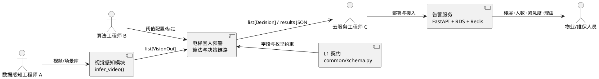
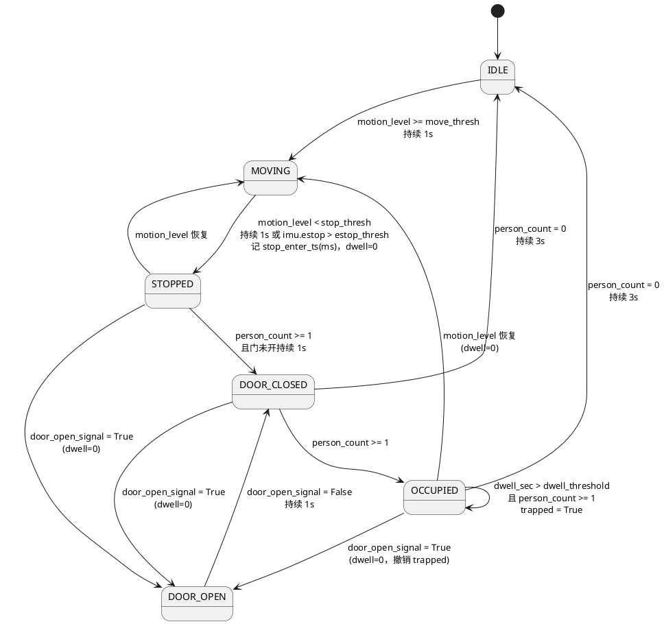
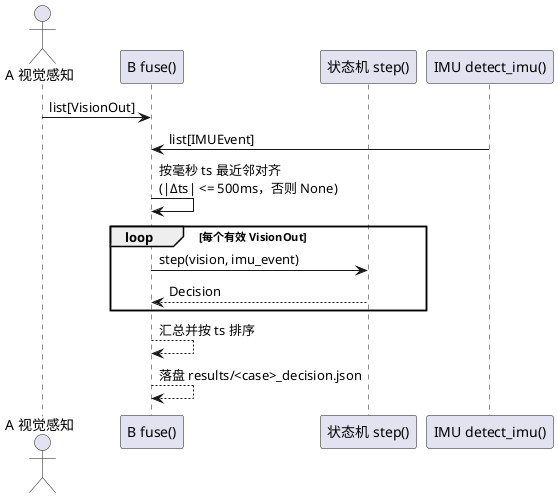

# 电梯困人主动预警系统 —— 需求规格说明书（EARS）

| 项目 | 内容 |
|---|---|
| 文档编号 | SPEC-ELEV-RESCUE-001 |
| 文档名称 | 昇腾上的「电梯困人预警」——算法与决策链路需求规格 |
| 版本 | v1.1（D1 基线，DEC-03 修订） |
| 状态 | 待评审（A/C/队长会签后转为已批准） |
| 编写日期 | 2026-11-17 |
| 责任人 | B（算法与决策） |
| 评审人 | A（数据与感知）、C（云服务与交付） |
| 上游基线 | L1 数据契约 v1.0（锁死，`CONTRACT_VERSION="L1-1.0"`）、L2 接口契约 v1.0 |
| 适用阶段 | D1–D15，D12 功能冻结 |
| 文档定位 | 回答“必须做出什么可验证的业务行为”，不回答“如何编码实现” |

---

## 0. 阅读指南

### 0.1 目的与范围

本文档定义“电梯困人主动预警”作品在**算法与决策链路**上的可测试需求，覆盖：

- IMU 事件检测（`detect_imu`）
- 困人状态机（`step`）
- 多模态融合判决（`fuse`）
- 紧急度分级、事件分类与可解释理由生成
- 降级路径、误报抑制、指标评估、消融实验、阈值配置
- 与 A（视觉）、C（云服务）之间的数据/接口契约

本文档**不覆盖**视觉模型训练细节、华为云部署脚本、数据库表结构与前端页面实现，这些分别由 A、C 负责。

### 0.2 EARS 句式约定

本文档全部需求采用 EARS（Easy Approach to Requirements Syntax）五类句式，并在条目头部标注类型：

| 类型 | 标注 | 句式模板 | 适用场景 |
|---|---|---|---|
| 普遍型 | `[普遍]` | 系统必须…… | 恒成立的结构性约束 |
| 事件驱动 | `[事件驱动]` | 当……时，系统必须…… | 由输入/触发条件驱动 |
| 状态驱动 | `[状态驱动]` | 在……状态下，系统必须…… | 状态机驻留期间的行为 |
| 非期望型 | `[非期望]` | 如果……，则系统必须…… | 异常、降级、防护 |
| 可选型 | `[可选]` | 若启用……，系统必须…… | 加分项，不阻塞 MVP |

### 0.3 优先级与 MVP 标记

| 优先级 | 含义 | 对 D12 冻结的影响 |
|---|---|---|
| P0 | MVP 必须实现、必须验收 | 缺失即视为交付失败 |
| P1 | MVP 内应当实现，允许降级但不允许缺失 | 需在风险表中登记 |
| P2 | 可选加分，不阻塞主路径 | 失败可整体回退，不影响验收 |

**MVP 范围**：全部 P0 + 已实现的 P1；不含 1D-CNN、不含昇腾 NPU 适配。
**可选范围**：`REQ-OPT-001`～`REQ-OPT-003`（1D-CNN 对比、昇腾适配、多路扩展）。

### 0.4 编号与追溯规则

- 需求编号格式：`REQ-<类别>-<三位序号>`。
- 类别：`FUNC`（功能）、`EXPL`（可解释性）、`DATA`（数据/接口）、`EVAL`（评测/消融）、`CFG`（配置）、`PERF`（性能）、`QUAL`（质量属性）、`CONST`（约束）、`OPT`（可选）、`ACC`（验收）。
- 每条需求末尾给出“追溯”，指向 L1/L2 契约项、验收条目或交付物。
- 契约标签定义：`L1-IMU`、`L1-VIDEO`、`L1-VISION`、`L1-IMUEVENT`、`L1-DECISION`、`L1-URGENCY`、`L1-REASON`、`L1-EVENT`、`L2-A`、`L2-B`、`L2-C`、`CARD`（任务卡/总览既有约束）。
- 编号一经发布不得复用；删除需求时保留编号并标注“已废弃”。

### 0.5 契约冲突消解记录

**DEC-01（必须会签）——`urgency=1` 与 `trapped` 的语义冲突**

- 冲突事实：L1 契约规定 `0→normal、1→estop、2→trapped/pry、3→faint`；而 B 初版判据写“`1 if trapped`”。
- 若照初版执行，会出现“`trapped=True` 但 `event_type=estop`”的语义错位，并让困人告警降级为“关注”。
- 本文档裁决：**以锁死的 L1 映射表为准**——`trapped=True` 时 `urgency` 必须 ≥2；`urgency=1` 只分配给 `estop`。
- 影响评估：不改变“困人必告警”的业务意图，只会把告警等级从 1 提升到 2，符合“公共安全优先”。
- 状态：待 D1 评审会确认；确认前按本文档执行，确认结果回写本表。

**DEC-02——门状态无真实信号**

- 电梯门开合状态没有独立硬件信号，MVP 使用“画面门缝区域变化”近似 `door_open_signal`。
- 该近似被明确登记为技术债（`REQ-FUNC-030`、`REQ-FUNC-043`），并在 `reason` 中输出 `technical_debt=door_signal_proxy`，答辩时不得隐去。

**DEC-03——`ts` 单位（v1.1 修订）**

- 冲突事实：v1.0 曾裁决 `ts` 为“相对该段视频/序列起点的整数秒（向下取整）”，该裁决与已锁死的 L1 数据契约冲突。`common/schema.py` 明确写为 `VisionOut.ts: int # 毫秒时间戳`、`IMUEvent.ts: int # 窗口结束的毫秒时间戳`、`Decision.ts: int # 毫秒时间戳（与 RDS BIGINT 对齐）`；L1 契约 6.5 节 `reason` 示例值为 `1763300000000`（13 位毫秒）。工程侧已按 L1 落地，契约测试 `tests/test_schema_contract.py` 11 项通过。
- 本文档裁决（v1.1）：**以锁死的 L1 契约为准——`ts` 为 Unix epoch 毫秒时间戳（整数，与 RDS BIGINT 对齐）**。本条不是新的自主选择，而是对既有契约的遵从；B 侧不得将 `ts` 解释为相对秒，也不得在 B 侧做单位变换后写回 `Decision`。
- 影响评估：所有时间差（dwell、时间对齐、窗口起点、持续性判定）必须显式按毫秒差值计算后再换算为秒（如 `dwell_ms / 1000.0`）；`window_sec=10.0` 仍为物理秒，不受影响；`reason` 中 `dwell` 仍以秒呈现，但必须由毫秒差值换算得来。
- 状态：v1.1 已按 L1 契约纠正，v1.0 的“整数秒”裁决作废；DEC-01、DEC-02 结论不变，无需重新会签。
- 追溯说明：`DEC-03 → common/schema.py CONTRACT_VERSION="L1-1.0" → tests/test_schema_contract.py`（11 项契约测试通过），三方一致由评审核对。

### 0.6 变更记录

| 版本 | 日期 | 变更内容 | 变更人 |
|---|---|---|---|
| v1.0 | 2026-11-17 | 首次建立 D1 需求基线，含 DEC-01～DEC-03 | B |
| v1.1 | 2026-11-17 | DEC-03 修订：`ts` 单位由整数秒纠正为毫秒时间戳，与 L1 契约对齐 | B |

---

## 1. 组件定位

### 1.1 核心职责

本组件负责融合电梯运行信号与轿厢视觉，推断困人状态并输出可解释分级告警。

### 1.2 核心输入

| 编号 | 输入 | 来源 | 内容概要 |
|---|---|---|---|
| IN-01 | `list[VisionOut]` | A 的 `infer_video(video_path)` | 逐帧人数、倒地概率、贴门程度、拥挤度、关键点质量 |
| IN-02 | `common/demo_data/<case>_imu.npy` | 场景库/现场采集 | `float32`，`(N,200,3)`，200 步@20Hz，通道 `[ax,ay,az]`，单位 m/s²，归一化到 `[-1,1]` |
| IN-03 | 阈值配置 | CLI / 配置文件 / 环境变量 | `dwell_threshold`、`fall_thresh`、`door_thresh`、`estop_thresh`、`idle_thresh` 等 |
| IN-04 | 场景元数据 | 场景库清单 | `case` 名（英文小写）、真值事件类型、是否演示模式 |
| IN-05 | 门缝区域变化 | 视觉侧派生 | 作为 `door_open_signal` 的代理信号（技术债，见 DEC-02） |

### 1.3 核心输出

| 编号 | 输出 | 目标 | 内容概要 |
|---|---|---|---|
| OUT-01 | `list[Decision]` | C 的告警服务、Demo 页面 | 每帧/每事件的 `trapped`、`urgency`、`event_type`、`location`、`people_count`、`confidence`、`reason` |
| OUT-02 | `results/<case>_decision.json` | 交付物/评审 | 每段视频一份 Decision 序列，UTF-8、字段符合 L1 |
| OUT-03 | `results/metrics.*`、`confusion_matrix.png`、`ablation.png` | 初赛材料 | 指标表、混淆矩阵、消融图，全部为真实测得的数字 |
| OUT-04 | `model/MODEL_CARD.md` | 初赛材料 | 数据来源、判据、指标、局限、演示参数声明 |
| OUT-05 | 结构化日志 | 运维/复现 | `case`、`ts`（毫秒）、`state`、`decision`、`reason`、生效阈值 |

### 1.4 职责边界（本组件不做什么）

1. **不做视觉推理**：YOLO-Pose、关键点、倒地/贴门/拥挤度全部由 A 的 `vision/` 产出，B 只消费 `VisionOut`。
2. **不做云侧服务**：HTTP 接口 `POST /api/v1/edge/report`、`GET /api/v1/alerts`、`POST /api/v1/alerts/{id}/ack`、RDS 落库、Redis 去重、Demo 页面由 C 负责。
3. **不改 L1 契约**：`common/schema.py` 的字段、类型、枚举、单位锁死；B 不得增删字段或改名。
4. **不做电梯控制**：不输出制动、复位、救援调度指令；只输出“处境判断 + 告警”。
5. **不接电梯厂商接口**：不逆向协议、不读取厂商故障码。
6. **不做身份识别**：不识别乘客身份、不保存人脸、不做人数以外的生物特征分析。
7. **不做机械故障诊断**：不判断钢缆、门机、变频器故障；`estop` 只作为“异常停机事件”，不是故障根因结论。
8. **MVP 不训练深度模型**：主路径为规则 + 信号处理；1D-CNN 仅为 P2 对比项。
9. **不用 10 秒 IMU 窗口直接判困人**：IMU 只做事件检测，困人由状态机与 dwell 判据给出（10s 与 180s 相差 18 倍）。
10. **不承诺商用精度**：5 段自建场景库的指标不外推为“真实电梯准确率”。

---

## 2. 领域术语

### 2.1 核心数据对象

**ts**
: 三个数据对象共有的时间戳字段，取值为 **Unix epoch 毫秒时间戳**（整数，13 位量级），与 RDS `BIGINT` 对齐。
: 备注：由 L1 契约锁死（见 DEC-03），禁止按“相对秒”或“段起点整数秒”理解；`VisionOut.ts` 为该帧时刻，`IMUEvent.ts` 为该窗口结束时刻，`Decision.ts` 沿用对应视觉帧时刻。

**VisionOut**
: A 侧视觉模块对单帧的感知结果，字段为 `ts`、`person_count`、`fall_prob`、`door_approach`、`crowded`、`keypoints_ok`。
: 备注：`person_count` 封顶 8；`fall_prob`、`door_approach`、`crowded` 均为 `[0,1]`。

**IMUEvent**
: B 侧对单个 200 步（10 秒）IMU 窗口的事件检测结果，字段为 `ts`、`estop`、`vibration`、`idle`、`window_sec`。
: 备注：`window_sec` 固定为 `10.0`；三个分数均为 `[0,1]`。

**Decision**
: B 侧融合判决的最终输出，字段为 `ts`、`device_id`、`trapped`、`urgency`、`location`、`people_count`、`event_type`、`confidence`、`reason`。
: 备注：字段集合与 `common/schema.py` 完全一致，不得增删。

**reason**
: `Decision` 中的可解释理由列表，只列本次触发的判据，每条必须带具体数值。
: 备注：标准写法如 `dwell=412s > 180s`、`fall_prob=0.87 > 0.70`、`imu.estop=0.92 > 0.80`。

**event_type**
: 事件类型枚举，取值 `normal | estop | trapped | pry | faint`。

**urgency**
: 紧急度枚举，取值 `0 | 1 | 2 | 3`，分别对应正常、关注、告警、紧急。

### 2.2 判据与状态术语

**trapped**
: 布尔判决，表示“停梯、门未开、轿厢内有人且滞留超过阈值”的困人状态。
: 备注：必须同时满足 `state == OCCUPIED`、`dwell_sec > dwell_threshold`、`person_count >= 1`。

**dwell_sec**
: 从电梯停稳（进入 `STOPPED`）到当前时刻的滞留秒数；门一旦打开立即清零。
: 备注：由 `ts` 毫秒差值换算得到（`dwell_ms = now_ts - stop_enter_ts`，`dwell_sec = dwell_ms / 1000.0`），不得把毫秒 `ts` 直接当作秒参与比较；演示环境与生产环境使用不同阈值，见“演示参数”。

**dwell_threshold**
: 判定困人的滞留阈值，生产默认 180 秒，演示默认 8 秒。

**OCCUPIED**
: 状态机中的“停梯且门关闭、轿厢内有人”状态，是产生 `trapped` 的唯一合法状态。

**estop**
: IMU 检测到的急停/异常停机事件分数，由加速度模长变化率在 0.5 秒短时突增映射到 `[0,1]`。
: 备注：`estop` 只表示“异常停机”，不等价于困人。

**vibration**
: IMU 窗口 FFT 后 2–8 Hz 频段能量占比过高所对应的分数。

**idle**
: IMU 窗口内加速度方差低于阈值所对应的“停着不动”分数，方差越小分数越高。

**keypoints_ok**
: A 侧给出的关键点质量标记；为 `False` 时 B 必须降级，不得使用 `fall_prob` 判“倒地”。

**门缝代理信号**
: 用画面中门缝区域变化近似电梯门开合状态的派生信号。
: 备注：无真实门信号，属登记技术债（DEC-02）。

### 2.3 评测与工程术语

**自建场景库**
: 由团队自建的 5 段/5 类演示场景集合（normal、estop、trapped、pry、faint 各至少 1 段）。
: 备注：所有指标必须限定为“在自建场景库（5 段/5 类）上测得”。

**演示参数**
: 为便于 15 天内演示而设置的阈值（如 `dwell_threshold=8s`），必须在文档、日志与 `reason` 中显式标记。

**误报**
: 非困人场景被输出为 `trapped=True` 的情况。

**漏报**
: 困人场景未被输出为 `trapped=True` 的情况。

**消融实验**
: 在完整系统基础上分别去掉某一判据/通道/滤波，观察指标变化的对照实验。

**降级**
: 某路输入或模型不可用时，系统按预定义规则降低能力但继续输出合法 `Decision` 的行为。

---

## 3. 角色与边界

### 3.1 核心角色

- **算法工程师 B**：实现 `model/` 下的 IMU 检测、状态机、融合、评测；维护本文档与 `MODEL_CARD.md`。
- **数据感知工程师 A**：提供 `VisionOut` 序列、5 段场景视频与 `DATA_DICT.md`；负责可选的昇腾适配。
- **云服务工程师 C**：消费 `Decision`，实现 HTTP、RDS、Redis、Demo 页面与部署。
- **物业/维保人员**：告警的最终处置者，需要看到楼层、人数、紧急度与判定理由。
- **评审专家**：依据初赛材料核验创新性、应用价值、指标真实性与可解释性。

### 3.2 外部系统

- **视觉感知模块（A）**：输入视频，输出 `list[VisionOut]`；B 只调用 `infer_video(video_path)`。
- **L1 数据契约（`common/schema.py`）**：提供三个 dataclass 与枚举定义，锁死不可改。
- **IMU 场景数据**：`common/demo_data/<case>_imu.npy`，满足 L1 形状与归一化要求。
- **评测工具链**：`model/eval.py`、`results/`、matplotlib 出图。
- **告警服务（C）**：`POST /api/v1/edge/report` 接收 `Decision`；`GET /api/v1/alerts?status=active` 与 `POST /api/v1/alerts/{id}/ack` 面向物业。
- **昇腾端侧运行时（可选）**：P2 阶段由 A 负责适配，B 提供规则模块的可移植性与一致性验证。

### 3.3 交互上下文

---

## 4. DFX 约束

### 4.1 性能

| 指标 | 红线 | 测量条件 |
|---|---|---|
| 单窗口 IMU 检测 | ≤ 1.0 s | CPU 单核，200×3 输入 |
| B 侧 5 段融合+评测 | ≤ 60 s | 不含 A 的视频推理 |
| B 侧内存峰值 | ≤ 500 MB | 单进程，5 段顺序处理 |
| 冷启动导入 | ≤ 3 s | `import model.*` 到可调用 |

### 4.2 可靠性

- 断网、无 GPU 必须可完整运行（端侧定位）。
- 同一输入重复运行，`Decision` 逐字段一致。
- 任一路输入缺失时不得崩溃，必须输出带降级标记的合法 `Decision`。

### 4.3 安全性

- 不落盘原始视频帧、不保存人脸、不做身份识别。
- 日志不得包含真实设备编号、真实楼层住户信息；`device_id` 使用演示编号。
- 关键操作（阈值变更、演示模式切换）必须留痕。

### 4.4 可维护性

- 阈值集中在单一配置源，禁止魔法数散落。
- 日志采用 JSON Lines，至少含 `case`、`ts`（毫秒）、`state`、`decision`、`reason`。
- 状态机为纯函数式推进，可用假数据单测。

### 4.5 兼容性

- Python 3.10/3.11；依赖锁版本；Windows 与 Linux 均可运行。
- 接口变更必须新增字段时，只能走 L1 契约评审，不得在 B 侧私自扩展 `Decision`。

### 4.6 DFX 需求条目

#### 性能需求

**REQ-PERF-001｜普遍｜P0｜IMU 单窗时延**
系统必须保证单个 200 步 IMU 窗口的检测耗时不超过 1.0 秒（CPU 单核）。
- 验收：对 5 段 npy 计时，单窗 P95 ≤ 1.0 s。
- 追溯：CARD（断网端侧）、L2-B。

**REQ-PERF-002｜普遍｜P0｜批量处理时延**
系统必须保证 5 段场景的 `fuse` + `eval` 总耗时不超过 60 秒（不含视频推理）。
- 验收：`python model/eval.py --cases all` 的 B 侧耗时 ≤ 60 s。
- 追溯：CARD（15 天节奏）、REQ-EVAL-007。

**REQ-PERF-003｜普遍｜P0｜内存上限**
系统必须保证 B 侧单进程内存峰值不超过 500 MB。
- 验收：处理 5 段时采样 RSS，峰值 ≤ 500 MB。
- 追溯：CARD（端侧/云主机资源约束）。

**REQ-PERF-004｜普遍｜P0｜离线可运行**
系统必须在不联网、不使用 GPU 的条件下完成检测、融合与评测。
- 验收：断网环境执行端到端命令，5 份 Decision JSON 正常产出。
- 追溯：CARD（昇腾端侧、断网运行）。

#### 质量属性需求

**REQ-QUAL-001｜普遍｜P0｜确定性**
系统必须保证同一输入、同一配置下多次运行输出的 `Decision` 逐字段一致。
- 验收：连续运行 3 次，JSON 深度比较完全相等（浮点按 1e-6 容差）。
- 追溯：CARD（可复现）、REQ-EVAL-007。

**REQ-QUAL-002｜非期望｜P0｜非法输入不崩溃**
如果输入 npy 形状不符、视频缺失、`VisionOut` 字段越界，则系统必须给出受控错误或降级结果，不得抛出未捕获异常导致进程退出。
- 验收：注入 5 类非法输入，进程退出码为 0 或带明确错误码的非零值，且日志含原因。
- 追溯：REQ-FUNC-006、REQ-FUNC-043。

**REQ-QUAL-003｜普遍｜P1｜结构化日志**
系统必须以 JSON Lines 记录每次判决，至少包含 `case`、`ts`（毫秒）、`state`、`decision`、`reason`、生效阈值。
- 验收：任取一次运行，日志可逐行被 JSON 解析，字段齐全。
- 追溯：REQ-CFG-005、REQ-EVAL-008。

**REQ-QUAL-004｜普遍｜P0｜可测试性**
状态机必须可在不依赖真实视频与 npy 的条件下，通过注入假 `VisionOut`/`IMUEvent` 推进到任一状态。
- 验收：单测覆盖 6 个状态及关键转移，假数据可跑到 `OCCUPIED`。
- 追溯：REQ-ACC-002、CARD（假数据验收）。

**REQ-QUAL-005｜普遍｜P0｜模块边界**
`model/` 不得导入 `vision/`、`service/`、`dashboard/`，不得修改 `common/schema.py`。
- 验收：静态检查 import 图，无越界依赖；`git diff` 不含 `common/schema.py`。
- 追溯：CARD（B 不碰 A/C 目录）、REQ-CONST-003。

**REQ-QUAL-006｜普遍｜P1｜跨平台**
系统必须使用与平台无关的路径处理，在 Windows 与 Linux 上均可执行同一命令。
- 验收：两平台各跑一次端到端，路径分隔符与编码无差异。
- 追溯：REQ-DATA-007、REQ-CONST-010。

---

## 5. 核心能力

### 5.1 IMU 事件检测

**能力说明**：`detect_imu(npy_path)` 将 IMU 序列按 200 步滑窗切分，输出每个窗口的 `IMUEvent`。该模块只回答“是否急停、是否振动异常、是否静止”，不回答“是否困人”。

**REQ-FUNC-001｜事件驱动｜P0｜窗口化输出**
当 `detect_imu` 接收到符合 L1 的 `.npy` 文件时，系统必须按 200 步窗口输出 `list[IMUEvent]`，输出条数等于完整窗口数。
- 验收：输入 `N=600` → 返回 3 条；`N=650` → 返回 3 条并记录尾部丢弃日志。
- 追溯：L1-IMU、L2-B（`detect_imu`）。

**REQ-FUNC-002｜普遍｜P0｜estop 计算**
系统必须基于加速度模长变化率 `|Δ|a||/Δt` 在 0.5 秒短时窗口内的突增程度计算 `estop`，并映射到 `[0,1]`。
- 验收：注入人工急停脉冲（0.5 s 内模长变化 > 3 倍基线）→ `estop ≥ 0.8`；平稳段 → `estop < 0.8`。
- 追溯：CARD（estop 判据）。

**REQ-FUNC-003｜普遍｜P0｜vibration 计算**
系统必须对 200 步窗口做 FFT，按 2–8 Hz 频段能量占比计算 `vibration`，输出 `[0,1]`。
- 验收：注入 5 Hz 单频振动 → `vibration` 显著高于平稳段；输出不越界。
- 追溯：CARD（vibration 判据）。

**REQ-FUNC-004｜普遍｜P0｜idle 计算**
系统必须按窗内加速度方差低于阈值计算 `idle`，方差越小 `idle` 越接近 1。
- 验收：全零/近零方差窗口 → `idle ≥ 0.9`；持续运动窗口 → `idle ≤ 0.2`。
- 追溯：CARD（idle 判据）、REQ-FUNC-028。

**REQ-FUNC-005｜普遍｜P0｜窗口元数据**
系统必须保证每条 `IMUEvent.window_sec` 恒为 `10.0`（物理秒），且 `ts` 为该窗口结束的 Unix epoch 毫秒时间戳，按毫秒单调递增、相邻 `ts` 之差恒为 `10000 ms`（200 步 @20Hz）。
- 验收：任取一段 npy，所有 `window_sec == 10.0`；所有 `ts` 为 13 位毫秒整数，相邻差为 10000 ms。
- 追溯：L1-IMUEVENT、DEC-03、REQ-DATA-002。

**REQ-FUNC-006｜非期望｜P0｜非法 npy 防护**
如果 npy 含 `NaN/Inf`、`dtype` 非 `float32` 或形状不等于 `(N,200,3)`，则系统必须抛出带文件名与形状信息的 `ValueError`，不得静默输出。
- 验收：5 类畸形输入均得到明确异常文本，且不产生半成品结果。
- 追溯：REQ-QUAL-002、L1-IMU。

**REQ-FUNC-007｜非期望｜P0｜职责隔离**
系统不得在 `detect_imu` 中输出 `trapped`/`urgency`，也不得读取视频或导入视觉模块。
- 验收：函数返回类型仅含 `IMUEvent` 字段；import 图无 `vision/`。
- 追溯：CARD（IMU 只做事件检测）、REQ-QUAL-005。

**REQ-FUNC-008｜非期望｜P0｜不足一窗处理**
如果 npy 长度小于 200 步（不足一个完整窗口），则系统必须返回空列表并记录 WARN，不得补零伪造事件。
- 验收：`N=199` → 返回 `[]`，日志含“insufficient window”。
- 追溯：L1-IMU、REQ-QUAL-002。

### 5.2 困人状态机

**能力说明**：`step(vision, imu_event) -> Decision` 以逐帧方式推进状态机，维护 `dwell_sec`，并在 `OCCUPIED` 状态下给出 `trapped` 判决。状态机是“时序证据”的唯一持有者。本节所有“持续 N 秒”的判定，一律按 `ts` 毫秒差值计算（`Δms ≥ N × 1000`），不得用毫秒 `ts` 直接与秒阈值比较。

**REQ-FUNC-009｜普遍｜P0｜状态集合与初始态**
系统必须且仅使用 `IDLE`、`MOVING`、`STOPPED`、`DOOR_OPEN`、`DOOR_CLOSED`、`OCCUPIED` 六个状态，初始状态必须为 `IDLE`。
- 验收：新建状态机实例首帧输出 `state == IDLE`；代码中无第七个状态常量。
- 追溯：CARD（状态机定义）、L1-DECISION。

**REQ-FUNC-010｜普遍｜P0｜转移表完备**
系统必须提供覆盖六状态全部输入组合的转移表，每个状态对“运动恢复/停稳/门开/门关/有人/无人/超时”均有确定下一状态或自环，不得存在未定义转移。
- 验收：附录 B 转移表逐格检查无空白；未覆盖组合触发时保持原状态并记录 WARN。
- 追溯：CARD（需定义每状态进入/退出/超时）、附录 B。

**REQ-FUNC-011｜事件驱动｜P0｜进入 MOVING**
当状态为 `IDLE` 且 `motion_level ≥ move_thresh` 持续不少于 1 秒（`Δts ≥ 1000 ms`）时，系统必须转移到 `MOVING`。
- 验收：注入连续 25 帧（1 s@25fps）运动信号 → 状态变为 `MOVING`。
- 追溯：CARD（MOVING）、REQ-FUNC-020。

**REQ-FUNC-012｜事件驱动｜P0｜停稳记时**
当状态为 `MOVING` 且 `motion_level < stop_thresh` 持续不少于 1 秒（`Δts ≥ 1000 ms`），或 `imu.estop > estop_thresh` 时，系统必须转移到 `STOPPED`，记录 `stop_enter_ts`（Unix epoch 毫秒时间戳）并将 `dwell_sec` 置 0。
- 验收：运动 2 s 后静止 1 s → `state=STOPPED`，`dwell_sec≈0`。
- 追溯：CARD（STOPPED、dwell 起点）。

**REQ-FUNC-013｜事件驱动｜P0｜门开转移**
当 `door_open_signal` 为真且状态属于 `STOPPED`、`DOOR_CLOSED`、`OCCUPIED` 之一时，系统必须转移到 `DOOR_OPEN`。
- 验收：在 `OCCUPIED` 注入门开 → 状态立即变为 `DOOR_OPEN`。
- 追溯：CARD（DOOR_OPEN）、DEC-02。

**REQ-FUNC-014｜状态驱动｜P0｜门开期间滞留清零**
在 `DOOR_OPEN` 状态下，系统必须保持 `dwell_sec == 0`，不得累计滞留时间。
- 验收：门开持续 60 s，`dwell_sec` 始终为 0。
- 追溯：CARD（门一开立刻清零）、REQ-FUNC-044。

**REQ-FUNC-015｜事件驱动｜P0｜关门转移**
当状态为 `DOOR_OPEN` 且 `door_open_signal` 为假持续不少于 1 秒（`Δts ≥ 1000 ms`）时，系统必须转移到 `DOOR_CLOSED`。
- 验收：门开 3 s 后关闭 → 状态变为 `DOOR_CLOSED`。
- 追溯：CARD（DOOR_CLOSED）。

**REQ-FUNC-016｜事件驱动｜P0｜进入 OCCUPIED**
当状态为 `DOOR_CLOSED` 且 `person_count ≥ 1` 时，系统必须转移到 `OCCUPIED`。
- 验收：门关且人数 2 → `state=OCCUPIED`。
- 追溯：CARD（OCCUPIED）、L1-VISION。

**REQ-FUNC-017｜事件驱动｜P0｜到站放人**
当状态为 `OCCUPIED` 且 `door_open_signal` 为真时，系统必须转移到 `DOOR_OPEN`，将 `dwell_sec` 清零并撤销 `trapped`。
- 验收：`OCCUPIED` 持续 300 s 后门开 → 当帧 `trapped=False`、`dwell_sec=0`。
- 追溯：CARD（正常到站门开即清零）、REQ-FUNC-044。

**REQ-FUNC-018｜事件驱动｜P0｜空梯退出**
当状态为 `OCCUPIED` 且 `person_count == 0` 持续不少于 3 秒（`Δts ≥ 3000 ms`）时，系统必须转移到 `IDLE`，并将 `dwell_sec` 清零。
- 验收：连续 75 帧人数为 0 → 状态变为 `IDLE`。
- 追溯：CARD（误检抑制）、REQ-FUNC-045。

**REQ-FUNC-019｜状态驱动｜P0｜困人判决**
在 `OCCUPIED` 状态下，当 `dwell_sec > dwell_threshold` 且 `person_count ≥ 1` 时，系统必须输出 `trapped=True`。
- 验收：`dwell_threshold=8s`（演示），滞留 9 s 且有人 → `trapped=True`。
- 追溯：CARD（困人判据）、L1-DECISION。

**REQ-FUNC-020｜普遍｜P0｜dwell 定义**
系统必须按 `dwell_ms = now_ts - stop_enter_ts`、`dwell_sec = dwell_ms / 1000.0` 计算滞留秒数（`now_ts`、`stop_enter_ts` 均为 Unix epoch 毫秒时间戳），且门开后基准时间重置为门关闭时刻。
- 验收：`stop_enter_ts=1763300000000`、`now_ts=1763300190000`、门未开 → `dwell_ms=190000`、`dwell_sec=190.0`。
- 追溯：CARD（dwell 定义）、DEC-03。

**REQ-FUNC-021｜非期望｜P0｜时序保护**
如果输入 `ts` 回退或与上一帧重复，则系统必须丢弃该帧并记录 WARN，不得让 `dwell_sec` 回退或重复累加。
- 验收：注入 `ts=1763300000000, 1763300000000, 1763299999000, 1763300001000` → 仅首帧与末帧生效，`dwell_sec` 单调不减。
- 追溯：REQ-QUAL-001、REQ-QUAL-003。

**REQ-FUNC-022｜非期望｜P0｜IMU 缺帧推进**
当 `step` 收到 `imu_event=None` 时，系统必须仅依靠视觉信号推进状态机，`dwell_sec` 仍按 `ts` 毫秒差值换算累加（`Δms / 1000.0`），且不得崩溃。
- 验收：全序列 `imu_event=None`，状态仍可到 `OCCUPIED` 并判决。
- 追溯：CARD（融合容错）、REQ-FUNC-039。

**REQ-FUNC-023｜状态驱动｜P0｜非 OCCUPIED 不判困人**
在 `IDLE`、`MOVING`、`STOPPED`、`DOOR_OPEN`、`DOOR_CLOSED` 任一状态下，`trapped` 必须为 `False`。
- 验收：构造 `dwell` 超阈值但状态为 `STOPPED` → `trapped=False`。
- 追溯：CARD（困人判据）。

**REQ-FUNC-024｜事件驱动｜P0｜逐帧 Decision 完整**
当 `step` 完成一次推进时，系统必须返回字段完整、类型合法的 `Decision`，其中 `reason` 至少包含一条带数值的说明。
- 验收：逐帧输出通过 `Decision` 字段校验；`reason` 非空。
- 追溯：L1-DECISION、REQ-EXPL-001。

### 5.3 多模态融合判决

**能力说明**：`fuse(vision, imu) -> list[Decision]` 按时间对齐两路信号，将 IMU 事件作为“停梯/静止/急停”的辅助证据注入状态机，并处理关键点降级与门信号代理。

**REQ-FUNC-025｜事件驱动｜P0｜逐帧融合输出**
当 `fuse` 接收到 `list[VisionOut]` 与非空 `list[IMUEvent]` 时，系统必须为每个有效 `VisionOut` 输出一条 `Decision`，条数等于有效视觉帧数。
- 验收：输入 750 个 `VisionOut` → 返回 750 条 `Decision`。
- 追溯：L2-B（`fuse`）、L1-DECISION。

**REQ-FUNC-026｜普遍｜P0｜时间对齐策略**
系统必须按毫秒 `ts` 将每个 `VisionOut` 与最近的 `IMUEvent` 对齐：`|Δts| ≤ 500 ms` 时取该事件，否则取 `None`；前向保持不得超过 `10000 ms`。
- 验收：构造相邻 `IMUEvent.ts`（窗口结束时刻）间隔 10000 ms 的序列，视觉帧位于该事件 `ts` 后 11000 ms → 对齐结果为 `None`。
- 追溯：L2-B、REQ-FUNC-022、DEC-03。

**REQ-FUNC-027｜事件驱动｜P0｜急停加速计时**
当对齐到的 `imu.estop > estop_thresh` 时，系统必须对 `dwell` 计时应用加速系数（默认 2.0，可配置），并在 `reason` 中记录 `imu.estop` 与加速事实。
- 验收：`estop=0.92`、真实滞留 100 s → 有效 `dwell` 约 200 s，`reason` 含 `imu.estop=0.92`。
- 追溯：CARD（融合：estop 加速 dwell）。

**REQ-FUNC-028｜事件驱动｜P0｜静止确认**
当 `imu.idle > idle_thresh` 时，系统必须将其作为“电梯停着不动”的辅助证据写入判决上下文，并在 `reason` 中输出 `imu.idle` 数值。
- 验收：`idle=0.95` 的停梯场景，`reason` 含 `imu.idle=0.95`。
- 追溯：CARD（idle 持续确认停着不动）。

**REQ-FUNC-029｜非期望｜P0｜关键点降级**
如果 `keypoints_ok == False`，则系统必须将 `fall_prob` 权重降为 0（或配置的降权值），不得据此判定 `faint`，并在 `reason` 中加入 `keypoints_unreliable`。
- 验收：`keypoints_ok=False`、`fall_prob=0.99` → `event_type != faint`，`reason` 含 `keypoints_unreliable`。
- 追溯：CARD（keypoints 降级）、REQ-EXPL-005。

**REQ-FUNC-030｜普遍｜P0｜门信号代理**
系统必须在无真实门信号时使用画面门缝区域变化近似 `door_open_signal`，并在判决上下文中标注 `technical_debt=door_signal_proxy`。
- 验收：任一门开相关判决的 `reason` 含该标记或日志含该字段。
- 追溯：DEC-02、CARD（技术债需承认）。

**REQ-FUNC-031｜非期望｜P0｜空视觉输入**
如果 `vision` 为空或全部帧无效，则系统必须返回空 `Decision` 列表（或单条 `normal` 且 `confidence=0`），不得凭 IMU 单独伪造 `trapped=True`。
- 验收：`vision=[]`、`imu` 含强 estop → 输出无 `trapped=True`。
- 追溯：CARD（IMU 不做困人判定）、REQ-FUNC-007。

### 5.4 紧急度分级与事件分类

**能力说明**：在 `trapped` 判决基础上，结合倒地、贴门、静止等证据给出 `urgency` 与 `event_type`；所有取值必须满足 L1 映射表。

**REQ-FUNC-032｜普遍｜P0｜紧急度枚举与映射**
系统必须保证 `urgency ∈ {0,1,2,3}`，且满足映射：`0↔normal`、`1↔estop`、`2↔trapped/pry`、`3↔faint`。
- 验收：枚举校验覆盖全部输出；不存在 `urgency=1` 且 `event_type=trapped`。
- 追溯：L1-URGENCY、DEC-01、附录 A。

**REQ-FUNC-033｜事件驱动｜P0｜faint 判定**
当 `trapped=True`、`keypoints_ok=True` 且 `fall_prob > fall_thresh` 时，系统必须输出 `urgency=3`、`event_type=faint`。
- 验收：`fall_prob=0.87`、`fall_thresh=0.70`、`trapped=True` → `urgency=3`、`faint`。
- 追溯：CARD（紧急度 3）、REQ-EXPL-003。

**REQ-FUNC-034｜事件驱动｜P0｜pry 判定**
当 `trapped=True`、`keypoints_ok=True` 且 `door_approach > door_thresh` 时，系统必须输出 `urgency=2`、`event_type=pry`。
- 验收：`door_approach=0.82`、`door_thresh=0.60` → `urgency=2`、`pry`。
- 追溯：CARD（扒门/拍门求助）、L1-EVENT。

**REQ-FUNC-035｜事件驱动｜P0｜trapped 基准等级**
当 `trapped=True` 且不满足 `faint`/`pry` 条件时，系统必须输出 `urgency=2`、`event_type=trapped`（按 DEC-01，不得降为 1）。
- 验收：仅 `dwell` 超阈值、有人、无倒地/贴门 → `urgency=2`、`trapped`。
- 追溯：DEC-01、L1-URGENCY。

**REQ-FUNC-036｜事件驱动｜P0｜estop 判定**
当未形成 `trapped` 且 `imu.estop > estop_thresh` 时，系统必须输出 `urgency=1`、`event_type=estop`。
- 验收：`estop=0.92`、`dwell=12s ≤ 阈值` → `urgency=1`、`estop`。
- 追溯：CARD（estop 语义）、附录 A。

**REQ-FUNC-037｜事件驱动｜P0｜normal 判定**
当无 `trapped`、无 `estop` 超阈值且无其他异常证据时，系统必须输出 `urgency=0`、`event_type=normal`。
- 验收：正常乘梯到站开门序列 → 全部 `normal`、`trapped=False`。
- 追溯：L1-EVENT、REQ-FUNC-044。

**REQ-FUNC-038｜普遍｜P0｜置信度与楼层**
系统必须输出 `[0,1]` 的 `confidence`，由已触发证据的归一化分数聚合得到；`location` 必须来自画面楼层识别或场景标注，无法估计时必须填 `"?"`，禁止编造楼层。
- 验收：无楼层信息的场景 `location == "?"`；`confidence` 不越界。
- 追溯：L1-DECISION、CARD（估不出填 ?）。

### 5.5 降级与鲁棒性

**REQ-FUNC-039｜非期望｜P0｜IMU 缺失降级**
如果 IMU 文件缺失或不可读，则系统必须退化为视觉单路模式继续输出 `Decision`，`reason` 标注 `imu_unavailable`，且该场景下不得输出 `urgency=3`。
- 验收：删除 npy 后运行 → 有 Decision 输出、含 `imu_unavailable`、无 `faint`。
- 追溯：CARD（降级路径）、REQ-FUNC-022。

**REQ-FUNC-040｜非期望｜P0｜视频规格防护**
如果视频分辨率、编码或帧率不符合 L1（1280×720、H.264、25fps），则系统必须以明确错误提示拒绝处理，并给出转码建议，不得静默输出错误结果。
- 验收：输入 640×480 视频 → 报错含实际规格与要求规格。
- 追溯：L1-VIDEO、REQ-QUAL-002。

**REQ-FUNC-041｜非期望｜P0｜人数封顶**
如果 `person_count > 8`，则系统必须按 8 封顶输出，并在日志中保留原始计数用于排查。
- 验收：输入 `person_count=12` → 输出 `people_count=8`，日志含 `raw_person_count=12`。
- 追溯：L1-VISION（0–8 封顶）。

**REQ-FUNC-042｜非期望｜P1｜假数据联调模式**
如果 A 侧视觉推理尚未就绪，则系统必须支持基于假数据/固定样本的联调模式，跑通状态机、融合与输出全链路。
- 验收：`--mock` 模式生成 5 份 Decision JSON，字段合法。
- 追溯：CARD（D2–D3 状态机假数据）、REQ-ACC-002。

**REQ-FUNC-043｜非期望｜P0｜降级标记不破坏契约**
任何降级场景下，系统仍必须输出符合 L1 字段集合的 `Decision`，降级信息只能写入 `reason`/日志，不得新增 schema 字段。
- 验收：降级运行输出通过 schema 校验；JSON 无额外字段。
- 追溯：L1-DECISION、REQ-DATA-001。

### 5.6 误报抑制

**能力说明**：以“正常场景零误报”为第一优先级，对五类典型误报逐一给出可测试的抑制规则。

| 误报场景 | 抑制手段 | 需求编号 |
|---|---|---|
| 正常到站停车 | 门开即清零 `dwell`、撤销 `trapped` | REQ-FUNC-044 |
| 检修停梯/空梯 | `person_count=0` 不判困人 | REQ-FUNC-045 |
| 蹲下捡东西 | 倒地需持续 ≥3 s 且髋部高度低 | REQ-FUNC-046 |
| 人多拥挤 | 降人数置信但不抑制告警 | REQ-FUNC-047 |
| 轻微晃动 | estop 需 0.5 s 突变且过阈值 | REQ-FUNC-048 |

**REQ-FUNC-044｜事件驱动｜P0｜正常到站零误报**
当门打开时，系统必须立即将 `dwell_sec` 清零、撤销 `trapped`，并输出 `normal`。
- 验收：正常场景 1 段完整视频，`trapped=True` 出现次数为 0。
- 追溯：CARD（正常到站门开即清零）、REQ-ACC-005。

**REQ-FUNC-045｜状态驱动｜P0｜空梯不告警**
在 `person_count == 0` 时，系统必须保持 `trapped=False`，即使 `dwell` 超阈值。
- 验收：检修停梯 600 s、人数 0 → 全部 `normal`。
- 追溯：CARD（检修停梯 person_count=0 不报）。

**REQ-FUNC-046｜普遍｜P0｜倒地持续性**
系统必须在 `fall_prob` 超阈值且持续不少于 3 秒（`Δts ≥ 3000 ms`）、同时满足髋部高度低于阈值时，才允许判定 `faint`；单帧或短时弯腰不得触发。
- 验收：注入 2 s 蹲下 → 不判 `faint`；注入 5 s 倒地 → 判 `faint`。
- 追溯：CARD（蹲下捡东西：3 秒持续性+髋部高度）。

**REQ-FUNC-047｜事件驱动｜P1｜拥挤不抑制告警**
当 `crowded` 较高时，系统必须降低 `people_count` 的置信度并在 `reason` 中记录 `crowded`，但不得因此将 `trapped=True` 改为 `False`。
- 验收：`crowded=0.9`、`trapped=True` → 仍输出 `trapped=True`，`reason` 含 `crowded=0.90`。
- 追溯：CARD（人多拥挤：降置信但不因此不报）。

**REQ-FUNC-048｜普遍｜P0｜轻微晃动不触发急停**
系统必须仅在 0.5 秒短时窗口内模长变化率突增且 `estop > estop_thresh` 时判定急停，日常轻微晃动不得触发。
- 验收：注入日常晃动样本 → `estop < 0.8`，无 `estop` 事件。
- 追溯：CARD（轻微晃动：IMU 阈值不设太低）、REQ-FUNC-002。

**REQ-FUNC-049｜事件驱动｜P0｜阈值边界行为**
当滞留时间恰好等于阈值时，系统不得判困人；仅当严格大于阈值且门未开、有人时才判困人。
- 验收：`dwell=179s` 后开门 → 无 `trapped`；`dwell=181s` 未开门 → `trapped=True`。
- 追溯：CARD（dwell > 阈值）、REQ-FUNC-019。

**REQ-FUNC-050｜普遍｜P0｜标定优先级**
系统标定必须遵循“正常场景零误报优先于困人全检出”的顺序：先消除正常场景误报，再在剩余阈值空间内提升召回。
- 验收：标定记录中先给出正常场景误报数=0，再给出困人召回；顺序颠倒视为不满足。
- 追溯：CARD（宁可漏不可误报）。

### 5.7 端到端演示链路

**REQ-FUNC-051｜事件驱动｜P0｜5 段端到端**
当执行端到端命令处理 5 段场景视频时，系统必须产出 5 份 `<case>_decision.json`，且每份均为合法 `Decision` 序列。
- 验收：D7 前完成，5 个文件齐全、可解析、字段合法。
- 追溯：CARD（D7 端到端）、REQ-ACC-004。

**REQ-FUNC-052｜普遍｜P0｜五类事件覆盖**
系统演示场景库必须覆盖 `normal`、`estop`、`trapped`、`pry`、`faint` 五类事件，每类至少 1 段。
- 验收：场景清单中五类各 ≥1，且端到端输出包含五类 `event_type`。
- 追溯：CARD（5 段/5 类）、REQ-ACC-003。

**REQ-FUNC-053｜事件驱动｜P0｜告警要素展示**
当产生 `urgency ≥ 2` 的 `Decision` 时，系统必须使 Demo/CLI 可展示四项要素：停梯位置（`location`）、被困人数（`people_count`）、紧急程度（`urgency`）、判定理由（`reason`）。
- 验收：任取一条告警，四项要素均可读且非空（`location` 允许为 `"?"`）。
- 追溯：CARD（输出停梯位置+人数+紧急程度）、REQ-ACC-006。

**REQ-FUNC-054｜普遍｜P0｜一键复现**
系统必须提供固定命令复现端到端与评测结果，固定输入、固定配置、固定随机种子。
- 验收：同一命令连续执行两次，`metrics` 与 `Decision` 一致。
- 追溯：REQ-QUAL-001、REQ-EVAL-007。

**5.7.1 异常场景汇总**

| 异常场景 | 触发条件 | 系统行为 | 用户感知 |
|---|---|---|---|
| IMU 文件缺失 | npy 不存在/损坏 | 退化为视觉单路，`reason` 加 `imu_unavailable` | 仍有 Decision，标注降级 |
| 视频规格不符 | 非 1280×720/H.264/25fps | 拒绝处理并给出转码建议 | 明确错误文本 |
| 关键点不可靠 | `keypoints_ok=False` | 关闭倒地判据，写 `keypoints_unreliable` | 告警等级不高于 2 |
| 时序抖动 | `ts` 回退/重复 | 丢弃异常帧并 WARN | 判决继续，指标不受污染 |
| 视觉空输入 | `vision=[]` | 不伪造困人，输出空/低置信 | 不产生虚假告警 |
| 人数超限 | `person_count>8` | 封顶 8，保留原始值日志 | 页面最多显示 8 人 |

---

## 6. 可解释性需求

**能力说明**：可解释性是本作品与“只报故障码”的现有电梯物联网的核心差异。每次判决都必须能被人读懂、被人复核、被人追责。

**REQ-EXPL-001｜普遍｜P0｜理由非空**
系统必须保证每条 `Decision` 的 `reason` 为非空列表，包括 `normal` 判决。
- 验收：对 5 段输出逐条检查，`len(reason) ≥ 1` 的比例为 100%。
- 追溯：CARD（每次报警列人类可读理由）、REQ-ACC-006。

**REQ-EXPL-002｜普遍｜P0｜只列触发项**
系统必须只列出本次实际触发的判据；`normal` 判决允许列出 1 条状态说明（如 `dwell=3s <= 180s`），不得罗列全部未触发项。
- 验收：`normal` 的 `reason` 条数 ≤ 2；告警的每条理由均能在当帧证据中找到对应数值。
- 追溯：CARD（只列触发的条目）。

**REQ-EXPL-003｜普遍｜P0｜数值化格式**
`reason` 的每条文本必须包含具体数值，并采用 `<key>=<value> <比较符> <threshold>` 或 `<key>=<value>` 形式，例如 `dwell=412s > 180s`、`fall_prob=0.87 > 0.70`、`imu.estop=0.92`。
- 验收：正则抽检 100% 命中“键=数值”结构；无纯文字条目。
- 追溯：CARD（每条带具体数值）、L1-REASON。

**REQ-EXPL-004｜普遍｜P0｜键名白名单**
`reason` 必须使用标准键名：`dwell`、`person_count`、`fall_prob`、`door_approach`、`crowded`、`motion_level`、`imu.estop`、`imu.idle`、`imu.vibration`、`keypoints_unreliable`、`technical_debt`、`demo_threshold`、`imu_unavailable`。
- 验收：键名扫描无白名单之外的业务键；新增键须先更新本节。
- 追溯：L1-REASON、附录 C。

**REQ-EXPL-005｜非期望｜P0｜关键点降级可见**
如果 `keypoints_ok == False`，则 `reason` 必须包含 `keypoints_unreliable`，且不得出现仅凭 `fall_prob` 得出的 `faint` 结论。
- 验收：降级样本的 `reason` 含该标记，且 `event_type != faint`。
- 追溯：CARD（keypoints 降级）、REQ-FUNC-029。

**REQ-EXPL-006｜非期望｜P0｜演示参数显式**
如果本次判决使用了演示阈值，则 `reason` 必须包含 `demo_threshold=true` 及该阈值数值（如 `dwell=95s > 8s`），禁止把演示结论表述为生产结论。
- 验收：演示模式输出 100% 含标记；生产模式不含该标记。
- 追溯：CARD（必须标明演示参数）、REQ-CFG-003。

**REQ-EXPL-007｜非期望｜P0｜禁止空话**
系统不得输出“检测到异常”“疑似困人”“请及时处理”等无数据支撑的空话作为唯一理由。
- 验收：人工评审 5 份 JSON，若某条 `reason` 全部为无数字文本则判不合格。
- 追溯：CARD（禁止空话）。

---

## 7. 数据与接口需求

### 7.1 L1 契约遵从

**REQ-DATA-001｜普遍｜P0｜字段零漂移**
系统输出的 `VisionOut`、`IMUEvent`、`Decision` 必须与 `common/schema.py` 的字段名、类型、顺序语义完全一致，不得增删、改名或改变类型。
- 验收：契约测试逐字段比对通过；`git diff common/schema.py` 为空。
- 追溯：L1-VISION、L1-IMUEVENT、L1-DECISION、REQ-QUAL-005。

**REQ-DATA-002｜普遍｜P0｜时间戳语义**
系统必须将 `ts` 定义为 **Unix epoch 毫秒时间戳**（整数，13 位量级，与 RDS `BIGINT` 对齐），并在同一段数据内保持 `VisionOut` → `IMUEvent` 对齐 → `Decision` 全链路同单位、同基准。
- 验收：5 段输出的 `ts` 均为 13 位毫秒整数、同段内单调不减、无秒/毫秒混用；与 L1 契约 6.5 节样例 `1763300000000` 同量级。
- 追溯：DEC-03、L1-DECISION、L1-IMUEVENT、`common/schema.py`（`CONTRACT_VERSION="L1-1.0"`）、`tests/test_schema_contract.py`。

**REQ-DATA-003｜普遍｜P0｜设备标识**
系统必须输出非空 `device_id`，取值来自输入参数或配置，不得硬编码真实电梯编号、小区名称等敏感信息。
- 验收：5 份 JSON 的 `device_id` 非空且为演示编号（如 `demo_elev_01`）。
- 追溯：L1-DECISION、REQ-QUAL-003。

**REQ-DATA-004｜事件驱动｜P0｜结果落盘**
当完成一段场景处理时，系统必须将 `Decision` 序列写入 `results/<case>_decision.json`，编码为 UTF-8，且 `<case>` 与输入场景名一致。
- 验收：5 段处理后 `results/` 下恰好 5 个对应文件。
- 追溯：CARD（端到端 5 段）、REQ-ACC-004。

**REQ-DATA-005｜普遍｜P0｜JSON 合法性**
系统产出的 JSON 必须能被标准 JSON 解析器直接加载，每个元素包含 `Decision` 的全部字段，浮点数不得为 `NaN`/`Infinity`。
- 验收：`json.load` 5 个文件全部成功；字段缺失数为 0。
- 追溯：L1-DECISION、REQ-QUAL-002。

**REQ-DATA-006｜普遍｜P0｜命名规范**
系统必须保证所有数据文件、脚本参数与场景名使用全英文小写（`^[a-z0-9_]+$`），不得出现中文文件名或中文路径。
- 验收：扫描 `common/demo_data/`、`results/`、`model/`，命名不合规数为 0。
- 追溯：L1-VIDEO、CARD（不许中文文件名）。

**REQ-DATA-007｜普遍｜P0｜禁止绝对路径**
系统代码与配置不得包含本机绝对路径（如带盘符的路径、用户主目录前缀），所有路径必须相对项目根目录或来自 CLI 参数。
- 验收：全仓检索盘符与用户目录前缀，命中数为 0。
- 追溯：CARD（不许写绝对路径）、REQ-QUAL-006。

### 7.2 L2 接口契约

**REQ-DATA-008｜普遍｜P0｜函数签名锁定**
系统必须提供且仅依赖三个对外函数：`infer_video(video_path: str) -> list[VisionOut]`（A）、`detect_imu(npy_path: str) -> list[IMUEvent]`、`fuse(vision: list[VisionOut], imu: list[IMUEvent]) -> list[Decision]`（B）；内部状态机函数为 `step(vision: VisionOut, imu_event: IMUEvent | None) -> Decision`。
- 验收：签名与 L2 契约逐字一致；调用方无需了解内部实现。
- 追溯：L2-A、L2-B。

**REQ-DATA-009｜普遍｜P0｜运行命令固定**
系统必须支持下列可直接执行的命令：`python model/imu_detect.py --npy <path>`、`python model/eval.py --cases all`，并在 `--help` 中说明参数。
- 验收：两条命令在干净环境执行成功，退出码 0。
- 追溯：L2-B（运行命令）、CARD。

**REQ-DATA-010｜普遍｜P0｜依赖锁版本**
系统必须在 `requirements.txt` 中锁定版本：Python 3.10/3.11、`numpy 1.26.x`、`scikit-learn`、`matplotlib`；MVP 不得引入 PyTorch/TensorFlow/ONNX Runtime 等深度学习框架。
- 验收：`pip install -r requirements.txt` 可复现；依赖树无 DL 框架。
- 追溯：CARD（依赖版本、B 不引入深度学习框架）、REQ-CONST-001。

**REQ-DATA-011｜普遍｜P0｜HTTP 负载对齐**
系统必须保证 `Decision` 可直接作为 `POST /api/v1/edge/report` 的请求体字段集合；如需外层信封（`alert_id`、`received_at`、`status`），必须由 C 侧添加，B 不得修改 `Decision` 结构。
- 验收：取一份 Decision JSON 直接 POST，C 侧可解析；字段映射见附录 E。
- 追溯：L2-C、REQ-ACC-004。

---

## 8. 评测与消融

### 8.1 指标评估

**REQ-EVAL-001｜事件驱动｜P0｜批量评测入口**
当执行 `python model/eval.py --cases all` 时，系统必须对 5 段场景逐一推理、融合，并输出事件级指标。
- 验收：命令一条跑完，控制台打印汇总表，退出码 0。
- 追溯：L2-B（eval 命令）、REQ-ACC-007。

**REQ-EVAL-002｜普遍｜P0｜混淆矩阵**
系统必须输出事件级混淆矩阵，至少包含 5×5 事件类型矩阵与 `trapped` 二分类矩阵。
- 验收：`results/confusion_matrix.png` 存在，行列标签为五类事件/困人与非困人。
- 追溯：CARD（混淆矩阵）、REQ-ACC-007。

**REQ-EVAL-003｜普遍｜P0｜指标集合**
系统必须输出每类事件的 Precision、Recall、F1，以及告警延迟（秒）、误报次数、漏报次数。
- 验收：指标表每类均有数值，空值数为 0。
- 追溯：CARD（可量化指标）、REQ-ACC-007。

**REQ-EVAL-004｜普遍｜P0｜评测产物**
系统必须将指标表写入 `results/metrics.csv` 或 `results/metrics.md`，并生成 `results/confusion_matrix.png`、`results/ablation.png`。
- 验收：三个产物存在且非空，图片可打开。
- 追溯：CARD（指标表+混淆矩阵+消融图）、REQ-ACC-007。

**REQ-EVAL-005｜普遍｜P0｜指标口径声明**
所有对外指标必须标注“在自建场景库（5 段/5 类）上测得”，不得省略样本规模与来源。
- 验收：指标表、MODEL_CARD、答辩材料三处口径一致。
- 追溯：CARD（5 段数据永远写自建场景库）、REQ-CONST-006。

**REQ-EVAL-006｜非期望｜P0｜禁止编造与外推**
系统不得输出或宣称“准确率 95%”“商用级精度”等未经测量或超出 5 段样本支撑的结论；所有数字必须能回溯到 `results/` 文件。
- 验收：材料中每个指标均可定位到结果文件对应行；无来源数字数为 0。
- 追溯：CARD（不许编造指标）、REQ-CONST-006。

**REQ-EVAL-007｜普遍｜P0｜评测可复现**
评测必须固定输入、固定配置、固定随机种子，任何人可在干净环境用一条命令复现同一结果。
- 验收：两次运行指标差异为 0（浮点按 1e-6）。
- 追溯：REQ-QUAL-001、REQ-FUNC-054。

**REQ-EVAL-008｜普遍｜P1｜逐段时间线**
系统必须输出每段场景的 `Decision` 时间线（至少含 `ts`（毫秒）、`state`、`trapped`、`urgency`、`event_type`），供人工复核误报/漏报位置。
- 验收：任取一段，可按毫秒 `ts` 定位首次 `trapped=True` 的位置（呈现时可换算为秒数）。
- 追溯：CARD（人工复核）、REQ-QUAL-003。

### 8.2 消融实验

**REQ-EVAL-009｜普遍｜P0｜四项对照**
消融必须包含四行数字：完整系统（基线）、去倒地判据（关闭 `fall_prob` 通道）、去 IMU 通道（仅视觉）、去时序滤波（关闭连续帧确认与持续性窗口，仅用单帧判据）。
- 验收：`results/ablation.png` 与表格均含四行；缺一行即不合格。
- 追溯：CARD（消融四项都有数字）、REQ-ACC-007。

**REQ-EVAL-010｜普遍｜P0｜每项指标齐全**
每一消融项必须给出 Precision、Recall、F1 与误报次数，不得只给文字结论。
- 验收：四行 × 四项指标全部有数值。
- 追溯：CARD（四项都有数字）。

**REQ-EVAL-011｜普遍｜P0｜消融可视化**
系统必须生成消融对比图（柱状或折线），标注每项相对基线的指标变化（delta）。
- 验收：图中四组数据可读，delta 与表格一致。
- 追溯：REQ-EVAL-004、REQ-ACC-007。

**REQ-EVAL-012｜普遍｜P0｜结论与数字一致**
消融结论必须与测得数字一致，不得夸大单项贡献；若某项无提升，必须如实记录“无显著提升”。
- 验收：报告结论句中的方向与表格符号一致。
- 追溯：CARD（不许编造指标）。

---

## 9. 阈值与配置

**REQ-CFG-001｜普遍｜P0｜配置集中**
系统必须将全部业务阈值集中在单一配置源（如 `model/config.py` 或 CLI 参数表），业务代码中不得散落魔法数。
- 验收：全仓检索阈值字面量，仅允许出现在配置源与测试用例中。
- 追溯：CARD（可配置阈值）、REQ-QUAL-004。

**REQ-CFG-002｜事件驱动｜P0｜命令行覆盖**
当通过 CLI 传入 `--dwell-threshold`、`--fall-thresh`、`--door-thresh`、`--estop-thresh` 时，系统必须以传入值覆盖默认值，并在日志中记录生效值。
- 验收：传入 `--dwell-threshold 8` 后，判决使用 8 秒且 `reason` 显示 `> 8s`。
- 追溯：CARD（演示参数）、REQ-CFG-005。

**REQ-CFG-003｜普遍｜P0｜生产/演示双默认**
系统必须支持生产默认 `dwell_threshold=180s` 与演示默认 `dwell_threshold=8s`；使用演示默认时必须自动输出 `demo_threshold=true` 标记。
- 验收：不加参数为 180s；`--demo` 为 8s 且带标记。
- 追溯：CARD（180s 生产 / 8s 演示必须标明）、REQ-EXPL-006。

**REQ-CFG-004｜非期望｜P0｜参数合法性**
如果阈值超出合法范围（`dwell ≤ 0`、概率不在 `[0,1]`、`estop ∉ [0,1]`），则系统必须拒绝启动并给出明确错误。
- 验收：注入 6 类非法配置，均被拒绝且错误文本指明字段。
- 追溯：REQ-QUAL-002。

**REQ-CFG-005｜普遍｜P0｜配置留痕**
系统必须在日志或结果旁路文件中记录本次运行生效的全部阈值与模式（生产/演示），不得写入 `Decision` 新增字段。
- 验收：日志首行含配置快照；`Decision` 字段集合不变。
- 追溯：REQ-QUAL-003、REQ-DATA-001。

**阈值基线表**

| 参数 | 生产默认 | 演示默认 | 来源 | 说明 |
|---|---|---|---|---|
| `dwell_threshold` | 180 s | 8 s | 已定 | 演示值必须标记 |
| `fall_thresh` | 0.70 | 0.70 | 已定 | 倒地概率阈值 |
| `door_thresh` | 0.60 | 0.60 | 已定 | 贴门程度阈值 |
| `estop_thresh` | 0.80 | 0.80 | 已定 | 急停分数阈值 |
| `idle_thresh` | 0.80 | 0.80 | 本文档初值 | 待 D8–D10 标定 |
| `move_thresh` / `stop_thresh` | 0.15 / 0.05 | 同左 | 本文档初值 | 视觉运动代理 |
| `dwell_accel_factor` | 2.0 | 2.0 | 本文档初值 | `estop` 加速计时 |
| `fall_persist_sec` | 3 s | 3 s | 已定 | 倒地持续性 |
| `door_open_timeout` | 120 s | 120 s | 本文档初值 | 门长开告警参考 |

> 表中“本文档初值”不是 L1 锁死项，允许在 D8–D10 标定后调整，但调整必须回归 5 段场景并更新本节与 `MODEL_CARD.md`。

---

## 10. 可选加分能力（P2）

**REQ-OPT-001｜可选｜P2｜1D-CNN 对比**
若启用极小 1D-CNN 做 IMU 事件检测对比，则系统必须保留规则主路径为默认，CNN 仅作为可切换的对照实验，并在指标无提升时不上线。
- 验收：开关关闭时行为与 MVP 完全一致；开启时输出独立对比表；无提升则记录“未采用”。
- 追溯：CARD（极小 1D-CNN 为最低优先级可选）、REQ-OPT-003。

**REQ-OPT-002｜可选｜P2｜昇腾适配一致性**
若启用昇腾端侧推理，则 B 必须提供规则模块的可移植性支持，并与 A 共同验证同一输入在 CPU 与 NPU 上的 `Decision` 关键字段一致（数值误差 ≤ 1e-3）。
- 验收：同一段数据双端运行，`trapped`、`urgency`、`event_type` 完全一致，分数误差 ≤ 1e-3。
- 追溯：CARD（昇腾适配只由 A 负责，可选加分）、REQ-OPT-003。

**REQ-OPT-003｜可选｜P2｜不阻塞主路径**
任何可选能力失败或延期时，系统必须能够整体回退到 MVP，且不改变 L1 契约、不影响 D12 功能冻结。
- 验收：移除可选依赖后，5 段端到端与评测仍全部通过。
- 追溯：CARD（D12 功能冻结）、REQ-CONST-008。

---

## 11. 约束与非目标

### 11.1 硬约束

**REQ-CONST-001｜普遍｜P0｜技术栈限制**
MVP 只允许使用 `numpy`、`scikit-learn`、`matplotlib` 等轻量库，不得引入深度学习框架。
- 验收：依赖清单无 PyTorch/TensorFlow/PaddlePaddle/ONNX Runtime。
- 追溯：CARD（只用 numpy/scikit-learn/matplotlib）、REQ-DATA-010。

**REQ-CONST-002｜普遍｜P0｜L1 契约锁死**
不得修改 `common/schema.py` 中的字段、类型、枚举、单位与 `urgency` 映射。
- 验收：契约文件哈希与基线一致；评审记录无变更申请。
- 追溯：L1-VISION、L1-IMUEVENT、L1-DECISION、L1-URGENCY。

**REQ-CONST-003｜普遍｜P0｜目录边界**
B 不得修改 `vision/`、`service/`、`dashboard/`、`common/schema.py`。
- 验收：`git diff --stat` 中上述路径改动数为 0。
- 追溯：CARD（B 不碰这些目录）、REQ-QUAL-005。

**REQ-CONST-004｜普遍｜P0｜阈值初值**
`dwell_threshold`、`fall_thresh`、`door_thresh`、`estop_thresh` 的初值必须为 180 s、0.70、0.60、0.80。
- 验收：默认配置读取值与本节一致。
- 追溯：CARD（阈值初值）。

**REQ-CONST-005｜普遍｜P0｜标定优先级**
阈值标定必须以“正常场景零误报”优先于“困人全检出”，宁可漏报也不得牺牲正常场景。
- 验收：标定报告先列正常场景误报=0，再列召回。
- 追溯：CARD（宁可漏不可误报）、REQ-FUNC-050。

**REQ-CONST-006｜非期望｜P0｜指标诚实**
禁止编造、外推或美化指标；5 段样本结果必须写明“在自建场景库（5 段/5 类）上测得”。
- 验收：材料逐项核对来源，无出处数字数为 0。
- 追溯：CARD（不许编造指标）、REQ-EVAL-005、REQ-EVAL-006。

**REQ-CONST-007｜普遍｜P0｜演示参数标注**
演示阈值必须在文档、日志、`reason` 三处可识别，不得与生产参数混淆。
- 验收：演示运行三处均含 `demo` 标记。
- 追溯：CARD、REQ-CFG-003、REQ-EXPL-006。

**REQ-CONST-008｜普遍｜P0｜进度约束**
需求实现必须符合 15 天节奏，D12 功能冻结；冻结后只允许缺陷修复与材料完善。
- 验收：D12 后无新增功能提交；冻结清单归档。
- 追溯：CARD（15 天、D12 冻结）。

**REQ-CONST-009｜普遍｜P0｜材料交付**
必须交付 `model/MODEL_CARD.md` 与 2 段关键代码片段解读（建议覆盖状态机 `step` 与 `fuse` 融合逻辑）。
- 验收：MODEL_CARD 含数据、判据、指标、局限；代码解读 2 段均含“输入→判据→输出→为何这样设计”。
- 追溯：CARD（MODEL_CARD、关键代码片段解读 2 段）、REQ-ACC-008、REQ-ACC-009。

**REQ-CONST-010｜普遍｜P0｜工程规范**
代码不得含绝对路径、不得使用中文文件名；依赖必须锁版本。
- 验收：三项静态检查全部通过。
- 追溯：CARD、REQ-DATA-006、REQ-DATA-007、REQ-DATA-010。

### 11.2 非目标与范围外

1. **电梯控制**：不输出制动、复位、平层、开门指令。
2. **厂商接口**：不接入/破解任何电梯厂商协议或故障码接口。
3. **机械故障诊断**：不判断钢缆、门机、变频器、限速器故障；`estop` 只是事件。
4. **身份识别**：不做人脸识别、身份核验、乘客画像。
5. **原始视频留存**：不长期保存视频，不向云端回传原始画面。
6. **多电梯集群调度**：MVP 不做多设备联动、区域调度、工单派发。
7. **深度模型训练**：MVP 不训练检测/分类网络；1D-CNN 仅为 P2 对照。
8. **10 秒窗内困人结论**：IMU 窗口仅用于事件检测，不直接判困人。
9. **商用精度承诺**：不承诺真实电梯环境下的准确率、召回率。
10. **云平台实现**：ECS 部署、RDS 表结构、Redis 去重、Demo 前端均由 C 负责。
11. **灾难/治安事件判定**：不判火灾、地震、打斗、抢劫等非困人事件。
12. **法律与合规结论**：不替代物业/维保的现场处置与法定责任判断。

---

## 12. 风险与降级预案映射

| 编号 | 风险 | 触发信号 | 降级/应对 | 关联需求 |
|---|---|---|---|---|
| R01 | 门状态无真实信号 | 仅有画面门缝代理 | 代理信号 + `technical_debt` 标记，答辩如实说明 | REQ-FUNC-030、DEC-02 |
| R02 | 关键点质量差 | `keypoints_ok=False` 比例高 | 关闭倒地判据，仅用人数+dwell，紧急度上限 2 | REQ-FUNC-029、REQ-FUNC-039 |
| R03 | IMU 数据缺失/损坏 | 文件不存在、形状异常 | 视觉单路运行，`imu_unavailable` | REQ-FUNC-039、REQ-FUNC-043 |
| R04 | A 侧视觉未就绪 | `infer_video` 不可用 | 假数据联调模式，先跑通状态机与输出 | REQ-FUNC-042 |
| R05 | 样本量不足 | 仅 5 段场景 | 所有指标限定口径，不外推 | REQ-EVAL-005、REQ-EVAL-006 |
| R06 | 正常场景误报 | 正常段出现 `trapped=True` | 提高 `dwell`、强化门开清零与持续性 | REQ-FUNC-044、REQ-FUNC-050 |
| R07 | 演示参数被误读 | 8 s 阈值出现在材料 | 三处 `demo_threshold` 标记 | REQ-CFG-003、REQ-EXPL-006 |
| R08 | 昇腾适配失败 | CANN/ATC 环境不可用 | 回退 CPU 版本，可选功能不阻塞 | REQ-OPT-002、REQ-OPT-003 |
| R09 | 1D-CNN 无提升 | 对比指标不升 | 不上线，仅保留规则主路径 | REQ-OPT-001 |
| R10 | D12 冻结风险 | 进度滞后 | 砍可选，保 P0；冻结后只修缺陷 | REQ-CONST-008、REQ-OPT-003 |
| R11 | Schema 漂移 | 字段被改动 | 契约测试 + 代码评审拦截 | REQ-DATA-001、REQ-QUAL-005 |
| R12 | 时序抖动/丢帧 | `ts` 回退、重复、跳变 | 丢弃异常帧、单调性保护、日志告警 | REQ-FUNC-021、REQ-QUAL-001 |
| R13 | 人多拥挤导致人数失真 | `crowded` 高 | 降人数置信但不抑制告警 | REQ-FUNC-047 |
| R14 | 蹲下/弯腰误判倒地 | 单帧 `fall_prob` 高 | 3 秒持续性 + 髋部高度双重约束 | REQ-FUNC-046 |

---

## 13. 验收标准

**REQ-ACC-001｜事件驱动｜P0｜文档基线**
当 D1 评审开始时，仓库必须存在 `docs/spec/requirement.md`，且覆盖 L1/L2 契约、判据、降级、误报抑制、评测与消融。
- 验证：逐条核对本文章节与契约标签；缺口数为 0。
- 证据：本文件 + 评审记录。

**REQ-ACC-002｜事件驱动｜P0｜状态机假数据可达 OCCUPIED**
当注入假 `VisionOut`/`IMUEvent` 序列时，状态机必须能从 `IDLE` 经 `MOVING`、`STOPPED`、`DOOR_CLOSED` 到达 `OCCUPIED`，并输出 `trapped=True`。
- 验证：单测 + 调试输出状态轨迹。
- 证据：测试日志/轨迹文件。

**REQ-ACC-003｜事件驱动｜P0｜IMU 五段均输出**
当对 5 段 npy 分别执行 `detect_imu` 时，系统必须均返回非空 `list[IMUEvent]`，且 `window_sec` 全为 10.0。
- 验证：批量脚本检查条数与字段。
- 证据：5 份检测摘要。

**REQ-ACC-004｜事件驱动｜P0｜端到端 5→5**
当执行端到端命令时，5 段场景必须产出 5 份合法 `results/<case>_decision.json`，字段与 L1 完全一致。
- 验证：JSON Schema/字段校验脚本。
- 证据：5 份 JSON + 校验报告。

**REQ-ACC-005｜状态驱动｜P0｜正常场景零误报**
在 `normal` 场景下，系统必须不产生任何 `trapped=True`（误报次数为 0）。
- 验证：对正常段输出计数。
- 证据：指标表“正常场景误报=0”。

**REQ-ACC-006｜普遍｜P0｜理由 100% 可读**
系统必须保证 100% 的 `Decision` 具有非空 `reason`，且每条理由含具体数值；告警判决必须可读出触发判据。
- 验证：脚本扫描 + 人工抽检 10 条。
- 证据：理由合规报告。

**REQ-ACC-007｜事件驱动｜P0｜评测产物齐备**
当执行 `eval.py --cases all` 时，必须生成真实可追溯的指标表、混淆矩阵图与四项消融图。
- 验证：检查 `results/metrics.*`、`confusion_matrix.png`、`ablation.png`。
- 证据：三件产物 + 数字溯源表。

**REQ-ACC-008｜普遍｜P0｜MODEL_CARD 完整**
`model/MODEL_CARD.md` 必须包含数据来源与规模、判据与阈值、指标口径、已知局限、演示参数声明。
- 验证：按清单逐项核对。
- 证据：MODEL_CARD 文件。

**REQ-ACC-009｜普遍｜P0｜代码解读两段**
必须交付 2 段关键代码片段解读，至少覆盖状态机判决与融合/理由生成，说明输入、判据、输出与设计取舍。
- 验证：评审阅读并核对与代码一致。
- 证据：解读文档/答辩胶片。

**REQ-ACC-010｜普遍｜P0｜工程规范合规**
仓库必须满足：依赖锁版本、无绝对路径、无中文文件名、`common/schema.py` 未改动。
- 验证：静态检查脚本四项全绿。
- 证据：检查报告。

**REQ-ACC-011｜普遍｜P0｜冲突消解与可选隔离**
DEC-01 必须完成会签并记录；可选能力关闭时 MVP 全部验收项仍通过。
- 验证：会签记录 + 关闭可选开关后的回归。
- 证据：DEC 记录、回归结果。

---

## 14. 需求追溯矩阵

| 契约/来源 | 关键要求 | 对应需求 | 验收 |
|---|---|---|---|
| L1-IMU | `(N,200,3)`、float32、20Hz、归一化 | REQ-FUNC-001、006、008、REQ-DATA-001 | ACC-003 |
| L1-VIDEO | 1280×720、H.264、25fps、英文小写名 | REQ-FUNC-040、REQ-DATA-006 | ACC-010 |
| L1-VISION | `VisionOut` 六字段、人数 0–8 | REQ-FUNC-041、REQ-DATA-001 | ACC-004 |
| L1-IMUEVENT | `window_sec=10.0`、`ts` 为窗口结束毫秒时间戳、三分量分数 | REQ-FUNC-002～005、REQ-DATA-002 | ACC-003 |
| L1-DECISION | `Decision` 九字段、`ts` 为 Unix epoch 毫秒时间戳（对齐 RDS `BIGINT`） | REQ-DATA-001～005、REQ-FUNC-024 | ACC-004、ACC-006 |
| L1-时间戳基线 | `ts` 毫秒语义三方一致 | REQ-DATA-002、REQ-FUNC-005、020、026 | ACC-003、ACC-004（`tests/test_schema_contract.py` 11 项） |
| L1-URGENCY | `0/1/2/3` 映射 | REQ-FUNC-032、DEC-01 | ACC-006、ACC-011 |
| L1-REASON | 只列触发项、带数值 | REQ-EXPL-001～007 | ACC-006 |
| L1-EVENT | 五类事件语义 | REQ-FUNC-033～037、REQ-FUNC-052 | ACC-004 |
| L2-A | `infer_video` 签名 | REQ-DATA-008、REQ-FUNC-042 | ACC-004 |
| L2-B | `detect_imu`/`fuse`/`step`/命令 | REQ-DATA-008、009、REQ-PERF-002 | ACC-003、ACC-004 |
| L2-C | 三个 HTTP 接口 | REQ-DATA-011、附录 E | ACC-004 |
| CARD-判据 | 困人=停梯+门未开+有人+超时 | REQ-FUNC-019、020、023、049 | ACC-002、ACC-005 |
| CARD-状态机 | 六状态、进入/退出/超时 | REQ-FUNC-009～018、附录 B | ACC-002 |
| CARD-融合 | estop 加速、idle 确认、门代理 | REQ-FUNC-025～030 | ACC-004 |
| CARD-降级 | keypoints/IMU 缺失降级 | REQ-FUNC-029、039、043 | ACC-006 |
| CARD-误报 | 五类误报抑制 | REQ-FUNC-044～050 | ACC-005 |
| CARD-指标 | 指标表/混淆矩阵/消融四项 | REQ-EVAL-001～012 | ACC-007 |
| CARD-约束 | 技术栈/目录/命名/诚实指标 | REQ-CONST-001～010 | ACC-010、ACC-011 |

---

## 15. 待确认事项

| 编号 | 待确认内容 | 影响 | 建议结论/截止 |
|---|---|---|---|
| OPN-01 | DEC-01：`trapped` 最低 `urgency` 是否定为 2 | 影响告警等级与映射一致性 | D1 评审确认，按本文档执行 |
| OPN-02 | 门缝代理信号的可用性与验收口径 | 影响 `pry`/门开判据可信度 | D2 与 A 确认字段与阈值 |
| OPN-03 | `idle_thresh`、`move_thresh`、`stop_thresh` 初值 | 影响状态机进入条件 | D4 前用假数据标定 |
| OPN-04 | `VisionOut` 是否含门缝区域/运动量派生字段 | 影响 `door_open_signal` 与 `motion_level` 来源 | D2 与 A/C 对齐，不改 schema 则用内部派生 |
| OPN-05 | C 侧 `/edge/report` 是否加外层信封 | 影响联调字段映射 | D3 与 C 确认，附录 E 为准 |
| OPN-06 | 消融“去时序滤波”的具体实现口径 | 影响四项消融可比性 | D8 前固定并写入 MODEL_CARD |

---

## 附录 A：五类事件语义与判决真值表

| `event_type` | `trapped` | `urgency` | 触发证据 | 业务含义 |
|---|---|---|---|---|
| `normal` | False | 0 | 无异常；门开/正常到站 | 正常乘梯 |
| `estop` | False | 1 | `imu.estop > 0.80`，未形成困人 | 急停/异常停机，人员无明显异常 |
| `trapped` | True | 2 | `dwell > 阈值`、门未开、人数 ≥1，无倒地/贴门 | 停梯被困 |
| `pry` | True | 2 | `trapped` + `door_approach > 0.60` | 扒门/拍门求助 |
| `faint` | True | 3 | `trapped` + `fall_prob > 0.70` 且关键点可靠 | 有人倒地不起（最紧急） |

> 依据 DEC-01，`trapped=True` 时 `urgency` 不得为 1；`urgency=1` 仅属于 `estop`。

## 附录 B：状态转移表

| 当前状态 | 输入/条件 | 下一状态 | 动作/说明 |
|---|---|---|---|
| `IDLE` | `motion_level ≥ move_thresh` 持续 1 s | `MOVING` | 记录运动起点 |
| `IDLE` | `imu.estop > estop_thresh` | `STOPPED` | 记 `stop_enter_ts`（毫秒），`dwell=0` |
| `IDLE` | 其他 | `IDLE` | 保持 |
| `MOVING` | `motion_level < stop_thresh` 持续 1 s | `STOPPED` | 记 `stop_enter_ts`（毫秒），`dwell=0` |
| `MOVING` | `imu.estop > estop_thresh` | `STOPPED` | 急停优先 |
| `MOVING` | `door_open_signal=True` | `DOOR_OPEN` | 异常到站，`dwell=0` |
| `MOVING` | 其他 | `MOVING` | 保持 |
| `STOPPED` | `door_open_signal=True` | `DOOR_OPEN` | `dwell=0` |
| `STOPPED` | `person_count ≥ 1` 且门未开持续 1 s | `DOOR_CLOSED` | 进入待判定分支 |
| `STOPPED` | `motion_level` 恢复 | `MOVING` | 电梯重新运行 |
| `STOPPED` | 其他 | `STOPPED` | `dwell` 继续累计 |
| `DOOR_OPEN` | `door_open_signal=False` 持续 1 s | `DOOR_CLOSED` | 门已关闭 |
| `DOOR_OPEN` | 门开超过 `door_open_timeout` | `DOOR_OPEN` | 记录 `long_open`，不判困人 |
| `DOOR_OPEN` | 其他 | `DOOR_OPEN` | `dwell` 保持 0 |
| `DOOR_CLOSED` | `door_open_signal=True` | `DOOR_OPEN` | `dwell=0` |
| `DOOR_CLOSED` | `person_count ≥ 1` | `OCCUPIED` | 开始滞留计时 |
| `DOOR_CLOSED` | `person_count=0` 持续 3 s | `IDLE` | 空梯复位 |
| `DOOR_CLOSED` | `motion_level` 恢复 | `MOVING` | 重新运行 |
| `OCCUPIED` | `door_open_signal=True` | `DOOR_OPEN` | `dwell=0`，撤销 `trapped` |
| `OCCUPIED` | `person_count=0` 持续 3 s | `IDLE` | `dwell=0`，撤销 `trapped` |
| `OCCUPIED` | `motion_level` 恢复 | `MOVING` | `dwell=0`，撤销 `trapped` |
| `OCCUPIED` | `dwell > dwell_threshold` 且人数 ≥1 | `OCCUPIED` | 自环，`trapped=True` |

## 附录 C：`reason` 标准写法示例

| 场景 | `event_type` / `urgency` | `reason` 示例 |
|---|---|---|
| 正常到站 | `normal` / 0 | `["dwell=3s <= 180s", "person_count=2 >= 1", "state=DOOR_OPEN"]` |
| 急停未困人 | `estop` / 1 | `["imu.estop=0.92 > 0.80", "dwell=12s <= 180s", "person_count=1 >= 1"]` |
| 停梯被困 | `trapped` / 2 | `["dwell=412s > 180s", "person_count=1 >= 1", "state=OCCUPIED", "imu.idle=0.91 > 0.80"]` |
| 扒门求助 | `pry` / 2 | `["dwell=95s > 8s", "door_approach=0.82 > 0.60", "demo_threshold=true"]` |
| 有人倒地 | `faint` / 3 | `["dwell=212s > 180s", "fall_prob=0.87 > 0.70", "person_count=1 >= 1"]` |
| 关键点不可靠 | `trapped` / 2 | `["dwell=201s > 180s", "keypoints_unreliable", "person_count=1 >= 1"]` |
| IMU 缺失 | `trapped` / 2 | `["dwell=205s > 180s", "person_count=1 >= 1", "imu_unavailable"]` |
| 门信号代理 | 任一告警 | `["...", "technical_debt=door_signal_proxy"]` |

> 单位说明：`reason` 中的 `dwell` 仍以秒呈现（如 `dwell=412s`），但必须由毫秒 `ts` 差值换算得到（`dwell_ms / 1000.0`）；`reason` 中不得出现 `ts` 原始毫秒值与秒制数值混排，避免审阅时误读单位（DEC-03）。

## 附录 D：交付物验收清单映射

| # | 交付物 | 验收条目 | 责任 |
|---|---|---|---|
| 1 | `docs/spec/requirement.md` | REQ-ACC-001 | B |
| 2 | 状态机假数据跑到 `OCCUPIED` | REQ-ACC-002 | B |
| 3 | IMU 对 5 段 npy 均输出 | REQ-ACC-003 | B |
| 4 | 端到端 5 段视频 → 5 份 Decision JSON | REQ-ACC-004 | B + A |
| 5 | 正常场景零误报 | REQ-ACC-005 | B |
| 6 | 每条 Decision 非空可读 `reason` | REQ-ACC-006 | B |
| 7 | 指标表 + 混淆矩阵 + 消融图 | REQ-ACC-007 | B |
| 8 | `MODEL_CARD.md` | REQ-ACC-008 | B |
| 9 | 关键代码片段解读 2 段 | REQ-ACC-009 | B |
| 10 | 依赖锁版本 / 无绝对路径 / 无中文文件名 | REQ-ACC-010 | B + C |
| 11 | DEC-01 会签 + 可选能力隔离 | REQ-ACC-011 | B + A + C |

## 附录 E：HTTP 负载字段映射（L2-C）

| `Decision` 字段 | `POST /api/v1/edge/report` 请求体 | `GET /api/v1/alerts` 响应项 | 说明 |
|---|---|---|---|
| `ts` | `ts` | `ts` | Unix epoch 毫秒（13 位整数，对齐 RDS `BIGINT`） |
| `device_id` | `device_id` | `device_id` | 演示编号 |
| `trapped` | `trapped` | `trapped` | 布尔 |
| `urgency` | `urgency` | `urgency` | 0–3 |
| `location` | `location` | `location` | 允许 `"?"` |
| `people_count` | `people_count` | `people_count` | 0–8 |
| `event_type` | `event_type` | `event_type` | 五类枚举 |
| `confidence` | `confidence` | `confidence` | 0–1 |
| `reason` | `reason` | `reason` | 字符串数组 |
| — | — | `alert_id`、`status`、`received_at`、`acked_at` | 仅 C 侧添加，B 不输出 |

> 接口语义：`/edge/report` 接收边侧上报；`/alerts?status=active` 返回待处置告警；`/alerts/{id}/ack` 仅更新处置状态，不改变 B 的判决内容。

---

## 附：需求分类统计（v1.1）

| 类别 | 编号范围 | 数量 |
|---|---|---|
| 功能需求 `REQ-FUNC` | 001–054 | 54 |
| 可解释性 `REQ-EXPL` | 001–007 | 7 |
| 数据与接口 `REQ-DATA` | 001–011 | 11 |
| 评测与消融 `REQ-EVAL` | 001–012 | 12 |
| 配置 `REQ-CFG` | 001–005 | 5 |
| 性能 `REQ-PERF` | 001–004 | 4 |
| 质量属性 `REQ-QUAL` | 001–006 | 6 |
| 约束 `REQ-CONST` | 001–010 | 10 |
| 可选 `REQ-OPT` | 001–003 | 3 |
| 验收 `REQ-ACC` | 001–011 | 11 |
| **合计** | — | **123** |