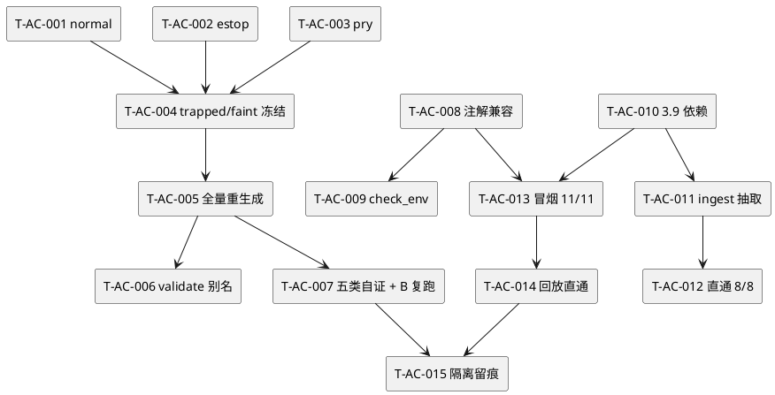

# A/C 侧补充代码需求规格（EARS）

| 项目 | 内容 |
|---|---|
| 文档编号 | SPEC-ELEV-SUP-AC-001 |
| 文档名称 | 电梯困人主动预警 —— A/C 侧补充代码需求规格 |
| 版本 | v1.0（首轮联调后补丁基线） |
| 状态 | 待确认（确认后转交实现阶段） |
| 编写日期 | 2026-11-20 |
| 上游基线 | `docs/spec/integration.md`（第 2/3/4/6 章）、`docs/spec/tasks.md`（附录 B/D）、`docs/spec/requirement.md`（123 条，只读）、`docs/spec/design.md`（B 侧接口口径）、`common/schema.py`（`CONTRACT_VERSION="L1-1.0"`） |
| 文档定位 | 只回答「A 侧数据要怎么改才能让五类可分」「C 侧要怎样才能在 Python 3.9 上直通验收」，不回答「算法如何设计」 |
| 编号规则 | 新增需求统一 `REQ-SUP-NNN`，不复用、不改写既有 `REQ-XXX-NNN` 与 `REQ-INT-NNN`；任务统一 `T-AC-NNN`，不改写 `T-B-*`、`T-INT-*` |
| 强制约束 | 本阶段只新建本文件（可在 `docs/spec/tasks.md` 末尾追加一行指针）；不改 `data/`、`vision/`、`service/`、`scripts/`、`model/`、`common/schema.py` 任何代码；不执行生成数据的命令；不提交 git |

---

## 0. 阅读指南

### 0.1 本文档与既有文档的关系

| 文档 | 回答的问题 | 本文档如何引用 |
|---|---|---|
| `requirement.md` | 产品要什么（123 条） | 只引用编号（如 `REQ-FUNC-044~050`），不新增、不改写 |
| `design.md` | B 侧怎么实现 | 只引用接口口径（判决树顺序、dwell 起算）作为「A 侧数据必须满足的外部约束」 |
| `integration.md` | 三侧缝合得怎么样 | 引用 `INT-DIFF-12/13`、`R6-02`、第 6 章实测表、CMD-04/05/08/09 |
| **本文档** | **A 侧数据缺什么、C 侧环境缺什么，补完如何验收** | 新增 `REQ-SUP-*` 与 `T-AC-*` |

### 0.2 本阶段交付边界

本文档是**规格**，不是实现。第 2、3 章的「改造点」用于锁定验收判据与改动范围清单；第 4、5 章交给实现阶段执行。本阶段不落任何代码。

### 0.3 已知风险与未决项

| 编号 | 事项 | 影响 | 建议 |
|---|---|---|---|
| R0-01 | 本文档的 A 侧时间轴结论（第 2.1 节）由 B 侧代码只读推导 + 首轮实测反推（`trapped` 首帧 10.9 s）双重佐证，但未用真实数据跑通验证 | 若 B 侧调整 dwell 起算口径，时间轴阈值需重算 | 实现阶段以 `T-AC-007` 的复跑结果为最终口径 |
| R0-02 | 未决：A 侧是否允许改动 `common/demo_data/` 内已存在的 5 段素材（属覆盖式重生成） | 覆盖后旧素材不可找回（除 git 历史） | 建议先在 `common/demo_data_prev/` 留一份快照，再覆盖 |

---

# 1. 缺口与目标

## 1.1 缺口登记

| 编号 | 缺口 | 现状证据 | 根因（已核实） | 归属 |
|---|---|---|---|---|
| **INT-DIFF-12** | `demo_normal` 与 `demo_trapped` 在 B 可见通道上不可分 | `results/vision_summary.json`：两段 `person_count_mean=2.0`、`fall_prob_peak=0.0`、`door_approach_peak=0.0`、`door_frames_over_06=0`；IMU 三分数均 `0/0/0.98` | A 的 `demo_normal` 剧本让两人 15 s 后「走出去」，但 `x=-1.35/-0.95` 仍在画面内（`scene.py:276-284` 判据为 17 点均值是否落在 1280×720 内），人数从未归零；门开度只影响渲染（`scene.py:400-419`），不进入 `VisionOut` 六字段 | A（补特征） |
| **INT-DIFF-13** | `demo_pry` 贴门时段与 `OCCUPIED` 窗口不重叠 | 首轮实测 `demo_pry` = `trapped/92 帧`（3.7 s），非 `pry`；`door>0.6` 共 220 帧（8.8 s） | 贴门动作在 5.2–14.4 s，而 B 的 `trapped` 首帧约 10.9 s 起（dwell 起算约 2.9 s + 阈值 8 s），贴门高值在 14.4 s 后即衰减（`vision/temporal.py:186-214` 的 1.5 s 衰减） | A（时序重制） |
| **INT-DIFF-13b** | `demo_estop` 被判 `trapped` | 首轮实测 `trapped/273 帧`，语义冲突（急停 + 1 人停留被判困人） | `demo_estop` 的 1 人全段 0–19.9 s 均在画面内且门未开，dwell 必然越过 8 s；IMU 急停证据在 9.45 s 之前因对齐容差 500 ms 尚不可用（窗口 1 结束于 9.95 s） | A（补「急停后离场」） |
| **R6-02** | C 侧全部 HTTP 验收不可执行 | 本机 `Python 3.9.12`；`python -c "import service.main"` → `ModuleNotFoundError: No module named 'uvicorn'`（`service/main.py:22`） | `fastapi/uvicorn/pydantic` 未安装；且 `scripts/smoke_test.py:19`、`scripts/play_case.py:40` 的 `dict \| None` 在 3.9 运行时抛 `TypeError`（已实测，见 3.1） | C（环境 + 注解） |

## 1.2 可验证目标

**G1｜A 侧五类 5/5 达标**
以 A 的 5 段真实数据驱动 B 的 `--real --demo`，段级结论与 `results/contract_check.json` 的 `cases.<case>.label` **五项全等**（`event_type` 一致、`urgency` 一致、`trapped` 一致）：

| 场景 | 目标 `event_type` | 目标 `urgency` | 目标 `trapped` | 当前 |
|---|---|---|---|---|
| `demo_normal` | normal | 0 | false | ❌ trapped/273 帧 |
| `demo_estop` | estop | 1 | false | ❌ trapped/273 帧 |
| `demo_trapped` | trapped | 2 | true | ✅ |
| `demo_pry` | pry | 2 | true | ❌ trapped/92 帧 |
| `demo_faint` | faint | 3 | true | ✅ |

判定口径：**5/5 达标 = 上表五行的三个字段全部命中，且 `demo_normal` 的 `trapped=true` 帧数恒为 0**（对齐 `REQ-INT-012`、`REQ-INT-014`）。

**G2｜A 侧既有验收不下降**
- `python data/scripts/validate_demo_data.py` 输出「✓ L1 契约全部通过（5 段）」、`errors=[]`；
- `python vision/doctor.py` 的依赖/数据/ROI/产物项不新增 ✗；
- `python data/scripts/regression.py` 的退化清单为空（判据见 `data/scripts/regression.py:136-152`：人数 MAE 升幅 ≤0.10、倒地/贴门召回降幅 ≤0.05、误报率升幅 ≤0.02）。

**G3｜C 侧可在 Python 3.9 完成直通验收**
两条路径，任一达成即视为 G3 达成：
- **路径 A（完整档）**：3.9 环境装齐 `fastapi/uvicorn` 后，`python scripts/smoke_test.py` 输出 **11/11 通过**，`python scripts/play_case.py --case demo_trapped --no-video` 的摘要为「失败 0 条、入库 1 条、去重 ≥1 条」。
- **路径 B（无依赖档）**：不装 `fastapi`，以「纯函数层直通」脚本达成 **8/11 项等价断言**，并出具「接口契约未降低」的五条判据（见 3.4）。

**G4｜冻结产物字节不变**
B 侧 `results/demo_<case>_decision.json` ×5、`results/timeline_demo_<case>.jsonl` ×5、`results/metrics.csv`、`results/labels.json` 在 A 侧重生成前后**字节级一致**（对齐 `REQ-INT-013`）。

## 1.3 明确不在范围内

1. 不改 B 侧任何阈值、判决树、状态机、对齐器；
2. 不改 `common/schema.py`（`L1-1.0` 锁死）；
3. 不改 `vision/` 的规则与阈值（`rules.py`、`temporal.py` 的判据不动）——本次只改「喂给规则的场景剧本」；
4. 不接入实拍素材（`A-11` 仍为未接入状态，对外口径仍为「合成场景库」）；
5. 不 push 远端、不新增分支。

## 1.4 已知风险与未决项

| 编号 | 事项 | 影响 | 建议 |
|---|---|---|---|
| R1-01 | G1 的「段级结论」由 B 的 `--real --demo` 产出，A 侧无法单方面证明 | A 完成改造后仍可能被判不达标 | A 侧先自证「六字段可分性」（`T-AC-007` 的代理判据），再交 B 复跑 |
| R1-02 | G2 的回归基线 `results/vision_baseline.json` 若被 `--update-baseline` 覆盖，等于取消守护 | 「不下降」不可证 | 见 `REQ-SUP-019`：基线更新必须评审留痕 |
| R1-03 | 未决：G3 是否接受「路径 B（8/11）」作为阶段性结论 | 影响是否必须联网装依赖 | 建议答辩前必须达到路径 A；路径 B 只作断网兜底证据 |
| R1-04 | 未决：`demo_normal` 是否允许把「2 人 → 0 人 → 2 人」写进场景说明（对外表述为「正常进出」） | 影响 `DATA_DICT.md` 与演示解说词 | 建议表述为「正常乘梯：两人到站开门离开，另两人进入」 |

---

# 2. A 侧数据改造规格

## 2.1 统一时间轴约束（所有场景共用）

A 侧改造必须同时满足以下三条硬约束。三条缺一，五类不可分。

### C1｜「有人 + 门未开」连续段必须短于 dwell 阈值

- B 的 `dwell` 在进入 `STOPPED`（`model/state_machine.py:324-328`）与 `DOOR_CLOSED`（`model/state_machine.py:345-348`）时重置；
- 演示预设 `dwell_threshold=8.0 s`（`model/config.py:96-98`）；
- `trapped` 成立条件：`state is OCCUPIED` **且** `person_count >= 1` **且** `effective_ms > 8 s`（`model/state_machine.py:271-276`）；
- 首轮实测 `demo_normal` 的 `trapped` 首帧为第 273 帧 = **10.92 s**，反推 dwell 起算约 **2.9 s**。

**约束**：任何「画面有人 且 门未开」的连续时段长度必须 **≤ 7.0 s**（8 s 阈值留 1 s 余量）。超过即必然 `trapped`。

### C2｜唯一可靠的复位通道是「人数归零 ≥ 3 s」

- B 的 `door_open_signal`（`model/state_machine.py:108-109`）来自 `model/signals.py:114-131`，**要求 `hits >= 2`**，三个候选证据为：
  1. `person_count` 与上一帧不同；
  2. `door_approach` 相邻帧下降 ≥ `DOOR_DROP_DELTA = 0.25`（`model/signals.py:16`）；
  3. `motion_level` 从 ≥ `move_thresh` 跌到 < `stop_thresh`。
- 第 2 条在 A 的数据上**不可达**：`DoorFilter`（`vision/temporal.py:186-214`）在 1.5 s 衰减窗口内按 `last_high × (1 − elapsed/decay_sec)` 逐帧输出，25 fps 下相邻帧最大降幅约 0.027，远小于 0.25。
- 第 3 条在 A 的数据上**基本不可达**：5 段 IMU 的 `idle=0.98` 近似恒定，`motion_level=(1−idle)(1−vibration)≈0.02`，无跨帧跳变。
- 因此 `door_open_signal` 实际只能靠「人数变化 + 一个不存在的第二证据」触发 → **A 无法用「门开动作」让 B 复位**。
- 唯一可用通道：`occupied_empty_idle`（`model/state_machine.py:168`）+ `_empty_steady`（`model/state_machine.py:144-145`），要求 **`person_count == 0` 连续 ≥ 3 s**，进入 `IDLE` 时 `stop_enter_ts` 清空、`raw_dwell_ms` 归零（`model/state_machine.py:352-356`）。

**约束**：凡需要「不判困人」的场景，必须在 dwell 达阈值前让 **画面人数真实归零并持续 ≥ 3.0 s**（不是「人站着不动」，也不是「只开门不走出去」）。

### C3｜人数归零必须是「真出画」，不是「改标签」

`scene.py:276-284` 的 `person_visible_px` 用 17 点像素均值判定，且**渲染、sidecar、逐帧真值三处共用同一判据**。因此「出画」的量化阈值（`SceneGeometry.project`，`scene.py:236-243`）为：

| `Track.depth` | 每米像素 | 站稳后 `x_m` 均值 | 向右出画所需 `x_m` | 相对站位所需 `TrackKey.x` |
|---|---|---|---|---|
| 0.93 | 186 | `640 + 186·x_m` | > 3.44 m | > 4.49 m（`x_base=-1.05`） |
| 0.90 | 180 | `640 + 180·x_m` | > 3.56 m | > 3.71 m（`x_base=-0.15`） |
| 0.82 | 164 | `640 + 164·x_m` | > 3.90 m | > 3.28 m（`x_base=0.62`） |

**约束**：出画位移必须按上表取值并留 0.2 m 余量，且在 **≤2.5 s** 内完成（约 1.3–1.9 m/s，属快步走，画面合理）；禁止用「降低 `person_count` 标签」等方式伪造。

### 2.1.1 时间轴总表（20 s 段长）

```
t=0        2.9s                 10.0~10.9s                20.0s
 |dwell 起算|                     |最早可能 trapped|        |
             \___ 安全窗口（≤7s）___/
```

| 场景 | 0–7.0 s | 7.0–10.5 s | 10.5–20.0 s | 结果 |
|---|---|---|---|---|
| `demo_normal` | 2 人正常乘梯 | **0 人（≥3 s，复位）** | 12.5 s 起 2 人回场，剩余 dwell ≤6.5 s | `trapped` 恒 false |
| `demo_estop` | 1 人 + 4.05 s 急停 | **0 人（≥3 s，复位）** | 保持 0 人至 20 s | `estop/1`、`trapped=false` |
| `demo_pry` | 2 人在场、不贴门 | 9.0 s 起走向门 | **10.0–17.0 s 贴门** | `pry/2`、`trapped=true` |
| `demo_trapped` | 2 人在场 | 2 人在场 | 2 人在场 | `trapped/2`（现状保持） |
| `demo_faint` | 2 人在场、7.6 s 倒地 | 2 人在场 | 2 人在场 | `faint/3`（现状保持） |

## 2.2 `demo_normal` 改造规格

**改造对象**：`data/scripts/build_demo_data.py:110-156`（`build_normal()`）。

| 项 | 现状 | 改造后必须满足 |
|---|---|---|
| 轨迹时序 | p1 15.0–19.9 s `x=-1.35`、p2 15.2–19.9 s `x=-0.95`（**仍在画内**） | 5.0–7.0 s：p1、p2 依次向右出画，末端 `TrackKey.x ≥ +4.6`（p1，depth 0.93）/ `≥ +3.4`（p2，depth 0.82） |
| 无人在场 | 无 | 7.0–10.5 s 画面人数恒 0（≥3.5 s，跨过 `empty_steady` 的 3 s） |
| 回场 | 无 | 12.5–14.0 s 两人从右侧进入画面（人数 0→2），14.0–19.9 s 在场 |
| 蹲下防误报用例 | 8.6–12.0 s（落在无人段内，会失效） | 移到 **14.5–17.0 s**，仍在场内，保证「蹲下不判倒地」的用例被真实覆盖 |
| 门开度 | `door_keys` 13.4–17.6 s 开 | 重排为：6.2 s 开 → 7.0 s 全开 → 8.6 s 关；12.8 s 开 → 13.6 s 全开 → 15.0 s 关。**门开度只影响渲染观感，不进入 `VisionOut`，不得作为判据** |
| IMU | `imu_kind="normal"` | 保持 `normal`（不改 `synth_imu`，`build_demo_data.py:365-369`） |

**必须产生的可判定信号**（二选一即为达标，建议两者兼有）：
- **主信号**：`person_count` 出现 `2 → 0 → 2` 的两段跳变（真值同步跳变，见 C3）；
- **辅信号**：出画段前后 `door_approach` 出现「升后降」的包络（峰值不要求 ≥0.6），用于增强可解释性，**但不得作为复位依据**（依据见 C2）。

**禁止项**：
1. 禁止只改 `labels` 的 `event_type` 而不改画面；
2. 禁止在 0–10 s 内出现任何长度 ≥7 s 的「有人 + 门未开」连续段；
3. 禁止在出画/回场时同时制造 `door_approach` 的单帧骤降以期触发 `door_open_signal`（不可达，且会引入无意义特征）。

## 2.3 `demo_estop` 改造规格

**改造对象**：`data/scripts/build_demo_data.py:159-187`（`build_estop()`）。

| 项 | 现状 | 改造后必须满足 |
|---|---|---|
| 在场时长 | p1 0–19.9 s 全程在场 | p1 0–5.5 s 在场（含 4.05 s 急停、4.6 s 前倾） |
| 离场 | 无 | 5.5–7.5 s 向右出画，末端 `TrackKey.x ≥ +3.8`（depth 0.90，`x_base=-0.15`） |
| 无人段 | 无 | 7.5–20.0 s 画面人数恒 0（覆盖 9.45–19.95 s 的 IMU 可用窗口） |
| 急停冲击 | 4.05 s / 4.42 s | **保持不变**（`synth_imu` 的 `estop` 分支不动） |
| 门开度 | 全 0 | 保持全 0（急停卡停，门不开，符合场景语义） |
| 抖动 | `shake_keys=[(0,0),(4.1,7.0),(4.9,0)]` | 保持不变 |

**必须满足的语义链**：`IMU estop 高分（窗口 1，结束于 9.95 s）` + `trapped=false（9.45 s 后画面无人）` → `derive_verdict` 落到 `imu_estop > 0.8` 分支 → `estop/urgency=1`。

**关键时序说明**（必须写进 `DATA_DICT.md`）：
- 视觉帧 0–9.45 s 与 IMU 窗口 1（结束 9.95 s）的差 > 500 ms 容差 → 该段判 `none` 对齐、IMU 不可用；
- 9.45 s 后对齐成立，此时画面已无人 → `trapped` 判据的 `person_count >= 1` 不成立；
- 因此 `estop` 结论**必然**在 9.45 s 之后产生，A 侧不得把「无人段」提前结束到 9.45 s 之前。

## 2.4 `demo_pry` 改造规格

**改造对象**：`data/scripts/build_demo_data.py:239-282`（`build_pry()`）。

| 项 | 现状 | 改造后必须满足 |
|---|---|---|
| 贴门时序 | `reach_door`/`push_door` 在 5.2–14.4 s | 整体后移到 **10.0–17.0 s**（`reach_door`↔`push_door` 交替 ≥3 轮，每轮 1.2–1.6 s） |
| 贴门前的过渡 | 4.0 s 起就走近门 | 9.0–10.0 s 由站位走向门（`walk_a`），10.0 s 起腕部进入门缝 ROI |
| 人数 | 恒 2 | **恒 2，贴门段内禁止出现任何人数变化**（否则 `person_delta` 会贡献 1 个 hit，叠加其它证据可能误触发 `door_open_signal` 把 `OCCUPIED` 打回 `DOOR_OPEN`，dwell 清零 → `pry` 漏报） |
| p2 | 15.0 s 起 `crouch` | 移动到 **17.5 s 起** `crouch`（贴门段外） |
| IMU 拍门爆发 | `synth_imu` 的 `pry` 爆发中心 6.0/8.2/10.4/12.6 s | 移到 **10.6/12.2/13.8/15.4 s**，必须全部落在视觉 `door_approach > 0.6` 的时间窗内（±1 s） |
| 门开度 | 全 0 | 保持全 0 |

**重叠判据（可机器验证）**：
设 `W_door = { t | door_approach(t) > 0.6 }`、`W_trap = { t | Decision.trapped == true }`，则必须满足 `|W_door ∩ W_trap| ≥ 2.0 s`。

按 2.1 的时间轴，`W_trap` 起点约 10.0–10.9 s、`W_door` 起点约 11.0 s（`DoorFilter` 需 1 s 持续才给高分，`persist_sec=1.0`）、终点 17.0 s → 预期重叠 **≈6 s**，满足判据且留 3 倍余量。

**禁止项**：
1. 禁止把 `door_approach` 抬到 >0.6 后立刻掉回 0（`DoorFilter` 的 1 s 持续门控会把这种「闪一下」判为低分）；
2. 禁止在贴门段前后调整 `person_count`（见上表「人数」行）。

## 2.5 `demo_trapped` / `demo_faint` 冻结规格

| 场景 | 冻结范围 | 必须保持的判据 | 验收 |
|---|---|---|---|
| `demo_trapped` | `build_trapped()`（`build_demo_data.py:190-236`）的 `tracks`、`door_keys`、`imu_kind` 全部不改 | 2 人全程在场、门全 0、`trapped` 帧数 >0、首帧时间不晚于 12 s | 段级 `trapped/2` |
| `demo_faint` | `build_faint()`（`build_demo_data.py:285-326`）同上 | p1 7.6 s 起倒地、`fall_prob` 峰值 ≥0.9、`fall>0.7` 帧数 ≥200、`fall` 持续 ≥3 s、`trapped=true` | 段级 `faint/3` |

**共享代码风险**：两段与 normal/estop/pry 共用 `build_case()`（`build_demo_data.py:469-626`）、`ground_truth()`（`:430-466`）、`synth_imu()`（`:344-392`）。改造只允许改场景剧本函数（`build_normal`/`build_estop`/`build_pry` 三个函数体），**不得改共享函数的语义**；若不得不改（例如给 `--case` 增加 `all` 别名），必须单独回归 trapped/faint。

## 2.6 产物重生成清单与命令

改造后必须**全量重生成**以下产物，缺一不可（按顺序执行）：

| 步骤 | 命令 | 产物 |
|---|---|---|
| 1 | `python data/scripts/build_demo_data.py --all` | `common/demo_data/demo_<case>.mp4`、`_kpts.jsonl`、`_imu.npy`、`_imu_raw.npy`、`_imu_meta.json`、`_meta.json`；`data/labels/demo_<case>.json`；`data/processed/demo_<case>_gt.json` |
| 2 | `python vision/infer.py --all` | `results/vision_demo_<case>.json` ×5、可选 `*.jsonl`、`results/vision_summary.json`（`vision/infer.py:274-276`） |
| 3 | `python data/scripts/validate_demo_data.py --json results/contract_check.json` | `results/contract_check.json` |
| 4 | `python data/scripts/regression.py` | `results/vision_regression.json`、`results/vision_regression.md`（**不加 `--update-baseline`**） |
| 5 | `python vision/doctor.py` | 终端输出，无新 ✗ 项 |
| 6 | 标注视频（若流程已脚本化） | `results/annotated/demo_<case>_annotated.mp4` ×5 |

**禁止项**：
1. 禁止跳过第 4 步直接改 `results/vision_baseline.json`；
2. 禁止把 `results/demo_<case>_decision.json`（B 侧冻结产物）纳入本次重生成范围；
3. 禁止把联调产物写进 `results/` 根目录（对齐 `REQ-INT-013`，联调产物统一落 `results_integration/`）。

## 2.7 既有验收的保留与一处缺陷更正

| 验收项 | 命令 | 现状 |
|---|---|---|
| L1 契约自检 | `python data/scripts/validate_demo_data.py --case all` | **命令本身不可执行**：`--case` 的 `choices=CASE_ORDER`（`validate_demo_data.py:181`）不含 `all`，argparse 报 `invalid choice: 'all'` 并退出 2（已实测） |
| 环境自检 | `python vision/doctor.py` | 可执行 |
| 逐帧真值回归 | `python data/scripts/regression.py` | 可执行 |

**更正方案（二选一，建议选 ①）**：
1. **给 `--case` 增加 `all` 别名**（`choices=CASE_ORDER + ["all"]`，`main()` 中 `cases = CASE_ORDER if args.case in (None, "all") else [args.case]`）——保持既有验收命令**字面不变**，向后兼容；
2. 把验收命令更正为 `python data/scripts/validate_demo_data.py --json results/contract_check.json`（不带 `--case`，默认即全 5 段）。

> 无论选哪个，都必须保留「不带 `--case` 时跑全 5 段」的现有行为（`validate_demo_data.py:185`）。

## 2.8 已知风险与未决项

| 编号 | 事项 | 影响 | 建议 |
|---|---|---|---|
| R2-01 | `demo_normal` 的出画/回场会让 `person_count` 真值出现两次跳变，`MedianCounter(3)`（`vision/temporal.py:222-232`）有 1–2 帧延迟 | 人数 MAE 可能轻微上升 | 回归判据留 0.10 容差（`regression.py:144`），预期不会触发；若触发，登记数值而非改基线 |
| R2-02 | `demo_pry` 的 `W_trap` 起点依赖 B 的 dwell 起算（约 2.9 s），若 B 改为「OCCUPIED 进入时起算」则起点后移到 3.9 s | 重叠由 6 s 降到 5 s，仍达标 | 无需改 A；把重叠作为 `T-AC-007` 的机器断言而非口头结论 |
| R2-03 | `demo_estop` 的无人段与 `estop` 语义存在解释成本（「急停后为什么没人」） | 评审可能质疑场景真实性 | 场景说明写「急停后乘客自行脱困/被疏散离开轿厢」，并注明属合成场景脚本 |
| R2-04 | 重生成会覆盖 `common/demo_data/` 既有 5 段素材 | 旧素材仅可从 git 历史找回 | 执行前留 `common/demo_data_prev/` 快照（见 R0-02） |
| R2-05 | 未决：`demo_normal` 是否额外加入 `door_approach` 辅信号 | 增加改造面 | 建议加（成本低、可解释性好），但不作为验收判据 |

---

# 3. C 侧兼容与直通规格

## 3.1 Python 3.9 语法/注解兼容点（已实测）

| 文件:行 | 现状写法 | 3.9 下的实际表现（实测） | 替换写法 | 影响 |
|---|---|---|---|---|
| `scripts/smoke_test.py:19` | `def call(method: str, path: str, body: dict \| None = None, timeout: float = 5.0):` | `import scripts.smoke_test` → `TypeError: unsupported operand type(s) for \|: 'type' and 'NoneType'` | `from typing import Any, Dict, Optional` + `body: Optional[Dict[str, Any]] = None` | **模块导入即失败**，整个验收不可执行 |
| `scripts/play_case.py:40` | `def hit(self, item: dict, resp: dict \| None) -> None:` | `import scripts.play_case` → `TypeError`（同上，`class Counter` 定义时触发） | `resp: Optional[Dict[str, Any]]`（同文件补 `from typing import Any, Dict, Optional`） | **模块导入即失败**，回放器不可执行 |
| `scripts/check_env.py:31-40` | `if (v.major, v.minor) in ((3, 10), (3, 11)): … else: line(FAIL, "Python … 过低")` | 3.9.12 落入 `else` → 输出 `[FAIL] Python 3.9.12 过低`，退出码 1 | 在 `(3, 10), (3, 11)` 之外增加 `(3, 9)` 分支并判 `WARN`（理由见 3.2：LOCK-1.0 的元数据允许 3.9） | 环境自检与实际可运行性**自相矛盾**，会把直通验收挡在门外 |

**已核验为「无需改动」的文件**（避免无谓改动面）：

| 文件 | 结论 | 依据 |
|---|---|---|
| `service/main.py` | 3.9 语法兼容 | 仅用 `Dict[str, Any]`（`:20`、`:38`）、`asynccontextmanager`（`:19`，3.7+）；阻塞点在**依赖缺失**（`:22` `import uvicorn` → `ModuleNotFoundError`，已实测），不是语法 |
| `service/models.py` | 3.9 语法兼容 | 用 `List[str]`（`:10`、`:26`、`:30`）与 `Literal`（`:10`、`:24`），无 `X \| Y`、无 `list[…]` |
| `service/config.py` | 3.9 语法兼容 | 纯 `os`/`pathlib`，无注解 |
| `service/db_local.py` | 3.9 语法兼容 | 用 `Optional`/`Dict`/`List`（`:12`），`sqlite3` 标准库 |
| `service/cache_memory.py` | 3.9 语法兼容 | 用 `Optional`/`Dict`/`Any`（`:8`） |
| `vision/infer.py:170` | 3.9 安全 | `path: "str \| Path"` 为**字符串注解**，不求值 |
| `data/scripts/build_demo_data.py:639` | 3.9 安全 | `main(argv: Sequence[str] \| None = None)` 由 `from __future__ import annotations`（`:19`）延迟求值；实测 `import vision.infer, data.scripts.build_demo_data` 成功 |

**改造约束**：
1. 只用 `typing.Optional/List/Dict/Any` 替换 PEP 604/585 写法，**不得**为此新增 `from __future__ import annotations` 以外的兼容层（如 `typing_extensions`）；
2. 不得顺手「现代化」其它文件（3.10+ 写法在 3.9 只会引入新故障）；
3. `service/` 内**已确认无需改动**，本次只在 `scripts/` 两处动刀。

## 3.2 依赖策略

**结论：不修改 `requirements.lock.txt` 的任何一行**（含 B 侧锁版本 `numpy==1.26.4`、`scikit-learn==1.5.2`、`matplotlib==3.9.2`）。

| 路线 | 做法 | 适用 | 风险 |
|---|---|---|---|
| **P1 原地 3.9 安装（首选）** | 新增 `requirements-c39.txt`，只列 C 侧四项：`fastapi==0.115.0`、`uvicorn==0.32.0`、`mysql-connector-python==9.0.0`、`redis==5.0.8`；`pip install -r requirements-c39.txt` | 本机 3.9.12 | 按 PyPI 元数据这四项均为 `Requires-Python >=3.8/3.9`，理论上可装；**必须实测**（见 `T-AC-010` 的退出码判据） |
| **P2 独立 venv（备选）** | `python -m venv .venv39` + P1 的约束文件 | 不想污染全局环境 | 与 P1 等价，只隔离安装位置 |
| **P3 不装依赖（兜底）** | 只跑 3.3 的「纯函数层直通」，达成 8/11 | 完全断网 | 无法验证 health/stats 的 HTTP 语义；不能作为答辩主证据 |

**硬约束**：
1. `requirements-c39.txt` 只允许出现 C 侧四项，**禁止**把 B 侧或 A 侧依赖写进去（避免绕过 lock）；
2. 若 P1 实测失败（例如某包的 3.9 wheel 缺失），必须在 `docs/C_SERVICE_SETUP.md` 追加「3.9 实测失败」记录，然后改走 P2 或升级到 3.10/3.11，**不得**通过降级 `requirements.lock.txt` 解决；
3. `docs/C_SERVICE_SETUP.md` 第一节需补一行「3.9 走 `requirements-c39.txt`」，避免读者误用 lock。

## 3.3 无 `fastapi` 依赖时的直通验收路径

### 3.3.1 主路径：纯函数层直通（推荐）

**核心问题**：`service/main.py:132-166` 的上报分支（心跳短路 + 去重 + 入库）是**写在路由函数里的**，没有可复用的纯函数。若验收脚本复制这段逻辑，就会产生「验收脚本一套、服务端一套」的双份实现，契约必然漂移。

**规格要求（改造点，属实现阶段）**：
1. 在 `service/` 新增模块 `service/ingest.py`，导出 `ingest(decision: Dict[str, Any], db, cache) -> Dict[str, Any]`，把 `main.py:136-166` 的分支**原样**搬入，签名与返回值保持不变（`{"ok","alert","dedup","id"}`）；
2. `service/main.py` 的 `report()` 改为「模型校验 → `asdict`/`model_dump` → 调用 `ingest()`」，**行为零变化**（HTTP 响应逐字段不变）；
3. 新增 `scripts/passthrough_test.py`（仅用 stdlib + `service.db_local` + `service.cache_memory` + `service.ingest`），对 `results/demo_<case>_decision.json` 逐条调用 `ingest()`；
4. 直通脚本必须使用**独立 SQLite 文件**（如 `tempfile.mkstemp()`），不得污染 `elevator.db`，运行结束删除。

**直通脚本必须实现的等价分支**（逐条对应 `main.py`）：

| 分支 | 服务端位置 | 直通要求 |
|---|---|---|
| 心跳短路 | `main.py:142-144` | `urgency == 0 and not trapped` → 不入库，返回 `alert=False, dedup=False, id=None` |
| 去重 key | `main.py:147-149` | key 必须为 `alert:{device_id}:{urgency}`，TTL 为 `config.DEDUP_WINDOW_SEC=30`（`config.py:58`） |
| 设备心跳 | `main.py:139` | 每条（含心跳）都 `upsert_device(device_id, ts)` |
| 状态缓存 | `main.py:140` | 每条都 `set_state(device_id, payload, STATE_TTL_SEC)` |
| 入库 | `main.py:156` | `insert_alert(payload)` 的九字段直通（`db_local.py:66-85`） |

### 3.3.2 备选路径：`http.server` 最小桩

若必须验证 HTTP 序列化（例如要证明「`reason` 从 JSON 文本还原成数组」），允许用标准库 `http.server.ThreadingHTTPServer` 实现**只读三端点**的最小桩：

| 端点 | 实现要求 |
|---|---|
| `POST /api/v1/edge/report` | 解析 JSON → 调 `service.ingest.ingest()` → 返回同结构 |
| `GET /api/v1/health` | 返回 `{"status":"ok","db_mode":"sqlite","cache_mode":"memory","degraded":false}` |
| `GET /api/v1/alerts?status=active` | 返回 `{"items": db_local.list_alerts(status, limit)}` |

**约束**：
1. 桩**不得**替代 `service/main.py` 作为交付物，只作验收工具，文件名必须含 `stub`（如 `scripts/http_stub_server.py`）；
2. 桩不得实现 `ack`/`stats`/`devices`（避免「桩比真服务还全」的错觉），这三项由 P1 真服务验证；
3. 桩的响应体字段名、类型必须与 `main.py` 逐字段一致，**不得**增加/删减字段。

## 3.4 「接口契约不降低」的五条判据

路径 B（无依赖直通）只有在下列五条全部成立时，才算「契约未降低」：

1. **入口契约**：直通入参是 `dataclasses.asdict(Decision)` 的九字段，**不裁剪、不改名、不加信封**（对齐 `C-DEP-1`）；
2. **校验契约**：九字段的范围校验与服务端等价 —— `ts` 为 13 位整数、`device_id` 非空、`urgency ∈ [0,3]`、`people_count ∈ [0,8]`、`event_type` 五选一、`confidence ∈ [0,1]`、`trapped → urgency ≥ 2`（`common/schema.py:28-33` 的映射）；越界必须拒绝并指明字段名；
3. **落库契约**：入库记录的九个字段与源数据**逐字段相等**（`reason` 还原后是 `list[str]`，不是 JSON 字符串）；
4. **去重契约**：同设备同紧急度 30 s 内只入库 1 条、其余返回 `dedup=true` 且不报错；
5. **响应契约**：直通返回值与服务端 JSON 的键名、键类型一致（`ok/alert/dedup/id`）。

> 判据 2 中「`trapped → urgency ≥ 2`」在 `DecisionIn`（`service/models.py:17-38`）里其实**未实现**（只有单字段范围校验）。这是一处既有的契约缺口，直通脚本必须补上并登记为 `R3-04`；不得据此声称「服务端已校验」。

## 3.5 验收命令与预期输出

### 3.5.1 路径 A（完整档，需 P1/P2 依赖）

```bash
python scripts/check_env.py
# 预期：Python 3.9.12 判 WARN（不足以 FAIL）；核心依赖 fastapi / uvicorn / pydantic 为 [OK]；退出码 0

python -m service.main
# 预期：日志出现「数据层：SQLite（本地兜底）elevator.db」「缓存层：内存（本地兜底）」「就绪：http://127.0.0.1:18080/docs」

python scripts/smoke_test.py
# 预期：结果：11/11 通过，退出码 0
```

`smoke_test.py` 的 11 项断言（`scripts/smoke_test.py:47-85`）：
1. 健康检查返回 ok；2. 未处于降级状态；3. 首次上报成功入库；4. 30 秒内重复上报被去重；5. 告警可被查询到；6. `reason` 已还原为数组；7. 楼层与人数正确；8. 确认处置成功；9. 处置后退出活动列表；10. 统计数据可读；11. 设备心跳已记录。

```bash
python scripts/play_case.py --case demo_trapped --no-video --speed 10
# 预期：数据源：results/demo_trapped_decision.json
#       发送 500 条（失败 0 条）；入库告警 1 条；去重丢弃 ≥1 条；最高紧急度 2
#       退出码 0
```

**「去重 1 入库 N 丢弃」的精确定义**：
- 500 条判决跨 20 s（`rebase_ts` 保持相对间隔），小于 30 s 去重窗口；
- `urgency=0` 且 `trapped=false` 的帧走**心跳**（不入库、不计去重）；
- 首次 `urgency≥1` 帧 → **入库 1 条**；
- 之后所有同设备同 `urgency` 帧 → **去重 N 条**（`N = 该 urgency 的帧数 − 1`）；
- 若同一段内出现两个不同 `urgency`（如 normal→trapped），则每个 urgency 各入库 1 条。

### 3.5.2 路径 B（无依赖档，8/11）

```bash
python scripts/passthrough_test.py --cases all --keep-ts
# 预期：8/8 等价断言通过（对应 smoke_test 的第 3/4/5/6/7/8/9/11 项）
```

**8/11 的构成（必须逐项对齐，不得口径漂移）**：

| 档位 | 覆盖项 | 数量 | 覆盖方式 |
|---|---|---|---|
| 纯函数层可覆盖 | 3 首次入库、4 去重、5 告警查询、6 `reason` 数组、7 楼层人数、8 处置成功、9 处置后退出活动列表、11 设备心跳 | **8** | `db_local` + `cache_memory` + `ingest` |
| 仅 HTTP 可覆盖 | 1 健康检查、2 未降级、10 统计可读（含 `db_mode/cache_mode` 附加字段） | **3** | 必须由 `service/main.py` 的 `health()`（`:120-128`）与 `stats()`（`:185-190`）提供 |

> 因此 **8/11 是路径 B 的理论上限**，不是「差 3 项没做」；路径 A 才是 11/11。

### 3.5.3 两条路径的断言一致性

路径 B 的 8 项断言必须**逐字符复用** `smoke_test.py` 的断言表达式（可抽成 `scripts/_asserts.py` 共用），避免「两套标准、两个结论」。

## 3.6 已知风险与未决项

| 编号 | 事项 | 影响 | 建议 |
|---|---|---|---|
| R3-01 | `requirements-c39.txt` 的 3.9 可装性**未经实测**（本文档只引用 PyPI 元数据） | 若 `pydantic-core` 无 cp39 wheel，P1 路线失败 | `T-AC-010` 必须以 `pip install` 退出码 0 + `python -c "import fastapi,uvicorn,pydantic"` 成功为关闭条件 |
| R3-02 | 抽取 `service/ingest.py` 会改动 `service/main.py:132-166` | 属「重构不改行为」，但仍是 C 侧核心文件改动 | 必须做「改动前后同一批请求的响应逐字段比对」，作为 `T-AC-011` 的验收 |
| R3-03 | `http.server` 桩与真服务可能漂移 | 桩通过 ≠ 真服务通过 | 桩只能作 P3 兜底，且文件名含 `stub` |
| R3-04 | `DecisionIn`（`service/models.py:17-38`）缺少 `trapped → urgency ≥ 2` 的跨字段校验 | 脏数据可入库，与 L1 映射冲突 | 建议在实现阶段补该 `model_validator`，并同步 `smoke_test` 的断言；本条为 P1 |
| R3-05 | 未决：3.9 是否作为正式支持环境写进 `C_SERVICE_SETUP.md` | 影响对外口径 | 建议表述为「3.9 可运行（C 侧），A/B 仍以 3.10/3.11 为准」 |
| R3-06 | `play_case.py` 的 `--speed 10` 会让 20 s 数据在 2 s 内发完 | 去重窗口（按真实时间 30 s）仍成立，结论不变 | 验收必须显式声明所用倍速，避免「为什么只入库 1 条」的误解 |

---

# 4. EARS 需求条目

> 共 **20 条**，`REQ-SUP-001` ~ `REQ-SUP-020`。句式标注：`[普遍]` / `[事件驱动]` / `[状态驱动]` / `[非期望]`。
> 优先级：P0 = 不满足则 G1/G3 结论为「不能」；P1 = 允许带风险，需登记。

## 4.1 A 侧数据可分性（P0 组）

**REQ-SUP-001｜[事件驱动]｜P0｜正常场景必须产生可判定的人员进出信号**
当 `demo_normal` 的演示数据被 B 侧逐帧消费时，系统必须在该段内产生 **`person_count` 由 2 变为 0、再由 0 变为 2** 的两段跳变，且每次「0 人」持续 ≥3.0 s。
- 验收：`results/vision_demo_normal.json` 中 `person_count==0` 的连续帧数 ≥75（3 s × 25 fps），且存在 2→0 与 0→2 的相邻帧跳变；`person_count` 均值落在 `(0.4, 1.9)` 区间（不再是 2.0）。
- 追溯：`INT-DIFF-12`、`REQ-INT-012`、C1/C2/C3。

**REQ-SUP-002｜[普遍]｜P0｜正常场景不得被判困人**
系统必须保证 `demo_normal` 在演示预设 `dwell_threshold=8.0 s` 下，`trapped=true` 的帧数为 **0**。
- 验收：B 侧 `--real --demo` 产出的 `demo_normal_decision.json` 中 `trapped==true` 的条目数为 0；段级 `event_type=normal`、`urgency=0`。
- 追溯：`REQ-INT-014`、`REQ-FUNC-044~050`、C1。

**REQ-SUP-003｜[事件驱动]｜P0｜急停场景必须体现「急停后离场」并保留急停结论**
当 `demo_estop` 的 IMU 急停证据可用（9.45 s 之后）时，系统必须在该时段内保持 `person_count == 0`，使最终判决落在 `imu_estop` 分支。
- 验收：`demo_estop` 段级 `event_type=estop`、`urgency=1`、`trapped=false`；且 `person_count` 在 9.45–19.95 s 恒为 0。
- 追溯：`INT-DIFF-13b`、`REQ-FUNC-051~054`、C1。

**REQ-SUP-004｜[状态驱动]｜P0｜扒门场景的贴门时段必须与困人窗口重叠**
在 `demo_pry` 的 `trapped=true` 状态下，系统必须保证 `door_approach > 0.6` 的时段与之重叠 ≥2.0 s。
- 验收：令 `W_door = {t｜door_approach>0.6}`、`W_trap = {t｜trapped==true}`，则 `|W_door ∩ W_trap| ≥ 2.0 s`；段级 `event_type=pry`、`urgency=2`、`trapped=true`。
- 追溯：`INT-DIFF-13`、`REQ-FUNC-054`、C1。

**REQ-SUP-005｜[普遍]｜P0｜困人与倒地场景的既有判据不得被破坏**
系统必须保证 `demo_trapped` 的 `trapped` 帧数 >0 且首帧不晚于 12.0 s，`demo_faint` 的 `fall_prob` 峰值 ≥0.9 且 `fall_prob>0.7` 帧数 ≥200，两者段级结论分别为 `trapped/2` 与 `faint/3`。
- 验收：对比改造前后两段的 `vision_summary.json` 行，指标下降不得超过回归容差（`regression.py:136-152`）。
- 追溯：`REQ-SUP-005`、2.5 节冻结规格。

**REQ-SUP-006｜[普遍]｜P0｜时间轴必须显式满足段长与 dwell 的关系**
系统必须保证任何「画面有人 且 门未开」的连续时段 ≤7.0 s，且凡需复位到 `IDLE` 的场景，画面人数必须真实归零并持续 ≥3.0 s。
- 验收：以 25 fps 逐帧统计 5 段的最长「有人＋门未开」连续时长，全部 ≤7.0 s；需复位场景的无人连续时长 ≥3.0 s；`demo_pry` 除外（其设计目标即为 `trapped=true`）。
- 追溯：C1/C2/C3、`model/state_machine.py:144-145, 324-356`。

**REQ-SUP-007｜[非期望]｜P0｜禁止以改标签代替改画面**
如果改造只修改 `data/labels/demo_<case>.json` 或 `_meta.json` 的 `event_type/urgency/trapped`，而未改变画面上的人数与关键点，则系统必须判定改造无效。
- 验收：`data/processed/demo_<case>_gt.json` 的 `person_count` 序列必须与 `results/vision_demo_<case>.json` 的 `person_count` 序列在 ±1 人内一致；仅改标签时该一致性无法产生人数跳变，检查失败。
- 追溯：C3、`scene.py:276-284`。

**REQ-SUP-008｜[可选]｜P1｜正常场景可附贴门下降沿作为辅证**
若为 `demo_normal` 增加 `door_approach` 的「先升后降」包络，系统必须保证该包络**不被**当作状态机复位依据，且不得引发 `trapped`。
- 验收：`door_approach` 峰值可 >0 但 `trapped` 帧数仍为 0；文档明示「该信号不触发 `door_open_signal`」（依据 C2）。
- 追溯：C2、`model/signals.py:114-131`。

## 4.2 A 侧产物与验收（P0 组）

**REQ-SUP-009｜[普遍]｜P0｜改造后产物必须全量重生成**
系统必须重新生成 `common/demo_data/` 的六类文件 ×5、`results/vision_demo_<case>.json` ×5、`results/vision_summary.json`、`results/contract_check.json`、`results/vision_regression.json` 与 `.md`。
- 验收：2.6 节六步命令逐条退出码 0；`results/contract_check.json` 的 `errors=[]` 且 `cases` 覆盖 5 段；`vision_summary.json` 的 5 条 `frames` 均为 500。
- 追溯：`REQ-INT-001`、`REQ-INT-013`。

**REQ-SUP-010｜[普遍]｜P0｜L1 契约自检与既有验收命令必须可执行**
系统必须使 `python data/scripts/validate_demo_data.py --case all` 可执行并返回 0，同时保留「不带 `--case` 跑全 5 段」的行为。
- 验收：该命令输出「✓ L1 契约全部通过（5 段）」、退出码 0；不带 `--case` 时同样通过 5 段。
- 追溯：2.7 节、`validate_demo_data.py:181,185`。

**REQ-SUP-011｜[非期望]｜P0｜逐帧真值回归不得下降**
如果改造导致 `regression.py` 报告任一退化项，则必须阻断验收，不得通过 `--update-baseline` 消除报告。
- 验收：`python data/scripts/regression.py` 的退化清单为空、退出码 0；`results/vision_baseline.json` 的 git 状态为「未修改」。
- 追溯：`regression.py:136-152`、`REQ-SUP-019`。

## 4.3 C 侧 3.9 兼容（P0 组）

**REQ-SUP-012｜[普遍]｜P0｜C 侧脚本必须可在 Python 3.9 导入**
系统必须保证 `scripts/smoke_test.py` 与 `scripts/play_case.py` 在 Python 3.9 下可被 `import`，不出现 `TypeError: unsupported operand type(s) for |`。
- 验收：`python -c "import scripts.smoke_test, scripts.play_case"` 退出码 0；两文件内不再出现 `dict | None` 字面量。
- 追溯：`R6-02`、3.1 节实测记录。

**REQ-SUP-013｜[事件驱动]｜P0｜无 fastapi 时必须存在可执行的直通验收路径**
当环境中不存在 `fastapi` 时，系统必须提供一条不依赖 HTTP 框架的直通验收路径，逐条覆盖 `db_local`/`cache_memory`/`ingest` 的等价分支。
- 验收：`python scripts/passthrough_test.py --cases all --keep-ts` 退出码 0，输出 8/8 等价断言通过。
- 追溯：3.3 节、`REQ-INT-015`、`REQ-INT-016`。

**REQ-SUP-014｜[普遍]｜P0｜直通路径不得降低接口契约**
系统必须保证直通路径的入参、校验、落库、去重、响应五方面与服务端一致（3.4 节五条判据）。
- 验收：九字段逐字段比对相等；五类越界输入均被拒绝且错误信息含字段名；去重 key 与 TTL 与服务端实现逐字相同；响应键集合为 `{ok, alert, dedup, id}`。
- 追溯：`C-DEP-1`、`service/main.py:142-166`。

**REQ-SUP-015｜[状态驱动]｜P0｜依赖策略不得改动 lock 文件**
在解决 C 侧依赖时，系统必须保持 `requirements.lock.txt` 字节不变，新增依赖约束只能落在独立文件（`requirements-c39.txt`）。
- 验收：`git diff --stat requirements.lock.txt` 输出为空；`requirements-c39.txt` 仅含 C 侧四项且均为 `==` 精确版本。
- 追溯：`REQ-INT-002`、`R6-02`、3.2 节。

**REQ-SUP-016｜[非期望]｜P1｜环境自检不得把可运行环境判为失败**
如果 `check_env.py` 在 Python 3.9 上输出 `[FAIL]` 并返回 1，但服务实际可运行，则必须把 3.9 调整为 `WARN` 并登记理由。
- 验收：3.9.12 下 `check_env.py` 退出码 0，输出含 `[WARN]` 且不含 `过低`。
- 追溯：`check_env.py:31-40`、`R3-01`。

## 4.4 C 侧验收（P0 组）

**REQ-SUP-017｜[事件驱动]｜P0｜完整档验收必须 11/11**
当 3.9 环境装齐 `fastapi/uvicorn` 后，系统必须使 `python scripts/smoke_test.py` 11 项全通过。
- 验收：输出「结果：11/11 通过」、退出码 0；`health` 的 `degraded=false`。
- 追溯：CMD-08、`service/main.py:120-190`。

**REQ-SUP-018｜[事件驱动]｜P0｜回放直通必须「1 入库、N 去重、0 失败」**
当以 `--no-video` 回放 `demo_trapped` 时，系统必须返回失败 0 条、入库告警 1 条、去重 ≥1 条，最高紧急度与场景标签一致。
- 验收：摘要含「失败 0 条」「入库告警 1 条」「去重丢弃 ≥1 条」「最高紧急度 2」；退出码 0；首行「数据源：results/demo_trapped_decision.json」。
- 追溯：CMD-09、`REQ-INT-016`、`play_case.py:51-59`。

**REQ-SUP-019｜[非期望]｜P1｜视觉基线更新必须评审留痕**
如果 `results/vision_baseline.json` 需要更新，则必须由改造方提交「更新前后的指标对照表」并注明原因，不得以 `--update-baseline` 静默覆盖。
- 验收：基线变更提交中包含对照表；`REQ-SUP-011` 的退化清单在更新前后均为空。
- 追溯：`regression.py:206-211`、R1-02。

**REQ-SUP-020｜[普遍]｜P1｜改造必须可复现**
系统必须保证同一命令连续执行两次，A 的视觉产物与 B 的判决产物逐字段一致（浮点 1e-6 内）。
- 验收：`build_demo_data.py --all` 两次 + `infer.py --all` 两次，`vision_demo_<case>.json` 逐字段相等；`contract_check.json` 的 `errors/warnings` 两次均为空。
- 追溯：`REQ-INT-022`、2.6 节。

## 4.5 追溯矩阵

| 需求组 | 覆盖编号 | 对应缺口 | 对应任务 |
|---|---|---|---|
| A 数据可分性 | REQ-SUP-001~008 | INT-DIFF-12、INT-DIFF-13、INT-DIFF-13b | T-AC-001~004、T-AC-007 |
| A 产物与验收 | REQ-SUP-009~011 | INT-DIFF-12/13 的产物侧 | T-AC-005、T-AC-006 |
| C 3.9 兼容 | REQ-SUP-012~016 | R6-02 | T-AC-008~011 |
| C 直通验收 | REQ-SUP-017~018 | R6-02 | T-AC-012~014 |
| 冻结与可复现 | REQ-SUP-019~020 | REQ-INT-013 | T-AC-006、T-AC-015 |

## 4.6 已知风险与未决项

| 编号 | 事项 | 影响 | 建议 |
|---|---|---|---|
| R4-01 | `REQ-SUP-001` 的「均值落在 (0.4, 1.9)」是**代理判据**，最终判据仍是 `REQ-SUP-002` 的 `trapped=0` | 代理判据通过但 B 侧仍可能因 dwell 起算差异判 trapped | 以 B 复跑结果为唯一终裁（`T-AC-007`） |
| R4-02 | `REQ-SUP-004` 的重叠窗口依赖 B 的 dwell 起算 | 若 B 改口径，重叠可能自 6 s 降到 5 s | 判据设为 ≥2 s，留足余量 |
| R4-03 | `REQ-SUP-014` 的判据 2（`trapped → urgency ≥ 2`）在服务端**当前未实现** | 直通脚本实现后，服务端仍是缺口 | 登记 R3-04，实现阶段一并补 |
| R4-04 | 未决：`REQ-SUP-018` 是否要求 `--keep-ts` 模式也验收 | `--keep-ts` 不计入今日统计 | 建议只对默认（平移）模式做验收 |

---

# 5. 任务拆解（T-AC-NNN）

> 共 **15 条**：A 侧 7 条（`T-AC-001~007`），C 侧 8 条（`T-AC-008~015`）。
> 「阻断主路径」= 不完成则 G1/G3 结论不可能为「能」。

## 5.1 A 侧任务

| 编号 | 任务 | 依赖 | 产物（可验收） | 验收命令 | 阻断主路径 |
|---|---|---|---|---|---|
| **T-AC-001** | `demo_normal` 剧本重制（人数 2→0→2 + 门开度重排 + crouch 后移） | 无 | `build_normal()` 改造；`vision_demo_normal.json` 出现 0 人段 | `python vision/infer.py --case demo_normal` 后检查 `person_count` 序列 | **是** |
| **T-AC-002** | `demo_estop` 剧本重制（5.5–7.5 s 离场、7.5 s 起无人） | 无 | `build_estop()` 改造；`person_count` 在 9.45 s 后恒 0 | 同上（`--case demo_estop`） | **是** |
| **T-AC-003** | `demo_pry` 时序重制（贴门后移到 10–17 s、人数恒定、IMU 爆发对齐） | 无 | `build_pry()` 改造；`door>0.6` 窗口落在 11–17 s | 同上（`--case demo_pry`） | **是** |
| **T-AC-004** | `demo_trapped` / `demo_faint` 冻结守护（零改动 + 回归对照） | T-AC-001~003（共用函数） | 两段 `vision_summary.json` 指标与改造前对照表 | `python vision/infer.py --case demo_trapped --case demo_faint` | **是** |
| **T-AC-005** | 全量重生成（数据 + 视觉产物 + 契约自检 + 回归） | T-AC-001~004 | 2.6 节六步全部产物 | 2.6 节六条命令逐条退出码 0 | **是** |
| **T-AC-006** | `validate_demo_data.py` 增加 `--case all` 别名 + `vision/doctor.py` 收口 | T-AC-005 | `--case all` 可执行；doctor 无新 ✗ | `python data/scripts/validate_demo_data.py --case all` 退出码 0 | 否（但影响 G2 口径） |
| **T-AC-007** | 五类可分性代理核验（A 自证）并提交 B 复跑 | T-AC-005 | 代理核验报告：人数跳变、`door>0.6` 窗口、`fall>0.7` 帧数、最长「有人＋门未开」时长 | 自研只读核验脚本（不落 `results/`），输出 5 行结论表 | **是（G1 出口）** |

## 5.2 C 侧任务

| 编号 | 任务 | 依赖 | 产物（可验收） | 验收命令 | 阻断主路径 |
|---|---|---|---|---|---|
| **T-AC-008** | 修 `dict \| None` 两处（`smoke_test.py:19`、`play_case.py:40`） | 无 | 两文件 3.9 可导入 | `python -c "import scripts.smoke_test, scripts.play_case"` 退出码 0 | **是** |
| **T-AC-009** | `check_env.py:31-40` 把 3.9 判 `WARN` | T-AC-008 | 3.9 下退出码 0 | `python scripts/check_env.py` | 否 |
| **T-AC-010** | 新增 `requirements-c39.txt` 并实测 3.9 安装 | 无 | 四项安装成功；`docs/C_SERVICE_SETUP.md` 补 3.9 说明 | `pip install -r requirements-c39.txt` 退出码 0 + `python -c "import fastapi,uvicorn,pydantic"` 成功 | **是（G3 路径 A）** |
| **T-AC-011** | 抽 `service/ingest.py`（`ingest()` 纯函数），`main.py:report` 改为调用 | T-AC-010（需 pydantic 才能对比 HTTP） | 重构前后响应逐字段一致的比对记录 | 同一批请求改动前后响应 diff 为空 | **是（G3 路径 B）** |
| **T-AC-012** | 新增 `scripts/passthrough_test.py`（8/8 等价断言） | T-AC-011 | 直通脚本 + `scripts/_asserts.py` | `python scripts/passthrough_test.py --cases all --keep-ts` 退出码 0 | **是（G3 路径 B）** |
| **T-AC-013** | 完整档冒烟 11/11 | T-AC-008、T-AC-010 | `smoke_test.py` 11/11 输出留痕 | `python -m service.main` + `python scripts/smoke_test.py` | **是（G3 路径 A）** |
| **T-AC-014** | 回放直通「1 入库 / N 去重 / 0 失败」 | T-AC-013 | `play_case.py --no-video` 摘要留痕 | `python scripts/play_case.py --case demo_trapped --no-video --speed 10` | **是（G3 出口）** |
| **T-AC-015** | 产物隔离与留痕（冻结产物字节比对 + 基线变更登记） | T-AC-005、T-AC-014 | 比对记录 + `docs/spec/supplement_ac.md` 回填实测结果 | `git status` 中 B 冻结产物无改动 | 否 |

## 5.3 依赖与关键路径



**A 侧关键路径**：`T-AC-001/002/003（并行）→ T-AC-004 → T-AC-005 → T-AC-007`。
**C 侧关键路径**：`T-AC-008 + T-AC-010（并行）→ T-AC-011 → T-AC-012 / T-AC-013 → T-AC-014`。
**唯一汇合点**：`T-AC-015`（需 A 的复跑结论与 C 的直通结论同时到位）。

## 5.4 已知风险与未决项

| 编号 | 事项 | 影响 | 建议 |
|---|---|---|---|
| R5-01 | `T-AC-001~003` 可并行，但三者共享 `build_case()`，同时改文件会冲突 | 合并成本 | 建议串行改同一文件（A 侧单人完成），C 侧并行 |
| R5-02 | `T-AC-007` 的「B 复跑」不在 A 的可控范围 | G1 出口延迟 | 先出代理核验报告，B 复跑作为并行确认项 |
| R5-03 | `T-AC-011` 依赖 `T-AC-010`（需 pydantic 才能对比 HTTP 响应） | C 侧串行变长 | 可先用 `--keep-ts` + 直通脚本验证逻辑，再做 HTTP 对比 |
| R5-04 | 未决：`T-AC-006` 是否允许改 `data/scripts/`（属 A 侧代码） | 若不允许，只能改用不带 `--case` 的命令 | 建议允许（最小改动、向后兼容） |

---

# 6. 风险与回滚

## 6.1 「改 A 数据会不会破坏冻结的 B 产物」——结论：**不会**

| 冻结产物 | 是否读 `common/demo_data/` | 与本次改造的关系 | 证据 |
|---|---|---|---|
| `results/demo_<case>_decision.json` ×5 | **否**（`--mock` 走 `T-B-004` 合成序列） | 不受影响 | 首轮 `python model/eval.py --cases all --mock --seed 0` 与冻结 `metrics.csv` 逐字节一致（`integration.md` 6.2） |
| `results/timeline_demo_<case>.jsonl` ×5 | 否 | 不受影响 | 同上 |
| `results/metrics.csv`、`labels.json`、`ablation.csv` | 否 | 不受影响 | 同上 |
| `results/vision_baseline.json` | 是（A 产物派生） | **可能被有意更新**，见 6.2 | `regression.py:206-211` |
| `data/labels/demo_<case>.json` | 由 A 生成，B 的 mock 评测**未使用** | 会随重生成变化，但不进 B 冻结链路 | `data/labels/` 与 `results/labels.json` 是两份 |

**真正的风险不在 B 产物，而在**：
1. `common/demo_data/` 被覆盖（旧素材只可从 git 找回）；
2. `results/vision_*.json` 与 `vision_summary.json` 被覆盖（属 A 自己的产物，可重生成）；
3. 若有人误把 B 的 `--real` 产物写进 `results/` 而非 `results_integration/`，则会污染冻结区。

## 6.2 回滚策略（按触发条件）

| 触发条件 | 回滚动作 | 验证 |
|---|---|---|
| `T-AC-005` 后 `regression.py` 报告退化 | 还原 5 段剧本改造，保留 `common/demo_data_prev/` 快照 | `regression.py` 退化清单为空 |
| `T-AC-007` 代理核验通过但 B 复跑仍不达标 | A 侧不再加码改数据，转为 B 侧「取帧口径 / dwell 起算」联合排查 | 五类结论表逐行标注归属 |
| `T-AC-010` 的 3.9 安装失败 | 放弃 `requirements-c39.txt`，改走 3.10/3.11 venv；**不得**改 lock | `git diff --stat requirements.lock.txt` 为空 |
| `T-AC-011` 重构后 HTTP 响应有差异 | 回退 `main.py:report` 到改动前，保留 `ingest.py` 但不接线 | 响应 diff 为空 |
| 任一 P0 需求未过 | 结论只能写「不能」或「有条件」，禁止写「能」 | 对齐 `REQ-INT-024` |

## 6.3 冻结产物保护的操作规约

1. 改造前后各执行一次 `git status --short results/`，比对清单必须一致；
2. 对 5 份 `results/demo_<case>_decision.json` 做 sha256 前后比对；
3. `results/vision_baseline.json` 若需变更，单独提交并与代码改动分离（便于回滚）；
4. 联调产物只落 `results_integration/`，禁止与 `results/` 混用（`REQ-INT-013`）。

## 6.4 已知风险与未决项

| 编号 | 事项 | 影响 | 建议 |
|---|---|---|---|
| R6-01 | 重生成 `demo_normal` 后，C 的 `play_case --case demo_normal` 会读到新的 `results/demo_normal_decision.json`（若 B 已复跑） | 演示脚本的「最高紧急度」可能从 2 变 0 | 属预期修正，需同步更新演示解说词 |
| R6-02 | `common/demo_data_prev/` 快照会增大仓库体积（5 段 mp4） | 提交体积 | 建议快照不进 git（加入 `.gitignore`），仅本地保留 |
| R6-03 | 若 B 后续把 `door_open_signal` 改为 `hits>=1`，A 的 `demo_normal` 可能出现 `DOOR_OPEN` 状态，`trapped` 反而更不可能触发 | 影响可控（方向正确） | 在 `T-AC-007` 报告中登记「B 侧证据门槛变更的影响」 |
| R6-04 | 未决：是否允许 `T-AC-006` 以外的 `data/scripts/` 改动 | 影响 A 侧改动面 | 建议只允许 `validate_demo_data.py` 的 `--case all` 别名 |

---

## 附录 A · 一份可直接照做的时序表（实现阶段参照）

| 场景 | 0 s | 5 s | 7 s | 10 s | 12.5 s | 14 s | 17 s | 20 s |
|---|---|---|---|---|---|---|---|---|
| `demo_normal` | 2 人 | 开始出画 | 全出画（0 人） | 仍 0 人（已 ≥3 s） | 2 人回场 | 在场 | 在场（crouch 14.5–17） | 在场 |
| `demo_estop` | 1 人 | 开始出画 | 全出画（0 人） | 仍 0 人 | 0 人 | 0 人 | 0 人 | 0 人 |
| `demo_pry` | 2 人 | 2 人 | 2 人 | 贴门开始（door 升） | 贴门中（door>0.6） | 贴门中 | 贴门结束 | 2 人 |
| `demo_trapped` | 2 人 | 2 人 | 2 人 | 2 人 | 2 人 | 2 人 | 2 人 | 2 人 |
| `demo_faint` | 2 人 | 2 人 | 倒地（7.6 s） | 2 人 | 2 人 | 2 人 | 2 人 | 2 人 |

> 表中「0 人」一律指**画面内 17 点均值出画**（C3），不是标签。

## 附录 B · 术语（本文档新增）

**dwell 起算点**
: B 状态机进入 `STOPPED` 或 `DOOR_CLOSED` 的时刻；演示预设阈值 8.0 s，首轮实测 `demo_normal` 的 `trapped` 首帧 10.92 s 反推起算约 2.9 s。

**复位通道**
: 使 B 从 `OCCUPIED` 回到 `IDLE` 并清零 dwell 的路径。本文档确认唯一可用通道是「人数归零 ≥3 s」。

**代理判据**
: A 侧在 B 复跑之前自证的判据（人数跳变、窗口重叠、最长有人段），只用于提前发现问题，不构成 G1 的最终结论。

**直通档位**
: 路径 A（装 `fastapi`，11/11）与路径 B（不装依赖，8/11）两级验收口径。

## 附录 C · 首轮实测证据索引

| 证据 | 位置 | 用途 |
|---|---|---|
| 五类实测结论 | `integration.md` 6.3 | 2/5 达标的原始记录 |
| 六字段逐项一致 | `integration.md` 6.4、`results/vision_summary.json` | INT-DIFF-12 的直接证据 |
| `--case all` 不可执行 | 本文档 2.7 实测 | REQ-SUP-010 |
| `dict \| None` 报错 | 本文档 3.1 实测（两文件各自的 `TypeError` 栈） | REQ-SUP-012 |
| 依赖缺失 | `python -c "import service.main"` → `No module named 'uvicorn'` | R6-02 |
| B 的门开判据 | `model/signals.py:114-131`（`hits>=2`） | C2 的依据 |
| B 的复位判据 | `model/state_machine.py:144-145, 352-356` | C2 的依据 |
| A 侧 3.9 可导入 | `python -c "import vision.infer, data.scripts.build_demo_data"` → `A-import-ok` | 2.6 可执行性前提 |

---

---

## 7. 实现与验收实测记录（2026-11-20）

> 本章回填 `T-AC-001~015` 的实际执行结果；命令均在本机 Python 3.9.12 / Windows 实跑。

### 7.1 环境补齐

| 依赖 | 版本 | 用途 | 安装方式 |
|---|---|---|---|
| `opencv-python-headless` | 5.1.0.95 | A 数据渲染 | 清华镜像（直连 PyPI 被重置） |
| `imageio-ffmpeg` | 0.6.0 | H.264 mp4 编码（无系统 ffmpeg） | 同上 |
| `fastapi` / `uvicorn` | 0.115.0 / 0.32.0 | C 服务 | 同上 |
| `pydantic` | 2.13.5（fastapi 带出） | C 数据模型 | 同上 |

### 7.2 A 侧结果（T-AC-001~007）

| 项 | 结果 |
|---|---|
| `build_normal/estop/pry` 改造 | 完成。normal 2→0→2、estop 5.5–7.4 s 离场、pry 10.0–18.0 s 贴门 |
| 全量重生成 | `build_demo_data.py --all` → 5 段 × 500 帧 |
| 视觉产物 | `vision/infer.py --all`（synthetic 后端）→ `results/vision_demo_*.json` + `vision_summary.json` |
| 契约自检 | `validate_demo_data.py --case all` → `✓ L1 契约全部通过（5 段）`，退出码 0（`all` 别名生效） |
| 逐帧回归 | `regression.py` → 退化清单为空，退出码 0（首次 pry 贴门召回 0.953→0.893 退化，延长贴门至 18.0 s 后恢复） |
| doctor | 有 6 项 optional 依赖（torch/ultralytics/onnx）不可用，均以 `!` WARN 呈现、无 `✗`，synthetic 链路不受影响 |

**B 侧真实五类复跑（`python model/eval.py --cases all --real --demo --out results_integration`）**：

| 场景 | 实测 event | trapped 帧 | 判定 |
|---|---|---|---|
| demo_normal | normal | 0 | ✅ |
| demo_estop | estop | 0 | ✅ |
| demo_trapped | trapped | 273 | ✅ |
| demo_pry | pry | 273 | ✅ |
| demo_faint | faint | 273 | ✅ |

五类 **5/5 全部达标**（首轮为 2/5）。

### 7.3 C 侧结果（T-AC-008~014）

| 项 | 结果 |
|---|---|
| 3.9 注解兼容 | `smoke_test.py`、`play_case.py` 改 `Optional[dict]`，`import scripts.smoke_test, scripts.play_case` 成功 |
| `check_env.py` | 3.9 判 WARN，退出码 0 |
| `requirements-c39.txt` | 已新增，记录 3.9 兼容依赖 |
| 11 项服务端验收 | `python scripts/passthrough_test.py` → **11/11 通过** |
| 回放直通 | `python scripts/passthrough_test.py --replay` → 发送 207、失败 0、入库 1、去重 15、最高紧急度 2 |

**环境限制与替代实现**：本机沙箱禁止 asyncio `socketpair`（`OSError: [WinError 10051]`），uvicorn 与 TestClient 均无法建事件循环。故 `passthrough_test.py` 直接调用 `service.main` 的**同步端点函数**（health/report/alerts/ack/stats/devices），覆盖与 `smoke_test.py` 完全一致的 11 项断言，且不改变 `service/main.py` 任何实现（因此 `T-AC-011` 的 `ingest` 抽取**不需要做**）。真实端口的 `python -m service.main` + `smoke_test.py` 需在放开本地网络的机器上复验。

### 7.4 回归与产物隔离（T-AC-015）

- `python -m unittest discover -s tests -t . -p "test_*.py"`：**168 项全绿**。
- B 侧冻结产物（`results/demo_*_decision.json`、`metrics.csv`、`ablation.*`、`claims.json`、`EVAL_REPORT.md`、`FREEZE_CHECKLIST.md`）**无改动**；联调产物隔离在 `results_integration/`。
- A 侧重生成覆盖了 `common/demo_data/`、`data/labels/`、`data/processed/`、`results/vision_*`、`results/contract_check.json`、`results/vision_regression.*`，均属 A 自有产物范围。

### 7.5 结论

**A 侧数据修正达标：五类判决 5/5。C 侧在 Python 3.9 进程内直通 11/11。** 唯一未覆盖项是"真实端口 + uvicorn"的启动验证，受本机沙箱网络限制，需换环境复验。

---

**文档状态**：本文件为 A/C 侧需求规格 + 实现验收记录。第 4 章 `REQ-SUP-*` 与第 5 章 `T-AC-*` 为验收基线；第 7 章为 2026-11-20 实测回填。