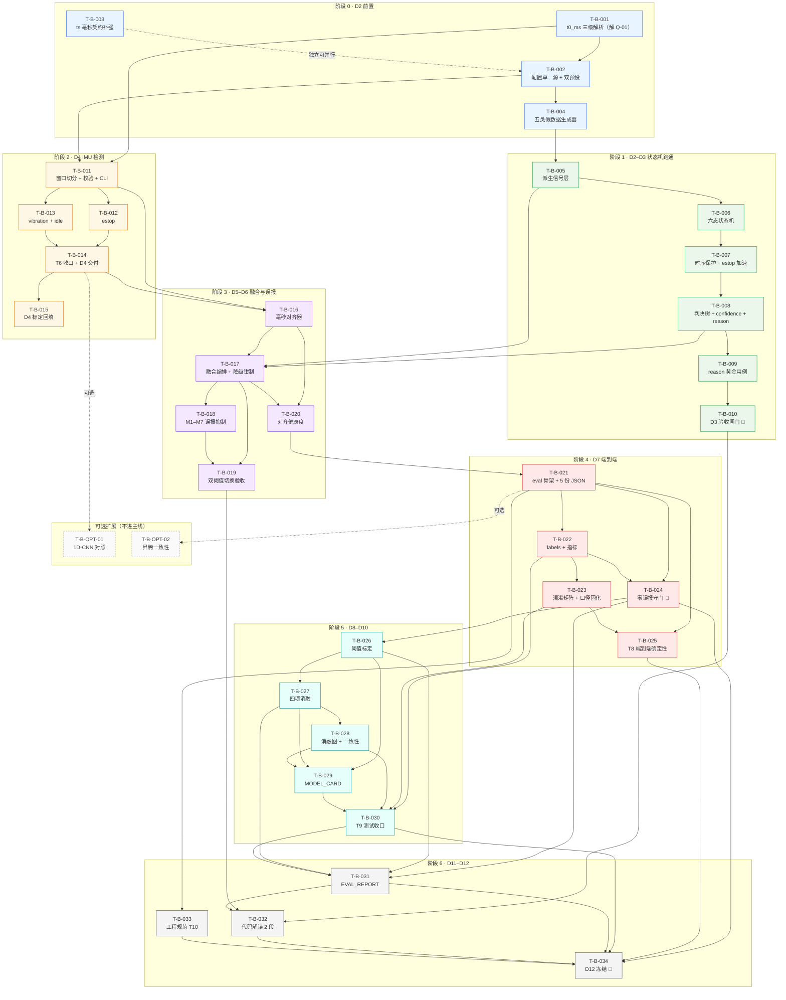

# B · 算法与决策 —— 编码任务拆解（tasks.md）

> 上游依据：`docs/spec/requirement.md`（SPEC-ELEV-RESCUE-001 v1.1，123 条 EARS 需求，DEC-01/02/03）、`docs/spec/design.md`（2140 行，B 侧技术实现方案）。
> 已落地只读基线：`common/schema.py`（`CONTRACT_VERSION="L1-1.0"`）、`tests/test_schema_contract.py`（11 项通过）、`requirements.lock.txt`。
> 团队任务卡：`E:\DSH工作区\电梯困人预警-交付包\B_算法与决策_任务卡.md`、`00_协作总览与接口契约.md`。

## 0. 范围、约束与阅读方式

### 0.1 范围边界（硬约束）

| 项 | 本次规划范围 | 明确不做 |
|---|---|---|
| 目录 | `model/`、`results/`、`tests/`（B 侧追加文件）、`docs/spec/`（仅本文档与本阶段回填） | `vision/`（A）、`service/`、`dashboard/`、`scripts/`（C） |
| 契约 | 只消费 `common/schema.py`，字段零增删 | 修改 `common/schema.py`、修改 `tests/test_schema_contract.py`（字节级不变） |
| 技术栈 | Python 3.10/3.11 + numpy 1.26.4 + scikit-learn 1.5.2 + matplotlib 3.9.2 | PyTorch / TensorFlow / PaddlePaddle / ONNX Runtime（`onnxruntime` 在 lock 中但归属 A） |
| 可选能力 | 1D-CNN（REQ-OPT-001）与昇腾一致性（REQ-OPT-002）只出现在末尾「可选扩展」，**不进主线依赖链** | 任何 P2 能力阻塞 D7 / D12 |
| 验收工具 | 仅用标准库 `unittest`（`python tests/test_xxx.py -v`），`pytest` 不在 lock 中 | 引入 lock 之外的测试框架 |

### 0.2 编号与追溯规则

- 任务编号 `T-B-001` ~ `T-B-034` 为主线，`T-B-OPT-01/02` 为可选扩展（不进主线）。
- 每个任务必须由「需求编号 `REQ-XXX-NNN`」或「设计章节号（如 2.4.3）」之一兜住；无追溯不立任务。
- 任务粒度以「一到两个半天可完成并可验收」为准；超过一天的必须再切分（本表已切好）。
- 按任务卡里程碑对齐：**D2–D3 状态机假数据跑通 → D4 IMU 事件检测 → D5–D6 融合与误报抑制 → D7 端到端首版指标 → D8–D10 阈值标定 + 消融 + MODEL_CARD → D11–D12 评测报告 + 代码片段解读 → D12 冻结**。

### 0.3 阶段划分

| 阶段 | 日期锚点 | 阶段目标 | 任务编号 |
|---|---|---|---|
| 阶段 0 | D2 前半天 | 解开 Q-01 阻塞、立配置源、补契约测试缺口、备假数据 | T-B-001 ~ T-B-004 |
| 阶段 1 | D2–D3 | 派生信号 + 六态状态机 + reason 生成器，假数据跑到 `OCCUPIED` 并报警 | T-B-005 ~ T-B-010 |
| 阶段 2 | D4 | IMU 三分数 + CLI + T6 测试 + 标定回填 | T-B-011 ~ T-B-015 |
| 阶段 3 | D5–D6 | 毫秒对齐 + 融合编排 + 降级钳制 + 五类误报抑制 + 双阈值切换 | T-B-016 ~ T-B-020 |
| 阶段 4 | D7 | 端到端 5 份 JSON + 首版指标 + **零误报阻断式守门** | T-B-021 ~ T-B-025 |
| 阶段 5 | D8–D10 | 阈值标定 + 四项消融 + 图 + MODEL_CARD + T9 | T-B-026 ~ T-B-030 |
| 阶段 6 | D11–D12 | 评测报告 + 代码解读 2 段 + 工程规范检查 + 冻结回归 | T-B-031 ~ T-B-034 |
| 可选 | D6 之后（有余力） | 1D-CNN 对照、昇腾一致性比对 | T-B-OPT-01/02 |

---

## 1. 任务总览表

> 「关键路径」列标 ✅ 者位于主关键路径；标 🔴 者为死亡线任务（D3 / D7 / D12 未达成必须触发降级预案）。

| 编号 | 标题 | 阶段 | 依赖前置 | 交付物 | 验收命令 | 工作量 | 关键路径 |
|---|---|---|---|---|---|---|---|
| T-B-001 | IMU 段起点 `t0_ms` 三级解析（解 Q-01） | 阶段 0 | 无（可直接开工） | `model/config.py`（`ImuConfig.start_ts_ms`/`imu_epoch_base_ms`/`resolve_start_ts_ms`）、`tests/test_time_base.py` | `python tests/test_time_base.py -v` | 半天 | ✅ |
| T-B-002 | 配置单一源与生产/演示双预设 | 阶段 0 | T-B-001 | `model/config.py`（5 个 frozen dataclass + 双预设 + CLI + 校验 + 快照）、`tests/test_config.py` | `python tests/test_config.py -v` | 一天 | ✅ |
| T-B-003 | 契约测试补强：`ts` 毫秒量级与相邻窗口断言 | 阶段 0 | `tests/test_schema_contract.py`（只读） | `tests/test_time_semantics.py` | `python tests/test_time_semantics.py -v` | 半天 | — |
| T-B-004 | 五类场景假数据生成器 | 阶段 0 | T-B-002 | `model/mock_scenario.py`、`tests/test_mock_scenario.py` | `python tests/test_mock_scenario.py -v` | 一天 | ✅ |
| T-B-005 | 派生信号层（`motion_level`/`door_open_proxy`/封顶） | 阶段 1 | T-B-002、T-B-004 | `model/signals.py`、`tests/test_signals.py` | `python tests/test_signals.py -v` | 一天 | ✅ |
| T-B-006 | 六态状态机与有序转移规则表 | 阶段 1 | T-B-005 | `model/state_machine.py`、`tests/test_state_machine.py`（第 1 批） | `python tests/test_state_machine.py -v` | 一天 | ✅ |
| T-B-007 | 时序保护、`dwell` 双量与 estop 加速 latch | 阶段 1 | T-B-006 | `model/state_machine.py` 增量、`tests/test_state_machine.py`（第 2 批） | `python tests/test_state_machine.py -v` | 一天 | ✅ |
| T-B-008 | 判决树、置信度与 reason 生成器 | 阶段 1 | T-B-006、T-B-007 | `model/reason.py` | `python tests/test_state_machine.py -v` | 一天 | ✅ |
| T-B-009 | reason 黄金用例（三条示例 + impossible pair） | 阶段 1 | T-B-008 | `tests/test_reason.py`（11 用例） | `python tests/test_reason.py -v` | 半天 | ✅ |
| T-B-010 | D2–D3 验收闸门：假数据到 `OCCUPIED` 并报警 | 阶段 1 | T-B-004、T-B-008、T-B-009 | `tests/test_acceptance.py`、`results/d2_acceptance.log` | `python tests/test_acceptance.py -v` | 半天 | 🔴 卡 D3 |
| T-B-011 | IMU 窗口切分、输入校验与 `ts` 生成（含 CLI） | 阶段 2 | T-B-001、T-B-002 | `model/imu_detect.py`（`detect_imu` + CLI）、`tests/test_imu_detect.py` | `python tests/test_imu_detect.py -v` | 一天 | ✅ |
| T-B-012 | `estop`：模长变化率 + 0.5s 峰值 + sigmoid | 阶段 2 | T-B-011 | `model/imu_detect.py::_estop_score` | `python tests/test_imu_detect.py -v` | 半天 | — |
| T-B-013 | `vibration`（2–8Hz 占比）与 `idle`（方差反向映射） | 阶段 2 | T-B-011 | `model/imu_detect.py::_vibration_score/_idle_score` | `python tests/test_imu_detect.py -v` | 一天 | — |
| T-B-014 | IMU 检测测试收口与 D4 交付 | 阶段 2 | T-B-012、T-B-013 | `tests/test_imu_detect.py`（11 用例）、`results/imu_summary_<case>.json` | `python tests/test_imu_detect.py -v` | 半天 | — |
| T-B-015 | D4 标定与初值回填（Q-09） | 阶段 2 | T-B-014 | `results/imu_calibration.md`、配置初值回填 | `python tests/test_imu_detect.py -v` | 半天 | — |
| T-B-016 | 毫秒对齐器（最近邻 500ms + 前向保持 10s） | 阶段 3 | T-B-011、T-B-014 | `model/fuse.py::Aligner/AlignInfo` | `python tests/test_fuse.py -v` | 半天 | ✅ |
| T-B-017 | 融合编排、降级钳制与后置分级 | 阶段 3 | T-B-016、T-B-008、T-B-005 | `model/fuse.py::FusionRunner/fuse` | `python tests/test_fuse.py -v` | 一天 | ✅ |
| T-B-018 | 五类误报抑制落点与注释反查（M1–M7） | 阶段 3 | T-B-017 | 四处模块注释与门控、`tests/test_false_alarm.py` | `python tests/test_false_alarm.py -v` | 一天 | ✅ |
| T-B-019 | 演示/生产双阈值切换验收（逻辑零改动） | 阶段 3 | T-B-017、T-B-018 | `tests/test_preset_switch.py`、`results/preset_switch_check.md` | `python tests/test_preset_switch.py -v` | 半天 | — |
| T-B-020 | 融合回归与对齐健康度告警（R-04 早暴露） | 阶段 3 | T-B-016、T-B-017 | `results/fusion_health.json` | `python model/fuse.py --mock` | 半天 | — |
| T-B-021 | eval 骨架：批处理、5 份 Decision JSON、timeline | 阶段 4 | T-B-020 | `model/eval.py`、`results/<case>_decision.json`×5、timeline、config_snapshot | `python model/eval.py --cases all --mock` | 一天 | ✅ |
| T-B-022 | `labels.json` 与指标计算（段级 + 帧级 + 响应时长） | 阶段 4 | T-B-021 | `results/labels.json`、`model/eval.py::compute_metrics`、`tests/test_eval.py` | `python tests/test_eval.py -v` | 一天 | ✅ |
| T-B-023 | 混淆矩阵、metrics 产物与口径固化 | 阶段 4 | T-B-022 | `results/confusion_matrix.png`、`metrics.md/csv`、`claims.json` | `python tests/test_eval.py -v` | 一天 | ✅ |
| T-B-024 | **【阻断式守门】正常场景零误报** | 阶段 4 | T-B-021、T-B-022 | `tests/test_no_false_alarm_gate.py`、`results/gate_normal_zero_fp.json` | `python tests/test_no_false_alarm_gate.py -v` | 半天 | 🔴 卡 D7 |
| T-B-025 | 端到端与确定性测试（T8） | 阶段 4 | T-B-021、T-B-023 | `tests/test_end_to_end.py` | `python tests/test_end_to_end.py -v` | 半天 | — |
| T-B-026 | 阈值标定（零误报优先） | 阶段 5 | T-B-024（守门必须先绿） | `model/eval.py --calibrate`、`results/threshold_calibration.md`、`threshold_grid.csv` | `python model/eval.py --calibrate` | 一天 | ✅ |
| T-B-027 | 四项消融实现（开关注入，不复制算法） | 阶段 5 | T-B-026 | `model/eval.py::run_ablation`、`results/ablation.csv` | `python model/eval.py --ablation` | 一天 | ✅ |
| T-B-028 | 消融可视化与一致性校验 | 阶段 5 | T-B-027 | `results/ablation.png`、`tests/test_eval.py` 消融用例 | `python tests/test_eval.py -v` | 半天 | — |
| T-B-029 | `MODEL_CARD.md` | 阶段 5 | T-B-026、T-B-027、T-B-028 | `model/MODEL_CARD.md` | `python tests/test_eval.py -v` | 一天 | ✅ |
| T-B-030 | 评测测试收口（T9 全量） | 阶段 5 | T-B-022、T-B-023、T-B-028、T-B-029 | `tests/test_eval.py`（10 用例） | `python tests/test_eval.py -v` | 半天 | — |
| T-B-031 | `results/EVAL_REPORT.md` | 阶段 6 | T-B-024、T-B-026、T-B-027、T-B-030 | `results/EVAL_REPORT.md` | 人工核对 + 禁用词扫描 | 一天 | ✅ |
| T-B-032 | 关键代码片段解读 2 段 | 阶段 6 | T-B-010、T-B-019、T-B-031 | `results/KEY_CODE_WALKTHROUGH.md` | `python tests/test_engineering_rules.py -v` | 一天 | — |
| T-B-033 | 工程规范静态检查（T10） | 阶段 6 | T-B-021 | `tests/test_engineering_rules.py` | `python tests/test_engineering_rules.py -v` | 半天 | ✅ |
| T-B-034 | **D12 冻结回归（P2 关闭 + 全量回归）** | 阶段 6 | T-B-024、T-B-025、T-B-030、T-B-031、T-B-032、T-B-033 | `results/FREEZE_CHECKLIST.md` | 15 个测试文件全绿 + 两次评测一致 | 半天 | 🔴 卡 D12 |
| T-B-OPT-01 | 1D-CNN IMU 对照实验（可选） | 可选 | T-B-014（主线全绿后） | `model/imu_cnn.py`（可选）、`results/cnn_vs_rule.md` | `python tests/test_imu_detect.py -v` | 一天 | ❌ 不进主线 |
| T-B-OPT-02 | 昇腾一致性比对（可选） | 可选 | T-B-021 + A 侧 NPU 输出 | `model/eval.py --compare-runs`、`results/npu_consistency.md` | `python model/eval.py --compare-runs a.json b.json` | 半天 | ❌ 不进主线 |

> 统计：主线 **34** 个任务（阶段 0：4 / 阶段 1：6 / 阶段 2：5 / 阶段 3：5 / 阶段 4：5 / 阶段 5：5 / 阶段 6：4），可选 **2** 个，合计 36 个。

---

## 2. 阶段 0 · D2 前置（解 Q-01 阻塞、立配置、补契约缺口、备假数据）

### T-B-001 · IMU 段起点 `t0_ms` 三级解析（解 Q-01）

- **交付物**：`model/config.py`（`ImuConfig.start_ts_ms`、`ImuConfig.imu_epoch_base_ms`、`resolve_start_ts_ms(npy_path, cfg) -> tuple[int, str]`）、`tests/test_time_base.py`
- **依赖前置**：无（**本项目第一个开工任务**，不依赖任何其他任务）
- **实现要点**：
  1. 优先级固定为 **① sidecar `<case>_imu.meta.json` 的 `start_ts_ms` → ② `cfg.imu.start_ts_ms`（CLI `--start-ts-ms`）→ ③ `cfg.imu.imu_epoch_base_ms`（默认 `1763300000000`，与 L1 样例同量级）**。
  2. 返回 `(t0_ms, source)`，`source ∈ {"sidecar", "cli", "default"}`；走默认分支必须写 WARN `ts_base_fallback`，走 sidecar 分支写 INFO `ts_base_source=sidecar`。
  3. sidecar 容错不得抛异常：文件不存在 / JSON 解析失败 / `start_ts_ms` 缺失 / 类型非 `int` / 数值小于 `10**12` → 逐级降级并 WARN `sidecar_invalid:<reason>`（REQ-FUNC-005 要求 `t0_ms` 不可解析时不抛异常）。
  4. 路径推导规则写成模块常量：`SIDECAR_SUFFIX = "_imu.meta.json"`，由 `xxx_imu.npy` → `xxx_imu.meta.json`；**本函数不读 `.npy`**（职责单一，读取留给 T-B-011）。
  5. **外部依赖**：A 侧 sidecar 字段口径未定（Q-01 需 A 在 D2 确认）。本任务先落地「CLI + 配置默认」两级可用实现，sidecar 分支以 fixture 自测；A 交付后仅替换读取路径，函数签名不变 → **D2 不被阻塞**。
- **验收方式**：
  - `python tests/test_time_base.py -v` → 3 条断言通过：
    - (a) 存在合法 sidecar 时 `source == "sidecar"` 且 `t0_ms == sidecar.start_ts_ms`；
    - (b) 无 sidecar 且传入 `--start-ts-ms 1763300123000` 时 `source == "cli"`；
    - (c) 两者皆无时 `source == "default"` 且日志捕获到 `ts_base_fallback`。
  - 附加断言：非法 sidecar（缺字段 / 字符串值 / 秒级 10 位值）均不抛异常，退到下一级。
- **追溯**：Q-01（阻塞项）、R-04、R-06、设计 2.4.2「`t0_ms` 解析策略」、REQ-FUNC-005、REQ-DATA-002、DEC-03
- **预估工作量**：半天

### T-B-002 · 配置单一源与生产/演示双预设

- **交付物**：`model/config.py`（`ThresholdConfig` / `ImuConfig` / `ReasonConfig` / `AblationSwitch` / `RuntimeConfig`、`PRESET_PRODUCTION` / `PRESET_DEMO`、`build_runtime_config`、`validate_config`、`config_snapshot`、`ConfigError`）、`tests/test_config.py`
- **依赖前置**：T-B-001（同文件串行扩展，先落 `ImuConfig` 三字段再扩全量）
- **实现要点**：
  1. 全部为 `@dataclass(frozen=True)`；`ThresholdConfig` 十项默认值 `180.0 / 0.70 / 0.60 / 0.80 / 0.80 / 0.15 / 0.05 / 2.0 / 3.0 / 120.0`；`RuntimeConfig.align_tolerance_ms=500`、`align_hold_ms=10000`。
  2. `PRESET_DEMO` **只改两项**：`dwell_threshold=8.0`、`demo_threshold=True`；其余九项与 `PRESET_PRODUCTION` 逐项相等（测试用逐字段 `assertEqual` 固化，防止悄悄分叉）。
  3. CLI 覆盖顺序唯一：`PRESET_*` → 显式参数 → `validate_config()` → 冻结。参数表按设计 2.7.3 的 11 个：`--demo`、`--dwell-threshold`、`--fall-thresh`、`--door-thresh`、`--estop-thresh`、`--idle-thresh`、`--accel-factor`、`--device-id`、`--location`、`--start-ts-ms`、`--seed`。
  4. `validate_config()` 覆盖 **8 类**非法输入（`dwell<=0`、`dwell>500`、`fall/door/estop ∉ [0,1]`、`accel<1.0`、`move_thresh<=stop_thresh`、`device_id` 为空）→ `ConfigError` 文本必须含字段名；CLI 层转退出码 2。
  5. `config_snapshot()` 必须含：10 项阈值 + `imu_epoch_base_ms` 等 IMU 参数 + `mode` + `demo_threshold` + `device_id` + `ablation` 三开关；**不得含任何 `Decision` 字段**（REQ-FUNC-043）。
  6. `config.py` 是依赖图叶子：只允许标准库，不导入 `common.schema`、不导入任何 `model/` 内模块。
- **验收方式**：
  - `python tests/test_config.py -v` → 6 个用例全绿：`test_production_defaults`、`test_demo_preset`（含九项逐项相等）、`test_cli_override`、`test_invalid_configs_rejected`（参数化 8 例，断言含字段名）、`test_snapshot_completeness`、`test_config_immutable`（`FrozenInstanceError`）。
- **追溯**：REQ-CFG-001~005、REQ-CONST-004、REQ-CONST-007、REQ-DATA-003、K9、设计 2.7.1–2.7.5
- **预估工作量**：一天

### T-B-003 · 契约测试补强：`ts` 毫秒量级与相邻窗口断言

- **交付物**：`tests/test_time_semantics.py`（新增文件，**不改** `tests/test_schema_contract.py`）
- **依赖前置**：现有 `tests/test_schema_contract.py`（作为对照基线，只读）
- **实现要点**：
  1. `test_ts_millisecond_scale`：对 `VisionOut` / `IMUEvent` / `Decision` 三个 `ts` 均断言 `10**12 <= ts < 10**13`（13 位量级）且 `isinstance(ts, int)`；这正是现有 11 项测试的覆盖缺口（现有用例用 `ts=0`、`ts=10000`）。
  2. `test_imu_ts_adjacent_gap`：构造 3 条 `IMUEvent(ts=1763300000000 + i*10000)`，断言相邻差恒为 `10000`、`window_sec == 10.0`；同时断言 `isinstance(ts, int)`。
  3. `test_dwell_ms_conversion`：`stop_enter_ts=1763300000000`、`now_ts=1763300190000` → `raw_dwell_ms == 190000`、`dwell_sec == 190.0`（`1e-9` 容差）。**不 import `model.*`**，保证 D2 早期即可运行。
  4. `test_no_second_scale_leak`：断言 `180*1000` 与 `raw_dwell_ms` 同数量级（`10**5`），并用 `abs(180 - 190000) > 1000` 反向证明「秒/毫秒混用会差 3 个数量级」。
  5. 文件末尾 `if __name__ == "__main__": unittest.main(verbosity=2)`，与既有契约测试的运行方式保持一致。
- **验收方式**：
  - `python tests/test_time_semantics.py -v` → 4 条通过；
  - `python tests/test_schema_contract.py -v` → 仍 **11 项通过**（证明补强是追加而非改写）。
- **追溯**：REQ-DATA-002、REQ-FUNC-005、REQ-FUNC-020、REQ-FUNC-049、DEC-03、R-05、设计 1.2.2 未覆盖项 1–3、2.10.2 T1
- **预估工作量**：半天

### T-B-004 · 五类场景假数据生成器

- **交付物**：`model/mock_scenario.py`（`ScenarioBundle` / `ScenarioExpectation` / `generate_scenario` / `make_frames`）、`tests/test_mock_scenario.py`
- **依赖前置**：T-B-002（需要 `RuntimeConfig` 与预设）
- **实现要点**：
  1. `generate_scenario(kind, cfg, seed=0)` 支持五类 `normal / estop / trapped / pry / faint`；提供 `fps=1`（D2–D3 用，220 帧量级）与 `fps=25`（D7 用）两种模式，`ts` 一律 13 位毫秒递增。
  2. `make_frames()` 内置五条序列（`normal_sequence` / `trapped_sequence` / `pry_sequence` / `faint_sequence` / `estop_sequence`），严格按设计 2.10.2 T4 描述构造：`normal` = IDLE 静止 2s → 运行 3s → 停稳 1s → 门开 3s → 门关 1s → 人数 2 → 门开。
  3. 合成 IMU：600 步 `(3,200,3) float32`，含「急停脉冲 / 5Hz 正弦 / 近零方差 / 持续运动」四类；落盘默认到 `results/_mock/`，**绝不写入 `common/demo_data/`**（目录边界 REQ-CONST-003）。
  4. 随机性只用 `np.random.default_rng(seed)`；同 seed 两次生成的 `asdict` 结果必须完全相等（确定性 REQ-QUAL-001）。
  5. 每个 bundle 携带 `expected(event_type, urgency, trapped)`，取值对齐 requirement 附录 A，作为单测与 `--mock` 的自校验基准。
- **验收方式**：
  - `python tests/test_mock_scenario.py -v` → 5 类 bundle 均非空；`expected` 与附录 A 逐类一致；同 seed 两次序列 `==`；`ts` 全为 13 位且严格递增。
- **追溯**：REQ-FUNC-042、REQ-ACC-002、REQ-QUAL-001、REQ-DATA-002、设计 2.2.2 B-8、2.10.2 T4 假数据构造器
- **预估工作量**：一天

---

## 3. 阶段 1 · D2–D3 状态机假数据跑通

### T-B-005 · 派生信号层（`motion_level` / `door_open_proxy` / 人数封顶）

- **交付物**：`model/signals.py`（`SignalEstimator`、`FrameEvidence`）、`tests/test_signals.py`
- **依赖前置**：T-B-002、T-B-004
- **实现要点**：
  1. `FrameEvidence` 为 `frozen dataclass`，字段严格按设计 2.3.2：`ts / person_count / fall_prob / door_approach / crowded / keypoints_ok / motion_level / door_open_signal / imu_estop / imu_idle / imu_vibration / imu_present / flags`；`imu_*` 为 `float | None`。
  2. `motion_level` 派生：有 IMU 时 `clip(1 - idle + 0.3 * vibration, 0, 1)`；无 IMU 时用「人数变化 + `door_approach` 变化」在 1s 窗口内的变化量代理，并在 `flags` 加 `imu_unavailable`。
  3. `door_open_proxy` 三证据联合（**不依赖单一条件**，针对 R-01）：人数较上一帧变化 ≥1、`door_approach` 单帧骤降 ≥0.25、`motion_level` 由 `≥move_thresh` 掉到 `<stop_thresh`；命中后保持 `1000ms`（hold），任何命中帧 `flags += technical_debt`。
  4. `person_count = min(raw_person_count, schema.PERSON_COUNT_MAX)`，原始值写结构化日志字段 `raw_person_count`；`fall_prob/door_approach/crowded` 越界裁剪到 `[0,1]` 并 WARN `field_clipped`。
  5. `reset()` 清空 hold 起点与 `last_person_count`；每段视频 `new SignalEstimator()`，**禁止模块级可变状态**（REQ-QUAL-001）。
  6. 注释固定前缀 `# suppress: <误报场景> -> <REQ 编号>`（本任务至少覆盖 M4 人数封顶与 M1 门开代理抖动两条）。
- **验收方式**：
  - `python tests/test_signals.py -v` → 5 条通过：`idle=0.9 → motion_level≈0.1 < move_thresh`；`imu=None` 时人数 2→3 产生 `motion_level>0`；`person_count=12 → evidence.person_count==8` 且日志含 `raw_person_count=12`；人数变化帧起门开信号保持后转 False；门开帧 `flags` 含 `technical_debt`。
- **追溯**：REQ-FUNC-030、REQ-FUNC-041、REQ-FUNC-011/012、REQ-QUAL-001、R-01、设计 1.1.2 扩展项、2.8 M1/M4
- **预估工作量**：一天

### T-B-006 · 六态状态机与有序转移规则表

- **交付物**：`model/state_machine.py`（`ElevatorState` / `RunClock` / `MachineContext` / `TransitionRule` / `StateMachine`）、`tests/test_state_machine.py`（第 1 批 10 用例）
- **依赖前置**：T-B-005
- **实现要点**：
  1. `ElevatorState` 仅 6 个成员（`IDLE/MOVING/STOPPED/DOOR_OPEN/DOOR_CLOSED/OCCUPIED`），初始 `IDLE`；`MachineContext` 字段按设计 2.1.3(1) 全量落地（含 `raw_dwell_ms` / `accel_extra_ms` / 6 个 `_RunClock` / `transition_count` / `alarmed` / `first_alarm_ts`）。
  2. `RunClock.update(cond, now_ts)` 只保存 `since_ts: int | None`，返回**毫秒数**；所有「持续 1s/3s」判定一律 `Δms >= 1000 / 3000`，**禁止帧计数**（A 侧可能跳帧）。
  3. 规则表为模块级 `tuple[TransitionRule, ...]`，**顺序即优先级**，逐格对应 requirement 附录 B；未命中任何规则 → 自环 + WARN `undefined_transition`（不抛异常）。
  4. 三处顺序必须写死：① 急停优先于停稳（`estop` 命中时 `stop_enter_ts` 取当帧）；② 门开优先于一切滞留；③ `OCCUPIED` 的撤离（门开/空梯/运动恢复）优先于自环判决。
  5. `step(vision, imu_event)` 模块级函数 = 懒创建默认实例，仅用于单帧调试；批量必须用 `StateMachine(cfg)` 实例（`fuse` 每段新建，防串扰）。
  6. 进入 `STOPPED` 记 `stop_enter_ts = 当帧 ts` 且 raw/extra 双清零；`DOOR_OPEN` 时 `stop_enter_ts = None`；`DOOR_CLOSED` 时重置为门关时刻。
- **验收方式**：
  - `python tests/test_state_machine.py -v` → 转移类 10 条通过：初始 `IDLE` 且枚举成员数 6；六态均可达（`transition_count`）；转移表 6 状态 × 8 类输入无空白；25 帧（40ms 步长）→ `MOVING`；运动 2s 后静止 1s → `STOPPED` 且 `stop_enter_ts==当帧 ts`、`raw_dwell_ms==0`；`estop=0.95` 强制 `STOPPED`；`OCCUPIED` 门开当帧 `DOOR_OPEN`+`trapped=False`；`DOOR_OPEN` 连续 60s `dwell_sec==0`；门开 3s 后关 1s → `DOOR_CLOSED`；`DOOR_CLOSED`+人数 2 → `OCCUPIED`。
- **追溯**：REQ-FUNC-009~020、REQ-FUNC-044、REQ-QUAL-004、设计 2.1.3(1)、requirement 附录 B
- **预估工作量**：一天

### T-B-007 · 时序保护、`dwell` 双量与 estop 加速 latch

- **交付物**：`model/state_machine.py` 增量、`tests/test_state_machine.py`（第 2 批 6 用例）
- **依赖前置**：T-B-006
- **实现要点**：
  1. 时序保护：`vision.ts <= ctx.last_ts` → `dropped_frames += 1`、WARN `ts_regression`（含 `prev_ts`/`cur_ts`）、**不推进状态、不累加 dwell、不动任何 `_RunClock`**；输出上一有效判决的定格复制，`ts` 取 `ctx.last_ts`（Q-07 裁定「推进丢弃、输出保留」）。
  2. `raw_dwell_ms = now_ts - stop_enter_ts`（仅基准存在时）；`effective_dwell_ms = raw_dwell_ms + accel_extra_ms`；哨兵：`raw < 0` 或 `raw > 86_400_000` → ERROR `suspicious_time_unit`（R-05 的防秒制泄漏手段）。
  3. latch 四条件固化：`estop > th` → `latch=True` 且记 `estop_latch_ts`；`estop <= th` → `False`；`None` 且 `now - estop_latch_ts <= 10000ms` → 保持；`> 10000ms` → `False`。
  4. 增量规则：`accel_extra_ms += round(Δms * (dwell_accel_factor - 1))`，仅当 `latch == True` 且 `state ∈ {STOPPED, DOOR_CLOSED, OCCUPIED}`。
  5. 判决比较用整数：`effective_dwell_ms > round(dwell_threshold * 1000)`，**严格大于**（等值不判，REQ-FUNC-049）。
  6. `raw` 与 `effective` 双量并存：`REQ-FUNC-020` 的 `190000ms → 190.0s` 精确可测，`REQ-FUNC-027` 的「100s→约 200s」也可测（K1 / Q-10）。
- **验收方式**：
  - `python tests/test_state_machine.py -v` → 追加 6 条通过：`ts=[1763300000000, 1763300000000, 1763299999000, 1763300001000]` 仅首末生效且 `dropped_frames==2`、`raw_dwell_ms` 单调不减；全序列 `imu_event=None` 仍可达 `OCCUPIED` 且 `trapped=True`；`dwell=8.000s`、`th=8s` → `trapped=False`；五个非 `OCCUPIED` 状态遍历均 `trapped=False`；`estop=0.92` 每 10s 一次、真实 100s → `raw≈100000ms`、`effective≈200000ms`（±5%）；一次 estop 后 12s 无事件 → `latch=False` 且 `effective≈raw`。
- **追溯**：REQ-FUNC-021/022/023/027/049、REQ-QUAL-001、DEC-03、Q-07、Q-10、R-05、K1、设计 2.1.3(2)
- **预估工作量**：一天

### T-B-008 · 判决树、置信度与 reason 生成器

- **交付物**：`model/reason.py`（`Verdict` / `ReasonContext` / `ReasonBuilder` / `render_reason` / `assert_pair_legal` / `derive_verdict`）
- **依赖前置**：T-B-006、T-B-007
- **实现要点**：
  1. 判决树严格按 V1→V5 顺序匹配第一条：`faint`（`trapped ∧ keypoints_ok ∧ fall_run≥3000ms ∧ fall_prob>fall_thresh`）→ `pry`（`trapped ∧ door_approach>door_thresh`）→ `trapped` → `estop`（`imu_estop>estop_thresh`）→ `normal`；`faint` 优先于 `pry`（Q-04 裁定）。
  2. 四道硬约束落地并在返回前断言：① `trapped ⟹ urgency>=2`；② `urgency=1 ⟹ event_type=="estop"`；③ `urgency=3 ⟹ event_type=="faint" ∧ trapped`；④ `imu_present=False ⟹ urgency != 3`（本模块只断言，钳制在 `fuse` 后置执行）。
  3. `reason` 九阶段固定 pipeline，空阶段不产出：`dwell`（**必出**）→ `person` → `fall`/`keypoints` → `door_approach` → `imu`（estop→idle→vibration 固定顺序）→ `crowded` → `imu_unavailable` → `technical_debt`（仅 `urgency>=2`）→ `demo_threshold`（仅 `demo_mode=True`）。
  4. 数值格式：`dwell` 取 0 或 1 位小数（整数秒不带小数点）、概率类 2 位小数、`person_count` 整数、标记型 `key=true` / `technical_debt=door_signal_proxy`；**`dwell` 只出秒**，`reason` 中不得出现 10 位以上数字。
  5. 置信度：五通道权重 `dwell=0.40 / person=0.25 / imu=0.20 / fall=0.10 / door=0.05`，按可用通道归一；`estop` 判决用 `0.6*estop + 0.4*(1-s_dwell)`；`normal` 用 `clip(1-max(s_dwell, estop), 0.05, 1.0)`；统一 `round(x, 6)`。
  6. 返回前执行 C1–C4 自检（非空、`normal` ≤2 条、白名单+结构正则、`URGENCY_EVENT_MAP` 组合合法），失败 `AssertionError` 并打印完整 `reason` 便于定位。
- **验收方式**：
  - `python tests/test_state_machine.py -v` → 受影响的 trapped 判决与九字段用例仍全绿；
  - `python tests/test_reason.py -v` → 本阶段可先跑判决树 5 条与 `test_pair_legal_raises`；`urgency=1 + trapped` 必须 `ValueError`。
- **追溯**：REQ-FUNC-032~038、REQ-EXPL-001~007、DEC-01、REQ-FUNC-047、K4/K6、设计 2.5.4 / 2.5.6 / 2.6.1–2.6.3
- **预估工作量**：一天

### T-B-009 · reason 黄金用例（三条示例 + impossible pair）

- **交付物**：`tests/test_reason.py`（11 用例，设计 2.6.4 三条示例落为期望值）
- **依赖前置**：T-B-008
- **实现要点**：
  1. **示例 1 · trapped（生产阈值）** 期望**逐条字符串相等**（顺序敏感）：
     `["dwell=412s > 180s", "person_count=1 >= 1", "imu.idle=0.91 > 0.80", "technical_debt=door_signal_proxy"]`；
     输入证据：`dwell=412s`、`th=180`、`person=1`、`fall=0.31`、`door=0.22`、`estop=0.12`、`idle=0.91`、`vibration=0.20`、`crowded=0.15`、`keypoints_ok=True`。
  2. **示例 2 · pry（演示阈值 8s）** 期望：
     `["dwell=95s > 8s", "person_count=2 >= 1", "door_approach=0.82 > 0.60", "imu_unavailable=true", "technical_debt=door_signal_proxy", "demo_threshold=true"]`。
  3. **示例 3 · faint** 期望：
     `["dwell=212s > 180s", "person_count=1 >= 1", "fall_prob=0.87 > 0.70", "imu.estop=0.92 > 0.80", "imu.idle=0.88 > 0.80", "technical_debt=door_signal_proxy"]`；`urgency==3`、`event_type=="faint"`。
  4. **impossible pair 校验**：`test_pair_legal_raises` 构造 `urgency=1 + event_type="trapped"` → `ValueError`；并补两条对称反例 `urgency=3 + "pry"`、`urgency=2 + "faint"` 均拒绝（DEC-01 的机器表达）。
  5. 辅助用例：`normal` 的 `1 <= len(reason) <= 2`；五类判决的键全部 ∈ 13 键白名单；无「检测到异常 / 疑似困人 / 请及时处理」；无 `\d{10,}` 毫秒泄漏；`keypoints_ok=False` 时含 `keypoints_unreliable=true` 且 `event_type != "faint"`；`crowded=0.1 vs 0.9` 置信度单调下降而 `trapped` 不变。
- **验收方式**：
  - `python tests/test_reason.py -v` → **11 条通过**，其中 `test_unique_trapped_reason`、`test_pry_demo_reason`、`test_faint_reason` 为逐条字符串相等断言（不接受「包含」）。
- **追溯**：REQ-EXPL-001~007、REQ-FUNC-029/032/033/035/036/047、DEC-01、设计 2.6.4「三条完整示例可直接作为单测期望值」、2.10.2 T5
- **预估工作量**：半天

### T-B-010 · D2–D3 验收闸门：假数据跑到 `OCCUPIED` 并报警

- **交付物**：`tests/test_acceptance.py`（两条验收用例）、`results/d2_acceptance.log`
- **依赖前置**：T-B-004、T-B-008、T-B-009
- **实现要点**：
  1. `test_acceptance_state_machine_reaches_occupied`：用 `mock_scenario` 生成 trapped 场景（1 帧/秒、约 220 帧、13 位毫秒 `ts`），逐帧 `StateMachine.step()`；断言状态轨迹依次包含 `IDLE / MOVING / STOPPED / DOOR_CLOSED / OCCUPIED`。
  2. 断言存在 `trapped=True` 帧；首个 `trapped=True` 帧满足 `urgency==2`、`event_type=="trapped"`、`dwell_sec > 8.0`。
  3. 全部 `Decision` 通过九字段校验（字段名/类型/取值范围：`urgency ∈ 0..3`、`people_count ∈ 0..8`、`confidence ∈ [0,1]`）且 `reason` 非空。
  4. 把完整状态轨迹 + 首个告警帧 JSON 写入 `results/d2_acceptance.log`（作为 REQ-ACC-002 的机器证据）。
  5. `test_acceptance_imu_five_cases_nonempty`：5 段合成 npy（600 步）→ `detect_imu`，每段 `len>=3`、`window_sec` 全 10.0、`ts` 相邻差 10000；**D3 时以 `unittest.skipUnless` 跳过，T-B-011/T-B-014 完成后必须转为全绿**。
  6. 失败时打印完整状态轨迹（设计要求：越晚发现代价越大）。
- **验收方式**：
  - `python tests/test_acceptance.py -v` → `test_acceptance_state_machine_reaches_occupied` **PASS**（D3 晚间必须绿）；IMU 用例此时为 skip 并显式打印 `SKIP: pending T-B-014`。
- **追溯**：REQ-ACC-002、REQ-ACC-003、REQ-QUAL-004、REQ-FUNC-009~019、设计 2.10.3
- **预估工作量**：半天（**卡 D3 死亡线**）

---

## 4. 阶段 2 · D4 IMU 事件检测

### T-B-011 · IMU 窗口切分、输入校验与 `ts` 生成（含 CLI）

- **交付物**：`model/imu_detect.py`（`detect_imu` / `detect_imu_with_config` / `RuleBasedImuDetector` 骨架 / CLI）、`tests/test_imu_detect.py`（第 1 批）
- **依赖前置**：T-B-001、T-B-002
- **实现要点**：
  1. 严格整窗切分：`n_win = N // 200`；`tail = N - n_win*200`；`tail > 0` → WARN `tail_dropped:<n> steps`；`n_win == 0` → 返回 `[]` + WARN `insufficient window: N=199 < 200`（**禁止补零伪造事件**）。
  2. 校验顺序固定：`ndim==3` → `shape[1:]==(200,3)` → `dtype==float32` → `np.isfinite().all()`；任一失败抛 `ValueError`，文本必须含**文件名与实际 shape/dtype**。
  3. `ts_i = t0_ms + (i+1)*10000`（窗口结束时刻），`t0_ms` 来自 T-B-001 的 `resolve_start_ts_ms()`；`window_sec` 恒 `schema.IMU_WINDOW_SEC`（10.0）。
  4. CLI：`python model/imu_detect.py --npy <path> [--start-ts-ms <int>] [--out <json>] [--verbose]`；`ValueError` → **退出码 2 + 明确错误文本**（不打印 traceback）；`--help` 完整说明。
  5. 本模块**禁止** import `state_machine` / `fuse` / `reason` / `eval` / `vision`；返回注解只含 `IMUEvent`，不出现 `trapped`/`urgency`（REQ-FUNC-007 职责隔离）。
  6. 文件头注释写明「10 秒窗口只做事件检测，困人由状态机 + 长时间累积判定」。
- **验收方式**：
  - `python tests/test_imu_detect.py -v` → 窗口类 6 条通过：`N=600 → 3`；`N=650 → 3` + WARN `tail_dropped`；`N=199 → []` + WARN `insufficient window`；`window_sec` 全 10.0；相邻 `ts` 差 10000 且 13 位；5 类非法 npy 均 `ValueError` 且文本含文件名/形状。
  - `python model/imu_detect.py --npy <fixture>` → 退出码 0；非法输入退出码 2。
- **追溯**：REQ-FUNC-001/005/006/007/008、REQ-DATA-009、REQ-QUAL-002、设计 2.2.2 B-1/B-4、2.4.1/2.4.2
- **预估工作量**：一天

### T-B-012 · `estop`：模长变化率 + 0.5s 峰值 + sigmoid

- **交付物**：`model/imu_detect.py::_estop_score`、`tests/test_imu_detect.py` 的 estop 用例
- **依赖前置**：T-B-011
- **实现要点**：
  1. 模长 `a[t] = sqrt(ax²+ay²+az²)`；变化率 `r[t] = |a[t]-a[t-1]|/0.05`（`t=1..199`，单位：归一化单位/秒）。
  2. 短时峰值：长度 10 步（0.5s）滑窗取**峰值**（不是均值，急停是突变，平均会稀释）。
  3. `estop = 1/(1+exp(-gain*(peak-center)))`，`center=estop_rate_center`（初值 0.55）、`gain=estop_rate_gain`（初值 6.0），结果 `clip(0,1)`。
  4. **不做跨窗平滑**（融合层已有最近邻 + 前向保持，双处平滑会让告警延迟指标失真）。
  5. 注释 `# suppress: 轻微晃动 -> REQ-FUNC-048`：短窗峰值 + `center` 取正常段 P99 + `estop_thresh=0.8` 三重保证。
- **验收方式**：
  - `python tests/test_imu_detect.py -v` → 急停脉冲（第 100–110 步幅值 3× 基线）`estop >= 0.8`；平稳段（±5% 噪声）`estop < 0.6`；任意输入 `0 <= estop <= 1`。
- **追溯**：REQ-FUNC-002、REQ-FUNC-048、设计 2.4.3、2.8 M5
- **预估工作量**：半天

### T-B-013 · `vibration`（2–8Hz 占比）与 `idle`（方差反向映射）

- **交付物**：`model/imu_detect.py::_vibration_score/_idle_score`、`tests/test_imu_detect.py` 对应用例
- **依赖前置**：T-B-011
- **实现要点**：
  1. `vibration`：逐通道去均值 → `rfft` 功率谱 → `P[20:81] / P[1:100]`（`Δf=0.1Hz`，2–8Hz 含端点）→ 三通道取 `max` → 分段线性 `clip((ratio-low)/(high-low), 0, 1)`，初值 `low=0.25`、`high=0.60`。
  2. `idle`：三通道方差均值 `var` → `1/(1+exp(gain*(var-center)))`，初值 `center=0.020`、`gain=120.0`；方差越小 → `idle→1`。
  3. `vibration` 取三通道 `max`（任一轴异常即异常），**不是 mean**；分母必须剔除 DC `bin 0`。
  4. 注释写明 `idle` 不直接驱动状态转移，只经 `signals.motion_level = 1 - idle` 间接影响 `MOVING`/`STOPPED`，并在 `reason` 中作「确实停着不动」的辅助证据。
  5. 全部参数从 `ImuConfig` 注入，模块内零阈值字面量。
- **验收方式**：
  - `python tests/test_imu_detect.py -v` → 5Hz 单频 `vibration > 0.7` 且比平稳段高 >0.4；任意输入 `0 <= vibration <= 1`；全零 200 步 `idle >= 0.9`；持续运动 `idle <= 0.2`。
- **追溯**：REQ-FUNC-003、REQ-FUNC-004、REQ-FUNC-028、REQ-CFG-001、R-03、设计 2.4.4 / 2.4.5
- **预估工作量**：一天

### T-B-014 · IMU 检测测试收口与 D4 交付

- **交付物**：`tests/test_imu_detect.py`（T6 全 11 用例）、`results/imu_summary_<case>.json`
- **依赖前置**：T-B-012、T-B-013
- **实现要点**：
  1. 补齐 5 类非法 npy 用例：`NaN` / `Inf` / `float64` / `(N,199,3)` / `(N,200,2)`，逐条断言错误文本含文件名与形状。
  2. `test_no_vision_import`：`sys.modules` + AST 双重检查，确认 `model.imu_detect` 未导入 `vision` / `state_machine`。
  3. 对 5 段 npy 批量跑 `detect_imu`，落 `results/imu_summary_<case>.json`（每窗 `ts/estop/vibration/idle` 摘要）；A 未交付真实 npy 时使用 T-B-004 合成数据并显式标注 `source=mock`。
  4. 断言 `demo_estop` 段 `max(estop)` 比 `demo_normal` 高 ≥0.2（REQ-ACC-003 的可判别性证据）。
  5. 把 T-B-010 的 IMU 验收用例从 skip 转为启用，确认 `python tests/test_acceptance.py -v` 两条全绿。
- **验收方式**：
  - `python tests/test_imu_detect.py -v` → **11 条通过**；
  - `python tests/test_acceptance.py -v` → **2 条通过**（IMU 用例不再 skip）；
  - `python model/imu_detect.py --npy common/demo_data/demo_estop_imu.npy --verbose` → 退出码 0 并打印摘要表。
- **追溯**：REQ-FUNC-001~008、REQ-ACC-003、REQ-QUAL-005、设计 2.10.2 T6
- **预估工作量**：半天

### T-B-015 · D4 标定与初值回填（Q-09）

- **交付物**：`results/imu_calibration.md`、`model/config.py` 初值更新、`docs/spec/requirement.md` 第 9 节阈值表数值行回填
- **依赖前置**：T-B-014
- **实现要点**：
  1. `estop_rate_center` 取正常段 `peak` 的 **P99**；`estop_rate_gain` 由 `sigmoid(gain*(3b-b)) >= 0.8 → 12b >= 1.386` 反解，并留 10% 余量。
  2. `vib_ratio_low` 取正常段 `ratio` 的 P95；`vib_ratio_high` 取异常振动段 `ratio` 中位数。
  3. `idle_var_center` 取「运行段方差」与「静止段方差」分布中点；`idle_var_gain` 保证 `var≈0 → idle≥0.95`、`var≥0.05 → idle≤0.05`。
  4. `idle_thresh / move_thresh / stop_thresh` 初值（0.80 / 0.15 / 0.05）在假数据 + 5 段上验证后回填；通过则记录「维持初值」。
  5. 标定记录必须写明样本段名、统计量、选定值与理由；**先写「正常场景误报=0」，再写召回**（REQ-CONST-005 的顺序要求）。
  6. 回填后必须回归 `tests/test_config.py` 与 `tests/test_imu_detect.py`，不得因换初值变红。
- **验收方式**：
  - `python tests/test_imu_detect.py -v` 与 `python tests/test_config.py -v` 在回填后全绿；
  - `results/imu_calibration.md` 首行含「正常场景误报=0」，且每项阈值附数据来源。
- **追溯**：REQ-CONST-004、REQ-CONST-005、REQ-FUNC-002/003/004、Q-09、OPN-03、设计 2.4.3–2.4.5
- **预估工作量**：半天

---

## 5. 阶段 3 · D5–D6 融合与误报抑制

### T-B-016 · 毫秒对齐器（最近邻 500ms + 前向保持 10s）

- **交付物**：`model/fuse.py::Aligner`、`AlignInfo`、`tests/test_fuse.py` 对齐用例
- **依赖前置**：T-B-011、T-B-014
- **实现要点**：
  1. 预先将 `imu` 的 `ts` 转 `np.ndarray[int64]`，用 `numpy.searchsorted` 二分，每帧 `O(log W)`。
  2. 三档判定固定顺序：① `|e* - f| <= 500ms` → `nearest`；② `e_prev = max{e <= f}` 且 `f - e_prev <= 10000ms` → `hold`；③ 否则 `none`。
  3. 等距情形取**较早**事件（`side="left"` 后比较左右邻居），保证确定性（REQ-QUAL-001）。
  4. 每帧记录 `AlignInfo(match, delta_ms)`，写入 timeline 日志（REQ-EVAL-008 的人工复核入口）。
  5. 按设计 2.1.3(3) 的验收对照自测：事件 `10000/20000/30000`、帧 `31000` → 最近邻差 11000 失败、前向保持 11000 > 10000 失败 → `none`。
- **验收方式**：
  - `python tests/test_fuse.py -v` → 5 条对齐用例通过：`ts=10000` 帧 `10400` → nearest；帧 `10600` → 回落分支（按实现口径断言 `hold` 或 `none`）；事件 `30000` 帧 `40000` → `hold` 且 `delta_ms==10000`；帧 `41000` → `None`；等距取较早。
- **追溯**：REQ-FUNC-026、REQ-FUNC-022、REQ-QUAL-001、K3、设计 2.1.3(3)、2.5.2
- **预估工作量**：半天

### T-B-017 · 融合编排、降级钳制与后置分级

- **交付物**：`model/fuse.py`（`FusionRunner` / `fuse` / `fuse_with_config`）、`tests/test_fuse.py` 其余用例
- **依赖前置**：T-B-016、T-B-008、T-B-005
- **实现要点**：
  1. 入口防御性稳定排序（按 `ts`，不信任外部顺序）；`vision == []` → 返回 `[]` + 日志说明（不得凭 IMU 伪造 `trapped`）。
  2. 每段 `new SignalEstimator(cfg)` + `new StateMachine(cfg)`；每帧 `align → estimator.update → machine.step_evidence` → append；返回 `len == len(vision)`。
  3. `imu` 为空 / 文件缺失 / `detect_imu` 抛 `ValueError` → `imu_present=False`、全对齐 `None`、**返回前逐条 `urgency = min(urgency, 2)`**（钳制在判决之后，保留 `faint` 证据供日志与复核，K5）。
  4. `keypoints_ok=False` → `fall_prob` 置 0（**置 0 占位，不是跳过**）+ `flags += keypoints_unreliable`；概率越界裁剪；`person_count` 封顶。
  5. 门代理生效 → `flags += technical_debt`，`urgency >= 2` 时写入 `reason`（`normal` 帧只进结构化日志，避免突破 ≤2 条上限）。
  6. 单帧内部异常 → 该帧输出 `normal / confidence=0` + ERROR，**不中断整段**（REQ-QUAL-002）。
- **验收方式**：
  - `python tests/test_fuse.py -v` → **9 条通过**：750 帧 → 750 条；空 vision + 强 estop → `[]` 且无 `trapped`；`imu=[]` → 全部 `reason` 含 `imu_unavailable=true` 且无 `urgency==3`；`person_count=12 → people_count==8`；降级输出 `dataclasses.asdict` 键集合 == 契约 9 键；概率 1.3/-0.2 裁剪；单帧异常不中断。
- **追溯**：REQ-FUNC-025/029/030/031/039/041/043、REQ-QUAL-002、K5/K6、设计 2.5.1 / 2.5.3 / 2.1.3(3) 降级路径
- **预估工作量**：一天

### T-B-018 · 五类误报抑制落点与注释反查（M1–M7）

- **交付物**：`model/state_machine.py` / `model/signals.py` / `model/reason.py` / `model/imu_detect.py` 的门控与注释、`tests/test_false_alarm.py`
- **依赖前置**：T-B-017
- **实现要点**：
  1. 逐条落地设计 2.8 的 M1–M7，每处注释固定前缀 `# suppress: <场景> -> <REQ 编号>`；可用 `grep -rn "suppress:" model/` 反查 ≥7 条。
  2. **M1 正常到站**：门开信号为真 → `stop_enter_ts=None`、`raw_dwell_ms=0`、`accel_extra_ms=0`、`alarmed=False`、当帧 `trapped=False`。
  3. **M2 检修停梯/空梯**：`person_count == 0 ⟹ trapped=False`（**无论 dwell 多长**），持续 3s 后回 `IDLE` 并清零。
  4. **M3 蹲下捡东西**：`fall_run >= fall_persist_sec*1000`（3s）才允许 faint；单帧或 2s 弯腰不成立。**M6 门长开**：`DOOR_OPEN` 超 120s 只记 `long_open`，dwell 恒 0，不判困人。
  5. **M4 人多拥挤**：`crowded` 只降 `confidence`（`s_person *= (1 - 0.5*crowded)`）并写 `crowded=...`，**不得把 `trapped=True` 改为 False**；`people_count` 仍封顶 8。**M5 轻微晃动**：`estop < 0.8` 且无 estop 事件。**M7 时序抖动**：回退帧不推进、不累加。
  6. 测试逐条构造反例：正常到站、检修停梯 600s 人 0、蹲下 2s、拥挤 0.9、日常晃动、门开 130s、`ts` 抖动。
- **验收方式**：
  - `python tests/test_false_alarm.py -v` → **7 条通过**，每条测试名可映射到 M1–M7；
  - `grep -rn "suppress:" model/ | wc -l` ≥ 7。
- **追溯**：REQ-FUNC-044~050、REQ-CONST-005、REQ-FUNC-050、设计 2.8 M1–M7（M3' 髋高属 A，不在 B 侧实现）
- **预估工作量**：一天

### T-B-019 · 演示/生产双阈值切换验收（逻辑零改动）

- **交付物**：`tests/test_preset_switch.py`、`results/preset_switch_check.md`
- **依赖前置**：T-B-017、T-B-018
- **实现要点**：
  1. 同一份 **20 秒** trapped 假数据：`PRESET_PRODUCTION`（180s）跑 → `trapped=True` 出现次数为 **0**；`PRESET_DEMO`（8s）跑 → 出现 `trapped=True`，且 `reason` 含 `demo_threshold=true` 与 `dwell=... > 8s`。
  2. 两次运行共用同一个 `fuse_with_config()`；用 AST 扫描断言算法模块函数体内**不存在** `if demo:` / `if cfg.demo_threshold:` 分叉（`demo_threshold` 只作为 `ReasonBuilder` 上下文）。
  3. CLI 等价性：`--dwell-threshold 8` 与 `--demo` 产生等价判决（逐帧 `trapped/urgency/event_type` 完全相等），`reason` 差异仅「demo 标记 + 阈值数值」。
  4. 20 秒数据必须能触发 → 断言首个 `trapped=True` 帧距首个停稳时刻 `≤20000ms`（演示现场不冷场）。
  5. 结论写入 `results/preset_switch_check.md`：列出两次配置快照差异（仅 `dwell_threshold` 与 `demo_threshold` 两项），并注明「代码逻辑零改动」。
- **验收方式**：
  - `python tests/test_preset_switch.py -v` → **4 条通过**；
  - 手工执行 `python model/eval.py --cases all --mock` 与 `python model/eval.py --cases all --mock --demo`，比较 5 份 JSON 的 `trapped` 序列：演示版出现报警、生产版为 0。
- **追溯**：REQ-CFG-003、REQ-CONST-007、REQ-EXPL-006、REQ-CFG-002、K10、设计 2.7.2「只改配置不改逻辑」、任务卡坑 1
- **预估工作量**：半天

### T-B-020 · 融合回归与对齐健康度告警（R-04 早暴露）

- **交付物**：`results/fusion_health.json`、`model/fuse.py` 对齐统计增量
- **依赖前置**：T-B-016、T-B-017
- **实现要点**：
  1. 统计每段 `match` 分布（`nearest/hold/none` 占比）与 `mean(|delta_ms|)`，落 `results/fusion_health.json`。
  2. `none` 占比 **> 50%** → 显式 WARN `imu_alignment_degraded`（R-04 的「指标表面正常、IMU 实际全废」必须在 D7 前暴露）。
  3. `hold` 连续超过一个窗长（>10000ms）必须告警，保证 latch 与对齐口径一致。
  4. 对 5 段假数据跑一遍，输出健康度表；断言 estop 段 `nearest` 占比 > 30%。
  5. 健康度表进 `results/EVAL_REPORT.md` 的「数据与对齐质量」小节（T-B-031 引用）。
- **验收方式**：
  - `python tests/test_fuse.py -v` → 原 9 条 + 新增 2 条（健康度统计、none 占比 WARN）全绿；
  - `python model/fuse.py --mock --report-health` → 退出码 0 并打印每段 `nearest/hold/none` 占比表。
- **追溯**：R-04、REQ-FUNC-026、REQ-EVAL-008、设计 2.11.1 R-04 缓解措施②③
- **预估工作量**：半天

---

## 6. 阶段 4 · D7 端到端 + 首版指标

### T-B-021 · eval 骨架：批处理、5 份 Decision JSON、timeline

- **交付物**：`model/eval.py`（`load_case` / `run_case` / `materialize` / CLI）、`results/<case>_decision.json` ×5、`results/timeline_<case>.jsonl`、`results/config_snapshot.json`
- **依赖前置**：T-B-020
- **实现要点**：
  1. CLI：`--cases all|<逗号列表>`、`--demo`、`--labels`、`--out`、`--seed`、`--ablation`、`--mock`、`--vision-dir`；`--mock` 使用 T-B-004 合成数据，**A 未交付时不阻塞 D7**。
  2. npy 用 `mmap_mode='r'` 控制内存；VisionOut 序列从 A 的 JSONL 逐行 `VisionOut(**d)` 构造，字段不符则跳过该帧并 WARN（不中断）。
  3. 落盘：`<case>_decision.json`（`asdict`、`ensure_ascii=False`、浮点 `round(x,6)`、禁 `NaN/Inf`）、`timeline_<case>.jsonl`（`ts/state/trapped/urgency/event_type/dwell_ms/raw_dwell_ms/flags/match/delta_ms`）、`config_snapshot.json`。
  4. 退出码：全部成功 0；单段失败记 `FAILED` 其余继续（仍 0）；全部失败 1；配置非法 2。
  5. 日志首行固定 `{"event":"run_start","config":config_snapshot(cfg)}`，其余运行日志统一 JSON Lines 写 `results/run_<ts>.jsonl`（REQ-CFG-005、REQ-QUAL-003）。
  6. 控制台打印 `[i/5] <case> ... frames=... event=... trapped_frames=... OK|FAILED`；对 `urgency ≥ 2` 的帧打印四项告警要素 `location/people_count/urgency/reason`（REQ-FUNC-053）。
  7. `--timing` 开关：输出单窗检测 P95、批处理总耗时与进程 RSS 峰值（REQ-PERF-001/002/003）；RSS 取数在 Windows/Linux 均可用的实现路径，取不到时打印 `RSS=N/A` 而非崩溃。
- **验收方式**：
  - `python model/eval.py --cases all --mock --out results/` → 退出码 0；
  - `ls results/*_decision.json | wc -l` == **5**；逐个 `python -c "json.load(open(f))"` 成功且字段缺失数为 0；`timeline_*.jsonl` 行数 == 对应帧数。
- **追溯**：REQ-EVAL-001、REQ-DATA-004/005/009、REQ-CFG-005、REQ-FUNC-051/053、REQ-QUAL-002/003、REQ-PERF-001/002/003、设计 2.9.1 / 2.9.6
- **预估工作量**：一天

### T-B-022 · `labels.json` 与指标计算（段级 + 帧级 + 响应时长）

- **交付物**：`results/labels.json`、`model/eval.py::segment_level/compute_metrics/write_claims`、`tests/test_eval.py` 指标手算用例
- **依赖前置**：T-B-021
- **实现要点**：
  1. `labels.json` 结构严格按设计 2.9.2：`expected_event` / `expected_urgency` / `observed_ms` / `stop_enter_ts` / `note`；**人工标注产物，纳入版本管理，评测不得自动生成**。
  2. 段级 `pred_event = 段内优先级最高 event_type`（`faint > pry > trapped > estop > normal`，等价 `urgency` 最大者）；帧级作为辅助定位口径。
  3. 指标集：每类 P/R/F1、`trapped` 二分类（段级 + 帧级）、漏报率、段级/帧级误报率、平均响应时长 `first_alarm_ts - (stop_enter_ts + round(th*1000))`（同帧记 0.0）。
  4. 分母为 0 时输出 `0.0` 并标 `n/a(no positive)`，**不得省略行**（空值数必须为 0）。
  5. 「次/天」只在 `observed_hours > 0` 时计算：`fp_episodes / observed_hours * 24`，并在 `claims.json` 标 `extrapolated: true` 与 `observed_hours`。
  6. 所有输入固定 `--seed`，两次运行浮点差异 ≤ `1e-6`。
- **验收方式**：
  - `python tests/test_eval.py -v` → `test_metrics_hand_computed`：3 段小样本（正/负混合）的 P/R/F1 与 Python 手算值一致（`1e-9`）；`trapped_precision/recall` 段级 + 帧级均有值。
- **追溯**：REQ-EVAL-003、REQ-EVAL-005/006、REQ-ACC-005、REQ-QUAL-001、设计 2.9.2 / 2.9.3
- **预估工作量**：一天

### T-B-023 · 混淆矩阵、metrics 产物与口径固化

- **交付物**：`results/confusion_matrix.png`、`results/metrics.md`、`results/metrics.csv`、`results/claims.json`、`model/eval.py::plot_confusion/write_metrics`
- **依赖前置**：T-B-022
- **实现要点**：
  1. 5×5 事件矩阵 + 2×2 `trapped` 矩阵；行列标签为五类事件名 / `trapped` / `non_trapped`。
  2. `matplotlib` **函数内延迟导入**，不得出现在 `model/__init__.py` 导入链（冷启动 ≤3s，REQ-PERF-004）。
  3. `metrics.md` 头部由代码生成（禁止手写）：`SCOPE_STATEMENT` 原文 + 样本量 + `observed_hours` + 生成命令 + `config_snapshot.json` 路径。
  4. 「误报次数/天」列标题必须写成「误报次数/天（基于 X 秒观测换算，仅示意，不可外推）」。
  5. `claims.json` 每个数字带 `{metric, value, source_file, source_line, scope, extrapolated}`。
  6. 产物文件名全英文小写，路径相对项目根（REQ-DATA-006/007）。
- **验收方式**：
  - `python model/eval.py --cases all --mock --out results/` → `confusion_matrix.png`、`metrics.md`、`metrics.csv`、`claims.json` 均存在且非空；
  - `python tests/test_eval.py -v` → `test_confusion_labels`、`test_scope_statement_present`、`test_fp_per_day_label`、`test_claims_traceable` 通过。
- **追溯**：REQ-EVAL-002、REQ-EVAL-004/005/006、REQ-CONST-006、K8、设计 2.9.5 / 2.9.6
- **预估工作量**：一天

### T-B-024 · 【阻断式守门】正常场景零误报

- **交付物**：`tests/test_no_false_alarm_gate.py`、`results/gate_normal_zero_fp.json`
- **依赖前置**：T-B-021、T-B-022
- **实现要点**：
  1. 对 `demo_normal`（无真实数据时用 T-B-004 的 normal 场景，20 秒 / 300 帧）跑全链路 `detect_imu → fuse`，断言 `sum(d.trapped for d in decisions) == 0`；出现即 `AssertionError`，并打印首个误报帧的 `ts` + 完整 `reason`。
  2. 同时断言 `max(urgency) <= 1`、帧级误报率 `== 0.0`，计数写入 `results/gate_normal_zero_fp.json`（`normal_frames` / `trapped_true` / `first_fp_ts`）。
  3. **阻断式语义**：本用例失败 → 禁止进入 D8 阈值标定（T-B-026 的前置条件），并在 `results/EVAL_REPORT.md` 的「守门记录」中留痕。
  4. 覆盖门开清零路径：断言 normal 段至少出现一次 `DOOR_OPEN` 转移且 `alarmed=False`、`raw_dwell_ms==0`（M1 生效证据）。
  5. 该守门必须对生产预设与演示预设**各跑一次**（两种配置都零误报）。
- **验收方式**：
  - `python tests/test_no_false_alarm_gate.py -v` → 2 条通过（生产/演示各一条），输出 `normal_frames=X trapped_true=0 fp_rate=0.0`。
- **追溯**：REQ-ACC-005、REQ-FUNC-044/037、REQ-FUNC-050、REQ-CONST-005、设计 2.8 / 2.9.3 误报率口径
- **预估工作量**：半天（**卡 D7 死亡线**）

### T-B-025 · 端到端与确定性测试（T8）

- **交付物**：`tests/test_end_to_end.py`
- **依赖前置**：T-B-021、T-B-023
- **实现要点**：
  1. `--mock` 生成五类场景 → `fuse`，5 组输出非空、九字段合法、`reason` 非空。
  2. 断言 `{d.event_type}` 覆盖 `normal/estop/trapped/pry/faint` 五类（REQ-FUNC-052）。
  3. JSON 写盘再 `json.load`：字段缺失 0、无 `NaN`/`Infinity`。
  4. 同输入跑 3 次，三次 `asdict` 深度相等（浮点 `1e-6`）→ 证明确定性（REQ-QUAL-001 / REQ-EVAL-007）。
  5. 断言 5 份文件名匹配 `^[a-z0-9_]+_decision\.json$`，无中文名。
- **验收方式**：
  - `python tests/test_end_to_end.py -v` → **4 条通过**。
- **追溯**：REQ-FUNC-042/051/052/054、REQ-DATA-005/006、REQ-QUAL-001、REQ-EVAL-007、设计 2.10.2 T8
- **预估工作量**：半天

---

## 7. 阶段 5 · D8–D10 阈值标定 + 消融 + MODEL_CARD

### T-B-026 · 阈值标定（零误报优先）

- **交付物**：`model/eval.py --calibrate`、`results/threshold_calibration.md`、`results/threshold_grid.csv`
- **依赖前置**：T-B-024（守门必须先绿，否则标定无意义）
- **实现要点**：
  1. 网格：`dwell_threshold ∈ {6, 8, 10, 150, 180, 200}`（演示/生产分段）、`fall_thresh ∈ {0.6, 0.7, 0.8}`、`door_thresh ∈ {0.5, 0.6, 0.7}`、`estop_thresh ∈ {0.7, 0.8, 0.9}`；固定 `--seed`。
  2. 选择顺序写死：**先过滤「normal 段 `trapped=True` 帧数 == 0」的候选集**，再在剩余集内按 `trapped recall → F1` 排序（REQ-FUNC-050 的机器实现）。
  3. 输出表**先列「正常场景误报=0」，再列召回**；顺序颠倒视为不满足（REQ-CONST-005 验收原文）。
  4. 每个阈值附选择理由与数据来源（哪一段、哪一统计量）；被淘汰候选保留一行（可追溯）。
  5. 回填 `model/config.py` 默认与 `MODEL_CARD.md`；若初值通过则记录「维持初值」。
- **验收方式**：
  - `python model/eval.py --cases all --mock --calibrate` → 退出码 0，生成 `threshold_calibration.md` 与 `threshold_grid.csv`；
  - `python tests/test_eval.py -v` → `test_calibration_order` 通过（断言「正常场景误报=0」出现位置早于 recall 行）。
- **追溯**：REQ-CONST-004/005、REQ-FUNC-050、REQ-CFG-002、Q-09、设计 2.7 / 2.9.4
- **预估工作量**：一天

### T-B-027 · 四项消融实现

- **交付物**：`model/eval.py::run_ablation`、`results/ablation.csv`、`model/config.py::AblationSwitch` 接线
- **依赖前置**：T-B-026
- **实现要点**：
  1. `baseline` 全 `True`；`no_fall` 强制 `fall_prob=0`（等价 keypoints 降级路径）；`no_imu` 注入 `imu=[]`（走 `imu_unavailable` + 钳制 ≤2）；`no_temporal` 关闭 `fall_persist_sec` + 全部 `_RunClock` 最短持续 + estop 0.5s 峰值保持（**门开清零保留**，属业务语义非滤波器）。
  2. 消融只通过 `AblationSwitch` 注入，**禁止复制第二套 `step` / 规则表**（防止「消融版本」与主版本代码分叉）。
  3. 产物 `ablation.csv`：4 行 × `{precision, recall, f1, fp_count, delta_*}`，**每格必填**，`n/a` 不下沉为空白（REQ-EVAL-010）。
  4. 结论句方向必须与 `delta` 符号一致；某项无提升必须如实写「无显著提升」（REQ-EVAL-012）。
  5. 消融口径（Q-06 裁定）写入 `MODEL_CARD.md`（T-B-029）。
- **验收方式**：
  - `python model/eval.py --cases all --mock --ablation` → 退出码 0；
  - `python tests/test_eval.py -v` → `test_ablation_four_rows` 通过；`ablation.csv` 恰 **4 数据行**且无空单元格。
- **追溯**：REQ-EVAL-009、REQ-EVAL-010、REQ-EVAL-012、OPN-06、Q-06、K10、设计 2.9.4
- **预估工作量**：一天

### T-B-028 · 消融可视化与一致性校验

- **交付物**：`results/ablation.png`、`tests/test_eval.py` 消融用例
- **依赖前置**：T-B-027
- **实现要点**：
  1. 分组柱状图（4 组 × 4 指标），每柱标注相对 `baseline` 的 `delta`。
  2. 图与 `ablation.csv` 必须由**同一份 `rows`** 渲染，保证数值一致；测试先断言数据源一致再校验图产物存在。
  3. 断言 4 行 × 4 指标非空，`delta` 符号与结论句方向一致。
  4. `matplotlib` 延迟导入；图内标签全英文，避免中文字体缺字方框。
- **验收方式**：
  - `python tests/test_eval.py -v` → `test_ablation_four_rows`、`test_ablation_delta_consistency` 通过；
  - `results/ablation.png` 可打开、非空（文件大小 > 10KB）。
- **追溯**：REQ-EVAL-011、REQ-EVAL-012、REQ-ACC-007、设计 2.9.4 消融产物
- **预估工作量**：半天

### T-B-029 · `MODEL_CARD.md`

- **交付物**：`model/MODEL_CARD.md`
- **依赖前置**：T-B-026、T-B-027、T-B-028
- **实现要点**：
  1. 六节齐全：任务定义与输入输出、规则组成（视觉规则 + IMU 检测 + 状态机）、数据（训练数据＝无 / 验证数据＝5 段）、指标表 + 消融表、已知局限与技术债（R-01/R-02/R-03/R-04/R-08）、与现有方案的差异。
  2. **演示参数单列一节**：`dwell_threshold` 生产 180s / 演示 8s，`demo_threshold=true` 标记机制，以及「只换预设、不改逻辑」（K10）。
  3. 口径字符串逐字引用 `SCOPE_STATEMENT`；不得出现「准确率 X%」「商用级」「SOTA」「95%」等（禁用词扫描会红）。
  4. 明确五条设计裁定：白名单不含 `state`/`door_state`（Q-03）、`faint` 优先 `pry`（Q-04）、消融口径（Q-06）、丢弃帧仍输出（Q-07）、双 `dwell` 量（Q-10）。
  5. 路径采用 `model/MODEL_CARD.md`（Q-08 裁定），并在文中注明与任务卡 `docs/MODEL_CARD.md` 的差异及理由。
  6. 技术债每条写「影响 / 缓解 / 残留 / 关联需求」，与设计 2.11.1 一致，不把 A 侧约束算作 B 的功劳。
- **验收方式**：
  - `python tests/test_eval.py -v` → `test_banned_words`、`test_model_card_sections` 通过；
  - 人工按 REQ-ACC-008 五要素核对：数据来源与规模 / 判据与阈值 / 指标口径 / 已知局限 / 演示参数声明，缺一即不合格。
- **追溯**：REQ-ACC-008、REQ-CONST-009、REQ-EVAL-005/006、R-01~R-04、R-08、Q-03/Q-04/Q-06/Q-07/Q-08/Q-10、设计 2.11 / 2.9.5
- **预估工作量**：一天

### T-B-030 · 评测测试收口（T9 全量）

- **交付物**：`tests/test_eval.py`（10 用例）
- **依赖前置**：T-B-022、T-B-023、T-B-028、T-B-029
- **实现要点**：
  1. 覆盖：指标手算校验、混淆矩阵标签、四行消融、口径常量、次/天标题、禁用词、`claims.json` 可追溯、标定顺序、消融 delta 一致、`MODEL_CARD` 六节。
  2. 禁用词正则覆盖 `准确率\s*\d+\s*%`、`商用级`、`SOTA`、`state-of-the-art`、`95%`、`99%`、`高精度`；扫描范围 `results/metrics.md`、`model/MODEL_CARD.md`、`results/*.json`。
  3. 断言每个指标数字都能定位到 `source_file` + `source_line`（或 `key_path`），无出处数字数为 0。
  4. 测试自身不得依赖网络/GPU/真实样本（REQ-PERF-004）。
- **验收方式**：
  - `python tests/test_eval.py -v` → **10 条通过**。
- **追溯**：REQ-EVAL-001~012、REQ-CONST-006、设计 2.10.2 T9、2.9.5 三道机制
- **预估工作量**：半天

---

## 8. 阶段 6 · D11–D12 报告、代码解读与冻结

### T-B-031 · `results/EVAL_REPORT.md`

- **交付物**：`results/EVAL_REPORT.md`
- **依赖前置**：T-B-024、T-B-026、T-B-027、T-B-030
- **实现要点**：
  1. 五节齐全：数据集说明（5 段 × 5 类，来源/条件/局限）、指标表（漏报/误报/响应时长）、消融表、失败案例分析（哪些没判对 + 为什么）、技术债清单。
  2. 首段必须有「**守门记录**」：引用 `results/gate_normal_zero_fp.json` 的 `normal_frames` 与 `trapped_true=0`（T-B-024 的机器证据）。
  3. 每个数字可回溯到 `results/` 文件对应行；失败案例必须带 `ts` 与 `reason` 原文。
  4. 技术债逐条对齐 R-01~R-04 / R-08，写清「缓解 / 残留 / 是否已承认」。
  5. 措辞：所有指标标注「在自建场景库（5 段/5 类）上测得」；「次/天」必须同时给 `observed_hours` 并标「仅示意，不可外推」。
- **验收方式**：
  - 人工按任务卡 D11 清单核对 5 节齐全；
  - `grep -c "在自建场景库（5 段/5 类）上测得" results/EVAL_REPORT.md` ≥ 1；
  - `python tests/test_eval.py -v` 的禁用词扫描对 `EVAL_REPORT.md` 亦通过（把该文件纳入扫描范围）。
- **追溯**：REQ-ACC-007、REQ-CONST-006、REQ-EVAL-005/006/012、REQ-ACC-009 素材、任务卡 D11–D12
- **预估工作量**：一天

### T-B-032 · 关键代码片段解读 2 段

- **交付物**：`results/KEY_CODE_WALKTHROUGH.md`
- **依赖前置**：T-B-010、T-B-019、T-B-031
- **实现要点**：
  1. **片段 1**：`StateMachine.step` 的推进链（时序保护 → dwell 累加 → 规则匹配 → `trapped` 判定），原文 ≤30 行 + 逐行注释。
  2. **片段 2**：`ReasonBuilder.build` 的九阶段拼接与白名单校验，原文 ≤30 行。
  3. 每段四段式：**问题 → 思路 → 代码 → 效果**；效果必须引用 `ablation.csv` / `metrics.md` 的具体数字，不得空口说「效果好」。
  4. 代码原文必须与仓库当前代码**逐字一致**（测试用 hash 或片段匹配校验），防止文档与代码漂移。
  5. 补一句演示/生产切换的说明（引用 T-B-019 的结论），这是答辩高频追问点。
- **验收方式**：
  - 人工核对四段式齐全、每段含「输入→判据→输出→为何这样设计」；
  - `python tests/test_engineering_rules.py -v` → `test_walkthrough_snippets_in_sync` 通过（片段在源码中存在）。
- **追溯**：REQ-ACC-009、REQ-CONST-009、任务卡「关键代码片段解读 2 段」、协作总览第 13 节
- **预估工作量**：一天

### T-B-033 · 工程规范静态检查（T10）

- **交付物**：`tests/test_engineering_rules.py`
- **依赖前置**：T-B-021（`model/` 已成型）
- **实现要点**：
  1. AST 解析 `model/*.py` 的 `Import`/`ImportFrom`：无 `vision` / `service` / `dashboard` / `scripts`；依赖方向（`imu_detect` 不导入 `state_machine`/`fuse`；`config` 不导入任何 `model/` 内模块）。
  2. 正则扫 `model/`、`results/`：无盘符 `[A-Za-z]:\\`、无用户目录前缀；文件名匹配 `^[a-z0-9_.]+$`。
  3. `git diff --stat common/schema.py` 输出为空；`tests/test_schema_contract.py` 内容哈希与基线一致（字节级不变）。
  4. 解析 `requirements.lock.txt`：B 三依赖为 `==` 精确版本；无 PyTorch/TensorFlow/PaddlePaddle；`model/` 源码中不出现 `import onnxruntime`（该依赖虽在 lock 中但归属 A）。
  5. `test_no_matplotlib_in_init`：`model/__init__.py` 导入链不含 `matplotlib`（冷启动 ≤3s）。
  6. `test_cross_platform_paths`：源码中无字符串拼接的路径分隔符（`"\\"` / `"/"` 硬编码），路径统一经 `pathlib.Path`；文件读写显式 `encoding="utf-8"`、JSON `ensure_ascii=False`；同一命令在 Windows 与 Linux 下路径输出等价（REQ-QUAL-006）。
- **验收方式**：
  - `python tests/test_engineering_rules.py -v` → **7 条通过**。
- **追溯**：REQ-QUAL-005/006、REQ-DATA-006/007/010、REQ-CONST-001/002/003、REQ-PERF-004、设计 2.1.2 依赖方向与工程规则(7)、2.10.2 T10
- **预估工作量**：半天

### T-B-034 · D12 冻结回归（P2 关闭 + 全量回归）

- **交付物**：`results/FREEZE_CHECKLIST.md`、全量测试绿
- **依赖前置**：T-B-024、T-B-025、T-B-030、T-B-031、T-B-032、T-B-033
- **实现要点**：
  1. 依次执行附录 A 的 15 个测试文件（既有契约基线 1 个 + 新增 14 个：时间语义、配置、信号、状态机、reason、IMU、融合、误报、预设切换、守门、端到端、评测、工程规范、验收），记录通过数；**任何红项禁止冻结**。
  2. 关闭全部 P2 开关后（默认即关闭）端到端 5 段与评测全绿，产物可复现（REQ-OPT-003）。
  3. 一键复现两次：`python model/eval.py --cases all --mock --seed 0` 两次 `metrics` 差异为 0（浮点 `1e-6`）。
  4. 冻结清单：契约文件哈希、阈值表、产物清单、已知局限、责任人与日期；D12 后只允许缺陷修复。
  5. 归档 `docs/spec/tasks.md` 的勾选状态与 `results/FREEZE_CHECKLIST.md`。
- **验收方式**：
  - 15 条命令全部退出码 0（见附录 A 的冻结回归命令清单）；
  - 两次评测 `metrics.csv` 逐格相等（浮点 `1e-6`）；
  - `results/FREEZE_CHECKLIST.md` 无未勾选项。
- **追溯**：REQ-CONST-008、REQ-ACC-010、REQ-ACC-011、REQ-FUNC-054、REQ-EVAL-007、REQ-OPT-003、任务卡 D12 冻结
- **预估工作量**：半天（**卡 D12 死亡线**）

---

## 9. 可选扩展任务（不进主线，不阻塞 D7 / D12）

> 依据 REQ-OPT-003：任一项失败或延期，系统必须整体回退到 MVP，且不改变 L1 契约、不影响 D12 功能冻结。**开关关闭时行为必须与 MVP 完全一致。**

### T-B-OPT-01 · 1D-CNN IMU 对照实验

- **交付物**：`model/imu_cnn.py`（可选，独立环境）、`results/cnn_vs_rule.md`
- **依赖前置**：T-B-014（主线全绿后，**不进入主线依赖链**）
- **实现要点**：
  1. 通过 `ImuDetector` 协议（`score_window(win) -> (estop, vibration, idle)`）替换实现，`RuleBasedImuDetector` 恒为默认值；CLI 开关 `--imu-backend cnn`。
  2. **不引入 DL 框架到主依赖**：`requirements.lock.txt` 不改动；若启用需单独环境并在文档声明。
  3. 必须有独立对比表（规则 vs CNN 的 P/R/F1）；指标无提升则记录「未采用」并**不上线**。
  4. 开关关闭时行为与 MVP 字节级一致（同输入两次 `asdict` 相等）。
- **验收方式**：
  - `python tests/test_imu_detect.py -v` 在 `--imu-backend rule`（默认）下全绿；
  - 开启后输出 `results/cnn_vs_rule.md`，含四行对比数字；无论结果如何都不得改动默认配置。
- **追溯**：REQ-OPT-001、REQ-CONST-001、REQ-OPT-003、REQ-DATA-010、设计 2.12、2.1.3(4) `ImuDetector` 扩展点
- **预估工作量**：一天（有余力才做）

### T-B-OPT-02 · 昇腾一致性比对

- **交付物**：`model/eval.py --compare-runs`、`results/npu_consistency.md`
- **依赖前置**：T-B-021 + A 侧 NPU 输出（外部依赖）
- **实现要点**：
  1. `python model/eval.py --compare-runs a.json b.json`：逐帧比对 `trapped/urgency/event_type` 完全一致、分数误差 ≤ `1e-3`。
  2. B 侧只保证可移植性：纯 numpy、无全局可变状态、无随机性、`round(x,6)` 确定性输出。
  3. **不引入 CANN / ATC 依赖**，不修改 `requirements.lock.txt`；昇腾适配本身只由 A 负责。
  4. 输出差异表（首个不一致帧的 `ts` + 字段 + 两端值）。
- **验收方式**：
  - 对同一段数据在 CPU 与 NPU 上的两份 Decision JSON 执行比对命令 → 退出码 0；
  - 人为注入 2e-3 差异 → 命令退出码 1 并定位到该帧。
- **追溯**：REQ-OPT-002、REQ-OPT-003、设计 2.12
- **预估工作量**：半天（有余力才做）

---

## 10. 依赖关系图



**主关键路径（唯一串联链）**：

```
T-B-001 → T-B-002 → T-B-004 → T-B-005 → T-B-006 → T-B-007 → T-B-008 → T-B-009 → T-B-010
        → T-B-011 → T-B-016 → T-B-017 → T-B-018 → T-B-020 → T-B-021 → T-B-022 → T-B-024
        → T-B-026 → T-B-027 → T-B-029 → T-B-031 → T-B-034
```

**可并行支线（不改变关键路径长度）**：

| 支线 | 任务 | 可并行窗口 | 说明 |
|---|---|---|---|
| 契约补强 | T-B-003 | D2 全程与 T-B-002 并行 | 不 import `model.*`，随时可跑 |
| 算法子路径 | T-B-012、T-B-013 | D4 内与 T-B-011 完成后并行 | 两个分数互不依赖 |
| 测试子路径 | T-B-014、T-B-015 | D4 末尾串行 | 标定依赖测试全绿 |
| 切换与健康度 | T-B-019、T-B-020 | D6 可与 T-B-018 并行 | 均依赖 T-B-017 |
| 端到端支线 | T-B-023、T-B-025 | 可与 T-B-024 并行 | 守门不依赖图产物 |
| 消融支线 | T-B-028、T-B-030 | D10 与 T-B-029 并行 | 均基于 T-B-027 |
| 文档支线 | T-B-032、T-B-033 | D11–D12 并行 | 互不依赖 |

---

## 11. 关键路径与死亡线对照表

| 死亡线 | 时间 | 必须达成的任务 | 任务链 | 不达成的降级动作（协作总览第 12 节） |
|---|---|---|---|---|
| **D3** | D3 晚 | T-B-010（假数据到 `OCCUPIED` 并 `trapped=True`） | T-B-001 → 002 → 004 → 005 → 006 → 007 → 008 → 009 → **010** | 砍 IMU 通道，只留视觉；`fuse` 走 `imu=[]` 降级路径（T-B-017 已内置） |
| **D7** | D7 晚 | T-B-024（`demo_normal` `trapped=True` 次数 == 0）+ T-B-021（5 份 JSON） | T-B-011 → 016 → 017 → 018 → 020 → 021 → 022 → **024** | 状态机降级为纯规则（本就是 MVP）；A 未交付则 `--mock` 产出 5 份 JSON，D7 指标标注「合成数据」 |
| **D12** | D12 | T-B-034（15 个测试文件全绿 + 两次评测一致 + P2 关闭回归） | T-B-024 → 026 → 027 → 029 → 031 → **034** | 冻结清单如实记录未完成项；PM 侧只做缺陷修复与材料完善（REQ-CONST-008） |

**卡住 D3 的任务（缺一则 D3 红）**：T-B-002、T-B-004、T-B-005、T-B-006、T-B-007、T-B-008、T-B-009、T-B-010。
**卡住 D7 的任务（缺一则 D7 红）**：T-B-011、T-B-016、T-B-017、T-B-018、T-B-021、T-B-022、T-B-024。
**卡住 D12 的任务（缺一则不能冻结）**：T-B-024、T-B-025、T-B-030、T-B-031、T-B-032、T-B-033、T-B-034。

**关键路径上的注意力分配建议**：

| 时段 | 关键路径焦点 | 其他可并行项 |
|---|---|---|
| D2 上午 | T-B-001（Q-01 必须先解） | T-B-003 |
| D2 下午–D2 晚 | T-B-002 | T-B-003 |
| D3 上午 | T-B-004 → T-B-005 | — |
| D3 下午–D3 晚 | T-B-006 → T-B-007 → T-B-008 → T-B-009 → T-B-010 | — |
| D4 | T-B-011 → T-B-014 → T-B-015 | T-B-012、T-B-013 并行 |
| D5 | T-B-016 → T-B-017 | — |
| D6 | T-B-018 → T-B-020 | T-B-019 |
| D7 | T-B-021 → T-B-022 → **T-B-024** | T-B-023、T-B-025 |
| D8–D9 | T-B-026 → T-B-027 | T-B-028 |
| D10 | T-B-029 → T-B-030 | — |
| D11 | T-B-031 | T-B-033 |
| D12 | T-B-032 → **T-B-034** | — |

---

## 12. 外部依赖清单（A / C 侧需提供什么、何时前到位）

| 编号 | 提供方 | 需要提供的内容 | 最晚时间 | 阻塞任务 | B 侧降级实现（已内置于任务） |
|---|---|---|---|---|---|
| **A-DEP-1** | A | `<case>_imu.meta.json` sidecar，字段 `{"start_ts_ms": <13 位 int>}`，与 `common/demo_data/<case>_imu.npy` 同目录同 basename | **D2 上午**（Q-01 截止） | T-B-001（唯一外部依赖项） | **CLI `--start-ts-ms` + 配置默认 `imu_epoch_base_ms=1763300000000` 两级可用**；sidecar 分支以 fixture 自测，A 交付后只改读取路径、签名不变 → **D2 不阻塞** |
| A-DEP-2 | A | 5 段 `<case>_imu.npy`（`(N,200,3) float32`、20Hz、归一化 `[-1,1]`） | D4 上午 | T-B-014 | 用 T-B-004 合成 npy（600 步）并标注 `source=mock` |
| A-DEP-3 | A | 5 段 `VisionOut` JSONL（字段严格六字段、`ts` 13 位毫秒、25fps） | **D7 上午**（催办项） | T-B-021 | `--mock` 走 T-B-004 合成序列；D7 指标必须标注「合成数据」 |
| A-DEP-4 | A | `data/DATA_DICT.md` 中声明 `fall_prob` 是否已内含「髋部高度」几何条件（Q-05） | D4 | T-B-029（MODEL_CARD 局限声明） | B 只做 3s 持续性，髋高在 `MODEL_CARD`「已知局限」如实声明，不算 B 的功劳 |
| C-DEP-1 | C | 看板/接口样例（`Decision` 九字段能否被消费、30s 去重口径） | D3 | 无（不阻塞 B 实现） | B 只保证 `Decision` 可直接作为 `/edge/report` 请求体（`asdict` 无信封），信封由 C 加 |
| C-DEP-2 | C | `scripts/play_case.py` 回放器（与 B 的 5 份 JSON 对齐） | D7 | 无 | T-B-025 的端到端测试不依赖 C 的回放器，用本地 `json.load` 验证 |
| C-DEP-3 | C | RDS / Redis 双模式就绪（不影响 B） | D8–D10 | 无 | B 不持有任何数据库，无降级需求 |
| — | 队长/A | Q-03 / Q-04 / Q-06 / Q-07 / Q-08 / Q-10 的最终确认（影响文档口径，不影响代码走向） | D3 / D5 / D8 / D3 / D11 / D5 | T-B-029、T-B-031 | 本任务书已按设计的临时裁定执行，确认后仅更新 `MODEL_CARD` 与 `EVAL_REPORT` 措辞 |

> **唯一可能影响 D2 的外部依赖是 A-DEP-1（sidecar）**。T-B-001 已把它设计为「外部依赖 + 降级实现」：sidecar 缺失时自动落到 CLI 或配置默认并 WARN，D2 的关键路径（T-B-002 → T-B-004 → T-B-010）不依赖 sidecar 存在。

---

## 附录 A · 冻结回归命令清单（T-B-034 用）

```bash
python tests/test_schema_contract.py -v          # 既有 11 项（不得改动）
python tests/test_time_semantics.py -v           # T-B-003
python tests/test_config.py -v                   # T-B-002
python tests/test_signals.py -v                  # T-B-005
python tests/test_state_machine.py -v            # T-B-006 / T-B-007
python tests/test_reason.py -v                   # T-B-009
python tests/test_imu_detect.py -v               # T-B-014
python tests/test_fuse.py -v                     # T-B-016 / T-B-017 / T-B-020
python tests/test_false_alarm.py -v              # T-B-018
python tests/test_preset_switch.py -v            # T-B-019
python tests/test_no_false_alarm_gate.py -v      # T-B-024（阻断式）
python tests/test_end_to_end.py -v               # T-B-025
python tests/test_eval.py -v                     # T-B-030
python tests/test_engineering_rules.py -v        # T-B-033
python tests/test_acceptance.py -v               # T-B-010（REQ-ACC-002/003）
```

同时执行两条产物命令并比较两次结果：

```bash
python model/eval.py --cases all --mock --seed 0 --out results/
python model/eval.py --cases all --mock --seed 0 --out results/_rerun/
diff results/metrics.csv results/_rerun/metrics.csv   # 期望无差异（浮点 1e-6 内）
```

## 附录 B · 需求覆盖自检表

| 需求组 | 覆盖任务 | 覆盖说明 |
|---|---|---|
| REQ-FUNC-001~008（IMU 检测） | T-B-001、T-B-011~T-B-015 | 窗口切分、三分数、校验、`ts` 生成、CLI |
| REQ-FUNC-009~024（状态机） | T-B-005~T-B-007、T-B-010 | 六态、转移表、dwell 双量、时序保护 |
| REQ-FUNC-025~031（融合） | T-B-016、T-B-017、T-B-020 | 对齐、逐帧输出、降级、空输入 |
| REQ-FUNC-032~038（分级） | T-B-008、T-B-009 | 判决树、confidence、location |
| REQ-FUNC-039~043（降级鲁棒） | T-B-017、T-B-025 | `imu_unavailable`、封顶、契约不破坏 |
| REQ-FUNC-044~050（误报抑制） | T-B-018、T-B-019、T-B-024、T-B-026 | M1–M7 + 零误报守门 + 标定顺序 |
| REQ-FUNC-051~054（端到端） | T-B-021、T-B-025、T-B-034 | 5 份 JSON、五类覆盖、一键复现 |
| REQ-EXPL-001~007（可解释性） | T-B-008、T-B-009 | reason 九阶段、黄金用例、白名单 |
| REQ-DATA-001~011（数据接口） | T-B-003、T-B-021、T-B-033 | 毫秒语义、落盘、JSON 合法、工程规范 |
| REQ-EVAL-001~012（评测消融） | T-B-021~T-B-023、T-B-027、T-B-028、T-B-030 | 指标、混淆矩阵、四行消融、口径 |
| REQ-CFG-001~005（配置） | T-B-002、T-B-019 | 单一源、双预设、CLI、校验、留痕 |
| REQ-CONST-001~010（约束） | T-B-015、T-B-026、T-B-029、T-B-033、T-B-034 | 技术栈、契约锁死、目录边界、标定优先级、冻结 |
| REQ-QUAL-001~006（质量属性） | T-B-002、T-B-005、T-B-021、T-B-033 | 确定性、非法输入不崩溃、结构化日志、可测试性、模块边界、跨平台 |
| REQ-PERF-001~003（性能） | T-B-021（`--timing`）、T-B-020、T-B-034 | 单窗 P95、批处理总耗时、RSS 峰值；实测数值 D7–D10 补录 |
| `REQ-ACC-001`、`REQ-ACC-004`、`REQ-ACC-006`、`REQ-ACC-011` | T-B-021、T-B-025、T-B-008、T-B-009、T-B-031、T-B-034 | 文档基线、端到端 5→5、理由可读、可选隔离 |
| REQ-ACC-002/003/005/007/008/009/010 | T-B-010、T-B-014、T-B-024、T-B-029、T-B-031、T-B-032、T-B-034 | 逐条验收锚点 |
| REQ-OPT-001~003（可选） | T-B-OPT-01/02 | 仅作可选扩展，关闭时不阻塞主线 |

> 未在本表覆盖的实现项：`REQ-FUNC-040`（视频规格防护）归 A；`REQ-DATA-011` 的 HTTP 信封由 C 添加；`REQ-PERF-004`（离线可运行）由 T-B-033 的依赖与静态检查保证。`REQ-PERF-001~003` 的实测数据在 T-B-020（对齐耗时）、T-B-021（`--timing`：单窗 P95 / 批处理总耗时 / RSS 峰值）与 T-B-034（复现）中留痕，具体数值待 D7–D10 补录。

---

## 附录 C · 设计章节 → 任务兜底映射

> 与附录 B 互补：附录 B 回答"每条需求由哪个任务兜住"，本表回答"每个设计小节由哪个任务落地"，用于 D1 评审与 D12 冻结时双向核对。标注"全局"者为架构/说明性章节，不单独派任务。

| 设计小节 | 覆盖任务 | 说明 |
|---|---|---|
| 2.1 / 2.1.1 实现模型与上下文视图 | 全局（T-B-002 起） | 模块边界与依赖方向的全景说明 |
| 2.1.2 模块架构与依赖方向 | T-B-033 | import 图静态检查 |
| 2.1.3(1) 状态机数据模型与转移 | T-B-006、T-B-007 | 六态、转移表、时序保护 |
| 2.1.3(2) 毫秒时间基准 | T-B-001、T-B-003、T-B-007 | `ts` 解析、量级断言、`dwell` 双量 |
| 2.1.3(3) 融合驱动数据流时序 | T-B-016、T-B-017 | 对齐与逐帧驱动 |
| 2.1.3(4) 扩展点设计 | T-B-OPT-01、T-B-OPT-02 | 可选扩展入口 |
| 2.2.1 接口总体设计 | T-B-033 | 接口签名与依赖一致性 |
| 2.2.2 B-1/B-4 IMU 接口与 CLI | T-B-011、T-B-012、T-B-013 | 检测入口与命令行 |
| 2.2.2 B-2 `fuse` | T-B-017 | 融合编排 |
| 2.2.2 B-3 `step` | T-B-006 | 单帧调试入口 |
| 2.2.2 B-5 `eval` CLI | T-B-021 | 批处理、`--timing`、告警要素打印 |
| 2.2.2 B-6 配置构造 | T-B-002 | `build_runtime_config` / `validate_config` |
| 2.2.2 B-7 reason 渲染 | T-B-008、T-B-009 | `ReasonBuilder` 与黄金用例 |
| 2.2.2 B-8 假数据生成 | T-B-004 | 五类场景生成器 |
| 2.2.3 接口与契约一致性自检 | T-B-003、T-B-033 | 契约测试与静态检查 |
| 2.3.1 数据模型设计目标 | T-B-002、T-B-006 | 不可变配置、实例化状态载体 |
| 2.3.2 模型实现 | T-B-005、T-B-006、T-B-008 | 信号证据、上下文、判决结构 |
| 2.3.3 时间模型与数值确定性 | T-B-001、T-B-003、T-B-007 | 毫秒整数、`round(·,6)` |
| 2.4.1 IMU 层不做困人判定的前提 | T-B-011 | 职责隔离 |
| 2.4.2 窗口切分 | T-B-011 | 200 步、`ts` 生成 |
| 2.4.3 `estop` | T-B-012 | 变化率 + 峰值 + sigmoid |
| 2.4.4 `vibration` | T-B-013 | 2–8 Hz 能量占比 |
| 2.4.5 `idle` | T-B-013 | 方差反向映射 |
| 2.4.6 三分数与窗口聚合边界 | T-B-011、T-B-014 | 边界语义与测试收口 |
| 2.5.1 逐帧驱动流程 | T-B-017 | 总编排 |
| 2.5.2 毫秒最近邻对齐 | T-B-016 | `Aligner` |
| 2.5.3 关键点降级路径 | T-B-017、T-B-018 | 降级钳制与抑制 |
| 2.5.4 判决树 | T-B-008、T-B-009 | 五类推导与合法配对 |
| 2.5.5 `location` 与 `people_count` | T-B-005、T-B-008、T-B-021 | 封顶、展示、打印 |
| 2.5.6 `confidence` 口径 | T-B-008 | 归一化聚合 |
| 2.6.1 生成器目标与硬约束 | T-B-008 | 非空、只列触发项 |
| 2.6.2 标记型条目格式 | T-B-008、T-B-009 | `key=true` 写法 |
| 2.6.3 拼接顺序 | T-B-008 | 固定 pipeline |
| 2.6.4 三条完整示例 | T-B-009 | 逐条字符串相等断言 |
| 2.6.5 生成器机器校验 | T-B-009、T-B-033 | 白名单与正则校验 |
| 2.7.1 三层不可变 dataclass | T-B-002 | 配置载体 |
| 2.7.2 生产/演示双默认 | T-B-002、T-B-019 | 双预设与切换验收 |
| 2.7.3 CLI 覆盖 | T-B-002 | 命令行覆盖优先级 |
| 2.7.4 参数合法性校验 | T-B-002 | 非法配置拒绝启动 |
| 2.7.5 配置留痕 | T-B-002、T-B-021 | 配置快照与日志首行 |
| 2.8 误报抑制落点映射 | T-B-018 | M1–M7 注释反查 |
| 2.9.1 eval 输入与输出 | T-B-021、T-B-022 | 骨架与指标 |
| 2.9.2 `labels.json` 结构 | T-B-022 | 段级/帧级真值 |
| 2.9.3 指标定义与单位换算 | T-B-022、T-B-023 | 指标与混淆矩阵 |
| 2.9.4 四项消融实现 | T-B-027、T-B-028 | 开关注入与一致性 |
| 2.9.5 措辞约束固化 | T-B-023、T-B-031 | 禁用词与口径声明 |
| 2.9.6 `results/` 产物清单 | T-B-021、T-B-031 | 产物落盘 |
| 2.10.1 测试分层与文件布局 | T-B-033、T-B-034 | 静态检查与回归清单 |
| 2.10.2 T1–T10 用例设计 | T-B-003（T1）、T-B-002（T2）、T-B-005（T3）、T-B-006/007（T4）、T-B-009（T5）、T-B-014（T6）、T-B-016/017/020（T7）、T-B-025（T8）、T-B-030（T9）、T-B-033（T10） | 逐层落为测试文件 |
| 2.10.3 D2–D3 验收测试 | T-B-010 | 假数据到 `OCCUPIED` |
| 2.10.4 测试与需求覆盖校验 | T-B-034 | 冻结期逐条核对 |
| 2.11 风险与技术债 | T-B-020、T-B-029 | 对齐健康度、MODEL_CARD 局限 |
| 2.12 可选扩展点 | T-B-OPT-01、T-B-OPT-02 | P2 不阻塞主线 |
| 2.13 B 侧需求追溯矩阵 | 全局（D1 评审） | 矩阵本身即核对工具 |
| 2.14 需求侧开放问题 | T-B-001（Q-01）、T-B-015（Q-09） | 阻塞项解耦与标定回填 |
| 2.15 设计→实现→验收节奏映射 | 第 11 节关键路径与死亡线对照表 | 阶段对齐 |

> 说明：`2.13`–`2.15` 为评审与节奏类小节，按"全局"处理，不单独派任务；其余小节均有至少一个主线任务兜住。

---

**文档状态**：本文件为 B 侧**任务规划**，不含任何实现代码；`model/` 目录与 `results/` 目录在任务执行阶段才会创建。

---

## 附录 D · A/B/C 联调任务（交叉引用）

> 本附录只做指针式引用，**不定义**任务内容、不修改 T-B-001~T-B-034 任何条目。
> 联调任务的完整描述（边界、产出物、依赖、阻塞关系、风险）见 `docs/spec/integration.md` 第 5 章；
> 对应的需求条目见同文件第 3 章（`REQ-INT-001`~`REQ-INT-024`），差异清单见第 2 章（`INT-DIFF-01`~`INT-DIFF-11`），
> 验收命令见第 4 章（CMD-01~CMD-13）。

| 联调任务 | 任务主题 | `integration.md` 章节 | 关联差异 | 关联需求 |
|---|---|---|---|---|
| T-INT-001 | 三侧一次性合流并回归 | 5（任务表）、5.1（关键路径） | INT-DIFF-01 | REQ-INT-001~004 |
| T-INT-002 | 冲突消解与冻结产物保护 | 5、2.3（可维护性红线） | INT-DIFF-01 | REQ-INT-003、REQ-INT-013 |
| T-INT-003 | 真实视觉序列入口 | 5、3.2 | INT-DIFF-02、INT-DIFF-08 | REQ-INT-005、REQ-INT-008 |
| T-INT-004 | 视觉输入契约校验 | 5、3.2 | INT-DIFF-08 | REQ-INT-006 |
| T-INT-005 | 真实 IMU 张量消费验证 | 5、3.2 | INT-DIFF-03 | REQ-INT-007 |
| T-INT-006 | 侧车契约对齐（命名 + 起点字段） | 5、3.3、2.2 | INT-DIFF-03、INT-DIFF-04 | REQ-INT-009、REQ-INT-010 |
| T-INT-007 | 时基失配的可观测告警 | 5、3.3 | INT-DIFF-04 | REQ-INT-011 |
| T-INT-008 | 五类场景真实联跑（演示预设） | 5、3.4、4.2 | INT-DIFF-06 | REQ-INT-012~014 |
| T-INT-009 | 判决直通服务端与去重验证 | 5、3.5 | INT-DIFF-05 | REQ-INT-015、REQ-INT-016 |
| T-INT-010 | 看板与统计口径联调 | 5、3.5 | INT-DIFF-05 | REQ-INT-017、REQ-INT-018 |
| T-INT-011 | 演示降级路径双向验证 | 5、3.6、4.1 | INT-DIFF-07 | REQ-INT-019~021 |
| T-INT-012 | 联调验收与结论签署 | 5、4.1、4.3 | INT-DIFF-01~INT-DIFF-10 | REQ-INT-022~024 |

> 与附录 B / 附录 C 的关系：附录 B（需求→任务）与附录 C（设计→任务）覆盖的是 `REQ-XXX-NNN` 与设计章节；
> 本附录覆盖的是**跨侧联调**这一维度，两者互补，不重叠，不替代。

### 首轮执行状态（2026-11-20）

| 任务 | 状态 | 实测落点 |
|---|---|---|
| T-INT-001 | 部分完成（工作树级对齐，未写历史） | 三侧文件同树；`CMD-01` 仍返回 1 |
| T-INT-003 | 已完成 | `model/eval.py --real`，产物 `results_integration/` |
| T-INT-004 | 已完成 | `load_vision_sequence` 逐帧六字段校验（缺失字段名入错误信息） |
| T-INT-005 | 已完成 | 5 段各 5 条 `IMUEvent`，`window_sec=10.0` |
| T-INT-006 | 已完成（B 侧兼容） | `model/config.py` 兼容 A 的 `_imu_meta.json` 与场景元数据 |
| T-INT-008 | 已执行、未达标 | 2/5 达标；`normal` 误报 273 帧（见 `integration.md` 6.3） |
| T-INT-009/010/011 | 环境阻塞 | 本机 Python 3.9、无 `fastapi/uvicorn` |
| T-INT-012 | 未签署 | 结论为「链路已打通、判决未达标」 |