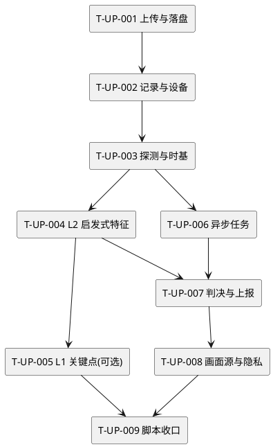
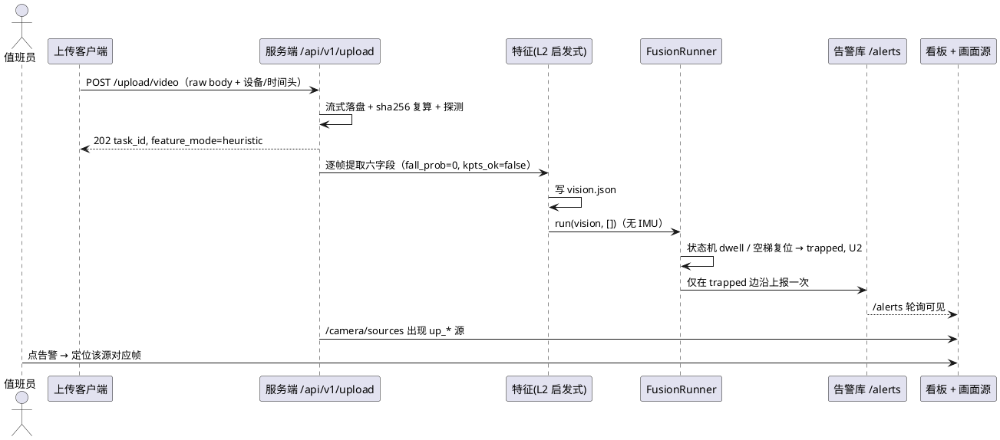

# 用户上传真实视频（困人判定）需求规格（EARS）

> 本文件为**新增规格**，编号自成体系（`REQ-UP-*` / `T-UP-*` / `CMD-UP-*` / `AMEND-UP-*`）。
> 不修改 `requirement.md`、`design.md`、`tasks.md`、`camera.md`、`frontend.md`、`supplement_ac.md`、`integration.md` 的任何既有条目；
> 需要扩展既有契约时，一律以 `AMEND-UP-*` 声明登记（见 0.2.1）。

## 0. 阅读指南

### 0.1 目的与范围

本文档定义「**用户上传一段真实录制的电梯视频（非 `common/demo_data/` 预置素材）→ 系统提取视觉特征 → 判断是否发生电梯困人 → 满足条件时产生告警并在看板/接口可见**」的完整需求规格。

范围边界（一句话）：只解决「真实字节进入系统」到「告警可查」这条链路；不解决实时摄像头采集（属 `camera.md` 的 `usb/rtsp` 未决项），不解决姿态模型训练，不解决取证留存。

**用户原始诉求（保真引用）**：

> 我是需要上传视频，真实的视频，判断什么情况下出现困人就会发出警告的那种

因此本文档的验收底线是：**用一段真拍的、非演示素材的电梯视频，系统能自己判出困人并发出告警**——由人预先喂关键点、或复用 `demo_*` 素材，均不算达标。

### 0.2 与既有文档的关系

| 关系 | 既有文档 | 说明 |
|---|---|---|
| 上游契约 | `docs/spec/integration.md`、`common/schema.py` | `VisionOut` 六字段、`Decision` 九字段、`ts` 为 13 位毫秒，**一字不改** |
| 并列能力 | `docs/spec/camera.md` | 上传件必须能被画面源清单看见并可播（4.2.1/4.2.2 字段完全复用） |
| 下游消费 | `docs/spec/frontend.md` | 看板零构建、单文件、`/alerts` 轮询口径不变 |
| 数据规范 | `common/demo_data/README.md`、`docs/DATA_DICT.md` §10 | 「实拍素材没有 `_kpts.jsonl`」是既有事实，本文档给出该情形的完整方案 |
| 判决口径 | `model/fuse.py`、`model/state_machine.py`、`model/reason.py` | 困人判定沿用既有状态机；上传件**不得另写判决** |

#### 0.2.1 本轮新增的修订声明（AMEND，不改原文）

| 编号 | 声明 | 影响的既有内容 | 是否改原文 |
|---|---|---|---|
| **AMEND-UP-01** | 新增 `/api/v1/upload/*` 路由族（4 条：`POST /video`、`GET /tasks/{id}`、`GET /items`、`DELETE /items/{id}`），不进入 2 s 轮询白名单 | `frontend.md` 的「3 条接口路径」白名单 | 否（白名单仅在上传页 P2 内扩展） |
| **AMEND-UP-02** | 上传件在无姿态模型时，`VisionOut` 的 `person_count`/`door_approach`/`crowded` 允许取**启发式估计值**，`fall_prob` 恒 `0.0`、`keypoints_ok=false`；字段集合与类型完全不变 | `integration.md` 六字段语义、`vision/rules.py` 输出 | 否（只扩语义，不改形状） |
| **AMEND-UP-03** | 上传件默认**无 IMU**，判定走 `FusionRunner.run(vision, [])`；由此既有规则「无 IMU 时 `urgency>2` 被钳到 `2` 且 `event_type` 可能被改写为 `trapped`」对上传件生效 | `model/fuse.py:145-148` | 否（既有行为即口径） |
| **AMEND-UP-04** | 上传源的水印文案取 `用户上传 · 非取证`；`service/camera.py` 的 `WATERMARK`（`演示数据 · 非取证`）保持原值不动，按源类型选择 | `camera.md` `REQ-CAM-020` | 否（新增常量，不改旧值） |
| **AMEND-UP-05** | 画面源清单登记新增一类来源：`data/raw/uploads/<upload_id>/`（含 `source.mp4` + `upload.json` + `vision.json`），`source_id = up_<16 hex>`；demo 5 条源的字段值与排序不变 | `service/camera.py` `scan_sources()`、`camera.md` `REQ-CAM-005` | 否（追加扫描分支） |
| **AMEND-UP-06** | `device_id` 从「全项目单值 `ELEV-DEMO-001`」扩展为「demo 源固定该值，上传源必带自有 `device_id`」 | `service/camera.py:32` `DEFAULT_DEVICE_ID`、`camera.md` 3.1 | 否（旧值保留，仅限 demo） |

### 0.3 编号与优先级

| 类型 | 编号 | 含义 |
|---|---|---|
| 需求 | `REQ-UP-001 ~ 027` | 27 条，含 EARS 类型、优先级、机器/人工验收、追溯 |
| 任务 | `T-UP-001 ~ 009` | 拆解建议，本阶段不实现 |
| 命令 | `CMD-UP-01 ~ 18` | 验收命令（8.1 沙箱可跑 / 8.2 需端口 / 8.3 需人工） |
| 缺口 | `GAP-UP-01 ~ 08` | 现状缺口 |
| 风险 | `R-UP-01 ~ 10` | 风险登记 |
| 未决 | `Q-UP-01 ~ 06` | 未决项 |
| 修订 | `AMEND-UP-01 ~ 06` | 扩展声明（0.2.1） |
| 人工 | `MAN-UP-01 ~ 08` | 必须人工/换环境确认 |

优先级沿用项目口径：**P0 = 缺此项则「上传→告警」链路不成立**；P1 = 影响可用性/可运维但不阻断主路径；P2 = 加分项，不作阻断。

### 0.4 事实与证据口径

1. 本文档 1.2 节的每一行「本轮实测」都是**在 `E:\云码道\Elevator-Trapped-Alert`、Python 3.9.12 下真实执行**得到的输出，可直接复现（命令见 8.1）。
2. 凡是**未实测**的项，标 `—`，不得写成「已验证」。
3. 本文档不写实现步骤。出现代码路径只为定位事实（如 `model/fuse.py:145`），不构成设计授权。
4. 「沙箱可验 / 需端口 / 需人工」三档口径见 7.4，禁止用进程内结果冒充端到端。

### 0.5 本轮交付边界

- 本轮只产出本文档，**零代码改动、零既有文档改动**。
- 本文档不承诺「真实视频能准确识别人体姿态」——该项取决于 `Q-UP-01`（是否引入姿态模型），已显式标为未决。

## 1. 现状盘点

### 1.1 基线快照

| 项 | 值 | 来源 |
|---|---|---|
| Python | **3.9.12** | `python -V`（本轮实测） |
| 依赖锁 | `requirements.lock.txt`（`opencv-python 4.10.0.84`） | 仓库 |
| 本机 `cv2` | **5.1.0**（与 lock 不一致，既有 `R-CAM-05` 同源风险） | `python -c "import cv2"`（本轮实测） |
| 判决预设 | demo `dwell_threshold=8.0 s`；生产 `180.0 s` | `model/config.py:96`、`:33` |
| 复位通道 | `person_count==0` 持续 **≥3000 ms** 才回 `IDLE`（唯一复位） | `model/state_machine.py:144-145` |
| U3 条件 | `trapped && keypoints_ok && imu_present && fall_persist≥3 s && fall_prob>0.70` | `model/reason.py:158-165` |
| 无 IMU 钳制 | `urgency>2 → urgency=2, event_type="trapped"` | `model/fuse.py:145-148` |
| 服务端口 | `18080` | `service/config.py:26` |
| 告警去重 | 同设备同紧急度 30 s | `service/config.py:37`、`service/main.py:153` |

### 1.2 已核实事实（本轮实测）

| # | 事实 | 实测命令 | 实测结果 |
|---|---|---|---|
| F1 | **无任何上传能力**（服务、脚本、看板均无上传入口） | 全仓搜索 `upload\|UploadFile\|multipart`（`*.py/*.txt/*.html`） | **零命中** |
| F2 | **`python-multipart` 未安装** → FastAPI `UploadFile`/`File()` 不可用 | `python -c "import multipart"` | `ModuleNotFoundError: No module named 'multipart'` |
| F3 | `requirements*.txt` 中**无** `python-multipart` | 阅读 `requirements.txt`（11 行） | 无该行 |
| F4 | **`ultralytics` 未安装** → `YoloPoseBackend` 不可用 | `python -c "import ultralytics"` | `ModuleNotFoundError` |
| F5 | **`onnxruntime` 未安装** → `OnnxPoseBackend` 不可用 | `python -c "import onnxruntime"` | `ModuleNotFoundError` |
| F6 | **`models/` 目录不存在** → 即使装上依赖也无权重可加载 | `ls models` | 无此目录 |
| F7 | 画面源清单**只扫 `common/demo_data/*_meta.json`**；`CAMERA_SOURCE_MODE=file` 走的是同一函数，**并未实现「目录投放」** | `service/camera.py:394-424` | `scan_sources()` 单一扫描路径 |
| F8 | 无 `_meta.json` 时，`VideoReader` 的时间基准**锚到「当前整秒」** | `vision/sources.py:116-129` | `int(time.time()*1000//1000)*1000` |
| F9 | `SyntheticBackend` 只读 `<stem>_kpts.jsonl`；实拍视频没有该侧车 → `auto` 会落到 `yolo`/`onnx`，**两者均不可用** | `vision/sources.py:388-424`、`make_backend` | `auto → yolo`（依赖缺失即报错） |
| F10 | B 侧「真实案例」入口**硬依赖 `<case>_imu.npy`** | `model/eval.py:156-175` | 缺失即 `FileNotFoundError` |
| F11 | B 侧视觉序列读取器**只认 `vision_<case>.json｜jsonl`** | `model/eval.py:146-155` | 命名不符即 `FileNotFoundError` |
| F12 | 画面源 `source_id` 约束 **≤20 字符 / `[a-z0-9_]`** | `service/camera.py:269-273` | `len>20` 即拒绝 |
| F13 | `data/raw/` 为空目录，且 `.gitignore` 已忽略 `data/raw/*`（`!data/raw/.gitkeep`） | `ls data/raw`、`.gitignore:20-21` | **空**（落盘位天然存在，且默认不进 Git） |
| F14 | 画面源登记结果**进程内缓存**（`_BOOTSTRAPPED`），新增源需重启或显式失效才可见 | `service/camera.py:401-414` | 幂等缓存 |
| F15 | 既有 `service/main.py` 已有 6 接口 + 6 条 camera 路由，`app.mount("/")` 在最后 | `service/main.py:203-305` | 追加块位于 mount 之前 |

### 1.3 缺口清单

| 编号 | 缺口 | 证据 | 影响 |
|---|---|---|---|
| **GAP-UP-01** | 没有上传入口，也没有落盘位置约定 | F1、F13 | 用户无法把真实视频交给系统 |
| **GAP-UP-02** | 真实视频**无法获得 17 关键点**：`cv2` 不出关键点，`ultralytics`/`onnxruntime` 未装，`models/` 不存在 | F4、F5、F6、F9 | 六字段链路断裂，判决无输入 |
| **GAP-UP-03** | 上传视频**没有 `start_ts_ms`** | F8 | 告警 `ts` 无基准，落库后「今日告警」口径失真 |
| **GAP-UP-04** | B 侧真实入口硬依赖 IMU 张量 | F10 | 上传件（天然无 IMU）无法走 `eval.py --real` |
| **GAP-UP-05** | 上传件无法被画面源发现（清单只扫 demo 目录 + 进程内缓存） | F7、F14 | 「看板可见」只剩告警列表，无法核验是哪段视频 |
| **GAP-UP-06** | 所有源共用 `device_id=ELEV-DEMO-001` | `service/camera.py:32` | 多设备/多上传件无法区分，`/devices` 只有一个设备 |
| **GAP-UP-07** | 上传视频含真实人脸，与「不做人脸识别、不留存录像」的既有口径存在张力 | `camera.md` 5.8、`REQ-CAM-020` | 合规质疑风险 |
| **GAP-UP-08** | 无同步/异步边界：200 MB 视频逐帧推理耗时可达数分钟 | F4/F5 缺失下的 `cv2` 逐帧解码本身即重 | 同步接口必然超时 |

### 1.4 四个 P0 缺口（本轮必须先解决）

1. **GAP-UP-02（特征来源）**——这是整条链路的**唯一真阻断点**。结论必须显式落地：**已装依赖（`cv2`）拿不到 17 点**，因此 P0 必须定义一条「不新增依赖也能产出六字段」的路径（启发式），姿态模型为可选增益。
2. **GAP-UP-03（时间基准）**——不定义 `start_ts_ms` 来源，告警 `ts` 必然错，且会污染 `stats`。
3. **GAP-UP-01 + GAP-UP-08（入口与异步）**——同步上传大文件必然超时；且 `python-multipart` 未装决定了传输方式不能是 multipart。
4. **GAP-UP-05 + GAP-UP-06（可见性与归属）**——「告警发出去了但看板看不出是哪段视频、哪台电梯」等于没完成诉求。

### 1.5 已知风险与未决项（本章）

见 7.1（`R-UP-01 ~ R-UP-10`）与 7.3（`Q-UP-01 ~ Q-UP-06`）。本章只想强调一条：**`R-UP-01`（无姿态模型 ⇒ 不能判「倒地」）** 直接决定产品对外话术，必须在实现前定稿。

## 2. 目标与约束

### 2.1 目标

| 编号 | 目标 | 可观测判据 |
|---|---|---|
| G-UP-01 | 用户能把**自己拍的**电梯视频交给系统 | 上传成功后磁盘出现 `data/raw/uploads/<upload_id>/source.mp4`，且 sha256 与原文件一致 |
| G-UP-02 | 系统能从该视频**自己**产出六字段序列 | `vision.json` 条数 = 视频帧数（跳帧时 = `ceil(frames/step)`），字段集合严格等于六字段 |
| G-UP-03 | 系统能据此判出困人并**发出告警** | 一段「门闭 + 有人滞留 > dwell」的真实视频 → `/alerts` 出现一条 `trapped=true`、`urgency=2` 的告警 |
| G-UP-04 | 告警与视频**可双向追溯** | 告警卡能定位到 `up_*` 源；`upload.json` 能列出该次上传产生的告警 id |
| G-UP-05 | 全链路**不破坏既有演示** | 不上传时，既有 6 接口 + camera 6 接口 + 看板请求数与基线逐项一致 |

### 2.2 硬约束

| 编号 | 约束 | 依据 |
|---|---|---|
| C-UP-01 | **Python 3.9 兼容**：注解只用 `Optional[...]`/`List[...]`/`Dict[str, Any]`，禁止 `X \| Y` | `supplement_ac.md` 3.1（实测 `TypeError`） |
| C-UP-02 | 数据结构用 `@dataclass(frozen=True)`；**禁止**引入新的 pydantic 模型处理上传件 | 项目偏好 + `service/models.py` 仅服务九字段 |
| C-UP-03 | **依赖零新增**：不得修改 `requirements*.txt`；不得依赖 `python-multipart`；`ultralytics`/`onnxruntime` 只能**运行时探测**，缺失即降级 | F2、F3、F4、F5 |
| C-UP-04 | 上传件**不得**写入 `common/demo_data/`（该目录是 A 的冻结产物，`README.md` 明令禁止手改） | `common/demo_data/README.md` |
| C-UP-05 | 上传件**不得**写入 `results/`（A/B 冻结产物区，且 `results/*.json` 未 gitignore） | `.gitignore`、`integration.md` |
| C-UP-06 | 上传件只落 `data/raw/uploads/`（已被 `.gitignore` 忽略） | F13 |
| C-UP-07 | 判决必须复用 `FusionRunner`，**不得**另写困人判定 | `model/fuse.py`、`REQ-INT-005` |
| C-UP-08 | 既有 `service/main.py` 行**零删除**；`app.mount("/")` 之前注册新路由 | `camera.md` 4.1 判据 1/2 |
| C-UP-09 | 看板保持单文件零构建零外链 | `frontend.md`、`REQ-CAM-002` |
| C-UP-10 | 六字段 `ts` 一律 13 位毫秒；禁止出现 10 位秒 | `requirement.md` 0.5、`DEC-03` |

### 2.3 明确不做（Non-goals）

| 编号 | 不做的事 | 理由 |
|---|---|---|
| NG-UP-01 | **不做实时流上传**（RTSP/RTMP 推流、WebSocket 直播） | 用户诉求是「上传视频」，实时采集属 `camera.md` `Q-CAM-02` |
| NG-UP-02 | **不做人脸识别/身份比对/人员去重** | `camera.md` 5.8、`REQ-CAM-020` 红线 |
| NG-UP-03 | **不把上传视频当取证材料**，不导出、不对外提供、不做截图归档 | 同上；且上传件 24 h 到期删除 |
| NG-UP-04 | **不做视频转码/剪辑/拼接**（只做「能否解码」的判定） | 转码引入 ffmpeg 依赖，违反 C-UP-03 |
| NG-UP-05 | **不做跨视频聚合**（多视频合并为一次判决） | 单视频单判决，语义可解释 |
| NG-UP-06 | **不做上传件参与评测/校准**（不得喂进 `run_calibration`/消融） | 上传件无标注真值，会污染 `results/` 指标 |
| NG-UP-07 | **不做自动把上传件转为 demo 源** | C-UP-04；且 demo 素材是答辩基线，不可混入 |
| NG-UP-08 | **不做上传件的多路并发解码**（并发上限 1） | 单机 CPU 预算，见 `REQ-UP-027` |

### 2.4 已知风险与未决项（本章）

| 编号 | 事项 | 影响 | 建议倾向 |
|---|---|---|---|
| R2-UP-01 | 无姿态模型 ⇒ 不能声称「倒地/晕倒检测」 | 对外话术与验收口径 | 上传件的困人判定只承诺 **「长时间滞留 + 门未开 + 有人」**；倒地能力仅在有 L1 时开启 |
| R2-UP-02 | 启发式人数在暗光/遮挡下漂移 | 空梯复位失效 → 误报或漏报 | 见 `REQ-UP-009` 的置信度标记与保守复位 |
| Q2-UP-01 | `start_ts_ms` 缺失策略 | 影响 `stats` 口径 | **已决（2026-11-24）**：以录制时间为准，必填；缺失即拒，见 `DEC-UP-01` |

## 3. 数据模型与时间基准

### 3.1 上传件记录（`@dataclass(frozen=True)`，字段即 JSON 契约）

| 结构 | 字段 | 类型 | 约束 |
|---|---|---|---|
| `UploadRecord` | `upload_id` | `str` | 32 位小写 hex（`sha256` 前 32 位），全局唯一 |
| | `source_id` | `str` | `up_` + `upload_id[:16]`，共 19 字符，满足 `[a-z0-9_]{1,20}`（F12） |
| | `device_id` | `str` | `^[A-Z0-9][A-Z0-9-]{2,23}$`；**禁止**等于 `ELEV-DEMO-001` |
| | `location` | `str` | ≤8 字符；缺省 `?`（与 `DecisionIn.location` 同口径） |
| | `original_name` | `str` | 仅展示用，≤64 字符；消毒后不得含 `/`、`\`、`..` |
| | `bytes` | `int` | `>0`，且 `≤209715200`（200 MiB） |
| | `sha256` | `str` | 64 位小写 hex，流式计算，落盘后复算必须一致 |
| | `fps` / `frames` / `width` / `height` | `float`/`int` | `1.0≤fps≤60.0`、`frames>0`、`0<width≤1920`、`0<height≤1080` |
| | `duration_ms` | `int` | `= round(frames*1000/fps)`，与 `frames/fps` 误差 ≤40 ms |
| | `start_ts_ms` | `int` | 13 位毫秒（`10^12 ≤ x < 10^13`） |
| | `start_ts_source` | `str` | `client` \| `sidecar`（仅标注录制时间来源，不得为上传/接收时刻） |
| | `door_roi` | `Optional[List[int]]` | 4 元 `[x1,y1,x2,y2]`，`x1<x2`、`y1<y2`；`null` 表示走全画面兜底 |
| | `feature_mode` | `str` | `pose` \| `heuristic` |
| | `keypoints_ok` | `bool` | `feature_mode=="pose"` 时为 `true`，否则必须 `false` |
| | `received_ms` | `int` | 13 位毫秒 |
| | `expire_ms` | `int` | `= received_ms + 86400000`（24 h，`REQ-UP-021`） |
| | `state` | `str` | `received`\|`extracted`\|`judged`\|`reported`\|`failed` |
| `UploadTask` | `task_id` | `str` | `<upload_id>-<epoch_ms>` |
| | `upload_id` / `device_id` | `str` | 必须能在 `UploadRecord` 中找到 |
| | `state` | `str` | `queued`\|`running`\|`done`\|`failed` |
| | `stage` | `str` | `received`\|`probe`\|`extract`\|`judge`\|`report`\|`done` |
| | `progress` | `int` | `0~100`，`stage` 变化时只增不减 |
| | `frames_total` / `frames_done` | `int` | `frames_done ≤ frames_total` |
| | `feature_mode` | `str` | `pose`\|`heuristic`（降级必须可见） |
| | `error` | `Optional[Dict]` | `{code, message}`；`state!="failed"` 时必须为 `null` |
| | `updated_ms` | `int` | 最近心跳 |
| `UploadManifest`（侧车 `upload.json`） | — | — | `UploadRecord` 全字段 + `vision_file`、`decisions_file`、`reported_alert_ids: List[int]` |

**产物文件约定（上传件自包含，不散落到冻结区）**：

| 文件 | 相对路径 | 内容 |
|---|---|---|
| 原视频 | `data/raw/uploads/<upload_id>/source.mp4` | 客户端字节原样（不改码、不转码） |
| 记录侧车 | `data/raw/uploads/<upload_id>/upload.json` | `UploadManifest` |
| 特征序列 | `data/raw/uploads/<upload_id>/vision.json` | 严格 `List[VisionOut]` 六字段，UTF-8 无 BOM |
| 判决序列 | `data/raw/uploads/<upload_id>/decisions.json` | 严格 `List[Decision]` 九字段 |

> 说明：`vision.json` / `decisions.json` 只含数值与短字符串，**不含画面任何像素**，因此可留存；`source.mp4` 到期删除（`REQ-UP-021`）。

### 3.2 特征能力三档（本方案的核心决策）

现状（F4/F5/F6/F9）：**有视频、有 `cv2`、没有任何姿态模型与权重**。因此必须按能力分档，且**分档结果必须对用户可见**，不得静默假装。

| 档位 | 触发条件 | `feature_mode` | `keypoints_ok` | 六字段可得性 |
|---|---|---|---|---|
| **L1 真关键点** | `ultralytics` + `models/yolov8n-pose.pt` 可用，或 `onnxruntime` + `models/yolov8n-pose.onnx` 可用 | `pose` | `true` | 六字段全部为模型输出 |
| **L2 纯视觉启发式** | 仅 `cv2` 可用（**本机默认档**） | `heuristic` | `false` | `person_count`/`door_approach`/`crowded` 为启发式估计；`fall_prob` **恒 `0.0`** |
| **L3 不可用** | `cv2` 缺失，或视频打不开 | — | — | 上传被拒（`422 UP_NOT_DECODABLE`），不得产生空 `vision.json` 冒充成功 |

L2 的关键约束（`REQ-UP-009`）：

1. `fall_prob` 必须恒为 `0.0` —— 不得用「画面方差」「帧差」等伪造倒地概率。
2. `keypoints_ok=false` 必须使 `SignalEstimator` 命中 `keypoints_unreliable` 标记（既有行为，`model/signals.py:84-86`），从而 `fall_prob` 被二次归零，U3 不可能出现。
3. `reason` 必须包含 `feature_mode=heuristic` 与 `roi=default|client`，让值班员知道「本次判定没有骨架依据」。
4. 由于 `derive_verdict` 的 U3 需 `keypoints_ok && imu_present`（`model/reason.py:158-165`），**L2 上传件的最高紧急度恒为 2**，这与 `AMEND-UP-03` 的钳制一致。

### 3.3 时间基准（唯一公式，禁止第二套）

存在三个时间：

- `start_ts_ms`：上传件第 0 帧的「素材时间」，来源优先级见 `REQ-UP-012`；
- `VisionOut.ts`：素材时间，必须按 `ts(frame) = start_ts_ms + round(frame*1000.0/fps)` 计算（与 `vision/sources.py:134-135` 同式）；
- `Decision.ts`：等于驱动它的那一帧的 `VisionOut.ts`，**不做任何二次平移**（全链路以录制时间为准，`DEC-UP-01`）。

对齐公式（必须唯一）：

```text
frame_ms           = 1000 / fps
ts(frame)          = start_ts_ms + round(frame * frame_ms)
frame(ts)          = round((ts - start_ts_ms) / frame_ms)
告警时间窗口         = [start_ts_ms - 1000, start_ts_ms + duration_ms + 1000]
```

**硬约束**：任何 `Decision.ts` 落在告警时间窗口外，必须视为时基错误并拒绝上报（`500 UP_TIME_BASE_INVALID`），避免「3 个月前的视频」把 `stats.today_alerts` 冲高（这是 F8 的直接后果，也是 `GAP-UP-03` 的事故形态）。

### 3.4 与 demo 的隔离（防止串味）

| 隔离项 | demo 源 | 上传源 | 判据 |
|---|---|---|---|
| 目录 | `common/demo_data/` | `data/raw/uploads/` | 上传件路径不得出现在 `common/demo_data/` |
| `source_id` | `demo_*` | `up_*` | 前缀不重叠 |
| `device_id` | 固定 `ELEV-DEMO-001` | 必带自有值 | 上传源 `device_id != ELEV-DEMO-001` |
| 水印 | `演示数据 · 非取证` | `用户上传 · 非取证` | `AMEND-UP-04` |
| 关键点 | 可有 `_kpts.jsonl`（17 点） | L2 无；L1 有模型输出 | 上传源 `keypoints` 能力位由 `feature_mode` 决定 |
| 视觉产物 | `results/vision_demo_*.json` | `<upload_dir>/vision.json` | 不写 `results/` |

## 4. 接口契约（新增 `/api/v1/upload/*`）

### 4.1 路由清单与冲突检查

| 方法 | 路径 | 用途 | 改既有接口 | 优先级 |
|---|---|---|---|---|
| POST | `/api/v1/upload/video` | 上传视频原始字节（**raw body 流式**） | 否 | P0 |
| GET | `/api/v1/upload/tasks/{task_id}` | 任务进度与结果 | 否 | P0 |
| GET | `/api/v1/upload/items` | 上传件清单（含状态/设备/时长） | 否 | P1 |
| GET | `/api/v1/upload/items/{upload_id}` | 上传件详情（含告警 id 列表） | 否 | P1 |
| DELETE | `/api/v1/upload/items/{upload_id}` | 主动清理（删除原视频，保留派生） | 否 | P1 |

**不冲突判据（P0 验收项）**：

1. `git diff --numstat service/main.py` **删除列 = 0**；
2. 新路由必须注册在 `app.mount("/")`（`service/main.py:305`）**之前**；
3. 既有 6 接口 + camera 6 接口的路径/方法/字段/错误体**逐字节不变**（`passthrough_test.py` 11/11、`tests/test_camera_sources.py`）；
4. 上传件不改变 `/alerts`、`/stats`、`/devices` 的响应**形状**（只可能多出数据行，不多出字段）。

### 4.2 字段契约

#### 4.2.1 `POST /api/v1/upload/video`

**为什么是 raw body 而不是 multipart**：`python-multipart` 未安装（F2）且属依赖新增（C-UP-03）。FastAPI 的 `UploadFile`/`File()` 强依赖它，装上即违反锁。因此传输方式定为「原始字节 + 自定义头」。

请求（**必须**满足）：

| 项 | 规格 |
|---|---|
| `Content-Type` | `video/mp4` 或 `application/octet-stream`（其他值 → `415`） |
| `Content-Length` | **必填**，`>0` 且 `≤209715200`；缺失 → `411 UP_LENGTH_REQUIRED`；超限 → `413 UP_TOO_LARGE` |
| `X-Upload-Device-Id` | 必填，`^[A-Z0-9][A-Z0-9-]{2,23}$`；缺省 → `400 UP_BAD_DEVICE_ID` |
| `X-Upload-Start-Ts-Ms` | **必填**，13 位毫秒，录制起始时间；缺失 → `400 UP_BAD_TIMESTAMP`；格式错 → `400 UP_BAD_TIMESTAMP` |
| `X-Upload-Location` | 可选，≤8 字符，缺省 `?` |
| `X-Upload-Door-Roi` | 可选，`x1,y1,x2,y2`（整数像素）；非法 → `400 UP_BAD_ROI` |
| `X-Upload-Name` | 可选，原始文件名（仅展示，服务端强制消毒） |

> **时基红线（`DEC-UP-01`）**：不提供任何「平移到当前时刻」的上传头或开关；告警时间恒等于录制时间轴，服务端接收时刻只用于配额与 TTL 计算，**不得**写入 `ts`。

流式落盘规则（必须）：

1. 必须**边读边写**（分块 ≤256 KB），不得整文件入内存；
2. 写入过程中累计字节超 `Content-Length` 或超上限必须**立即中止并删除半成品**；
3. 落盘完成后必须**复算 `sha256`** 并与接收期累计值比对，不一致 → `500 UP_HASH_MISMATCH`；
4. 落盘路径必须是 `data/raw/uploads/<upload_id>/source.mp4`，`upload_id` 由服务端生成，**禁止**用客户端文件名拼接路径。

成功响应（**`202`**，因为后续处理异步）：

```text
{
  "ok": true,
  "upload_id": "9f2c1b7a4e6d8c0a5b3f9d1e2c4a6b8d",
  "source_id": "up_9f2c1b7a4e6d8c0a",
  "task_id": "9f2c1b7a4e6d8c0a5b3f9d1e2c4a6b8d-1763300180000",
  "device_id": "ELEV-3F-001",
  "state": "queued",
  "bytes": 18392304,
  "sha256": "9f2c1b7a4e6d8c0a5b3f9d1e2c4a6b8d...",
  "probe": {"fps": 25.0, "frames": 6400, "width": 1280, "height": 720,
            "duration_ms": 256000},
  "start_ts_ms": 1763300180000,
  "start_ts_source": "client",
  "feature_mode": "heuristic",
  "degraded": true,
  "limits": {"max_bytes": 209715200, "max_seconds": 600, "min_seconds": 4,
             "ttl_hours": 24, "quota_bytes": 2147483648, "quota_items": 20},
  "watermark": "用户上传 · 非取证"
}
```

- `degraded=true` 当且仅当 `feature_mode=="heuristic"`（必须显式告知，`REQ-UP-008`）。
- **幂等**：同 `device_id` + 同 `sha256` 且记录未过期 → 返回 **`200`** + 既有 `upload_id`（不重复落盘、不重复建任务）；记录仍在处理中（`state` 属 `queued/running`）→ 返回 `200` + 既有 `task_id`，`state` 照实回填。

#### 4.2.2 `GET /api/v1/upload/tasks/{task_id}`

```text
{
  "task_id": "...",
  "upload_id": "...",
  "source_id": "up_9f2c1b7a4e6d8c0a",
  "device_id": "ELEV-3F-001",
  "state": "running",
  "stage": "extract",
  "progress": 42,
  "frames_total": 3200,
  "frames_done": 1344,
  "feature_mode": "heuristic",
  "eta_sec": 96,
  "started_ms": 1763300181200,
  "updated_ms": 1763300187600,
  "alerts": {"produced": 0, "first_alert_ts": null},
  "error": null
}
```

- `state=="done"` 时 `progress=100`，且 `alerts.produced` 必须为实际入库条数（0 也是合法值）。
- `state=="failed"` 时 `error` 必须含 4.3 表中某个 `code`，且 `progress` 停在失败点（不得回退到 0）。
- 未知 `task_id` → `404 UP_TASK_NOT_FOUND`；任务超过 `expire_ms` 后查询 → `404`（与上传件生命周期一致）。
- **查询必须无副作用**：不得因查询触发重跑。

#### 4.2.3 `GET /api/v1/upload/items`

```text
{
  "items": [
    {"upload_id": "...", "source_id": "up_...", "device_id": "ELEV-3F-001",
     "location": "3F", "original_name": "cabin_20261124.mp4",
     "bytes": 18392304, "duration_ms": 256000, "frames": 6400, "fps": 25.0,
     "start_ts_ms": 1763300180000, "start_ts_source": "client",
     "feature_mode": "heuristic", "keypoints_ok": false,
     "state": "reported", "received_ms": 1763300180000, "expire_ms": 1763386580000,
     "alert_ids": [17], "video": true, "vision": true}
  ],
  "total": 1,
  "quota": {"bytes_used": 18392304, "bytes_limit": 2147483648,
            "items_used": 1, "items_limit": 20},
  "server_time_ms": 1763300200000,
  "watermark": "用户上传 · 非取证"
}
```

- `items` 必须按 `received_ms` 倒序、同值按 `upload_id` 字典序（稳定，两次请求逐字节一致）。
- 空清单必须 `200 + {"items": [], "total": 0}`，**不得** 404。
- 到期未清理的记录不得出现在清单中（即使目录残留）。

#### 4.2.4 `DELETE /api/v1/upload/items/{upload_id}`

- 成功：`200 {"ok": true, "deleted": {"source.mp4": true, "vision.json": false}}`——默认**只删原视频**，派生特征保留（便于追溯判定依据）。
- `?purge=1` 时连派生一起删（`C-UP-06` 范围内，仍不得触碰 `results/`）。
- 未知/已过期 → `404 UP_NOT_FOUND`；目录删除失败 → `409 UP_DELETE_FAILED`（不得静默返回 ok）。

#### 4.2.5 上传件在画面源清单中的样子（`GET /api/v1/camera/sources`）

上传件必须作为**一类源**出现在既有清单里（`AMEND-UP-05`），且**demo 5 条的字段值与排序不变**：

```text
{
  "source_id": "up_9f2c1b7a4e6d8c0a",
  "device_id": "ELEV-3F-001",
  "label": "上传 · 3F",
  "event_type": "trapped",
  "fps": 25.0, "frames": 6400, "width": 1280, "height": 720,
  "duration_ms": 256000,
  "anchor_ts_ms": 1763300180000,
  "video": true, "keypoints": false, "vision": true,
  "transport": ["video"],
  "demo": false
}
```

- `event_type` 必须取自该上传件的最终判决（未完成时取 `normal`，并在 `label` 后缀标 `· 处理中`）。
- `label` ≤24 字符，格式 `上传 · <location>`（`location=="?"` 时用 `上传 · 未知楼层`）。
- `keypoints=false` → 既有 `/camera/kpts` 必须返回 `persons=[]` 且**不报错**（`camera.md` 4.2.3 第 4 条已定义该行为，此处只需保证能力位正确）。
- 上传件被删除后，`sources` 必须不再包含该 `source_id`（`REQ-UP-020`）。

### 4.3 错误码表（新增；既有错误体不变）

| HTTP | `code` | 触发 | 用户可见文案 |
|---|---|---|---|
| 400 | `UP_BAD_REQUEST` | 缺头/头值类型错 | 「上传参数有误」 |
| 400 | `UP_BAD_DEVICE_ID` | `device_id` 缺失或不匹配 `^[A-Z0-9][A-Z0-9-]{2,23}$`，或等于 `ELEV-DEMO-001` | 「设备编号格式不对（例：ELEV-3F-001）」 |
| 400 | `UP_BAD_TIMESTAMP` | `X-Upload-Start-Ts-Ms` 缺失，或 `start_ts_ms` 非 13 位毫秒 | 「录制时间缺失或格式异常」 |
| 400 | `UP_BAD_ROI` | 门区坐标非法（非 4 元/顺序反/越界） | 「门区坐标不合法」 |
| 411 | `UP_LENGTH_REQUIRED` | 缺 `Content-Length` | 「上传需声明文件大小」 |
| 413 | `UP_TOO_LARGE` | `bytes > 200 MiB` | 「文件超过 200 MB 上限」 |
| 415 | `UP_UNSUPPORTED_TYPE` | `Content-Type` 非白名单，或魔数非 `ftyp`（mp4） | 「只支持 MP4 视频」 |
| 422 | `UP_NOT_DECODABLE` | `cv2` 打不开 / `frames==0` / `fps` 越界 / 宽高超限 | 「视频无法解码，请换 MP4(H.264)」 |
| 422 | `UP_TOO_SHORT` | `duration < 4 s` | 「视频太短（至少 4 秒）」 |
| 422 | `UP_TOO_LONG` | `duration > 600 s` | 「视频超过 10 分钟」 |
| 404 | `UP_NOT_FOUND` | `upload_id` 不存在或已过期 | 「上传记录不存在或已过期」 |
| 404 | `UP_TASK_NOT_FOUND` | `task_id` 不存在或已过期 | 「处理任务不存在」 |
| 409 | `UP_DELETE_FAILED` | 删除原视频失败（占用/权限） | 「删除失败，请稍后重试」 |
| 500 | `UP_HASH_MISMATCH` | 落盘后 sha256 与接收期不一致 | 「文件写入校验失败」 |
| 500 | `UP_TIME_BASE_INVALID` | 判决 `ts` 落在告警时间窗口外（3.3） | 「时间基准异常，已阻断上报」 |
| 500 | `UP_INTERNAL` | 未预期异常 | 「处理异常，已保留现场」 |
| 503 | `UP_BUSY` | 队列已满（并发 1、排队上限 3） | 「当前有视频在处理，请稍后再传」 |
| 504 | `UP_TIMEOUT` | 单件处理超 600 s | 「视频处理超时」 |
| 507 | `UP_QUOTA_EXCEEDED` | 总量 >2 GiB 或件数 >20 | 「上传空间已满，请先清理」 |

错误体统一（**只用于 `/api/v1/upload/*`**，既有接口错误体不动）：

```text
{"detail": {"code": "UP_TOO_LARGE", "message": "文件超过 200 MB 上限",
            "upload_id": null, "limit_bytes": 209715200}}
```

**边界**：既有 `POST /ack` 的 404 仍必须是字符串 `detail`（`main.py:180`），不得为统一而改。

### 4.4 降级矩阵

| 条件 | 服务端行为 | 用户感知 | 对应需求 |
|---|---|---|---|
| 无 `ultralytics`/`onnxruntime`/权重（**本机默认**） | 走 L2 启发式；`feature_mode=heuristic`、`keypoints_ok=false`、`fall_prob=0.0` | 响应 `degraded=true`；看板显示「未启用姿态模型 · 仅按滞留与门区判定」 | `REQ-UP-008/009` |
| `cv2` 缺失 | `422 UP_NOT_DECODABLE`，删除半成品，记录元数据 | 「当前环境无法解码视频」 | `REQ-UP-023` |
| 无 `start_ts_ms` | `400 UP_BAD_TIMESTAMP`，删除半成品，**不落盘、不建任务** | 「请提供录制起始时间（13 位毫秒）」 | `REQ-UP-012`、`DEC-UP-01` |
| 无门区 | 用画面下部 1/3 作为兜底门区，`door_roi=null`，`reason` 标 `roi=default` | 角标提示「门区为默认推断」 | `REQ-UP-010` |
| 无 IMU（默认） | `FusionRunner.run(vision, [])`；日志 `imu_unavailable`；`urgency ≤ 2` | 告警最高显示「告警」级，不出现「紧急」 | `REQ-UP-017` |
| 启发式人数低置信 | `person_count=0`，`reason` 加 `count_low_conf` | 不产生困人告警（宁可漏报不误报） | `REQ-UP-009` |
| 上传件无 17 点 | `sources.keypoints=false`；`/camera/kpts` 返回 `persons=[]` | 画面只播视频不画骨架 | `REQ-UP-020` |
| 处理超时 | `state=failed`、`error.code=UP_TIMEOUT`；保留已产出部分序列 | 「视频处理超时，已保留前 N 帧结果」 | `REQ-UP-016` |
| 磁盘满/配额满 | `507 UP_QUOTA_EXCEEDED`；**不覆盖**已有上传件 | 「上传空间已满」 | `REQ-UP-004` |
| 服务重启 | 上传件记录从 `upload.json` 重建；未完成任务标 `failed`（`UP_INTERNAL`），可重传 | 「上次处理被中断，请重新上传」 | `REQ-UP-016` |

**降级红线**：任何上传降级**不得**影响 `/alerts`、`/stats`、`/devices`、`/camera/*` 的可用性与既有渲染。

### 4.5 Python 3.9 与依赖约束

1. 注解只用 `Optional[T]`、`List[T]`、`Dict[str, Any]`；禁止 `X | Y`、`dict[str, Any]`。
2. 上传记录/任务一律 `@dataclass(frozen=True)`；JSON 序列化用 `dataclasses.asdict`；**不得**为上传引入新的 pydantic 模型。
3. **依赖零新增**（`C-UP-03`）：`requirements*.txt` 零改动；`ultralytics`/`onnxruntime` 只在运行时 `importlib.util.find_spec` 探测，`ImportError` 一律降级为 L2，不得崩。
4. `cv2` 只用稳定子集：`VideoCapture`、`CAP_PROP_*`、`read`、`resize`、`cvtColor`、`absdiff`、`threshold`、`findContours`、`createBackgroundSubtractorMOG2`（后者需按 4.10/5.1 双版本实测，见 `R-UP-06`）；**禁止**使用 5.x 独有 API。
5. 路径一律基于 `service/config.BASE_DIR`，禁止绝对路径与 `C:\` 硬编码。

### 4.6 观测与日志

- 必须记录（INFO）：`上传接收 upload=<id> bytes=<n> device=<id>`、`上传探测 fps/frames/duration`、`特征档位 mode=pose|heuristic`、`判决完成 alerts=<n>`、`清理过期 n 条`。
- 必须记录（WARN，单键 1 分钟内合并）：`feature_degraded`、`count_low_conf`、`roi_default`、`quota_exceeded`。
- **禁止记录**：原始文件名之外的任何文件内容、帧像素、关键点坐标全文、任何可复原画面的字段。
- 频率约束：单次上传的日志行数 ≤ 60（逐帧日志一律禁止）；验收：10 分钟视频的处理日志行数 ≤ 60。

## 5. EARS 需求条目

> 共 **27 条**，`REQ-UP-001 ~ 027`。优先级：P0 = 20 条（001/002/003/004/007/008/009/012/013/014/015/017/018/019/020/021/022/023/024/025），P1 = 5 条（005/006/010/011/016），P2 = 2 条（026/027）。

### 5.1 上传入口与传输

**REQ-UP-001｜[普遍]｜P0｜上传的必须是真实字节，不得复用演示素材**
系统必须只接受客户端提交的视频二进制作为上传内容；判定成功的唯一依据是「落盘文件 sha256 与客户端提交字节一致」；任何以 `common/demo_data/*.mp4` 为源、或以预置关键点侧车冒充上传结果的行为必须被识别并拒绝。

- 验收：`[机器]` 上传后 `sha256sum data/raw/uploads/<id>/source.mp4` 与客户端文件一致；`[机器]` `grep -rn "demo_data" service/upload.py` 无「作为上传源」的路径；`[机器]` 上传件的 `source_id` 必须以 `up_` 开头；`[人工]` 上传一段自拍电梯视频，`/upload/items` 能看到该件且 `original_name` 为真实文件名。
- 追溯：GAP-UP-01、`C-UP-04`、NG-UP-07、T-UP-001。

**REQ-UP-002｜[事件驱动]｜P0｜传输方式为 raw body 流式接收，禁止 multipart**
当客户端 `POST /api/v1/upload/video` 时，系统必须按 `Content-Type` + `Content-Length` 流式接收原始字节并按 ≤256 KB 分块落盘；系统**禁止**依赖 `python-multipart`（未安装且属依赖新增），**禁止**把整个文件读入内存。

- 验收：`[机器]` `python -c "import multipart"` 仍失败而上传仍可工作；`[机器]` 上传 200 MiB 文件时进程 RSS 增量 ≤ 64 MiB（`tracemalloc` 峰值断言）；`[机器]` `git status --short requirements*` 为空；`[机器]` 缺 `Content-Length` → `411 UP_LENGTH_REQUIRED`。
- 追溯：F2、F3、`C-UP-03`、GAP-UP-08、T-UP-001。

**REQ-UP-003｜[非期望]｜P0｜格式白名单与尺寸边界必须显式拒绝**
如果上传内容不满足「MP4 容器（`ftyp` 魔数）+ `cv2` 可打开 + `1.0≤fps≤60.0` + `frames>0` + 宽 ≤1920 + 高 ≤1080 + `4 s≤时长≤600 s` + 字节 ≤200 MiB」，则系统必须按下表拒绝并且**不得留半成品**。

- 验收：`[机器]` 非 mp4（如 `.jpg` 改名）→ `415 UP_UNSUPPORTED_TYPE`，`data/raw/uploads/` 下无新增目录；`[机器]` 3 s 视频 → `422 UP_TOO_SHORT`；`[机器]` 上传 201 MiB → `413 UP_TOO_LARGE` 且已写入的临时块被删除；`[机器]` `Content-Length: 0` → `400 UP_BAD_REQUEST`；`[人工]` 一条合法 MP4 可成功。
- 追溯：`REQ-CAM-002`（媒体白名单口径）、4.3、T-UP-001。

**REQ-UP-004｜[状态驱动]｜P0｜落盘位置、配额与清理必须可预测**
系统必须把上传件落在 `data/raw/uploads/<upload_id>/`，并在 `expire_ms`（24 h）后删除 `source.mp4`、保留 `vision.json`/`decisions.json`/`upload.json` 的元信息摘要；总量 >2 GiB 或件数 >20 时必须返回 `507 UP_QUOTA_EXCEEDED`，**禁止**覆盖或静默驱逐已有上传件。

- 验收：`[机器]` 上传后 `ls data/raw/uploads/<id>` 含 4 个约定文件；`[机器]` 伪造 `expire_ms` 为过去时刻后调用清理，`source.mp4` 消失而 `vision.json` 仍在，且 `/upload/items` 不再列出该件；`[机器]` 构造 21 个小件 → 第 21 个返回 507 且前 20 个文件仍完整；`[机器]` `git status --short` 不含 `data/raw/`（已被 ignore）。
- 追溯：F13、`C-UP-06`、GAP-UP-08、T-UP-001。

**REQ-UP-005｜[可选]｜P1｜目录投放与命令行与 HTTP 三入口同构**
若提供目录投放（`data/raw/uploads/<upload_id>/source.mp4` + `upload.json`）或命令行入口，则二者必须产出与 HTTP 上传**完全同构**的 `UploadRecord` 与任务记录，且必须执行同一套校验（格式/时长/设备号/时间基准）。

- 验收：`[机器]` `python scripts/upload_video.py --video x.mp4 --device ELEV-3F-001` 产出的 `upload.json` 字段集合与 HTTP 路径相同（键集合相等断言）；`[机器]` 目录投放非法文件（无 `upload.json` 或缺 `device_id`）被跳过并记 WARN，不产生源；`[人工]` 三入口产出的 `source_id` 规则一致（`up_` + 16 hex）。
- 追溯：1.2 F7、`REQ-CAM-005`（磁盘事实推导口径）、T-UP-002。

**REQ-UP-006｜[状态驱动]｜P1｜重复上传必须幂等**
当同一 `device_id` 再次提交相同 `sha256` 且记录未过期时，系统必须返回 `200` 与既有 `upload_id`，**禁止**重复落盘或重复建任务；若既有记录仍在处理中，必须返回既有 `task_id` 与真实 `state`。

- 验收：`[机器]` 同一文件上传两次 → 第二次 `200`、`upload_id` 相同、`data/raw/uploads/` 目录数不变；`[机器]` 处理中重复上传返回的 `state ∈ {queued, running}`；`[机器]` 不同 `device_id` + 相同 `sha256` → 视为**两次独立上传**（`upload_id` 不同，因设备归属不同）。
- 追溯：4.2.1、`R-UP-05`（磁盘增长）、T-UP-002。

### 5.2 特征提取（链路唯一真阻断点）

**REQ-UP-007｜[普遍]｜P0｜上传件必须产出与 demo 同构的六字段序列**
系统必须为每个上传件产出 `data/raw/uploads/<upload_id>/vision.json`，内容严格为 `List[VisionOut]` 六字段（`ts`/`person_count`/`fall_prob`/`door_approach`/`crowded`/`keypoints_ok`），字段集合与类型不得多、不得少；`ts` 必须按 3.3 公式严格递增。

- 验收：`[机器]` `python -c "…读 vision.json…"` 断言条数 = `ceil(frames/step)`、每条键集合恰为 6 个、`ts` 严格递增且首条 `ts == start_ts_ms`；`[机器]` `model/eval.py` 的 `load_vision_sequence` 可直接读取该文件（复用既有校验器，5 类非法输入均被拒）；`[机器]` 任何字段越界（`person_count` 非 0~8、分数 >1）→ 处理失败 `UP_INTERNAL` 并保留错误帧号。
- 追溯：F9、F11、`AMEND-UP-02`、`REQ-INT-005/006`、T-UP-004。

**REQ-UP-008｜[状态驱动]｜P0｜特征档位必须可探测、必须对用户可见**
系统必须在处理前探测特征能力并锁定档位：`ultralytics` + `models/yolov8n-pose.pt` 或 `onnxruntime` + `models/yolov8n-pose.onnx` 可用 → `feature_mode=pose`；仅 `cv2` 可用 → `feature_mode=heuristic`；`cv2` 不可用 → 拒绝上传。档位必须在 `POST` 响应与 `GET /tasks` 中都可见（`degraded` 标志），**禁止**静默假装具备姿态能力。

- 验收：`[机器]` 本机（`ultralytics`/`onnxruntime` 均缺失，F4/F5）上传成功且 `feature_mode=="heuristic"`、`degraded==true`；`[机器]` 伪造 `models/yolov8n-pose.pt` 空文件后档位不得变 `pose`（必须能被加载校验拦下）；`[机器]` `grep -c "feature_mode" service/upload.py` > 0 且 `POST` 响应含该字段；`[人工]` 看板/接口文案出现「未启用姿态模型」。
- 追溯：F4/F5/F6、3.2、`C-UP-03`、T-UP-005。

**REQ-UP-009｜[状态驱动]｜P0｜启发式档的语义边界必须写死，禁止伪造倒地概率**
当 `feature_mode=="heuristic"` 时，系统必须满足：`fall_prob` 恒为 `0.0`；`keypoints_ok` 恒为 `false`；`person_count` 与 `door_approach`/`crowded` 必须由可解释的画面统计量（门区前景占比、前景连通域）产出；`reason` 必须含 `feature_mode=heuristic`；人数置信不足时必须以 `person_count=0` 输出并置 `count_low_conf`（宁可漏报不误报）。

- 验收：`[机器]` 该档全部帧 `fall_prob==0.0`、`keypoints_ok is False`；`[机器]` 全黑视频 → 全部帧 `person_count==0` 且**不产生**任何 `trapped=true` 告警；`[机器]` `reason` 文本含 `feature_mode=heuristic`（至少首条告警）；`[机器]` 代码中不存在用 `frame variance`/`diff` 计算 `fall_prob` 的路径（审查：`fall_prob` 赋值点恒为 0.0）。
- 追溯：3.2、`AMEND-UP-02/03`、`REQ-CAM-013`（角标不可显示伪值）、T-UP-004。

**REQ-UP-010｜[普遍]｜P1｜门区必须显式，兜底必须标注**
系统必须按「请求头 `X-Upload-Door-Roi` → 侧车 `upload.json.door_roi` → 默认兜底（画面下部 1/3）」的优先级确定门区，并在 `reason` 中标注 `roi=client|sidecar|default`；`door_roi=null` 时 `door_approach` 必须基于兜底区域计算，**禁止**恒为 0（否则 `pry` 永远判不出）。

- 验收：`[机器]` 带头部坐标上传 → `upload.json.door_roi` 与请求一致且 `reason` 含 `roi=client`；`[机器]` 不带头部 → `door_roi is null` 且 `reason` 含 `roi=default`，且 `door_approach` 在「有人贴近画面下部」的样本上 >0.6；`[机器]` 非法坐标 → `400 UP_BAD_ROI`。
- 追溯：`camera.md` 3.1 `door_roi`、`REQ-UP-009`、T-UP-004。

**REQ-UP-011｜[可选]｜P1｜允许外部侧车覆盖为「真关键点」**
若上传件目录存在合法 `kpts.jsonl`（每行 `frame/ts/persons[17×[x,y,conf]]`，`ts` 单调），则系统必须改用该侧车作为关键点来源，并把 `feature_mode` 置为 `pose`、`keypoints_ok=true`；格式非法必须拒绝（`422 UP_NOT_DECODABLE`），**禁止**静默回落到启发式而仍声称 `pose`。

- 验收：`[机器]` 放入合法侧车 → `feature_mode=="pose"` 且 `keypoints_ok==true`、`fall_prob` 可非 0；`[机器]` 放入 16 点/非单调侧车 → `422`；`[机器]` 无侧车 → 仍是 `heuristic`；`[人工]` 该档在看板上可显示骨架（依赖 `AMEND-UP-05` 的 kpts 能力位）。
- 追溯：`common/demo_data/README.md`（实拍无侧车）、`vision/sources.py:388`（synthetic 口径）、T-UP-004。

### 5.3 时间基准

**REQ-UP-012｜[普遍]｜P0｜`start_ts_ms` 必须以录制时间为准且必填**
系统必须按优先级「`X-Upload-Start-Ts-Ms` → `upload.json.start_ts_ms`」确定 `start_ts_ms`；两者都缺失时必须以 `400 UP_BAD_TIMESTAMP` 拒绝上传（删除半成品、不建任务、不落盘），**不得**用服务端接收时刻或处理完成时刻顶替。值必须是 13 位毫秒，来源必须写入 `start_ts_source ∈ {client, sidecar}`。

- 验收：`[机器]` 带头部时间上传 → 响应 `start_ts_ms` 与头部一致、`start_ts_source=="client"`；`[机器]` 不带头部且无侧车 → `400 UP_BAD_TIMESTAMP`，且 `data/raw/uploads/` 下不新增目录；`[机器]` 10 位时间 → `400 UP_BAD_TIMESTAMP`；`[机器]` `vision.json[0].ts == start_ts_ms`；`[机器]` 响应与 `upload.json` 中不出现 `upload_ms`/`received_ms` 参与 `ts` 计算的痕迹。
- 追溯：F8、GAP-UP-03、3.3、`DEC-UP-01`、T-UP-003。

**REQ-UP-013｜[非期望]｜P0｜时基越界必须阻断上报，历史录制时间不得平移**
如果任一 `Decision.ts` 落在 `[start_ts_ms-1000, start_ts_ms+duration_ms+1000]` 之外，则系统必须中止上报、把任务置为 `failed`、返回 `500 UP_TIME_BASE_INVALID`，并且**不得**把该批判决写入告警表。反之，`start_ts_ms` 本身早于「今日」属于合法输入：系统必须按录制时间原样入库，**不得**平移到当前时刻。

- 验收：`[机器]` 注入 `start_ts_ms` 为 2026-01-01 且视频 10 分钟 → 处理成功、`/alerts` 出现该 `device_id` 的告警且 `ts` 落在该历史时间轴内、`stats.today_alerts` 增量 = 0（不得因「不是今天」而平移或拒绝）；`[机器]` 篡改 `decisions.json` 注入一条窗口外 `ts` → 任务 `failed`、`code=UP_TIME_BASE_INVALID`、`/alerts` 无新增；`[机器]` 请求携带 `X-Upload-Rebase-Ts: 1` → `400 UP_BAD_REQUEST`，`upload.json` 中不存在任何平移偏移字段。
- 追溯：3.3、F8、`REQ-INT-015`、`R-UP-07`、`DEC-UP-01/02`、T-UP-003。

### 5.4 判定、告警与可见性链路

**REQ-UP-014｜[事件驱动]｜P0｜端到端链路必须脚本可复现**
当上传成功且处理完成后，系统必须完成「特征 → 判决 → 上报入库 → 看板/接口可见」的整条链路，且该链路必须能由一条命令复现（不依赖人工点击）。

- 验收：`[机器]` `python scripts/check_upload.py --e2e --video <fixture.mp4> --device ELEV-3F-001` 退出码 0，输出断言：`vision.json` 存在、`decisions.json` 存在、`/alerts` 含该 `device_id` 且 `event_type=="trapped"`、`urgency==2`；`[机器]` `/stats` 的 `today_alerts` 增量 = 1；`[人工]` 看板 2 s 轮询内出现该告警卡（楼层/人数/等级正确）。
- 追溯：G-UP-03/04、`REQ-INT-015`、T-UP-007。

**REQ-UP-015｜[事件驱动]｜P0｜告警必须边沿触发，禁止逐帧刷屏**
当上传件的判决序列中 `trapped` 由 `false` 变为 `true` 时，系统必须只在**该边沿的首帧**上报一次告警；`trapped` 回落为 `false` 后必须重置边沿状态并允许下一次告警。`urgency=0` 的帧只允许刷心跳（沿用既有 `/edge/report` 语义）。

- 验收：`[机器]` 一段 10 分钟、连续滞留的视频：`decisions.json` 中 `trapped=true` 的帧数 >100，而 `/alerts` 中该 `device_id` 新增告警数 == 1；`[机器]` 构造「困人→脱困→再困人」序列 → 新增 2 条告警；`[机器]` 上报次数 ≤ `trapped` 边沿数 + 1（心跳）。
- 追溯：`service/main.py:146-158`（30 s 去重）、`REQ-INT-005`、T-UP-007。

**REQ-UP-016｜[非期望]｜P1｜处理失败必须可查、可重试**
如果处理在任一阶段失败，系统必须把任务置为 `failed`、写入 `error.code`、保留已产出的中间产物，并允许客户端用同一文件重新上传触发重试；单阶段内部重试必须最多 3 次、退避 1/2/4 s，且**禁止**静默产出 0 条判定冒充成功。

- 验收：`[机器]` 处理中删除 `source.mp4` → 任务 `failed`、`state` 不回退、`error.code` 为 4.3 表中某值；`[机器]` 服务重启后未完成任务被标 `failed` 且 `/upload/items` 可查；`[机器]` 重试 3 次后仍失败只落 1 条日志（合并计数）。
- 追溯：4.4（服务重启行）、`R-UP-04`、T-UP-006。

**REQ-UP-017｜[状态驱动]｜P0｜无 IMU 的口径必须写死为「最高 U2」**
系统必须对上传件调用 `FusionRunner.run(vision, [])`（空 IMU 序列），不得伪造 IMU 张量、不得要求上传件具备 `_imu.npy`；由此产生的判决必须满足 `urgency ≤ 2`，且困人场景必须为 `event_type=="trapped"`、`urgency==2`。

- 验收：`[机器]` 上传件从不读取 `data_dir/*_imu.npy`（审查：代码无 `_imu.npy` 路径）；`[机器]` 全部判决 `urgency<=2`；`[机器]` 困人样本的 `event_type=="trapped"`、`confidence>0`；`[机器]` 日志含 `imu_unavailable`（沿用 `model/signals.py:98` 的既有标记）。
- 追溯：F10、`AMEND-UP-03`、`model/fuse.py:145-148`、`model/reason.py:158-169`、T-UP-007。

**REQ-UP-018｜[普遍]｜P0｜判决必须复用既有状态机，禁止另写一套**
系统必须通过 `FusionRunner`（`model/fuse.py`）推进判决，由 `StateMachine` 的 dwell 与空梯复位规则决定 `trapped`；**禁止**在上传链路内实现第二套「滞留计时」「人数归零复位」逻辑；上传件必须通过 `RuntimeConfig` 注入自身 `device_id` 与 `location`。

- 验收：`[机器]` 审查：`service/upload.py` 内无 `dwell`/`state_machine` 的重复实现（`grep -c "StateMachine"` 只在 import 处出现）；`[机器]` 把 demo 预设 dwell 改为 8 s 后，上传件判决的 `trapped` 首帧时刻落在「有人且门闭」≥8 s 处（与既有 `test_state_machine` 同口径）；`[机器]` 判决字段集合严格等于九字段。
- 追溯：`C-UP-07`、`REQ-INT-005`、T-UP-007。

**REQ-UP-019｜[普遍]｜P0｜上传源必须可被画面源发现并可播**
系统必须把上传件登记为一类画面源（`source_id = up_<16 hex>`、`anchor_ts_ms = start_ts_ms`、`video=true`、`vision=true`、`keypoints` 由档位决定），并且**不得改变 demo 5 条源的字段值与排序**；上传件删除后必须从清单消失。

- 验收：`[机器]` 上传完成后 `GET /api/v1/camera/sources` 含该 `up_*` 源，且 demo 5 条的 `source_id`/`anchor_ts_ms`/`duration_ms` 与原值逐项相等；`[机器]` 两次调用输出稳定排序、逐字节一致；`[机器]` `GET /camera/video?source_id=up_*` 返回 `200 video/mp4` 且 `Content-Length` = 源文件大小；`[机器]` 删除该件后清单不再含它；`[人工]` 浏览器能播放该上传视频。
- 追溯：F7、F14、GAP-UP-05、`AMEND-UP-05`、`REQ-CAM-005`、T-UP-008。

**REQ-UP-020｜[普遍]｜P0｜设备归属必须唯一，禁止落到演示设备**
系统必须要求上传件携带自有 `device_id`（`^[A-Z0-9][A-Z0-9-]{2,23}$`），其值必须同时写入 `UploadRecord`、`Decision.device_id`、`devices` 表；`ELEV-DEMO-001` **禁止**用于上传件；同一 `device_id` 的多次上传必须聚合到同一设备行（`last_seen` 更新）。

- 验收：`[机器]` 不带头部 → `400 UP_BAD_DEVICE_ID`；`[机器]` 传 `ELEV-DEMO-001` → `400 UP_BAD_DEVICE_ID`；`[机器]` 用 `ELEV-3F-001` 上传两次 → `/devices` 中只有 1 条该设备、`last_seen` 为最后上报时间；`[机器]` `upload.json.device_id == decisions.json[i].device_id`（全条一致）。
- 追溯：GAP-UP-06、`AMEND-UP-06`、`service/main.py:144`（`upsert_device`）、T-UP-002。

### 5.5 隐私与非取证

**REQ-UP-021｜[普遍]｜P0｜上传件不得进入冻结区，且必须到期删除**
系统必须把上传原件只写入 `data/raw/uploads/`（`.gitignore` 已忽略），**禁止**写入 `common/demo_data/`、`results/`、`data/labels/`、`data/processed/`；`source.mp4` 必须在 24 h 后删除，派生特征（无像素）可留存。

- 验收：`[机器]` `git status --short` 在上传后不含 `data/raw/`、`common/demo_data/`、`results/` 的任何新增；`[机器]` 上传后 `ls common/demo_data` 文件数不变；`[机器]` 清理后 `source.mp4` 不存在而 `vision.json` 存在；`[机器]` `grep -rn "data/raw/uploads" service/` 的写入点唯一。
- 追溯：F13、`C-UP-04/05/06`、`camera.md` 5.8、T-UP-001。

**REQ-UP-022｜[普遍]｜P0｜不做人脸识别，不把上传件当取证**
系统**禁止**引入人脸检测/人脸识别/身份比对能力；**禁止**把上传视频帧、截图或骨架图对外提供或落盘导出（原视频只在源目录内、只经同源 `/camera/video` 分发）；上传源的水印必须为 `用户上传 · 非取证`；日志不得含可复原画面的内容。

- 验收：`[机器]` `grep -rnE "face_recognition|insightface|dlib|facenet|MediaRecorder|toDataURL" service/ vision/ dashboard/` 无命中；`[机器]` 上传源 `sources` 响应 `watermark == "用户上传 · 非取证"`（`AMEND-UP-04`）；`[机器]` 日志样例不含坐标数组与文件名以外的内容；`[人工]` 看板该源播放时水印可见、对比度 ≥4.5:1。
- 追溯：GAP-UP-07、`REQ-CAM-020`、NG-UP-02/03、T-UP-008。

### 5.6 降级与既有能力零变化

**REQ-UP-023｜[非期望]｜P0｜降级必须成矩阵、必须可感知**
如果出现 4.4 表中任一条件，则系统必须按对应行行为处理并返回对应错误码/降级标志，且**不得**让 `/alerts`、`/stats`、`/devices`、`/camera/*` 出现空白、异常或额外字段。

- 验收：`[机器]` 依次制造 7 种降级（无姿态依赖 / `cv2` 屏蔽 / 无时间基准 / 无门区 / 无 IMU / 低置信人数 / 超时），每种下 4 个既有接口均 `200` 且字段集合不变；`[机器]` `cv2` 屏蔽后上传 → `422 UP_NOT_DECODABLE` 且服务不退出；`[人工]` 每种降级都有中文提示。
- 追溯：4.4、GAP-UP-02/08、T-UP-009。

**REQ-UP-024｜[普遍]｜P0｜错误码必须一一映射且不泄漏内部信息**
如果 `/api/v1/upload/*` 返回 4.3 表中任一 `code`，则错误体必须符合 4.3 的统一形状（`detail{code,message,...}`），`message` 必须是中文用户可读文案；既有接口的错误体**逐字节不变**。

- 验收：`[机器]` 4.3 表 20 个 `code` 与实现中常量集合**集合相等**（断言）；`[机器]` 每个错误注入一次，响应体 `detail.code` 命中且 `message` 不含英文堆栈/路径；`[机器]` `POST /ack` 的 404 仍是字符串 `detail`（`passthrough_test.py` 11/11）。
- 追溯：`camera.md` 4.3 体例、`REQ-UI-019`、T-UP-009。

**REQ-UP-025｜[普遍]｜P0｜Python 3.9 兼容且既有链零破坏**
上传链路必须能在 Python 3.9.12 下导入与运行；注解不得使用 `X | Y`；依赖不得新增；`service/main.py` 既有行删除列必须为 0；不上传时，看板请求数与既有测试必须与基线一致。

- 验收：`[机器]` `python -c "import service.upload"` 退出码 0（3.9.12）；`[机器]` `grep -nE ": *[A-Za-z0-9_.\[\]]+ *\|" service/upload.py` 无输出；`[机器]` `git status --short requirements*` 为空；`[机器]` `git diff --numstat service/main.py` 删除列 = 0；`[机器]` `python scripts/passthrough_test.py` 11/11、`python scripts/check_frontend.py --strict` 全绿。
- 追溯：`C-UP-01/02/03/08`、`supplement_ac.md` 3.1、`REQ-CAM-003/004`、T-UP-009。

### 5.7 可选扩展

**REQ-UP-026｜[可选]｜P2｜上传页（看板内）**
若在看板提供上传入口，则必须严格满足单文件零构建零外链（不新增 JS/CSS 文件、不引 CDN），上传请求不得进入 2 s 轮询调度器，进度必须来自 `GET /upload/tasks/{id}` 且轮询间隔 ≥1 s。

- 验收：`[机器]` `ls dashboard` 文件数 = 1；`[机器]` `grep -nE "https?://\|<script[^>]*src"` 无输出；`[机器]` 上传相关 `setInterval` 与 `refresh()` 无共享变量（审查）；`[人工]` 上传进度条从 0 走到 100，页面不卡顿、告警轮询仍为 3 请求/2 s。
- 追溯：`REQ-CAM-002/017`、AMEND-UP-01、NG-UP-01。

**REQ-UP-027｜[可选]｜P2｜批量上传与并发上限**
若支持批量，则必须串行处理（并发解码路数恒为 1），排队上限 3，超出返回 `503 UP_BUSY`；批量不得改变单个上传件的判定结果。

- 验收：`[机器]` 同时提交 4 个 → 3 个 `202` + 1 个 `503`；`[机器]` 任意时刻运行中任务 ≤1（计数器断言）；`[人工]` 3 个文件顺序完成，结果与逐个上传一致。
- 追溯：NG-UP-08、`R-UP-04`、T-UP-006。

### 5.8 需求 → 缺口 → 任务追溯矩阵

| 需求组 | 覆盖编号 | 对应缺口 | 对应任务 |
|---|---|---|---|
| 上传与传输 | REQ-UP-001~006 | GAP-UP-01/08 | T-UP-001、T-UP-002 |
| 特征提取 | REQ-UP-007~011 | **GAP-UP-02** | T-UP-004、T-UP-005 |
| 时间基准 | REQ-UP-012~013 | GAP-UP-03 | T-UP-003 |
| 判定与告警 | REQ-UP-014~018 | GAP-UP-04 | T-UP-006、T-UP-007 |
| 可见性与归属 | REQ-UP-019~020 | GAP-UP-05/06 | T-UP-008 |
| 隐私与非取证 | REQ-UP-021~022 | GAP-UP-07 | T-UP-001、T-UP-008 |
| 降级与零破坏 | REQ-UP-023~025 | GAP-UP-02/08 | T-UP-009 |
| 可选扩展 | REQ-UP-026~027 | — | 不进主线 |

## 6. 任务拆解建议（T-UP-001 ~ 009）

> 本阶段只给拆解建议，不实现。每任务必须按「静态脚本 → 进程内契约 → 人工/换环境」三步验收（6.3）。

### 6.1 任务表

| 编号 | 任务 | 依赖 | 交付物（可验收） | 验收命令 | 阻断主路径 |
|---|---|---|---|---|---|
| **T-UP-001** | 上传入口与流式落盘：`POST /api/v1/upload/video`、`Content-Length` 校验、分块写入、sha256 复算、配额与 24 h 清理 | 无 | `service/upload.py`（接收/落盘/清理）+ `service/main.py` 追加路由（零删除） | `python scripts/check_upload.py --accept` | **是** |
| **T-UP-002** | 上传记录与设备归属：`UploadRecord`/`UploadTask` dataclass、`device_id` 校验、`source_id` 生成、幂等判定、`upload.json` 侧车 | T-UP-001 | 同文件 + `tests/test_upload_record.py` | `python -m unittest tests.test_upload_record -v` | **是** |
| **T-UP-003** | 探测与时间基准：`video_info` 复用、格式/时长/分辨率校验、`start_ts_ms` 录制时间必填与来源标注、时基越界阻断 | T-UP-002 | 同文件 + 时间基准单测 | `python scripts/check_upload.py --probe` | **是** |
| **T-UP-004** | **L2 启发式特征后端**：门区 ROI 解析、背景减除/前景连通域算人数、画面下部占比算 `door_approach`、`crowded`、六字段产出 | T-UP-003 | `vision/heuristic.py` + `tests/test_heuristic_vision.py` | `python scripts/check_upload.py --heuristic` | **是（唯一长杆）** |
| **T-UP-005** | L1 关键点接线：`ultralytics`/`onnxruntime` 运行时探测、权重加载校验、失败降级到 L2、侧车覆盖路径 | T-UP-004 | `vision/sources.py` 追加探测函数（不改既有后端行为）+ 档位单测 | `python scripts/check_upload.py --pose` | 否（P1 增益） |
| **T-UP-006** | 异步任务与进度：单并发任务队列、`GET /tasks/{id}`、进度/阶段上报、3 次重试、重启恢复为 `failed` | T-UP-003 | `service/upload.py` 任务段 | `python scripts/check_upload.py --task` | **是** |
| **T-UP-007** | 判决与上报：`FusionRunner.run(vision, [])`、`RuntimeConfig` 注入 `device_id`/`location`、边沿触发上报、九字段校验 | T-UP-006 | `service/upload.py` 判决段 | `python scripts/check_upload.py --judge` | **是** |
| **T-UP-008** | 画面源打通与隐私：扫描 `data/raw/uploads/` 并入 `/camera/sources`、上传源水印、`source_id` 前缀隔离 | T-UP-007 | `service/camera.py` 追加 `scan_uploads()`（既有 demo 分支不动） | `python scripts/check_upload.py --sources` | **是** |
| **T-UP-009** | 验收脚本与文档回填：`scripts/check_upload.py` 全量、错误码集合断言、零新增依赖断言 | T-UP-001~008 | `scripts/check_upload.py` + 本文档实测回填 | `python scripts/check_upload.py --strict` | 否 |

### 6.2 依赖与关键路径



**关键路径**：`T-UP-001 → 002 → 003 → 004 → 006 → 007 → 008 → 009`。
**并行点**：`T-UP-005`（依赖 004，P1）可插空；`T-UP-004` 与 `T-UP-006` 只需在 003 之后即可并行（不同文件）。
**唯一阻断点**：`T-UP-004` 未完成前，「真实视频判困人」不成立——其余任务都只是管道。

### 6.3 每任务验收三步（沿用既有体例）

1. **静态检查**：`python scripts/check_upload.py --strict`（错误码集合、零新增依赖、`main.py` 删除行=0、路径白名单、日志行数上限）。
2. **进程内契约**：直接调用端点函数（沿用 `scripts/passthrough_test.py` 手法，规避沙箱端口限制），断言 4.2 字段与 4.3 错误码。
3. **人工/换环境**：真实端口 + 真实拍摄视频 + 浏览器（上传、进度、告警可见、画面播放、水印）。

### 6.4 已知风险与未决项（本章）

| 编号 | 事项 | 影响 | 建议 |
|---|---|---|---|
| R6-UP-01 | `T-UP-004` 是启发式算法，参数（前景阈值、最小连通域面积、门区比例）需要真视频调 | 调参占用大量时间，且易过拟合到一段视频 | 参数外置到 `vision/configs/`，并提供 `--heuristic-profile`；验收只用「有/无困人」二值，不追求 `person_count` 精确 |
| R6-UP-02 | `T-UP-008` 改 `service/camera.py` 会与既有 camera 任务同文件 | 合并冲突 | 只追加 `scan_uploads()` 与一个筛选分支，demo 分支一行不改 |
| R6-UP-03 | `check_upload.py` 若复制服务端公式会漂移 | 「脚本一套、服务一套」 | 脚本只调真实端点函数（同 `R5-CAM-02`） |

## 7. 风险、回滚与未决项

### 7.1 风险登记

| 编号 | 风险 | 触发条件 | 影响 | 缓解 |
|---|---|---|---|---|
| **R-UP-01** | **无姿态模型 ⇒ 不能判「倒地」** | `ultralytics`/`onnxruntime` 未装（F4/F5）+ 无权重（F6） | 真实视频只能判「滞留型困人」；对「晕倒」无能为力 | 话术收敛为「长时间滞留 + 门未开 + 有人」；L1 作为可选增益（`REQ-UP-008`）；`REQ-UP-009` 禁止伪造 `fall_prob` |
| **R-UP-02** | 启发式人数漂移 | 暗光、遮挡、镜头抖动、多人重叠 | 人数恒 ≥1 → 空梯复位永不触发 → `dwell` 无限增长 → 误报；或恒 0 → 永不判 → 漏报 | 低置信即 `person_count=0` + `count_low_conf`（`REQ-UP-009`）；保守复位优先（宁可漏报） |
| **R-UP-03** | 无 IMU ⇒ U3 不可达 | `AMEND-UP-03` | 无法演示「紧急级」上传告警 | 明确文档口径；U3 仍由 demo/IMU 通路覆盖 |
| **R-UP-04** | 大文件解码耗时 | 600 s @25 fps = 15000 帧 | 单件处理数分钟，占满 CPU | 异步 + 跳帧（默认 step=2 可配）+ 并发 1 + 进度可见（`REQ-UP-016/027`） |
| **R-UP-05** | 磁盘增长 | 20 × 200 MiB = 4 GiB | 磁盘打满，服务异常 | 配额 507 + 24 h TTL（`REQ-UP-004`） |
| **R-UP-06** | `cv2` 5.1.0（本机）vs 4.10.0.84（lock）API 差异 | 使用新版本独有 API | 换机后启发式后端崩溃 | 只用稳定子集；缺 API 时降级为「帧差 + 阈值」最简路径；`doctor` 式自检 |
| **R-UP-07** | 时基误用 | 用户传了 3 个月前的 `start_ts_ms` | `stats.today_alerts` 不纳入历史告警，看板显示历史时间 | `DEC-UP-01`：以录制时间为准、不提供平移；`REQ-UP-013` 窗口校验只拦真错位；`start_ts_source` 必须落盘 |
| **R-UP-08** | 上传件被当成「取证录像」 | 评委/审计误读 | 合规质疑 | 水印 `用户上传 · 非取证` + 24 h 删除（`REQ-UP-021/022`）+ 文档 2.3 |
| **R-UP-09** | `source_id` 超长被拒 | `up_` + 32 hex = 35 字符 > 20 上限（F12） | 上传源无法登记，看板不可见 | 固定 `up_` + `upload_id[:16]` = 19 字符；`check_upload.py` 断言长度 ≤20 |
| **R-UP-10** | 上传源进程内缓存不刷新 | `_BOOTSTRAPPED`（F14） | 上传成功后 `/camera/sources` 看不到 | 上传完成后必须显式失效源缓存；`REQ-UP-019` 机器断言 |

### 7.2 回滚策略

| 触发条件 | 回滚动作 | 验证 |
|---|---|---|
| 任一 P0（20 条）未过 | 删除 `service/upload.py`、还原 `service/main.py` 与 `service/camera.py` 的追加块 | `passthrough_test.py` 11/11；`/openapi.json` 无 `upload` 路由；`tests/test_camera_sources.py` 全绿 |
| 上传影响看板/既有接口 | 设 `UPLOAD_ENABLE=0`（保留代码，路由返回 `503 UP_BUSY`/`404`） | 既有 4 接口与 camera 6 接口逐项一致 |
| 启发式误报严重 | 关闭上传源上报（`UPLOAD_REPORT=0`），仅保留「特征 + 判决」供人工核对 | `/alerts` 无新增上传告警 |
| 磁盘/隐私事故 | 立即删除 `data/raw/uploads/*` 全部内容并重建空目录 | `ls data/raw/uploads` 为空；`/upload/items` 返回空清单 |
| 演示前 30 分钟不稳定 | 关闭上传链路，用既有 demo 链路完成答辩 | 基线命令（8.1 CMD-UP-01~08）复现 |

**回滚红线**：不得为「让上传好看」改动 `common/demo_data/`、`results/`、`data/labels/`（A/B 冻结产物）；不得改 `common/schema.py`。

### 7.3 决策登记与未决项

**已决项（2026-11-24，用户拍板）**：

| 编号 | 决策 | 结论 | 落地位置 |
|---|---|---|---|
| **DEC-UP-01** | 上传件的告警时间以什么为准 | **以录制时间为准**：`start_ts_ms` 必填（客户端头部或侧车），缺失即 `400 UP_BAD_TIMESTAMP`；不得用服务端接收/处理时刻顶替 | 3.3、4.1 请求头、4.3 错误码、4.4 降级矩阵、`REQ-UP-012` |
| **DEC-UP-02** | 是否允许把上传件平移到当前时刻上报 | **不允许**：移除 `UPLOAD_REBASE_TS` 与 `X-Upload-Rebase-Ts`；历史录制时间原样入库，不计入「今日告警」但不阻断 | 3.3、4.3、`REQ-UP-013`、`R-UP-07` |

**仍待拍板**：

| 编号 | 未决问题 | 影响 | 建议倾向 | 需谁拍板 |
|---|---|---|---|---|
| **Q-UP-01** | 是否引入姿态估计（`ultralytics` 或 `onnxruntime` + 权重） | 决定能否判「倒地」；决定是否允许新增依赖与权重下载 | **本期不引入**：先用 L2 打通「滞留型困人」（不违反依赖锁），把 L1 列为可选增益并保留档位探测 | 项目负责人 |
| **Q-UP-02** | 上传限额取值（24 h / 2 GiB / 20 件 / 200 MiB / 600 s） | 影响体验与磁盘 | 先按本文档取值实现，参数外置可改 | 项目负责人 |
| **Q-UP-05** | 上传派生特征是否允许被 `model/eval.py` 消费做回归 | 会导致指标口径混入无标注样本（NG-UP-06） | 不允许进入 `results/` 评测；只能单独 `--vision-dir` 只读核对 | B 侧负责人 |
| **Q-UP-06** | 是否允许「多人 + 门区久闭」作为 U2 的补充规则 | 需改 B 侧判决 | 本期不改 B；若要改必须另立需求（`AMEND-UP-03` 只登记现状） | B 侧负责人 |

### 7.4 沙箱口径（避免「假通过」）

| 能力 | 沙箱内可验 | 沙箱内不可验 | 替代手段 |
|---|---|---|---|
| 上传接收/落盘/sha256 | ✅ 进程内直调端点函数 | ❌ 真实 411/413/206 响应语义 | 换环境 `curl` |
| 格式/时长/分辨率校验 | ✅ 生成测试 mp4 + 断言错误码 | — | 用 `cv2` 现场生成 4 s 样本 |
| 六字段产出与校验 | ✅ 直调 `vision.json` + 既有 `load_vision_sequence` | — | 断言字段集合/ts 单调/条数 |
| 时基窗口与录制时间 | ✅ 注入时间断言（含「历史录制时间不平移」） | ❌ 真实跨时区/时钟 | 人工核对 |
| 判决与边沿上报 | ✅ 直调 `FusionRunner` + 进程内 `/edge/report` | ❌ 真实 HTTP 去重时序 | 换环境 30 s 去重验证 |
| 画面源登记与可播 | ✅ 直调 `sources_payload()` | ❌ 浏览器解码/Range | 换环境 + 人工播放 |
| 「真视频能否判出困人」 | ❌ | ✅ 需真实拍摄素材 | **人工**（`MAN-UP-01`） |

## 8. 验收清单

### 8.1 本轮（需求规格阶段）已实测命令

> 全部在项目根执行。**这些是本文档编写时对「现状」的真实测量（本轮未改任何代码）。**

| 编号 | 命令 | 预期（实现后） | 本轮实测（现状） |
|---|---|---|---|
| CMD-UP-01 | `python -V` | `Python 3.9.12` | **Python 3.9.12** |
| CMD-UP-02 | `python -c "import service.upload"` | 退出码 0 | **`ModuleNotFoundError`**（模块不存在） |
| CMD-UP-03 | `python -c "import multipart"` | 仍失败（不得新增该依赖） | **失败**（`No module named 'multipart'`） |
| CMD-UP-04 | `python -c "import ultralytics"` / `python -c "import onnxruntime"` | 允许失败（走 L2） | **两者均失败** |
| CMD-UP-05 | `ls models` | 允许不存在（走 L2） | **目录不存在** |
| CMD-UP-06 | `python -c "import cv2;print(cv2.__version__)"` | 可告警（lock=4.10.0.84） | **5.1.0** |
| CMD-UP-07 | 全仓搜索 `upload\|UploadFile\|multipart`（`*.py/*.txt/*.html`） | 命中 `service/upload.py` 等新文件 | **零命中** |
| CMD-UP-08 | `ls data/raw` | 空（落盘位） | **空** |
| CMD-UP-09 | `git status --short requirements*` | 空输出 | **空**（未执行改动） |
| CMD-UP-10 | `git diff --numstat service/main.py` | 删除列 = 0 | **无改动**（本轮） |

### 8.2 实现后执行（需脚本或端口）

| 编号 | 命令 / 手段 | 预期 |
|---|---|---|
| CMD-UP-11 | `python scripts/check_upload.py --strict` | 退出码 0：错误码集合相等、零新增依赖、`main.py` 删除行=0、`source_id` 长度 ≤20、日志行数上限 |
| CMD-UP-12 | `python scripts/check_upload.py --accept` | 合法 mp4 → `202`；非法/超大/超短/超长 → 对应错误码；半成品被清理 |
| CMD-UP-13 | `python scripts/check_upload.py --probe` | `start_ts_ms` 三源优先级、10 位时间被拒、时基越界被阻断 |
| CMD-UP-14 | `python scripts/check_upload.py --heuristic` | 六字段 6/6、`fall_prob` 全 0、`keypoints_ok` 全 False、全黑视频不产生告警 |
| CMD-UP-15 | `python scripts/check_upload.py --task` | 进度单调、`stage` 流转、重启后 `failed`、重试 3 次合并日志 |
| CMD-UP-16 | `python scripts/check_upload.py --judge` | `urgency ≤ 2`、困人样本 `event_type=trapped`、边沿上报 1 条 |
| CMD-UP-17 | `python scripts/check_upload.py --sources` | `up_*` 源可查、demo 5 条不变、`video` 分发 200、删除后消失 |
| CMD-UP-18 | 起服务后 `curl -s -o /dev/null -w "%{http_code}" -H "Content-Type: video/mp4" -H "Content-Length: <n>" -H "X-Upload-Device-Id: ELEV-3F-001" --data-binary @v.mp4 "http://127.0.0.1:18080/api/v1/upload/video"` | `202`；随后 `GET /api/v1/upload/tasks/<id>` 到 `done`，`GET /api/v1/alerts` 含该设备告警 |

### 8.3 必须人工 / 换环境确认

| 编号 | 项 | 为什么本机不行 | 责任 |
|---|---|---|---|
| **MAN-UP-01** | **用一段真实拍摄的电梯视频（非 demo）**，系统能判出困人并发出告警 | 需要真实素材与主观确认「这是不是困人现场」 | 项目负责人拍摄 + 人工判定 |
| **MAN-UP-02** | 真实视频的启发式人数是否稳定（无遮挡/有遮挡两份样本） | 需真实画面 | 人工 |
| MAN-UP-03 | 200 MiB / 10 分钟视频的上传与处理耗时在可接受范围 | 需真实端口与真实文件 | 换环境计时 |
| MAN-UP-04 | 看板上传进度、告警卡、画面播放（若 P2 上传页落地） | 需浏览器 | 人工 |
| MAN-UP-05 | 水印「用户上传 · 非取证」在缩放/投影下可读（对比度 ≥4.5:1） | 需去色与投影设备 | 人工 |
| MAN-UP-06 | 24 h 清理真实生效（可用伪造 `expire_ms` 提前触发） | 需长跑或改时钟 | 人工 |
| MAN-UP-07 | 多设备上传后 `/devices` 出现多个设备、`last_seen` 正确 | 需真实上报时序 | 换环境 |
| MAN-UP-08 | 撤销上传后看板不再显示该源、告警仍在（派生保留） | 需浏览器与接口联看 | 人工 |

### 8.4 结论口径

1. **P0 全绿（20 条）+ CMD-UP-11~17 通过 + MAN-UP-01 通过**，才可宣布「真实视频困人告警可用」。
2. **MAN-UP-01 是唯一不能由脚本替代的项**：没有一段真拍素材跑通，任何「已实现」的结论都不成立。
3. P1 允许有条件通过（须回填实测与残余风险）；P2 不作阻断。
4. 本机只能证明「契约、校验、启发式链路」；**「启发式在真实视频上的准确率」必须由 MAN-UP-01/02 补齐**，不得用 demo 视频结果冒充。

## 9. 追溯矩阵（跨文档）

| 本文档 | 关联既有条目 | 关系 |
|---|---|---|
| REQ-UP-001/021 | `common/demo_data/README.md`（禁手改）、`camera.md` 8.2（回滚红线） | 同一冻结区约束 |
| REQ-UP-002 | `REQ-CAM-004`（依赖零新增）、`supplement_ac.md` 3.1 | 同一红线 |
| REQ-UP-003 | `REQ-CAM-002`（媒体白名单）、`REQ-DATA-010`（版本锁定） | 格式/版本口径 |
| REQ-UP-007/009 | `REQ-INT-005/006`（六字段直通与校验）、`AMEND-UP-02` | 字段形状不变，语义扩 |
| REQ-UP-012/013 | `REQ-DATA-001`（`ts` 毫秒）、`DEC-03`、`camera.md` 3.2 | 时间语义一致 |
| REQ-UP-014/015 | `REQ-INT-015`（判决直通）、`service/main.py:146-158` | 上报与去重 |
| REQ-UP-017/018 | `model/fuse.py:145-148`、`model/reason.py:158-169`、`AMEND-UP-03` | 无 IMU 口径 |
| REQ-UP-019 | `REQ-CAM-005`（磁盘事实推导）、`AMEND-UP-05` | 源清单扩展但 demo 不变 |
| REQ-UP-020 | `REQ-INT-015`、`AMEND-UP-06` | 设备归属 |
| REQ-UP-022 | `REQ-CAM-020`、`camera.md` 5.8、`AMEND-UP-04` | 隐私红线同级 |
| REQ-UP-023/024 | `camera.md` 4.3/4.4 | 体例一致 |
| REQ-UP-025 | `REQ-CAM-003/004`、`REQ-UI-002/003` | 既有零变化 |
| REQ-UP-026 | `REQ-CAM-002/016/017`、`REQ-UI-028` | 零构建/轮询隔离 |

## 附录 A · 端到端时序（可直接照做）

> 以「用户上传 `cabin_20261124.mp4`（10 分钟、25 fps、1280×720、设备 `ELEV-3F-001`）」为例。

1. 客户端 `POST /api/v1/upload/video`，头 `Content-Length=18392304`、`X-Upload-Device-Id=ELEV-3F-001`、`X-Upload-Start-Ts-Ms=1763300180000`；
2. 服务端流式落盘 `data/raw/uploads/9f2c.../source.mp4`，复算 sha256 通过 → `202`，`feature_mode=heuristic`（本机无姿态依赖）；
3. 任务后台跑 `probe`：`fps=25`、`frames=15000`、`duration_ms=600000`；
4. 任务跑 `extract`：按门区 ROI 逐帧算 `person_count`/`door_approach`/`crowded`，`fall_prob=0.0`、`keypoints_ok=false` → 写 `vision.json`（7500 条，`step=2`）；
5. 任务跑 `judge`：`FusionRunner.run(vision, [])` → 门闭 + 人数 ≥1 持续 > dwell（demo 预设 8 s）→ `trapped=true`、`urgency=2`、`event_type=trapped`；
6. 任务跑 `report`：仅在 `trapped` 由假转真的首帧调 `/edge/report` → 入库 1 条，`/alerts` 可见、`/stats.today_alerts +1`；
7. 任务 `done`：`progress=100`，`alerts.produced=1`；`upload.json` 回填 `reported_alert_ids=[17]`；
8. 源缓存失效 → `GET /camera/sources` 出现 `up_9f2c...`，`anchor_ts_ms=1763300180000`，`video=true`、`keypoints=false`；
9. 值班员点开看板该告警 → 定位到该源的 `frame(alert.ts)`（3.3 公式），视频跳到对应时刻；角标显示「3F · 2 人 · 困人 · 未启用姿态模型」。



## 附录 B · 术语（本文档新增）

**上传件（upload item）**
: 一次真实视频上传所形成的自包含记录，用 `upload_id` 唯一标识，包含原视频、记录侧车、六字段序列与判决序列。

**特征档位（feature mode）**
: 指上传件获得六字段所使用的能力等级：`pose`（真关键点）或 `heuristic`（仅画面统计量，`fall_prob` 恒 0）。

**启发式特征（heuristic features）**
: 只用 `cv2` 稳定子集（前景减除/阈值/连通域）从画面统计量估算人数、门区接近度与拥挤度的方法，不产出人体骨架，也不产出倒地概率。

**边沿上报（edge-triggered report）**
: 指仅在 `trapped` 由假转真的那一刻上报一次告警，而非逐帧上报；用于避免一段 10 分钟视频产生数百条重复告警。

**就地隔离（in-place isolation）**
: 指上传件与演示素材在目录、`source_id` 前缀、`device_id`、水印四个维度上互不交叉的约束，目的是既不污染冻结产物，也不让上传内容冒充演示基线。

**时基标注（start_ts_source）**
: 指 `start_ts_ms` 的来源标记（`client`/`sidecar`）；两者都表示「录制时间」，区别只在录制时间的提交通道，用于回溯告警时间来自哪一份录制元数据。