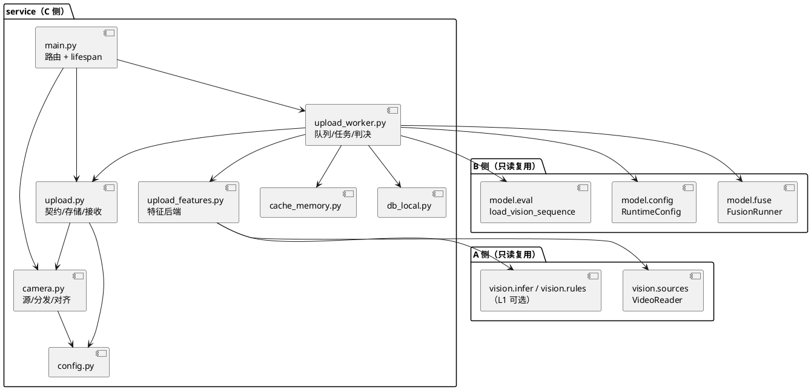
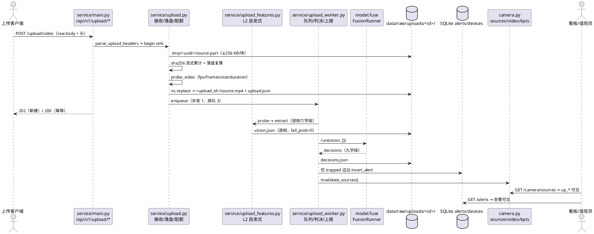
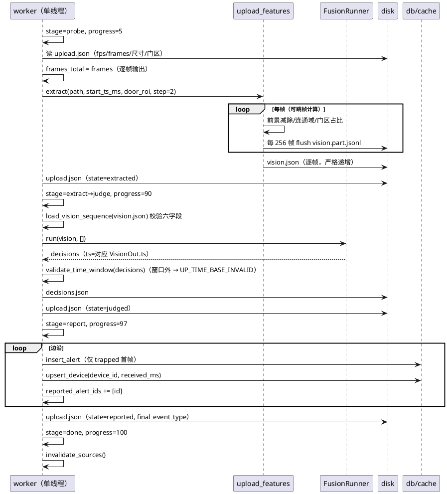
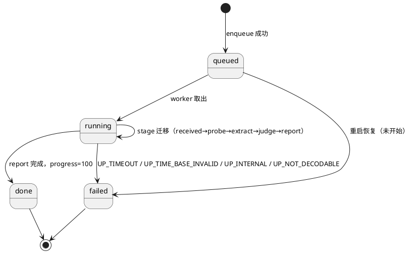
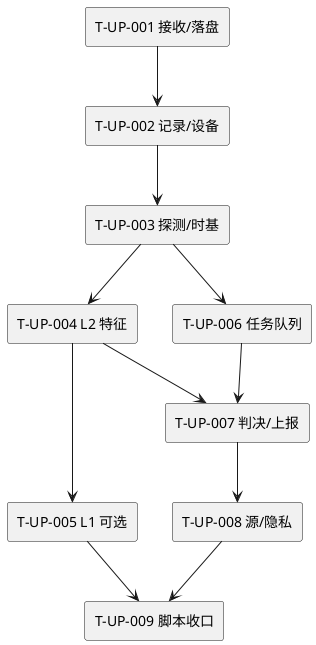
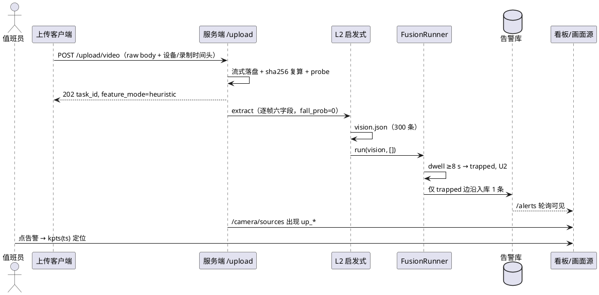

# 用户上传真实视频（困人判定）—— 技术设计文档

| 项目 | 内容 |
|---|---|
| 文档编号 | DESIGN-ELEV-RESCUE-UP-001 |
| 文档名称 | 「用户上传真实视频 → 六字段 → 困人判决 → 告警可见」技术设计 |
| 版本 | v1.0（对应需求基线 `docs/spec/upload_video.md`，2026-11-24，27 条 `REQ-UP-*`） |
| 编写日期 | 2026-11-24 |
| 上游需求 | `docs/spec/upload_video.md`（含已决项 `DEC-UP-01/02`） |
| 上游契约 | `common/schema.py`（`VisionOut` 六字段 / `Decision` 九字段，只读）、`docs/spec/integration.md`（`/edge/report` 直通）、`docs/spec/camera.md`（`/api/v1/camera/*` 六接口） |
| 设计范围 | 新增 `service/upload.py`、`service/upload_features.py`、`service/upload_worker.py`、`scripts/check_upload.py`、`tests/test_upload_*.py`；**只追加** `service/main.py` 路由与 import；**只追加** `service/camera.py` 的上传源分支；落盘仅 `data/raw/uploads/` |
| 明确不做 | 不写实现代码、不改 `requirement.md` / `design.md` / `tasks.md` / `camera.md` / `frontend.md` / `supplement_ac.md` / `integration.md` / `upload_video.md`；不改 `common/schema.py`、`common/demo_data/`、`results/`、`data/labels/`、`dashboard/index.html` |
| 约束继承 | Python 3.9 语法（禁 `X \| Y`、禁运行期 `dict[str, ...]`）；依赖零新增；数据结构 `@dataclass(frozen=True)`；既有六接口 + camera 六接口零变化；判决必须复用 `FusionRunner` |

---

## 0. 阅读约定

### 0.1 文档定位

本文档回答「**如何构建**」：把 `upload_video.md` 的 27 条需求（WHAT）翻译成模块、接口、数据模型、状态机与降级口径（HOW）。文档**不含**函数体实现、不含可运行代码；所有接口以「签名 + 前置/后置 + 异常映射」描述。

### 0.2 事实来源与行号口径

1. 所有既有代码引用均给出 `path:line`，可在当前仓库直接定位；**新增文件**一律标注「（新增）」且不编造行号。
2. 已有实测事实以 `upload_video.md` 1.2（F1~F15）为准；本文档不重复测量，只做设计映射。
3. 沙箱限制沿用 `supplement_ac.md:769-779`（7.3）：本机 `asyncio` 的 `socketpair` 报 `WinError 10051`（`uvicorn`/`TestClient` 不可用），因此设计把「进程内服务函数可直调」作为第一档验收。

### 0.3 设计裁定登记（D-UP-*）

需求文档内部存在若干处字面冲突；若不先裁定，实现会出现「两套口径」。以下裁定是**设计层落地口径**，不新增 `REQ-UP-*` 编号、不改需求原文：

| 编号 | 冲突点 | 裁定（实现以此为准） | 依据 |
|---|---|---|---|
| **D-UP-01** | `upload_video.md:183` 说 `upload_id` =「`sha256` 前 32 位」，但 `REQ-UP-006`（`:525-529`）要求「不同 `device_id` + 相同 `sha256` → 两次独立上传（`upload_id` 不同）」 | `upload_id = sha256(device_id + "\x00" + file_sha256).hexdigest()[:32]`。同设备同文件稳定（幂等 O(1)），不同设备不同 id | `REQ-UP-006` 的行为判据优先；`sha256` 字段仍存文件裸摘要 |
| **D-UP-02** | `G-UP-02`（`:136`）允许「跳帧时条数 = `ceil(frames/step)`」，但 `service/camera.py:857-870` 的 `KptStore` 按**帧号**索引 `vision`，跳帧会错位 | `vision.json` **始终逐帧输出**（`frames` 条）；`step` 只减少启发式计算量，中间帧复制上一帧统计量。`ts` 仍严格递增 | 保证 `/camera/kpts` 的 `vision` 直通不错位；`G-UP-02` 的「跳帧 ceil」是允许值，不是强制值 |
| **D-UP-03** | `REQ-UP-009/010` 要求 `reason` 含 `feature_mode=heuristic` / `roi=client|sidecar|default` / `count_low_conf`，但 `model/reason.py:16-32` 的 `WHITELIST` 仅 13 键，`_self_check`（`:252-268`）会拒绝未知键 | **不改** `model/reason.py`。上传层在 B 生成 `Decision` 之后追加 3 条上传件扩展条目；上传件的 `Decision` **不得**再回灌 `ReasonBuilder._self_check` | `Decision.reason` 是 `List[str]`（`common/schema.py:78`），C 侧 `DecisionIn`（`service/models.py:26`）不做键白名单 |
| **D-UP-04** | 上传件边沿告警若走 `service/main.py:136-171` 的 `report()`，会命中 `:152-159` 的「同设备同紧急度 30 s」去重；两轮「困人→脱困→再困人」在墙钟上可能同秒完成，第二条会被丢弃 | 上传件**不调用** `report()`；由 `upload_worker` 直接 `db.insert_alert` + `db.upsert_device` + `cache.set_state`，用 `upload:{upload_id}:{edge_seq}` 做幂等键。30 s 去重只服务实时 `/edge/report` | `REQ-UP-015` 要求边沿数即告警数；`REQ-INT-016` 的 30 s 去重语义不被削弱 |
| **D-UP-05** | `camera.md:3.2` 的联动依赖 `offset_ms` 与 `aligned=true`，但上传件没有「回放起播」概念 | 上传源（`demo=false`）无会话时 `alignment()` 返回 `aligned=true, offset_ms=0, drift_ms=0`；有会话时仍按会话。demo 源行为**逐字节不变** | 上传源的时间轴就是录制时间，`alert.ts` 与 `anchor_ts_ms` 同源，偏移恒 0 |
| **D-UP-06** | `upload_video.md:3.1` 的 `UploadManifest` 字段清单未含 `event_type`，但 `4.2.5`（`:419`）要求源清单 `event_type` 取自最终判决 | `upload.json` 增加**可选摘要字段** `final_event_type`（五类之一，缺省 `normal`）；`UploadRecord` / `Decision` / `VisionOut` 字段集合不变 | 避免 `scan_uploads()` 每次读 15000 条 `decisions.json`；摘要字段不进入九字段/六字段契约 |
| **D-UP-07** | `REQ-UP-027`（`:663-667`）验收「同时提交 4 个 → 3 个 202 + 1 个 503」，但正文写「并发 1、排队上限 3」；两者相加是 4 个活动任务 | 容量 = 运行 1 + 排队 3 = **4**；第 5 个起 `503 UP_BUSY`。`check_upload.py --task` 以 5 个断言 | 「排队 3」是硬约束；4 个验收数字按「运行 1 + 排队 3」修正 |
| **D-UP-08** | `REQ-UP-014` 的 e2e fixture 未给时长；`REQ-UP-018` 明确用 demo 预设 `dwell=8 s`；4 s 视频不可能触发 8 s 滞留 | 上传件默认 `dwell_threshold=8.0 s`（demo 口径），可用 `UPLOAD_DWELL_SECONDS` 覆盖；`--e2e` 生成 **12 s** fixture（≥8 s 有人门闭）；4 s fixture 只测 `UP_TOO_SHORT` 边界与链路 | `model/config.py:95-99` 的 `PRESET_DEMO`；`model/state_machine.py:271-276` 的严格大于 |
| **D-UP-09** | `REQ-UP-014` 验收「`stats.today_alerts` 增量 = 1」，而 `REQ-UP-013` 要求历史录制时间不计入今日 | `stats` 由 `Decision.ts` 决定（`service/db_local.py:139-166`）；`--e2e` 默认 `start_ts_ms = now_ms()`；历史时间断言单独用 `--start-ts-ms` 验证增量为 0 | `DEC-UP-02`：不平移、不改 `ts` |
| **D-UP-10** | `UploadTask` 需要可查询/可恢复，但 `upload.json` 字段清单未含 `task_id` | `task_id = <upload_id>-<received_ms>`（确定性，可由 `upload.json.received_ms` 重建，不需新增字段） | 与需求示例 `task_id = ...-1763300180000` 同构 |
| **D-UP-11** | `REQ-UP-022` 验收上传源 `sources` 响应 `watermark == "用户上传 · 非取证"`，但 `sources_payload()` 顶层 `watermark` 是 demo 常量（`service/camera.py:35,455-467`） | 顶层 `watermark` 保持 `"演示数据 · 非取证"`；**仅上传源 item** 额外输出 `"watermark": "用户上传 · 非取证"`。demo 5 条 item 不输出该字段，逐字节不变 | `AMEND-UP-04`；`REQ-UP-019` 要求 demo 5 条字段值不变 |
| **D-UP-12** | `DELETE` 默认只删 `source.mp4`，派生保留；但 `sources` 要求删除后不再包含该源 | `scan_uploads()` 只登记 `source.mp4` 存在的件；`/upload/items` 仍列未过期但视频已删的件（`video=false`） | 可播性与可追溯性分离；`REQ-UP-020` 只约束 `sources` |
| **D-UP-13** | `REQ-UP-020` 要求 `/devices.last_seen` 更新；若用历史 `Decision.ts` 会立即显示离线 | 上传件 `upsert_device(device_id, received_ms)`；`Decision.ts` 不变 | `service/db_local.py:117-124` 的 `last_seen` 语义是「最近被看见」；`received_ms` 是本次上传/处理时刻 |
| **D-UP-14** | `REQ-UP-012` 允许 `start_ts_ms` 来自 `X-Upload-Start-Ts-Ms` 或 `upload.json`；HTTP 请求到达时目标目录尚不存在 | HTTP 路径**只认头部**，缺失即 `400 UP_BAD_TIMESTAMP`；`sidecar` 来源只用于目录投放/命令行/重启恢复 | `DEC-UP-01`；HTTP 不得读「尚未创建」的侧车 |
| **D-UP-15** | `REQ-UP-024` 说「4.3 表 20 个 code」，实际表为 **19** 个 | `ERROR_CODES` 常量集合严格等于 4.3 表 19 个；`check_upload.py --strict` 断言集合相等（不是数量 20） | `upload_video.md:424-446` |

### 0.4 与既有文档的关系

| 文档 | 关系 | 本文档的用法 |
|---|---|---|
| `upload_video.md` | 本轮需求与已决项 | 27 条需求逐条落地；`DEC-UP-01/02` 不再讨论 |
| `design.md` | B 侧架构（`FusionRunner`、`reason`、时间语义） | 只复用 `FusionRunner`（`model/fuse.py:114-192`）与 `RuntimeConfig`（`model/config.py:79-99`），不改 B |
| `camera.md` | `/api/v1/camera/*` 六接口契约 | 上传源作为一类源并入 `sources_payload`；`video_payload`/`iter_video_chunks` 零改动复用 |
| `integration.md` | `/edge/report` 字段直通、统计口径 | 上传件入库走同一 `db` 接口，九字段直通；不改 `/edge/report` |
| `frontend.md` | 看板单文件、零构建、2 s 轮询 | 本期不做看板上传页（P2）；上传请求不进入 `refresh()` |
| `supplement_ac.md` | 3.9 语法红线、依赖策略、沙箱限制 | 注解、`@dataclass`、无 `python-multipart`、进程内验收 |
| `tasks.md` | 既有任务体例与冻结回归命令 | 任务映射沿用「文件 + 函数 + 验收命令」体例；回归命令见 11.6 |

---

## 1. 目标与现状

### 1.1 目标（承接 `G-UP-01~05`）

| 编号 | 目标 | 设计可观测判据 | 需求出处 |
|---|---|---|---|
| G-UP-01 | 用户能上传自己拍的电梯视频 | `data/raw/uploads/<upload_id>/source.mp4` 存在，`sha256` 与客户端一致 | `upload_video.md:135` |
| G-UP-02 | 系统自己产出六字段序列 | `vision.json` 条数 = `frames`（逐帧，D-UP-02），字段集合恰为 6 | `:136` |
| G-UP-03 | 能判出困人并告警 | 12 s「门闭 + 有人滞留 ≥8 s」→ `/alerts` 一条 `trapped=true, urgency=2` | `:137` |
| G-UP-04 | 告警与视频双向可追溯 | `/camera/sources` 出现 `up_*`；`upload.json.reported_alert_ids` 有告警 id | `:138` |
| G-UP-05 | 不破坏既有演示 | 既有 6 接口 + camera 6 接口 + `check_frontend.py` 25/25 与基线一致 | `:139` |

### 1.2 现状关键事实（只列设计会碰到的）

| 事实 | 代码/文档位置 | 对设计的强制影响 |
|---|---|---|
| 无任何上传能力，`python-multipart` 未装 | `upload_video.md:89-90`（F1/F2） | 传输必须 raw body 流式；禁用 `UploadFile`/`File()` |
| `ultralytics`/`onnxruntime`/`models/` 均不可用 | `:94-96`（F4/F5/F6） | 默认 L2 启发式；L1 仅运行时探测 |
| 源清单只扫 `common/demo_data/*_meta.json`，且有进程内缓存 `_BOOTSTRAPPED` | `service/camera.py:382-398`、`:401-425`（F7/F14） | 新增 `scan_uploads()` + `invalidate_sources()`；demo 分支不动 |
| 无 `_meta.json` 时 `VideoReader` 锚到当前整秒 | `vision/sources.py:116-128`（F8） | 上传必须显式传 `start_ts_ms`，禁止用当前时间顶替 |
| `VideoReader` 对非法 fps 回退 25.0 | `vision/sources.py:105-107` | 上传探测不能直接用 `video_info.fps`；须读原始 `CAP_PROP_FPS` 严格校验 |
| `SyntheticBackend` 只读 `<stem>_kpts.jsonl`；`auto` 无侧车落到 yolo/onnx | `vision/sources.py:388-418`、`:430-465`（F9） | L2 不经过 `make_backend`；L1 侧车文件名 `source_kpts.jsonl` |
| `model/eval.py --real` 硬依赖 `_imu.npy` | `model/eval.py:156-193`（F10） | 上传件不走 `eval.py --real`；直接构造 `FusionRunner` |
| `load_vision_sequence` 只认 `vision_<case>.json|jsonl`，并做六字段校验 | `model/eval.py:119-143`（F11） | 上传层写完后**直接调用**该校验器（不复制规则） |
| `source_id` ≤20 字符、`[a-z0-9_]` | `service/camera.py:269-273`（F12） | `up_` + `upload_id[:16]` = 19 字符 |
| `data/raw/` 为空且已 gitignore | `.gitignore:26-27`（F13） | 落盘位天然存在；`git status` 不应出现 `data/raw/` |
| 既有 `main.py` 的 mount 在最后 | `service/main.py:304-305`（F15） | 新路由必须在其之前；`main.py` 既有行零删除 |
| 判决入口是 `FusionRunner.run`，无 IMU 时钳制 `urgency≤2` | `model/fuse.py:114-192`、`:145-148` | 上传件 `FusionRunner.run(vision, [])`，禁止另写状态机 |
| `SignalEstimator` 对 `keypoints_ok=False` 强制 `fall_prob=0` 并加 `keypoints_unreliable` | `model/signals.py:77-79` | L2 红线有第二层兜底 |
| `reason` 白名单 13 键 | `model/reason.py:16-32`、`:252-268` | `feature_mode/roi/count_low_conf` 不能进 B 白名单（D-UP-03） |
| 既有 30 s 去重 key = `alert:{device}:{urgency}` | `service/main.py:146-159`、`service/config.py:58` | 上传件绕开该 key（D-UP-04） |
| `stats.today_alerts` 按 `ts >= 今日 0 点` | `service/db_local.py:139-166` | 历史录制时间自然不计入今日（D-UP-09） |

### 1.3 四个 P0 缺口与设计回应

| 缺口 | 设计回应 | 落点 |
|---|---|---|
| GAP-UP-02 特征来源（唯一真阻断） | L2 启发式后端 `HeuristicBackend`（前景减除/连通域/门区占比），`fall_prob` 恒 0 | 6.2 |
| GAP-UP-03 时间基准 | `start_ts_ms` 必填（HTTP 头 / 侧车），`ts(frame)` 唯一公式，窗口校验 | 7 |
| GAP-UP-01 + 08 入口与异步 | raw body 流式 + 单进程队列（并发 1、排队 3）+ 600 s 超时 | 3、4、8 |
| GAP-UP-05 + 06 可见性与归属 | `up_*` 源并入 `sources_payload`；上传源自有 `device_id` | 5.5、8.8 |

### 1.4 可直接复用的既有能力（不改）

| 能力 | 位置 | 复用方式 |
|---|---|---|
| 六字段契约 | `common/schema.py:43-52` | 只构造，不改 |
| 九字段契约 | `common/schema.py:66-78` | 只构造，不改 |
| `FusionRunner.run(vision, imu)` | `model/fuse.py:114-192` | 上传判决唯一入口 |
| `RuntimeConfig` / `PRESET_DEMO` | `model/config.py:79-99` | `dataclasses.replace` 注入 `device_id/location` |
| `load_vision_sequence` | `model/eval.py:119-143` | 写完 `vision.json` 后复用校验 |
| `video_payload` / `iter_video_chunks` | `service/camera.py:699-705`、`:682-696` | 上传源可播，零改动 |
| `sources_payload` | `service/camera.py:455-467` | 合并上传源，顶层字段不变 |
| `KptStore` | `service/camera.py:795-875` | 上传源 `vision` 直通；无 kpts → `persons=[]` |
| `db.insert_alert` / `upsert_device` / `stats` | `service/db_local.py:66-85`、`:117-124`、`:139-166` | 上传件入库 |
| `check_*` 脚本体例 | `scripts/check_camera.py:16-18`、`:44-57` | `check_upload.py` 只调真实服务函数 |

---

## 2. 模块划分与复用边界

### 2.1 文件清单与职责

| 文件 | 状态 | 职责 | 为什么单独成文件 |
|---|---|---|---|
| `service/upload.py` | **新增** | 契约与存储层：`UploadRecord`/`UploadTask`、头解析、`UploadSink`、`upload_id`/`source_id`、探测、配额、TTL 清理、`upload.json` 读写、`GET /items`/`DELETE` 的服务函数 | 不依赖 `fastapi`/`cv2`/`numpy`，保证 `python -c "import service.upload"` 在 3.9 下退出码 0；便于纯函数单测 |
| `service/upload_features.py` | **新增** | `FeatureBackend` 协议、`HeuristicBackend`、L1 探测与 `PoseFeatureBackend`、`vision.json` 写出与校验 | 特征后端是唯一长杆（`T-UP-004`），与存储/任务解耦；避免 `service/upload.py` 超过 800 行 |
| `service/upload_worker.py` | **新增** | 单进程队列、worker 线程、任务状态机、阶段推进、600 s 超时、重启恢复、判决/边沿上报/入库 | 任务编排依赖 `model.fuse`（会带 `numpy`）；与「可无依赖导入」的 `upload.py` 分层 |
| `service/camera.py` | **只追加** | `scan_uploads()`、`invalidate_sources()`、上传源构造、上传源 `watermark` 字段、上传源 `alignment` 分支 | demo 分支（`:382-398`）一行不改；`CameraSource` 只追加带默认值的字段 |
| `service/main.py` | **只追加** | 新增 `/api/v1/upload/*` 路由 + import + `lifespan` 启动/停止 worker | 既有 6 接口与 camera 6 接口零删除（`:203-305` 之后、`:304` mount 之前） |
| `scripts/check_upload.py` | **新增** | `--strict/--accept/--probe/--heuristic/--pose/--task/--judge/--sources/--e2e/--make-fixture` | 只调真实服务函数，不复制公式（同 `check_camera.py` 体例） |
| `scripts/upload_video.py` | **新增（P1 可选）** | 目录投放/命令行上传，产出与 HTTP 同构的 `upload.json` | 满足 `REQ-UP-005` 的 `python scripts/upload_video.py --video ...` 验收；不进 P0 关键路径 |
| `tests/test_upload_*.py` | **新增** | 纯函数与进程内契约单测 | 见 11.1 |
| `data/raw/uploads/` | **运行时创建** | 上传件目录（四件产物 + 临时区） | `.gitignore:26-27` 已忽略 |

**不新增**：`service/upload_models.py`（不引入 pydantic）、`vision/heuristic.py`（`T-UP-004` 的建议交付物改落 `service/upload_features.py`，理由见 2.4）。

### 2.2 与 `service/camera.py` 的复用边界

| 能力 | 既有实现 | 上传链路如何使用 | 是否改既有行为 |
|---|---|---|---|
| 源登记 | `scan_sources()`（`service/camera.py:382-398`）只扫 `common/demo_data/*_meta.json` | 新增 `scan_uploads(base_dir)` 扫 `data/raw/uploads/*/upload.json`；`load_sources()` 合并「demo 源 + 上传源」 | 否（`scan_sources` 不改） |
| 源清单响应 | `sources_payload()`（`:455-467`） | 直接返回合并后的 `load_sources()`；顶层 `items/mode/watermark/degraded` 形状不变 | demo 5 条逐字节不变（D-UP-11） |
| 源缓存 | `_BOOTSTRAPPED`/`load_sources()`（`:401-432`） | 新增 `_UPLOAD_CACHE` + `invalidate_sources()`；上传完成/删除后显式失效 | 否（`_BOOTSTRAPPED` 只控制 demo） |
| 视频分发 | `video_payload()`（`:699-705`）、`iter_video_chunks()`（`:682-696`） | 上传源 `CameraSource.video_path` 指向 `<upload_dir>/source.mp4`；Range/206/416 逻辑原样复用 | 否（零解码、零改动） |
| 关键点窗口 | `kpts_payload()`（`:911-973`）、`KptStore`（`:795-875`） | 上传源 `keypoints=false` → `kpts_path` 不存在 → `persons=[]`；`vision_path` 指向 `vision.json` → `vision` 六字段直通 | 否（`KptStore` 不改；逐帧输出保证索引正确，D-UP-02） |
| 时间基准 | `frame_ms_of()`/`wall_ms_of()`/`frame_for_alert()`（`:473-491`） | 上传源 `anchor_ts_ms = start_ts_ms`，`offset_ms=0`；同一公式 | demo 不变；上传源 `alignment` 新增分支（D-UP-05） |
| 错误体 | `CameraError`/`error_detail()`（`:197-215`） | 上传层新建同构 `UploadError`，不混用 `CAM_*` 错误码 | 否 |

**关键约束**：`sources_payload()` 的 `items` 排序按 `source_id` 字典序（`service/camera.py:397`）。`demo_*` < `up_*`，因此合并后 demo 5 条顺序不变；新增上传源排在末尾。

### 2.3 分层与依赖方向



**依赖规则（硬约束，用 import 图测试固化）**：

| 层 | 模块 | 允许依赖 | 禁止 |
|---|---|---|---|
| L0 | `service/upload.py` | 标准库、`service.config`、`service.camera.invalidate_sources`；`cv2` **仅在 `probe_video()` 内懒加载** | 顶层 import `fastapi`/`cv2`/`numpy`/`model.fuse`/`model.eval` |
| L1 | `service/upload_features.py` | 标准库、`service.config`、`vision.sources.VideoReader`（懒加载）、`vision.rules`（仅 L1）；`cv2` 函数内懒加载 | 顶层 import `fastapi`/`model.fuse` |
| L2 | `service/upload_worker.py` | L0/L1、`model.fuse`、`model.config`、`model.eval.load_vision_sequence`、`service.db_*`、`service.cache_*` | `fastapi`、`service.main`（依赖由 `start(db, cache)` 注入） |
| L3 | `service/main.py` | 全部 + `fastapi` | 不得在 `app.mount("/")` 之后注册 upload 路由 |

> `load_vision_sequence` 的调用点在 **worker**（`run_judge`），不在 `upload.py`；这样 `upload.py` 的顶层导入链不含 `numpy`，`python -c "import service.upload"` 在 3.9 最小环境仍退出码 0。

### 2.4 为什么拆分与两处「不按任务表建议」的取舍

1. **`T-UP-004` 交付物从 `vision/heuristic.py` 改为 `service/upload_features.py`**：`vision/` 是 A 侧冻结区（`camera.md:155` C-CAM-07），上传特征只服务上传链路，且需要与 `upload.json` 的 `feature_mode`/`roi` 强耦合。放在 `service/` 可保证「A 侧 `make_backend`/`SyntheticBackend` 行为零变化」，也避免把上传专属参数写进 `vision/configs/`。
2. **`service/upload_worker.py` 必须单独存在**：`upload.py` 要保证「无 `fastapi`/无 `numpy` 也能 import」，而判决编排必须 import `model.fuse`（`numpy`）。若合并，`python -c "import service.upload"` 在 3.9 的最小环境会因 `numpy` 缺失失败，破坏 `REQ-UP-025` 的验收。
3. **不新增 `service/upload_models.py`**：上传记录/任务一律 `@dataclass(frozen=True)`，JSON 用 `dataclasses.asdict` + 手写平铺函数；不引入 pydantic（`C-UP-02`）。

---

## 3. 数据流与时序

### 3.1 端到端数据流



### 3.2 上传接收时序（HTTP → 落盘 → 探测 → 入队）

```text
1. 路由层读 request.headers → parse_upload_headers(headers)
   - Content-Length 缺失 → 411 UP_LENGTH_REQUIRED
   - Content-Length=0 或非整数 → 400 UP_BAD_REQUEST
   - Content-Length > 200 MiB → 413 UP_TOO_LARGE
   - Content-Type 非 video/mp4|application/octet-stream → 415 UP_UNSUPPORTED_TYPE
   - X-Upload-Device-Id 非法/等于 ELEV-DEMO-001 → 400 UP_BAD_DEVICE_ID
   - X-Upload-Start-Ts-Ms 缺失/非 13 位 → 400 UP_BAD_TIMESTAMP
   - X-Upload-Door-Roi 非 4 元/顺序反/负 → 400 UP_BAD_ROI
   - X-Upload-Location >8 字符 → 400 UP_BAD_REQUEST
2. cleanup_expired(now_ms)（启动 + 每次上传前，带清理锁）
3. UploadSink 写入 data/raw/uploads/.tmp/<uuid>/source.part
   - 分块 ≤256 KB；累计 sha256
   - 前 12 字节校验 bytes[4:8] == b"ftyp" → 否则 415
   - 累计字节 > Content-Length 或 > 200 MiB → 413（删半成品）
   - 客户端提前断开（实际 < Content-Length）→ 400（删半成品）
4. finish() 复算与落盘
   - 重新流式读 source.part 复算 sha256 → 不一致 500 UP_HASH_MISMATCH
   - upload_id = sha256(device_id + "\x00" + sha256)[:32]
   - 幂等：data/raw/uploads/<upload_id>/upload.json 存在且未过期 → 删 .tmp，返回 200
   - 配额：bytes_used + bytes > 2 GiB 或 items_used + 1 > 20 → 删 .tmp，507
   - os.replace(.tmp/<uuid>/source.part → <upload_id>/source.mp4)
5. probe_video(source.mp4, start_ts_ms)
   - cv2 缺失/打不开/frames=0/fps∉[1,60]/宽高越界 → 422 UP_NOT_DECODABLE（删目录）
   - duration<4 s → 422 UP_TOO_SHORT；duration>600 s → 422 UP_TOO_LONG（删目录）
   - 门区越界（相对 width/height）→ 400 UP_BAD_ROI（删目录）
6. 构造 UploadRecord + 写 upload.json
   - state=received；fps/frames/width/height/duration_ms 来自 probe
   - start_ts_source=client；expire_ms=received_ms+24h
7. enqueue(upload_id)
   - 队列满 → 删目录 → 503 UP_BUSY
   - 成功 → 202；幂等命中且已有任务 → 200
```

### 3.3 处理时序（probe → extract → judge → report）



### 3.4 可见性时序（`/camera/sources`）

```text
上传完成（state=reported）
  → camera.invalidate_sources()
  → GET /api/v1/camera/sources
      → load_sources() = demo 5 条 + scan_uploads() 的 up_* 条
      → up_* 的 anchor_ts_ms = start_ts_ms，video=true，keypoints=false，vision=true
      → 顶层 watermark 仍为 "演示数据 · 非取证"
      → up_* item 额外 watermark = "用户上传 · 非取证"
删除（DELETE /upload/items/<id>）
  → 删 source.mp4（默认）/ 整目录（purge=1）
  → camera.invalidate_sources()
  → GET /camera/sources 不再含该 source_id
```

### 3.5 失败/超时时序

```text
extract 中途超时（>600 s）
  → 已产出部分：vision.part.jsonl 转为 vision.json（合法 List[VisionOut]）
  → task.state=failed, stage=extract, progress=停在最后值, error={code:UP_TIMEOUT}
  → upload.json.state=failed
  → 保留 source.mp4 / vision.json / upload.json；不生成 decisions.json
  → 不写告警
处理中被删除 source.mp4（REQ-UP-016）
  → 下一帧 open/read 失败 → task.failed, error={code:UP_INTERNAL}
  → progress 不回退
服务重启
  → recover_on_startup()：upload.json.state ∈ {received, extracted, judged} → 置 failed（UP_INTERNAL）
  → reported → task=done（progress=100）；failed → task=failed
```

---

## 4. 并发与任务模型

### 4.1 单进程内队列（并发 1、排队 3）

| 项 | 设计 | 理由 |
|---|---|---|
| 并发 | 1（单 worker 线程） | `NG-UP-08`、`REQ-UP-027`；单机 CPU 预算 |
| 排队 | 3 | `REQ-UP-027` |
| 总活动任务 | 4（1 运行 + 3 排队）；第 5 个 `503 UP_BUSY` | D-UP-07 |
| 载体 | `queue.Queue(maxsize=3)` + `threading.Thread(daemon=True)` | 标准库、3.9 兼容、无需 `asyncio` |
| 入队 | `put_nowait(task_id)`；`queue.Full` → `503` | 队列满必须在**落盘后立即**判定；新建件回滚目录 |
| 任务字典 | `Dict[str, UploadTask]` + `threading.Lock` | 查询/更新同锁；`UploadTask` 用 `dataclasses.replace` 更新（frozen） |
| 依赖注入 | `start(db, cache, base_dir)`（由 `lifespan` 在 `_load_db/_load_cache` 之后调用） | worker 不 import `service.main`；避免与 `fastapi` 耦合 |
| 停止 | `stop()`：置 `_STOP` + 投毒丸 + `join(timeout=2)` | `lifespan` 退出时调用；daemon 兜底 |
| 上传路由阻塞 | `async def` 读 `request.stream()`；`sink.feed()` 用 `starlette.concurrency.run_in_threadpool` | 256 KB/块，避免阻塞事件循环；`starlette` 随 FastAPI 已装，不新增依赖 |

### 4.2 任务状态机（`UploadTask.state` + `stage`）



| `stage` | `progress` | 触发 | 持久化 |
|---|---|---|---|
| `received` | 0 | 入队前 | `upload.json.state=received` |
| `probe` | 5 | worker 开始 | 内存 |
| `extract` | 10→90（按 `frames_done/frames_total`） | 逐帧/每 256 帧 | 内存；`vision.part.jsonl` 每 256 帧 |
| `judge` | 92 | `vision.json` 校验通过 | 内存 |
| `report` | 97 | 边沿上报中 | 内存 |
| `done` | 100 | 全部完成 | `upload.json.state=reported` |
| `failed` | 停点（不回退） | 任一异常 | `upload.json.state=failed` |

**进度公式**：

```text
extract_progress = 10 + round(80 * frames_done / max(1, frames_total))
eta_sec          = 0                         （frames_done == frames_total）
                 = round((frames_total - frames_done) / max(0.1, observed_fps))
observed_fps     = frames_done_since_stage / max(0.1, elapsed_sec_since_stage)
```

`frames_total = frames`（逐帧输出，D-UP-02）；`step=2` 只影响计算，不影响 `frames_total`。`frames_done` 每 64 帧更新一次内存，避免锁竞争；`updated_ms` 每 ≥1 s 更新一次。

### 4.3 超时 600 s

| 项 | 设计 |
|---|---|
| 计时起点 | worker 取出任务时的 `time.monotonic()`（不是 `received_ms`） |
| 检查点 | 每帧 `extract`、每个 `judge` 批次、每次上报前 |
| 超时动作 | 抛 `UploadTimeout`；`vision.part.jsonl` 落为 `vision.json`；`state=failed`、`stage=extract`、`error={code:"UP_TIMEOUT",message:"视频处理超时"}` |
| 保留产物 | `source.mp4`、`vision.json`（已产出部分）、`upload.json`；不生成 `decisions.json` |
| 不重试 | 任务级不自动重试；用户可用同一文件重新上传（`REQ-UP-016`） |
| 阶段内重试 | 单阶段最多 3 次、退避 1/2/4 s；仅对 `OSError`/瞬时读失败；合并为 1 条 WARN（`REQ-UP-016`） |

### 4.4 重启恢复

`recover_on_startup()` 在 `lifespan` 中、worker 启动前执行：

| `upload.json.state` | 重建任务 | `task.state` | `task.stage` | `error` | `progress` |
|---|---|---|---|---|---|
| `reported` | 是 | `done` | `done` | `null` | 100 |
| `failed` | 是 | `failed` | 按 `state` 映射（`received`） | `{code:"UP_INTERNAL"}` | 0 |
| `received` | 是 | `failed` | `received` | `{code:"UP_INTERNAL",message:"上次处理被中断，请重新上传"}` | 0 |
| `extracted` | 是 | `failed` | `extract` | 同上 | 90 |
| `judged` | 是 | `failed` | `judge` | 同上 | 92 |

- `task_id = <upload_id>-<received_ms>`（D-UP-10），不落盘、可重建。
- `frames_done` 若 `vision.json` 存在，取 `load_vision_sequence()` 的条数；否则 0。
- `alerts.produced = len(reported_alert_ids)`；`first_alert_ts` 取 `reported_alert_ts[0]`（若 manifest 存，见 5.2）。
- **查询无副作用**：`GET /tasks/{id}` 只读内存/`upload.json`，不重跑。

### 4.5 幂等矩阵（`REQ-UP-006`）

| 既有记录状态 | 同 `device_id` + 同 `sha256` 再传 | 响应 | 动作 |
|---|---|---|---|
| 不存在 | 新建 | 202 | 落盘 + 建任务 |
| `received` / `extracted` / `judged`（任务在跑） | 幂等命中 | 200 | 删临时文件；返回既有 `task_id`；`state` 照实（`queued/running`） |
| `reported` | 幂等命中 | 200 | 返回既有 `task_id`；`state=done` |
| `failed` | **重试** | 202 | 复用 `upload_id` 目录，删除旧 `vision.json`/`decisions.json`，重置 `received_ms/expire_ms`，新 `task_id` |
| 已过期（`expire_ms < now`） | 视为不存在 | 202 | 先清理 `source.mp4`，再按新建覆盖派生（D-UP-12） |
| 不同 `device_id` + 同 `sha256` | 独立 | 202 | `upload_id` 不同（D-UP-01） |

**幂等 O(1)**：`upload_id` 由 `device_id + file_sha256` 直接推导，查 `data/raw/uploads/<upload_id>/upload.json` 即可，无需扫描全部件。

---

## 5. 存储布局与数据模型

### 5.1 目录布局

```text
data/raw/uploads/                      # .gitignore:26-27 已忽略
├── .tmp/                              # 接收期临时区，启动时清空
│   └── <uuid>/source.part             # 未完成字节，不计配额
└── <upload_id>/                       # 32 位小写 hex（D-UP-01）
    ├── source.mp4                     # 客户端字节原样；24 h 后删除
    ├── upload.json                    # UploadManifest（记录侧车）
    ├── vision.json                    # List[VisionOut]，六字段，逐帧
    ├── decisions.json                 # List[Decision]，九字段
    └── vision.part.jsonl              # 仅处理中/失败保留；成功后删除
```

**原子写**：`upload.json`、`vision.json`、`decisions.json` 先写 `<name>.tmp`，再 `os.replace`；读取方只读完整文件。避免 `scan_uploads()` 读到半截 JSON。

**只读隔离**：上传链路只写 `data/raw/uploads/`；**禁止**写 `common/demo_data/`、`results/`、`data/labels/`、`data/processed/`（`REQ-UP-021`、`C-UP-04/05/06`）。

### 5.2 数据结构（`@dataclass(frozen=True)`，字段即 JSON 契约）

#### `UploadRecord`（`upload.json` 的主体，平铺）

| 字段 | 类型 | 约束 | 来源/写入点 |
|---|---|---|---|
| `upload_id` | `str` | 32 位小写 hex；`sha256(device_id+"\x00"+file_sha256)[:32]`（D-UP-01） | `build_upload_id()` |
| `source_id` | `str` | `up_` + `upload_id[:16]`，19 字符，`[a-z0-9_]` | `source_id_of()` |
| `device_id` | `str` | `^[A-Z0-9][A-Z0-9-]{2,23}$`；不得等于 `ELEV-DEMO-001` | `parse_device_id()` |
| `location` | `str` | ≤8 字符；缺省 `?` | `parse_location()` |
| `original_name` | `str` | ≤64；消毒后不含 `/`、`\`、`..` | `sanitize_filename()` |
| `bytes` | `int` | `>0` 且 `≤209715200` | `UploadSink.finish()` |
| `sha256` | `str` | 64 位小写 hex；落盘后复算一致 | `UploadSink.finish()` |
| `fps` | `float` | `1.0≤fps≤60.0`（原始 `CAP_PROP_FPS`，不回退） | `probe_video()` |
| `frames` | `int` | `>0`；`CAP_PROP_FRAME_COUNT` 为 0 时逐帧计数 | `probe_video()` |
| `width` / `height` | `int` | `0<width≤1920`、`0<height≤1080` | `probe_video()` |
| `duration_ms` | `int` | `round(frames*1000/fps)`；误差 ≤40 ms | `probe_video()` |
| `start_ts_ms` | `int` | `10^12≤x<10^13`；**只来自录制时间** | `parse_ts13()` |
| `start_ts_source` | `str` | `client` / `sidecar`（D-UP-14） | `parse_upload_headers()` |
| `door_roi` | `Optional[List[int]]` | 4 元 `[x1,y1,x2,y2]`；`x1<x2`、`y1<y2`；`null` 走默认 | `parse_door_roi()` + `probe` 后越界校验 |
| `feature_mode` | `str` | `pose` / `heuristic` | `detect_feature_mode()` |
| `keypoints_ok` | `bool` | `feature_mode=="pose"` 时为 `true`，否则 `false` | `detect_feature_mode()` |
| `received_ms` | `int` | 13 位毫秒；仅用于 TTL/配额/`last_seen`，**不参与 `ts`** | `UploadSink.finish()` |
| `expire_ms` | `int` | `received_ms + 86400000` | `UploadSink.finish()` |
| `state` | `str` | `received`/`extracted`/`judged`/`reported`/`failed` | 阶段迁移 |

#### `UploadTask`（内存 + 可重建，`frozen=True`）

| 字段 | 类型 | 约束 | 更新方式 |
|---|---|---|---|
| `task_id` | `str` | `<upload_id>-<received_ms>`（D-UP-10） | 创建时 |
| `upload_id` / `device_id` | `str` | 能在 `UploadRecord` 找到 | 创建时 |
| `state` | `str` | `queued`/`running`/`done`/`failed` | `dataclasses.replace` |
| `stage` | `str` | `received`/`probe`/`extract`/`judge`/`report`/`done` | 同上 |
| `progress` | `int` | `0~100`，只增不减 | 同上 |
| `frames_total` / `frames_done` | `int` | `frames_done≤frames_total` | 每 64 帧 |
| `feature_mode` | `str` | `pose`/`heuristic` | 创建时 |
| `error` | `Optional[Dict]` | `{code,message}`；`state!="failed"` 为 `None` | 失败时 |
| `updated_ms` | `int` | 最近心跳（≥1 s 更新） | 同上 |
| `started_ms` | `int` | worker 开始时刻（墙钟） | 创建时 |
| `reported_alert_ts` | `List[int]` | 已上报告警的 `ts` | 追加 |

#### `UploadManifest`（`upload.json` 平铺 JSON）

`UploadRecord` 全字段 + 以下摘要字段：

| 字段 | 类型 | 说明 |
|---|---|---|
| `vision_file` | `str` | 固定 `"vision.json"`（相对 `upload_dir`，不输出绝对路径） |
| `decisions_file` | `str` | 固定 `"decisions.json"` |
| `reported_alert_ids` | `List[int]` | 本次上传产生的告警 id，顺序即边沿顺序 |
| `reported_alert_ts` | `List[int]` | 与 `reported_alert_ids` 平行；供 `first_alert_ts`（D-UP-06 延伸） |
| `final_event_type` | `str` | 最终判决五类之一；未完成 `normal`（D-UP-06） |

> `final_event_type` / `reported_alert_ts` 是**侧车摘要**，不进入 `UploadRecord`、`Decision`、`VisionOut` 契约。`tests/test_schema_contract.py` 不受影响。

#### `UploadIntent` / `ProbeInfo` / `Quota` / `UploadAcceptResult` / `Accepted`（纯值对象）

| 结构 | 字段 | 用途 |
|---|---|---|
| `UploadIntent` | `content_length`、`content_type`、`device_id`、`start_ts_ms`、`start_ts_source`、`location`、`door_roi`、`original_name`、`tmp_dir` | 头解析结果（`parse_upload_headers()`） |
| `ProbeInfo` | `fps`、`frames`、`width`、`height`、`duration_ms` | 探测结果（`probe_video()`） |
| `Quota` | `bytes_used`、`bytes_limit`、`items_used`、`items_limit` | 配额快照（`quota_snapshot()`） |
| `UploadAcceptResult` | `record: UploadRecord`、`status_code: int`、`body: Dict[str, Any]`、`created: bool` | `UploadSink.finish()` 的返回值（202 新建 / 200 幂等） |
| `Accepted` | `status_code: int`、`body: Dict[str, Any]` | `UploadTaskManager.enqueue()` 的返回值（202/200/503） |

### 5.3 配额与 24 h 清理

**配额常量**（`service/config.py` 追加，只追加行）：

```text
UPLOAD_MAX_BYTES          = 209715200      # 200 MiB / 件
UPLOAD_QUOTA_BYTES        = 2147483648     # 2 GiB / 总量
UPLOAD_QUOTA_ITEMS        = 20             # 20 件
UPLOAD_TTL_MS             = 86400000       # 24 h
UPLOAD_MIN_DURATION_MS    = 4000           # 4 s
UPLOAD_MAX_DURATION_MS    = 600000         # 600 s
UPLOAD_TASK_TIMEOUT_SEC   = 600
UPLOAD_QUEUE_SIZE         = 3
UPLOAD_CHUNK_SIZE         = 262144         # 256 KB
UPLOAD_FRAME_STEP         = 2
UPLOAD_DWELL_SECONDS      = 8.0            # D-UP-08
UPLOAD_REPORT             = 1              # 0=只判不发
```

**配额计算**（`quota_snapshot(now_ms)`）：

```text
items_used = count(upload.json where expire_ms >= now_ms)
bytes_used = sum(size(source.mp4) for 上述 items，source.mp4 存在)
```

- 过期件（`expire_ms < now_ms`）不计入配额与 `/items` 列表。
- 已删 `source.mp4` 但未过期的件计入 `items_used`，`bytes_used` 记 0；`/items` 仍列出（`video=false`，D-UP-12）。
- 超限 → `507 UP_QUOTA_EXCEEDED`，**不覆盖**已有件（`REQ-UP-004`）。

**清理触发点**：`lifespan` 启动时 + 每次 `parse_upload_headers()` 之后（带 `_CLEANUP_LOCK`）。

**清理顺序与失败处理**：

```text
1. 扫描 data/raw/uploads/*/upload.json，按 expire_ms < now 过滤
2. 删除 source.mp4（若存在）
   - 成功：记 INFO（合并计数：清理过期 n 条）
   - 失败（占用/权限）：记 WARN（单键 1 分钟合并），**不阻断**，下次再试
3. 保留 vision.json / decisions.json / upload.json（派生无像素，可追溯）
4. 不触碰 .tmp 以外的任何目录；启动时单独清空 .tmp
```

- 清理**只删 `source.mp4`**；`purge=1` 的 `DELETE` 才删整目录。
- 清理不改变 `upload.json`；`/items` 用 `expire_ms` 过滤，不依赖文件是否已删。

### 5.4 `DELETE` 与删除失败

| 参数 | 行为 | 响应 |
|---|---|---|
| 默认（`purge=0`） | 只删 `source.mp4`；`vision.json`/`decisions.json`/`upload.json` 保留 | `{"ok":true,"deleted":{"source.mp4":true,"vision.json":false}}` |
| `purge=1` | 删除 `source.mp4` + `vision.json` + `decisions.json` + `upload.json`（整目录） | `{"ok":true,"deleted":{"source.mp4":true,"vision.json":true,"decisions.json":true,"upload.json":true}}` |
| 未知/已过期 | — | `404 UP_NOT_FOUND` |
| 删除失败（占用/权限） | 记录 WARN，返回错误 | `409 UP_DELETE_FAILED` |

- `purge=1` 仍不得触碰 `results/`、`common/demo_data/`、`data/labels/`。
- 删除成功后调用 `camera.invalidate_sources()`；若 `source.mp4` 已删，`scan_uploads()` 不再登记该源（D-UP-12）。

### 5.5 隐私与归属

| 约束 | 设计落点 |
|---|---|
| 不做人脸识别 | `service/upload_features.py` 不 import 任何人脸库；`HeuristicBackend` 只做前景统计 |
| 不留存/导出画面 | 只写 `source.mp4`（源目录内）与 `vision.json`/`decisions.json`（无数值以外内容）；`/camera/video` 同源分发 |
| 水印 | 上传源 `watermark = "用户上传 · 非取证"`（D-UP-11）；demo 常量 `service/camera.py:35` 不动 |
| 日志 | 只记 `upload_id/device_id/bytes/mode/alerts`；不记像素、坐标数组、文件内容 |
| 设备归属 | `device_id` 写入 `UploadRecord`、`Decision.device_id`、`devices` 表；`ELEV-DEMO-001` 禁止 |

---

## 6. 特征后端抽象

### 6.1 `FeatureBackend` 协议（Python 3.9 写法）

```python
from typing import Callable, List, Optional, Protocol
from pathlib import Path

class FeatureBackend(Protocol):
    mode: str  # "heuristic" | "pose"

    def extract(
        self,
        video_path: Path,
        start_ts_ms: int,
        door_roi: Optional[List[int]],
        step: int,
        progress: Callable[[int, int], None],
        deadline: float,
    ) -> "FeatureResult":
        ...
```

- `Protocol` 在 Python 3.8+ 可用；不使用 `X | Y`、不使用运行期 `list[...]`。
- `progress(frames_done, frames_total)` 由 worker 注入，用于更新 `UploadTask`；`deadline` 是 `time.monotonic()` 截止点，后端每帧检查。
- `FeatureResult`（`@dataclass(frozen=True)`）：`rows: List[VisionOut]`、`roi_source: str`（`client|sidecar|default`）、`low_conf_count: int`、`mode: str`。

### 6.2 `HeuristicBackend`（L2，默认档）

**输入**：`source.mp4`、`start_ts_ms`、`door_roi`（可为 `None`）、`step=2`。

**逐帧流程（只用 `cv2` 稳定子集）**：

```text
1. capture = cv2.VideoCapture(source.mp4)
   - isOpened()==False → 抛 DecodeError（上层转 422 UP_NOT_DECODABLE）
2. 背景模型：cv2.createBackgroundSubtractorMOG2(history=300, varThreshold=16, detectShadows=False)
   - 若创建/apply 抛异常（5.x 差异）→ 回退 absdiff(prev_gray, gray) + threshold(25,255)
3. mask → medianBlur(5) → threshold(200,255)
4. 门区：
   - client/sidecar：用 manifest 的 door_roi
   - default：x1=0, x2=width, y1=round(height*2/3), y2=height
5. person_count：
   - contours, _ = cv2.findContours(binary, cv2.RETR_EXTERNAL, cv2.CHAIN_APPROX_SIMPLE)
   - 过滤 area < MIN_BLOB_AREA 的连通域
   - 若 fg_ratio < MIN_FG_RATIO 或有效连通域数 == 0 → person_count=0 + low_conf
   - 否则 person_count = min(8, 有效连通域数)
6. door_approach：
   - door_fg_ratio = countNonZero(door_mask) / door_area
   - person_in_door_ratio = 底边落在门区带内的连通域数 / max(1, person_count)
   - door_approach = clamp(0.6*door_fg_ratio/DOOR_FG_FULL + 0.4*person_in_door_ratio, 0, 1)
7. crowded = clamp(fg_ratio / CROWDED_FG_FULL, 0, 1)
8. fall_prob = 0.0；keypoints_ok = False   # 唯一赋值点
9. ts = start_ts_ms + round(frame * 1000.0 / fps)
10. step 跳帧：每 step 帧计算一次；中间帧复制上一帧的 person_count/door_approach/crowded
```

**参数与调参**（模块常量 + 环境变量覆盖，不新增配置文件）：

| 参数 | 初值 | 作用 | 风险 |
|---|---|---|---|
| `MIN_FG_RATIO` | 0.005 | 全画面前景占比低于此值 → 无人 | 暗光/噪声 |
| `MIN_BLOB_AREA` | `0.002*width*height` | 过滤噪声连通域 | 远处小人 |
| `DOOR_FG_FULL` | 0.35 | 门区前景占比饱和点 | 门区误配 |
| `CROWDED_FG_FULL` | 0.45 | 拥挤度饱和点 | 多人重叠 |
| `UPLOAD_FRAME_STEP` | 2 | 计算跳帧 | 4 s 视频仅 50 帧，step=2 仍 25 次 |

**保守规则（`REQ-UP-009`）**：

- `person_count=0` 时 `low_conf=True`；`reason` 追加 `count_low_conf=true`（D-UP-03）。
- 宁可漏报不误报：前景噪声不足以形成连通域时，人数为 0，空梯复位仍可触发（`model/state_machine.py:144-145` 的 3000 ms 规则）。
- **禁止**从 `frame variance`/`diff` 推导 `fall_prob`；`fall_prob` 唯一赋值点恒为 `0.0`。

**`reason` 追加策略（D-UP-03）**：

| 追加项 | 追加范围 | 值 |
|---|---|---|
| `feature_mode` | **仅 `trapped=true` 的帧**（含首条告警） | `feature_mode=heuristic` / `feature_mode=pose` |
| `roi` | 同上 | `roi=client` / `roi=sidecar` / `roi=default` |
| `count_low_conf` | 同上且该帧 `low_conf=True` | `count_low_conf=true` |

- `normal` 帧不追加，避免 `reason` 过长（`model/reason.py:255-256` 的 `normal ≤2` 约束只约束 B 生成阶段；上传件不为 `normal` 追加）。
- 上传件 `Decision` 追加后**不得**再调用 `ReasonBuilder._self_check`；C 侧 `DecisionIn` 只校验 `List[str]`（`service/models.py:26-32`）。

**性能**：10 min @25 fps、step=2 → 7500 次计算；MOG2+contours 单帧约 5~10 ms → 40~75 s，低于 600 s 超时。`vision.json` 仍逐帧 15000 条（D-UP-02）。

### 6.3 `PoseFeatureBackend`（L1，可选）

**档位探测**（`detect_feature_mode(base_dir)`）：

| 条件 | `feature_mode` | `keypoints_ok` | 结果 |
|---|---|---|---|
| `find_spec("ultralytics")` + `models/yolov8n-pose.pt` 可被 `YOLO(path)` 加载 | `pose` | `true` | L1 |
| `find_spec("onnxruntime")` + `models/yolov8n-pose.onnx` 可被 `InferenceSession` 加载 | `pose` | `true` | L1 |
| 仅有 `cv2` | `heuristic` | `false` | L2 |
| `cv2` 也没有 | — | — | 拒绝上传 `422 UP_NOT_DECODABLE` |

- **空文件权重不得变 `pose`**：`YOLO`/`InferenceSession` 构造异常 → 捕获 → 降级 L2（`REQ-UP-008` 验收）。
- **L1 实现复用**：`vision.sources.iter_frames`（`vision/sources.py:473-499`）+ `vision.rules.VisionEngine.process`（`vision/rules.py:54-99`）；`cfg.runtime.base_ts = start_ts_ms`（`vision/config.py:199-200`），`frame_skip=step`。不另写关键点/倒地规则。
- **侧车覆盖**（`REQ-UP-011`）：`source_kpts.jsonl`（或 `kpts.jsonl`）存在时，`load_kpts_sidecar()` 校验每行 `frame/ts/persons[17×[x,y,conf]]`、`ts` 单调；合法 → `feature_mode=pose`、`keypoints_ok=true`；非法 → `422 UP_NOT_DECODABLE`，**禁止**静默回落。
- L1 失败（依赖/权重/运行异常）→ 只在该上传件降级 L2，`feature_mode=heuristic`、`degraded=true`；不崩服务。

### 6.4 `vision.json` 产出与校验

**写出**（`write_vision_json(path, rows)`）：

- UTF-8 无 BOM；流式写 `[` + 每行 `json.dumps(asdict(row), ensure_ascii=False)` + `]`；先写 `.tmp` 再 `os.replace`。
- 条数 = `frames`（逐帧，D-UP-02）；`rows[0].ts == start_ts_ms`；`ts` 严格递增。
- 字段集合恰为 `service/camera.py:42-49` 的 `VISION_FIELDS` 六项；不得多、不得少。

**校验**（三层，失败即任务 `UP_INTERNAL`）：

1. `model.eval.load_vision_sequence(Path)`（`model/eval.py:119-143`）：字段集合、`ts` 13 位、`person_count` 0~8、分数 0~1、`keypoints_ok` 布尔、`ts` 严格递增、非空。**直接复用，不复制规则**。
2. `validate_vision_shape(rows, frames, start_ts_ms)`：`len(rows)==frames`、首条 `ts==start_ts_ms`。
3. `validate_heuristic_vision(rows)`（仅 L2）：全部 `fall_prob==0.0` 且 `keypoints_ok is False`；违反 → `UP_INTERNAL`。

**与 `KptStore` 的兼容**：`KptStore._load_vision()`（`service/camera.py:806-820`）按 `vision_rows[frame]` 取六字段；逐帧输出保证帧号对齐；`source.mp4` 的 `frames` 与 `vision.json` 条数一致。

### 6.5 L2 红线（三层强制）

| 层 | 函数/位置 | 强制内容 |
|---|---|---|
| 1. 产出层 | `HeuristicBackend.to_vision_out()`（新增） | `fall_prob=0.0`、`keypoints_ok=False` 是**唯一赋值点**；统计量只进 `person_count/door_approach/crowded` |
| 2. 校验层 | `validate_heuristic_vision()`（新增） | 解析后断言全部 `fall_prob==0.0`、`keypoints_ok is False`；失败 `UP_INTERNAL` |
| 3. 判决层 | `model/signals.py:77-79`（既有） | `keypoints_ok=False` → `fall_prob=0` + `keypoints_unreliable`；`derive_verdict`（`model/reason.py:158-165`）U3 需 `keypoints_ok && imu_present`，L2 恒不可达 |

**结论**：L2 上传件的最高紧急度恒为 2（与 `AMEND-UP-03` 的 `urgency≤2` 钳制一致）；对外话术只能是「长时间滞留 + 门未开 + 有人」，不得声称「倒地检测」。

### 6.6 跳帧与内存

| 项 | 设计 |
|---|---|
| 计算跳帧 | `step=2`（可配）；只影响 MOG2/contours 次数 |
| 输出 | 每帧一条 `VisionOut`；中间帧复制上一帧统计量 |
| 内存 | 15000 条 `VisionOut` ≈ 3~5 MB；`decisions` 同量级；可接受 |
| 落盘 | `vision.part.jsonl` 每 256 帧；成功后合并为 `vision.json`；删除 part |
| 超时保留 | part → `vision.json`（合法数组），任务 `failed`，保留已产出 |

---

## 7. 时间基准实现

### 7.1 唯一公式（全项目只此一套）

```text
frame_ms   = 1000.0 / fps
ts(frame)  = start_ts_ms + round(frame * frame_ms)
frame(ts)  = round((ts - start_ts_ms) / frame_ms)
窗口        = [start_ts_ms - 1000, start_ts_ms + duration_ms + 1000]
duration_ms = round(frames * 1000 / fps)
```

- 与 `vision/sources.py:134-135` 的 `base_ts + round(index*1000/fps)` 同式；上传层**不得**另写第二套。
- `ts` 一律 13 位毫秒；禁止 10 位秒（`REQ-UP-025`、`DEC-03`）。
- `VisionOut.ts` 用 `ts(frame)`；`Decision.ts` 等于驱动它的 `VisionOut.ts`，不做二次平移（`DEC-UP-01`）。

### 7.2 `start_ts_ms` 来源与解析

| 入口 | 优先级 | 缺失行为 | `start_ts_source` |
|---|---|---|---|
| HTTP `POST /upload/video` | 只认 `X-Upload-Start-Ts-Ms` | `400 UP_BAD_TIMESTAMP`；删除半成品、不落盘、不建任务 | `client`（D-UP-14） |
| 目录投放 / `scripts/upload_video.py` | `upload.json.start_ts_ms` | 跳过并 WARN（目录投放）/ `400`（命令行） | `sidecar` |
| 重启恢复 | `upload.json.start_ts_ms` | 已存在，不重解析 | 沿用落盘值 |

**禁止**：用 `now_ms()`、`received_ms`、`处理完成时刻` 顶替（`DEC-UP-01`）。HTTP 路径**不得**读取目标目录的 `upload.json`（目录尚未创建）。

**解析函数**：

```python
def parse_ts13(value: Optional[str]) -> Optional[int]:
    # 纯数字、无小数点、10^12 <= n < 10^13；否则 None
```

- `13 位` 判定与 `service/camera.py:1115-1132` 的 `_wall_ms_13` 同口径，但**不复用私有函数**（避免跨模块依赖）。
- 请求头值为字符串；允许 `1763300180000`；拒绝 `1763300180`（10 位）、`1763300180000.0`、负数。

### 7.3 `start_ts_source` 落盘

- `upload.json.start_ts_source` 必须是 `client` 或 `sidecar`；不得写 `server`/`received`。
- `POST` 响应回显 `start_ts_ms` 与 `start_ts_source`；`GET /items` 逐件回显。
- 日志记 `上传接收 upload=<id> device=<id> start_ts_source=<...>`，便于回溯（`REQ-UP-012`）。

### 7.4 窗口校验与历史时间不平移

**校验时机**：`judge` 阶段、`decisions.json` 写出前。

```text
for d in decisions:
    if d.ts < start_ts_ms - 1000 or d.ts > start_ts_ms + duration_ms + 1000:
        raise UploadError(500, "UP_TIME_BASE_INVALID", "时间基准异常，已阻断上报")
```

- 失败动作：任务 `failed`、`error.code=UP_TIME_BASE_INVALID`；**不写告警表**；保留 `source.mp4`/`vision.json`/`decisions.json` 供排查。
- 同步入口（`check_upload.py --judge` 直调）抛 `UploadError(500)`；异步任务通过 `GET /tasks` 的 `error` 暴露（HTTP 202 时无法预知）。
- **历史时间合法**：`start_ts_ms` 早于今日 → 处理成功；`Decision.ts` 原样入库；`stats.today_alerts` 增 0（`service/db_local.py:139-166` 按 `ts` 过滤）；**不平移**（`DEC-UP-02`）。
- **禁止**任何 `UPLOAD_REBASE_TS`/`X-Upload-Rebase-Ts` 字段；请求中出现 `X-Upload-Rebase-Ts` → `400 UP_BAD_REQUEST`（`REQ-UP-013`）。

### 7.5 与 `/camera/*` 的 `anchor_ts_ms` / `offset_ms` 衔接

| 源类型 | `anchor_ts_ms` | `offset_ms` | `aligned` | `frame(alert)` |
|---|---|---|---|---|
| demo 源 | `_meta.json.start_ts_ms`（`service/camera.py:330-335`） | `start_wall_ms - anchor`（`:511-527`） | 有会话才 `true` | `(alert.ts - offset - anchor)/frame_ms`（`:483-491`） |
| 上传源 | `upload.json.start_ts_ms` | **0**（无会话时，D-UP-05） | `true` | `round((alert.ts - anchor) * fps / 1000.0)` |

- 上传源的告警 `ts` 与 `anchor` 同源（录制时间），因此 `offset=0` 直接对齐；`/camera/kpts?ts=` 对上传源可换算，不返回 `409 CAM_NOT_ALIGNED`。
- **非整数帧率（29.97/59.94）必须用浮点 fps 反算**：`frame = round((ts - anchor) * fps / 1000.0)`，与 `ts(frame)` 互逆；`KptStore` 对上传源的 `KptFrame.ts` 同样用 `round(anchor + frame*1000.0/fps)`。若沿用 `frame_ms_of()` 的整数步长（`round(1000/fps)`），10 min 视频累计漂移可达数秒（上传源新增分支，demo 分支不变）。
- demo 源的 `aligned=false` 语义不变；`session` 接口行为不变（`service/camera.py:1148-1192`）。
- **P2 上传页**不得为上传源建 `session`；若建，`offset = 当前墙钟 - anchor` 会平移，违反 `DEC-UP-02` 的展示口径（只影响展示，不影响库存 `ts`）。

### 7.6 上传源为什么不需要 session

- session 的职责是「把素材时间搬到当前墙钟」（`camera.md:202-225` 3.2）；上传件的告警时间**就是**素材时间，不需要搬运。
- 上传源以 `offset=0` 作为**隐式对齐**：`aligned=true`、`drift_ms=0`；`kpts_payload` 的 `ts` 分支直接可用。
- 该分支只对 `CameraSource.demo == False` 生效；demo 5 条源的 `alignment` 行为逐字节不变（`REQ-UP-019`）。

---

## 8. 接口实现要点

### 8.1 路由清单与注册位置

| 方法 | 路径 | 服务函数 | 优先级 |
|---|---|---|---|
| POST | `/api/v1/upload/video` | `upload_svc.parse_upload_headers()` + `UploadSink.feed/finish`（路由层驱动） | P0 |
| GET | `/api/v1/upload/tasks/{task_id}` | `upload_worker_svc.task_payload(task_id)` | P0 |
| GET | `/api/v1/upload/items` | `upload_svc.items_payload()` | P1 |
| GET | `/api/v1/upload/items/{upload_id}` | `upload_svc.item_payload(upload_id)` | P1 |
| DELETE | `/api/v1/upload/items/{upload_id}` | `upload_svc.delete_item(upload_id, purge)` | P1 |

**注册位置**：`service/main.py:299`（camera session GET 之后）与 `:304`（`app.mount("/")`）之间。新增 import 放 `:32` 的 `camera_svc` 之后；`main.py` 既有行**零删除**（`git diff --numstat service/main.py` 删除列 = 0）。

### 8.2 FastAPI 路由写法

```python
from starlette.concurrency import run_in_threadpool   # FastAPI 自带依赖

@app.post("/api/v1/upload/video")
async def upload_video(request: Request) -> JSONResponse:
    headers = {key.lower(): value for key, value in request.headers.items()}
    try:
        intent = upload_svc.parse_upload_headers(headers, now_ms())
        sink = upload_svc.UploadSink(intent)
        async for chunk in request.stream():
            await run_in_threadpool(sink.feed, chunk)
        result = sink.finish()          # 复算/幂等/配额/落盘/probe/门区越界
        accepted = upload_worker_svc.enqueue(result.record)
    except upload_svc.UploadError as exc:
        return JSONResponse(status_code=exc.status_code, content={"detail": exc.detail()})
    return JSONResponse(status_code=accepted.status_code, content=accepted.body)


@app.get("/api/v1/upload/tasks/{task_id}")
def upload_task(task_id: str) -> Dict[str, Any]:
    try:
        return upload_worker_svc.task_payload(task_id)
    except upload_svc.UploadError as exc:
        raise HTTPException(status_code=exc.status_code, detail=exc.detail())


@app.get("/api/v1/upload/items")
def upload_items() -> Dict[str, Any]:
    return upload_svc.items_payload()


@app.get("/api/v1/upload/items/{upload_id}")
def upload_item(upload_id: str) -> Dict[str, Any]:
    try:
        return upload_svc.item_payload(upload_id)
    except upload_svc.UploadError as exc:
        raise HTTPException(status_code=exc.status_code, detail=exc.detail())


@app.delete("/api/v1/upload/items/{upload_id}")
def upload_delete(upload_id: str, purge: str = Query("0")) -> Dict[str, Any]:
    try:
        return upload_svc.delete_item(upload_id, purge in ("1", "true", "yes"))
    except upload_svc.UploadError as exc:
        raise HTTPException(status_code=exc.status_code, detail=exc.detail())
```

- `run_in_threadpool` 来自 `starlette.concurrency`（FastAPI 自带，不新增依赖）；256 KB/块的写盘不阻塞事件循环。
- **不定义** `UploadFile` / `File()` / `Form()`；不依赖 `python-multipart`。
- 路由层只做「头 → 流 → 服务函数 → 错误转换」；业务逻辑全在 `service/upload*.py`，便于进程内直调（沙箱）。

### 8.3 `Upload-*` 头解析函数签名

```python
def parse_upload_headers(headers: Mapping[str, str], now_ms: int) -> UploadIntent
def parse_ts13(value: Optional[str]) -> Optional[int]
def parse_device_id(value: Optional[str]) -> str
def parse_location(value: Optional[str]) -> str
def parse_door_roi(value: Optional[str]) -> Optional[List[int]]
def sanitize_filename(value: Optional[str]) -> str
```

| 头 | 必填 | 规则 | 失败 |
|---|---|---|---|
| `Content-Type` | 是 | `split(";")[0].strip().lower()` ∈ `{video/mp4, application/octet-stream}` | `415 UP_UNSUPPORTED_TYPE` |
| `Content-Length` | 是 | 纯数字、`>0`、`≤209715200` | 缺失 `411`；0/非法 `400`；超限 `413` |
| `X-Upload-Device-Id` | 是 | `^[A-Z0-9][A-Z0-9-]{2,23}$`；`!= "ELEV-DEMO-001"` | `400 UP_BAD_DEVICE_ID` |
| `X-Upload-Start-Ts-Ms` | 是 | 13 位毫秒（`10^12≤x<10^13`） | `400 UP_BAD_TIMESTAMP` |
| `X-Upload-Location` | 否 | ≤8 字符；去控制字符；空 → `?` | `400 UP_BAD_REQUEST`（超长） |
| `X-Upload-Door-Roi` | 否 | `x1,y1,x2,y2` 四个整数；非负、`x1<x2`、`y1<y2` | `400 UP_BAD_ROI` |
| `X-Upload-Name` | 否 | 仅展示；消毒 `/`、`\`、`..`；截断 64；空 → `upload.mp4` | 不报错（强制消毒） |
| `X-Upload-Rebase-Ts` | 禁止 | 出现即拒绝 | `400 UP_BAD_REQUEST` |

**门区越界**：头解析阶段只能校验「4 元 + 顺序 + 非负」；`probe_video()` 拿到 `width/height` 后校验 `x2≤width`、`y2≤height`，越界 → `400 UP_BAD_ROI`（删半成品）。

### 8.4 411 / 413 / 415 的具体实现位置

| 状态码 | 触发点 | 函数 | 动作 |
|---|---|---|---|
| 411 | `Content-Length` 缺失/空 | `parse_upload_headers()` | 抛 `UploadError(411,"UP_LENGTH_REQUIRED",...)` |
| 413 | `Content-Length > 209715200` | `parse_upload_headers()` | 抛 `UploadError(413,"UP_TOO_LARGE",...,limit_bytes=...)` |
| 413 | 累计字节 > `Content-Length` 或 > 上限 | `UploadSink.feed()` | 删 `.tmp`；抛 `UploadError(413,...)` |
| 415 | `Content-Type` 非白名单 | `parse_upload_headers()` | 抛 `UploadError(415,"UP_UNSUPPORTED_TYPE",...)` |
| 415 | 前 12 字节 `bytes[4:8] != b"ftyp"` | `UploadSink._check_container()` | 删 `.tmp`；抛 `UploadError(415,...)` |
| 400 | `Content-Length=0` / 非整数 / 实际字节 < 声明 | `parse_upload_headers()` / `UploadSink.finish()` | 删 `.tmp`；`UP_BAD_REQUEST` |
| 500 | 落盘复算 sha256 不一致 | `UploadSink.finish()` | 删 `.tmp`；`UP_HASH_MISMATCH` |

`UploadSink` 接口：

```python
class UploadSink:
    def __init__(self, intent: UploadIntent) -> None: ...
    def feed(self, chunk: bytes) -> None: ...
    def finish(self) -> "UploadAcceptResult": ...   # 复算/幂等/配额/落盘/probe/门区越界
```

### 8.5 错误体（仅 `/api/v1/upload/*`）

```text
{"detail": {"code": "UP_TOO_LARGE", "message": "文件超过 200 MB 上限",
            "upload_id": null, "limit_bytes": 209715200}}
```

- `UploadError.detail()` 返回 `{"code","message", ...extra}`；路由包 `detail`。
- 既有 `POST /ack` 的 404 仍是字符串 `detail`（`service/main.py:185`），**不得**为统一而改（`REQ-UP-024`、`passthrough_test.py` 11/11）。
- `message` 必须中文、不得含英文堆栈/绝对路径（`REQ-UP-024`）。

### 8.6 响应字段

#### `POST /api/v1/upload/video`

- 成功新建：`202`；幂等命中：`200`。
- 字段：`ok`、`upload_id`、`source_id`、`task_id`、`device_id`、`state`、`bytes`、`sha256`、`probe{fps,frames,width,height,duration_ms}`、`start_ts_ms`、`start_ts_source`、`feature_mode`、`degraded`、`limits{max_bytes,max_seconds,min_seconds,ttl_hours,quota_bytes,quota_items}`、`watermark`。
- `degraded = (feature_mode == "heuristic")`。
- `state` 新建恒 `queued`；幂等命中按 task 实际状态回填。

#### `GET /api/v1/upload/tasks/{task_id}`

- 字段：`task_id`、`upload_id`、`source_id`、`device_id`、`state`、`stage`、`progress`、`frames_total`、`frames_done`、`feature_mode`、`eta_sec`、`started_ms`、`updated_ms`、`alerts{produced,first_alert_ts}`、`error`。
- `state=="done"` → `progress=100`；`alerts.produced` 为实际入库条数（0 合法）。
- `state=="failed"` → `error.code` 为 4.3 表之一；`progress` 停点，不回退。
- 未知/过期 → `404 UP_TASK_NOT_FOUND`；查询无副作用。

#### `GET /api/v1/upload/items`

- `items` 字段：`upload_id`、`source_id`、`device_id`、`location`、`original_name`、`bytes`、`duration_ms`、`frames`、`fps`、`start_ts_ms`、`start_ts_source`、`feature_mode`、`keypoints_ok`、`state`、`received_ms`、`expire_ms`、`alert_ids`、`video`、`vision`。
- 排序：`received_ms` 倒序；同值 `upload_id` 字典序；空清单 `200 + {"items":[],"total":0}`。
- `quota`：`bytes_used`、`bytes_limit`、`items_used`、`items_limit`；`server_time_ms`；`watermark="用户上传 · 非取证"`。
- 到期未清理的记录**不出现**（按 `expire_ms` 过滤，D-UP-12）。

#### `GET /api/v1/upload/items/{upload_id}`

```text
{"item": {…与 items 同字段…},
 "manifest": {"vision_file":"vision.json","decisions_file":"decisions.json",
              "reported_alert_ids":[17],"reported_alert_ts":[1763300180000],
              "final_event_type":"trapped"}}
```

未知/过期 → `404 UP_NOT_FOUND`；不输出绝对路径。

#### `DELETE /api/v1/upload/items/{upload_id}`

见 5.4。

### 8.7 `/api/v1/camera/sources` 的上传源字段

| 字段 | 值 |
|---|---|
| `source_id` | `up_` + `upload_id[:16]` |
| `device_id` | `upload.json.device_id` |
| `label` | `上传 · <location>`；`?` → `上传 · 未知楼层`；未完成追加 `· 处理中`/`· 处理失败`；≤24 |
| `event_type` | `final_event_type`；未完成 `normal` |
| `fps/frames/width/height/duration_ms` | `upload.json` 对应字段；`duration_ms` 与 `frames/fps` 误差 ≤40 ms 才登记 |
| `anchor_ts_ms` | `start_ts_ms` |
| `video` | `source.mp4` 存在 |
| `keypoints` | `source_kpts.jsonl`/`kpts.jsonl` 合法时 `true`，否则 `false` |
| `vision` | `vision.json` 存在 |
| `transport` | `["video"]`；有 kpts 加 `"keypoints"`；`cv2_available()` 加 `"frames"`（与 demo 同规则） |
| `demo` | `false` |
| `watermark` | `"用户上传 · 非取证"`（**仅上传源 item 输出**，D-UP-11） |

- 顶层 `items` 仍按 `source_id` 字典序；`demo_*` 在前、`up_*` 在后。
- 上传源被删除/过期（`source.mp4` 不存在）→ `scan_uploads()` 不登记，`sources` 不再包含（`REQ-UP-020`）。
- `keypoints=false` → `/camera/kpts` 返回 `persons=[]` 且 `vision` 六字段直通（`service/camera.py:860-875`）；不 500。

---

## 9. 边沿触发去重

### 9.1 两层去重

| 层 | 作用域 | 键 | 存储 | 触发 |
|---|---|---|---|---|
| 第一层：边沿 | **单个上传件内** | `prev_trapped` 状态机 | `run_judge` 局部变量 | `trapped` 由 `false→true` 的首帧上报一次；回落重置 |
| 第二层：上传件幂等 | 同一 `upload_id` 的重试/重跑 | `upload:{upload_id}:{edge_seq}` | `cache.setnx`（TTL 24 h）+ `reported_alert_ids` | 防止同一上传件重复入库 |
| 既有 30 s 去重 | 实时 `/edge/report` | `alert:{device_id}:{urgency}`（`service/main.py:152-159`） | `cache_memory.setnx`（`service/cache_memory.py:19-28`） | **上传件不经过该路径**（D-UP-04） |

### 9.2 边沿算法

```text
prev = False
edge_seq = len(upload.json.reported_alert_ids)   # 重试时从已上报数继续
for d in decisions (ts 升序):
    if d.trapped and not prev:
        edge = (edge_seq, d)
        edge_seq += 1
        report(edge)           # 幂等键 upload:{upload_id}:{edge_seq-1}
    if not d.trapped:
        prev = False
    else:
        prev = True
```

- `urgency==0` 的帧不产生告警；只允许刷新 `cache.set_state`（沿用 `/edge/report` 心跳语义，`service/main.py:143-149`）。
- `trapped=true` 但 `urgency` 仍为 2（L2 最高）；`event_type` 可为 `trapped`/`pry`（`model/reason.py:166-169`）。
- **一段 10 分钟连续滞留**：`decisions.json` 中 `trapped=true` 可达数百帧，`/alerts` 只新增 1 条。
- **困人→脱困→再困人**：`prev` 在脱困帧重置，第二次边沿再上报，共 2 条。

### 9.3 与既有 30 s 去重不冲突

- 上传件**不调用** `service.main.report()`；直接 `db.insert_alert(payload)`（`service/db_local.py:66-85`）+ `db.upsert_device(device_id, received_ms)`（`:117-124`）+ `cache.set_state(device_id, payload, STATE_TTL_SEC)`。
- 因此 `alert:{device}:{urgency}` 键不会被上传件占用；实时 `/edge/report` 的 30 s 去重语义、`passthrough_test.py --replay` 的「1 入库 / N 去重」结果不变。
- `UPLOAD_REPORT=0`（回滚开关）时只写 `vision.json`/`decisions.json`，不写 DB、不写 `reported_alert_ids`。

### 9.4 `reported_alert_ids` 的幂等语义

- `reported_alert_ids` 与 `reported_alert_ts` 平行，顺序即边沿顺序；`GET /tasks` 的 `alerts.produced = len(reported_alert_ids)`，`first_alert_ts = reported_alert_ts[0]`。
- 入库前先 `cache.setnx("upload:{upload_id}:{edge_seq}", UPLOAD_TTL_SEC)`：
  - `False`（已上报）→ 跳过，不重复入库；
  - `True` → `insert_alert`，append id/ts，原子写 `upload.json`。
- 若进程在 `setnx` 后、`insert` 前崩溃：任务在重启后置 `failed`；用户重试时 `edge_seq` 从 `len(reported_alert_ids)` 继续（未 append 的那条会重新上报），不会重复已成功的 id。
- `state=reported` 的上传件再次上传 → `200` 幂等，不重跑、不重复入库。

### 9.5 `stats.today_alerts` 与 `/devices`

- `stats()` 用 `ts >= 今日 0 点`（`service/db_local.py:139-166`）；上传件 `ts` 为录制时间：
  - 录制时间在今天 → `today_total +1`（e2e 默认 `start_ts_ms=now_ms()`，D-UP-09）；
  - 录制时间在历史 → `today_total` 不变（`DEC-UP-02`），但告警仍入库、`/alerts` 可见。
- `upsert_device(device_id, received_ms)`：同一 `device_id` 的多次上传聚合为一行，`last_seen` 为最近上传时刻（D-UP-13），避免历史 `ts` 让设备立即离线。
- `avg_ack_seconds` 的 SQL 过滤 `ack_ts >= ts`（`:150-154`），历史告警被确认后不参与平均，避免负值。

---

## 10. 错误与降级映射

### 10.1 错误码表（19 个，`ERROR_CODES` 集合严格相等）

| HTTP | `code` | 触发函数/分支 | 用户文案 |
|---|---|---|---|
| 400 | `UP_BAD_REQUEST` | `parse_upload_headers()`：缺头/类型错/`Content-Length=0`/`X-Upload-Rebase-Ts` 出现 | 上传参数有误 |
| 400 | `UP_BAD_DEVICE_ID` | `parse_device_id()`：缺失/不匹配正则/等于 `ELEV-DEMO-001` | 设备编号格式不对（例：ELEV-3F-001） |
| 400 | `UP_BAD_TIMESTAMP` | `parse_ts13()`：缺失/非 13 位 | 录制时间缺失或格式异常 |
| 400 | `UP_BAD_ROI` | `parse_door_roi()` 形状错 / `probe_video()` 后越界 | 门区坐标不合法 |
| 411 | `UP_LENGTH_REQUIRED` | `parse_upload_headers()`：缺 `Content-Length` | 上传需声明文件大小 |
| 413 | `UP_TOO_LARGE` | `parse_upload_headers()` 超 200 MiB / `UploadSink.feed()` 累计超限 | 文件超过 200 MB 上限 |
| 415 | `UP_UNSUPPORTED_TYPE` | `parse_upload_headers()` Content-Type 非白名单 / `_check_container()` 魔数非 `ftyp` | 只支持 MP4 视频 |
| 422 | `UP_NOT_DECODABLE` | `probe_video()`：cv2 缺失/打不开/`frames=0`/`fps` 越界/宽高超限 | 视频无法解码，请换 MP4(H.264) |
| 422 | `UP_TOO_SHORT` | `probe_video()`：`duration<4 s` | 视频太短（至少 4 秒） |
| 422 | `UP_TOO_LONG` | `probe_video()`：`duration>600 s` | 视频超过 10 分钟 |
| 404 | `UP_NOT_FOUND` | `item_payload()`/`delete_item()`：未知/过期 | 上传记录不存在或已过期 |
| 404 | `UP_TASK_NOT_FOUND` | `task_payload()`：未知/过期 | 处理任务不存在 |
| 409 | `UP_DELETE_FAILED` | `delete_item()`：`OSError`/占用 | 删除失败，请稍后重试 |
| 500 | `UP_HASH_MISMATCH` | `UploadSink.finish()`：复算不一致 | 文件写入校验失败 |
| 500 | `UP_TIME_BASE_INVALID` | `validate_time_window()`：判决 `ts` 窗口外 | 时间基准异常，已阻断上报 |
| 500 | `UP_INTERNAL` | worker 未预期异常 / 重启恢复 | 处理异常，已保留现场 |
| 503 | `UP_BUSY` | `enqueue()`：队列满 | 当前有视频在处理，请稍后再传 |
| 504 | `UP_TIMEOUT` | worker `_check_deadline()`：>600 s | 视频处理超时 |
| 507 | `UP_QUOTA_EXCEEDED` | `quota_snapshot()`/`UploadSink.finish()` | 上传空间已满，请先清理 |

> 计数说明：4.3 表实际 **19** 个 code；`REQ-UP-024` 的「20 个」按笔误处理（D-UP-15）。`check_upload.py --strict` 断言 `set(ERROR_CODES) == set(4.3 表)`。

### 10.2 需求 §4.4 降级矩阵逐行映射

| 需求行（`upload_video.md:461-470`） | 代码分支/函数 | 用户可见 |
|---|---|---|
| 无 `ultralytics`/`onnxruntime`/权重 | `detect_feature_mode()` 返回 `heuristic` → `HeuristicBackend` | `POST` 响应 `degraded=true`；`reason` 含 `feature_mode=heuristic` |
| `cv2` 缺失 | `probe_video()` 捕获 `ImportError` → `UploadError(422,"UP_NOT_DECODABLE")`；删目录 | 中文「当前环境无法解码视频」 |
| 无 `start_ts_ms` | `parse_upload_headers()` → `UploadError(400,"UP_BAD_TIMESTAMP")`；**不落盘/不建任务** | 「请提供录制起始时间（13 位毫秒）」 |
| 无门区 | `resolve_door_roi()` → 下部 1/3；`door_roi=null`；`roi_source="default"` | `reason` 含 `roi=default`；角标提示 |
| 无 IMU | `run_judge()` → `FusionRunner.run(vision, [])`；`model/fuse.py:145-148` 钳制 `urgency≤2`；日志 `imu_unavailable` | 最高「告警」级，不出现「紧急」 |
| 启发式人数低置信 | `HeuristicBackend` → `person_count=0` + `low_conf=True`；`decorate_reason()` 加 `count_low_conf=true` | 不产生困人告警（宁可漏报） |
| 上传件无 17 点 | `scan_uploads()` → `keypoints=false`；`kpts_payload()` 返回 `persons=[]` | 只播视频不画骨架 |
| 处理超时 | worker `_check_deadline()` → `UP_TIMEOUT`；`vision.part.jsonl → vision.json` | 「视频处理超时，已保留前 N 帧结果」 |
| 磁盘/配额满 | `quota_snapshot()`/`ensure_disk_space()` → `507`；不覆盖已有件 | 「上传空间已满」 |
| 服务重启 | `recover_on_startup()` → 未完成置 `failed(UP_INTERNAL)`；可重传 | 「上次处理被中断，请重新上传」 |

### 10.3 降级红线

- 任何上传降级**不得**影响 `/alerts`、`/stats`、`/devices`、`/camera/*` 的可用性与既有渲染。
- 降级只通过 `degraded`/`reason`/`error.code` 暴露；**不得**给 `/alerts`/`/stats`/`/devices` 增加字段。
- `sources` 中上传源缺失/失败时，demo 5 条源的字段值与顺序不变。

---

## 11. 测试策略

### 11.1 单测清单（`tests/test_upload_*.py`）

| 文件 | 覆盖 | 主要断言 | 命令 |
|---|---|---|---|
| `tests/test_upload_accept.py` | 接收/头/错误码/半成品 | 411/413/415/400；sha256 复算；超限删除 `.tmp`；配额 507 | `python -m unittest tests.test_upload_accept -v` |
| `tests/test_upload_record.py` | 记录/任务/幂等 | `upload_id` 同设备稳定、跨设备不同；`source_id` 长度 19；`device_id` 正则；`duration_ms`；`expire_ms`；`task_id` 解析 | `python -m unittest tests.test_upload_record -v` |
| `tests/test_upload_time.py` | 时间基准 | `parse_ts13` 三态；`ts(frame)` 首帧/末帧；`frame(ts)` 反算；窗口越界；历史不平移；`X-Upload-Rebase-Ts` 拒绝 | `python -m unittest tests.test_upload_time -v` |
| `tests/test_upload_heuristic.py` | L2 特征 | 全黑 → 全 0；已知 mask → 人数/门区/拥挤；`fall_prob==0`；`keypoints_ok is False`；跳帧复制；`vision.json` 条数=frames | `python -m unittest tests.test_upload_heuristic -v` |
| `tests/test_upload_pose.py` | L1 探测（可选） | 空权重不变 `pose`；依赖缺失回退 L2；侧车 16 点/非单调 → 422；合法侧车 → `pose` | `python -m unittest tests.test_upload_pose -v` |
| `tests/test_upload_task.py` | 队列/状态机 | 4 个活动任务接受、第 5 个 503；`stage/progress` 单调；超时；重启恢复 `failed`；查询无副作用 | `python -m unittest tests.test_upload_task -v` |
| `tests/test_upload_judge.py` | 判决/边沿 | `urgency≤2`；`trapped` 首帧；10 min 连续 → 1 条；困人→脱困→再困人 → 2 条；`reason` 含 3 个扩展键；窗口越界不入库 | `python -m unittest tests.test_upload_judge -v` |
| `tests/test_upload_sources.py` | 源可见性 | `scan_uploads` 合并；demo 5 条字段/顺序不变；上传源 `watermark`；`kpts` 空 persons；删除/过期后源消失 | `python -m unittest tests.test_upload_sources -v` |

**隔离要求**：所有涉及磁盘的用例使用 `tmp_path`/`TemporaryDirectory`，并把 `service.config.BASE_DIR` 的依赖改为函数参数（`base_dir`）；不得写真实 `data/raw/uploads/` 或 `elevator.db`。涉及 DB 的用例用 `tempfile.mkstemp()` 的独立 SQLite（沿用 `supplement_ac.md` 3.3.1 的直通手法）。

### 11.2 纯函数优先清单

以下函数必须**无 I/O、无全局状态**，可独立单测：

```text
parse_ts13 / parse_device_id / parse_location / parse_door_roi / sanitize_filename
build_upload_id / source_id_of / parse_task_id
ts_of_frame / frame_of_ts / duration_ms_of / validate_time_window
resolve_door_roi / estimate_person_count / estimate_door_approach / estimate_crowded
edge_alerts / progress_of / quota_snapshot（只读文件系统）/ cleanup_plan
```

### 11.3 `scripts/check_upload.py` 子命令

| 子命令 | 断言 | 对应任务 |
|---|---|---|
| `--make-fixture --seconds 4|12 --out <path>` | 用 cv2 现生成 mp4；打印 `fps/frames/size` | 测试准备 |
| `--accept` | 合法 mp4 → 202；非法/超大/超短/超长 → 对应错误码；半成品清理；`sha256` 一致 | T-UP-001 |
| `--probe` | `start_ts_ms` 来源优先级；10 位拒绝；`duration` 边界；`fps` 越界拒绝 | T-UP-003 |
| `--heuristic` | 六字段 6/6；`fall_prob` 全 0；`keypoints_ok` 全 False；全黑不告警；条数=frames | T-UP-004 |
| `--pose` | 依赖缺失 → SKIP（不失败）；空权重 → 仍 heuristic；合法侧车 → pose | T-UP-005 |
| `--task` | 4 个活动任务 / 第 5 个 503；`progress` 单调；超时 `UP_TIMEOUT`；重启恢复 `failed` | T-UP-006 |
| `--judge` | `urgency≤2`；`event_type=trapped`；边沿 1/2 条；窗口越界 `UP_TIME_BASE_INVALID` | T-UP-007 |
| `--sources` | `up_*` 可查；demo 5 条不变；`video` 分发 200；删除后消失 | T-UP-008 |
| `--e2e` | 12 s fixture 全链路：`vision.json`/`decisions.json`/`/alerts`/`/stats`/`sources` | T-UP-007/009 |
| `--strict` | 错误码集合相等（19）；零新增依赖；`main.py` 删除行=0；`source_id`≤20；日志行数≤60；`dashboard` 单文件 | T-UP-009 |

**脚本纪律**（沿用 `scripts/check_camera.py:16-18`）：只调用 `service.upload*` 的真实服务函数/纯函数，**不复制**时间公式、`vision.json` 校验、配额公式；静态断言只读文件，不改文件。

### 11.4 三档验收

| 能力 | 沙箱可验 | 需端口 | 需人工 |
|---|---|---|---|
| 头解析/411/413/415/400 | ✅ 进程内直调 `parse_upload_headers()` + 模拟 `chunks` | ✅ 真实 `curl` | — |
| 流式落盘/sha256/幂等 | ✅ `UploadSink` + `tmp_path` | ✅ 真实 200 MiB | — |
| `probe_video` | ✅ 生成的 4/12 s fixture | — | — |
| L2 六字段 | ✅ `HeuristicBackend` + 合成帧 | — | MAN-UP-01/02 |
| 判决/边沿 | ✅ `FusionRunner` + 独立 SQLite | ✅ 真实 HTTP 去重时序 | — |
| `sources` 可见/可播 | ✅ `sources_payload()` | ✅ `curl` 206/200 | ✅ 浏览器播放 |
| 24 h 清理 | ✅ 伪造 `expire_ms` | — | MAN-UP-06 |
| 200 MB/10 min 耗时 | — | ✅ 真实文件/端口 | MAN-UP-03 |
| 真实视频判困人 | ❌ | ❌ | ✅ **MAN-UP-01（唯一不可替代）** |

### 11.5 用 cv2 现生成 fixture

```python
# scripts/check_upload.py --make-fixture
import cv2
import numpy as np

writer = cv2.VideoWriter(
    str(out), cv2.VideoWriter_fourcc(*"mp4v"), 25.0, (1280, 720)
)
for index in range(seconds * 25):
    frame = np.full((720, 1280, 3), 32, dtype=np.uint8)
    # 门区（下部 1/3）画一条亮线；中间画一个移动矩形模拟人
    cv2.rectangle(frame, (0, 480), (1280, 720), (70, 70, 70), -1)
    x = 400 + int(200 * (index / max(1, seconds * 25)))
    cv2.rectangle(frame, (x, 380), (x + 120, 640), (230, 230, 230), -1)
    writer.write(frame)
writer.release()
```

- `4 s` fixture：测 `UP_TOO_SHORT` 边界、链路连通；**不用于判困人**（<8 s dwell，D-UP-08）。
- `12 s` fixture：e2e 判困人；`start_ts_ms=now_ms()`（D-UP-09）；`device_id=ELEV-3F-001`、`location=3F`。
- `mp4v` 编码可被 `cv2.VideoCapture` 解码；浏览器对 `mp4v` 支持不稳定，人工浏览器验证用 H.264 素材（风险 R3-UP-03）。

### 11.6 回归命令

```bash
# 3.9 导入（不依赖 fastapi/cv2/numpy 的模块）
python -c "import service.upload"
python -c "import service.upload_features"
python -c "import service.upload_worker"

# 新增单测
python -m unittest tests.test_upload_accept -v
python -m unittest tests.test_upload_record -v
python -m unittest tests.test_upload_time -v
python -m unittest tests.test_upload_heuristic -v
python -m unittest tests.test_upload_task -v
python -m unittest tests.test_upload_judge -v
python -m unittest tests.test_upload_sources -v

# 验收脚本
python scripts/check_upload.py --strict
python scripts/check_upload.py --accept
python scripts/check_upload.py --probe
python scripts/check_upload.py --heuristic
python scripts/check_upload.py --task
python scripts/check_upload.py --judge
python scripts/check_upload.py --sources
python scripts/check_upload.py --e2e

# 既有零破坏
python scripts/passthrough_test.py                 # 11/11
python scripts/check_frontend.py --strict          # 25/25
python scripts/check_camera.py --strict
python -m unittest discover -s tests -t . -p "test_*.py"   # ≥168 + 新增
git diff --numstat service/main.py                 # 删除列 = 0
git status --short requirements*                   # 空
git status --short                                 # 不含 common/demo_data、results、data/labels
```

---

## 12. 任务映射（T-UP-001~009）

### 12.1 任务 → 文件/函数/验收命令

| 任务 | 文件（新增/追加） | 关键函数/类型 | 依赖 | 验收命令 | 阻断主路径 |
|---|---|---|---|---|---|
| **T-UP-001** 上传入口与流式落盘 | `service/upload.py`（新增）；`service/main.py`（追加路由） | `UploadError`、`parse_upload_headers`、`UploadSink.feed/finish`、`cleanup_expired`、`quota_snapshot` | 无 | `python scripts/check_upload.py --accept` | **是** |
| **T-UP-002** 记录与设备归属 | `service/upload.py`；`tests/test_upload_record.py` | `UploadRecord`、`UploadTask`、`build_upload_id`、`source_id_of`、`parse_device_id`、`write_manifest/read_manifest`、`find_existing` | 001 | `python -m unittest tests.test_upload_record -v` | **是** |
| **T-UP-003** 探测与时间基准 | `service/upload.py`；`tests/test_upload_time.py` | `parse_ts13`、`probe_video`、`ts_of_frame`、`frame_of_ts`、`validate_time_window` | 002 | `python scripts/check_upload.py --probe` | **是** |
| **T-UP-004** L2 启发式特征 | `service/upload_features.py`（新增）；`tests/test_upload_heuristic.py` | `FeatureBackend`、`HeuristicBackend`、`FeatureResult`、`write_vision_json`、`validate_heuristic_vision` | 003 | `python scripts/check_upload.py --heuristic` | **是（唯一长杆）** |
| **T-UP-005** L1 关键点接线 | `service/upload_features.py`；`tests/test_upload_pose.py` | `detect_feature_mode`、`PoseFeatureBackend`、`load_kpts_sidecar` | 004 | `python scripts/check_upload.py --pose` | 否（P1） |
| **T-UP-006** 异步任务与进度 | `service/upload_worker.py`（新增）；`tests/test_upload_task.py` | `UploadTaskManager`、`enqueue`、`run_task`、`recover_on_startup`、`task_payload` | 003 | `python scripts/check_upload.py --task` | **是** |
| **T-UP-007** 判决与上报 | `service/upload_worker.py`；`tests/test_upload_judge.py` | `run_judge`、`edge_alerts`、`decorate_reason`、`report_alert`、`write_decisions` | 004、006 | `python scripts/check_upload.py --judge` | **是** |
| **T-UP-008** 画面源与隐私 | `service/camera.py`（只追加）；`service/upload.py`（`final_event_type`）；`tests/test_upload_sources.py` | `scan_uploads`、`invalidate_sources`、`upload_source_from_manifest`、`alignment` 上传分支 | 007 | `python scripts/check_upload.py --sources` | **是** |
| **T-UP-009** 验收脚本与收口 | `scripts/check_upload.py`（新增）；`tests/test_upload_*.py`；文档回填 | `--strict/--accept/--probe/--heuristic/--pose/--task/--judge/--sources/--e2e` | 001~008 | `python scripts/check_upload.py --strict` | 否 |

### 12.2 依赖图与关键路径



- **关键路径**：`T-UP-001 → 002 → 003 → 004 → 006 → 007 → 008 → 009`。
- **并行点**：`T-UP-005`（依赖 004，P1）可插空；`T-UP-004` 与 `T-UP-006` 在 003 后并行（不同文件）。
- **唯一阻断点**：`T-UP-004` 未完成前，「真实视频判困人」不成立；其余任务只是管道。

### 12.3 每任务验收三步（沿用既有体例）

1. **静态检查**：`python scripts/check_upload.py --strict`（错误码集合、零新增依赖、`main.py` 删除行=0、`source_id`≤20、日志行数≤60、`dashboard` 单文件）。
2. **进程内契约**：直接调用 `service.upload*` 的同步服务函数/`UploadSink`（模拟 `request.stream()` 的 chunk 迭代器），沿用 `scripts/passthrough_test.py:1-23` 的「不起端口」手法。
3. **人工/换环境**：真实端口 + 真实拍摄视频 + 浏览器（上传、进度、告警、画面、水印）。

---

## 13. 风险与开放问题

### 13.1 风险登记

| 编号 | 风险 | 触发条件 | 影响 | 缓解 |
|---|---|---|---|---|
| **R3-UP-01** | `cv2` 版本漂移 | 本机 5.1.0 vs lock 4.10.0.84（`upload_video.md:77`） | `createBackgroundSubtractorMOG2`/`findContours` 签名差异导致 L2 崩 | 只用稳定子集；`MOG2` 异常回退 `absdiff`；`findContours` 用 `contours, _ =` 兼容 4.x/5.x；启动自检 |
| **R3-UP-02** | 启发式误报/漏报 | 暗光、遮挡、镜头抖动、多人重叠 | 人数恒 ≥1 → 空梯复位失效 → 误报；恒 0 → 漏报 | `MIN_FG_RATIO`/`MIN_BLOB_AREA` 保守；低置信 `person_count=0` + `count_low_conf`；`MAN-UP-01/02` 调参 |
| **R3-UP-03** | H.264/HEVC 兼容 | 手机拍 HEVC、`mp4v` fixture、容器异常 | `cv2` 打不开 → 422；浏览器不能播 | 不做转码（`NG-UP-04`）；错误文案指引转 H.264；fixture 仅服务端解码 |
| **R3-UP-04** | 内存/磁盘 | 20 × 200 MiB = 4 GiB > 2 GiB 配额；15000 条 `VisionOut`；`.tmp` 200 MB | 磁盘打满、进程 RSS 升高 | 单件 200 MiB + 总量 2 GiB + 20 件；`.tmp` 不计配额但启动清理；逐帧输出内存可接受（≈5 MB） |
| **R3-UP-05** | 隐私删除失败 | Windows 文件占用/权限 | `source.mp4` 24 h 后仍在 | TTL 清理 WARN 不阻断；`DELETE` 返回 409；`purge=1` 重试；不触碰冻结区 |
| **R3-UP-06** | `camera` 源缓存竞态 | 上传完成/删除与 `sources_payload` 并发；`_BOOTSTRAPPED`（`service/camera.py:401-425`） | 上传源短时不可见或删除后仍可见 | `_UPLOAD_CACHE` + `threading.Lock`；`invalidate_sources()` 在完成/删除后调用；`upload.json` 原子写 |
| **R3-UP-07** | `reason` 白名单冲突 | `feature_mode/roi/count_low_conf` 不在 `model/reason.py:16-32` | 若回灌 B 的 `_self_check` 会断言失败 | D-UP-03：只在上传层追加，不回灌；单测断言 3 键存在 |
| **R3-UP-08** | `upload_id`/幂等冲突 | 3.1 的「sha256 前 32」与 `REQ-UP-006` 跨设备独立 | 不同设备同文件 id 冲突 | D-UP-01：`sha256(device_id+"\x00"+sha256)[:32]`；单测覆盖同/跨设备 |
| **R3-UP-09** | 队列容量与验收数字 | `REQ-UP-027` 的 4 个 → 3+1 503 与「排队 3」 | 验收口径不一致 | D-UP-07：容量 4；`--task` 用 5 个断言；开放问题 Q-UP-D03 |
| **R3-UP-10** | 4 s fixture 与 8 s dwell | 4 s 视频不可能触发 8 s 滞留 | e2e 误判「链路不通」 | D-UP-08：e2e 用 12 s；4 s 只测边界/链路 |
| **R3-UP-11** | 今日告警口径 | e2e 用历史 `start_ts_ms` | `today_alerts` 增量为 0，误判失败 | D-UP-09：e2e 默认 `now_ms()`；历史断言单独跑 |
| **R3-UP-12** | 探测误用 `video_info` | `video_info.fps` 对非法 fps 回退 25.0（`vision/sources.py:105-107`）；`base_ts` 锚当前秒（`:116-128`） | 非法 fps 被放行；`ts` 错 | `probe_video` 直接读 `CAP_PROP_FPS/FRAME_COUNT/WIDTH/HEIGHT`；`base_ts` 丢弃；不复用 `video_info` 的时间基准 |
| **R3-UP-13** | `KptStore` 帧索引 | `vision.json` 跳帧会导致 `vision_rows[frame]` 错位（`service/camera.py:857-870`） | 画面角标显示错帧分数 | D-UP-02：逐帧输出；`vision.json` 条数=frames |
| **R3-UP-14** | 异步错误码无法在 POST 返回 | `UP_TIME_BASE_INVALID`/`UP_TIMEOUT` 发生在任务内 | 调用方只看到 202 | 设计：作为 `GET /tasks.error.code` 暴露；同步 `check_upload --judge` 直调可抛 500；文档明确 |
| **R3-UP-15** | 600 s CPU/超时 | 10 min @25 fps、step=2 | 处理占满 CPU；超时失败 | 并发 1；step=2 可配；600 s deadline 每帧检查；进度可见 |
| **R3-UP-16** | 重启进度无持久化 | `UploadTask` 只在内存 | 恢复后 `progress` 只能按 stage 映射 | D-UP-10：`task_id` 可重建；`progress` 按 `state` 映射；`frames_done` 从 `vision.json` 条数推导 |
| **R3-UP-17** | 非整数帧率累计漂移 | 29.97/59.94 fps 上传；`service/camera.py:473-491` 的 `frame_ms_of()` 取整数步长 | 10 min 视频定位偏差可达数秒 | 上传源用浮点 fps 反算 `frame(alert)=round((ts-anchor)*fps/1000)`；`KptStore` 对上传源用 `round(anchor+frame*1000.0/fps)`；demo 分支不变（7.5） |

### 13.2 开放问题（需需求侧确认的设计裁定）

| 编号 | 事项 | 当前裁定 | 需确认 |
|---|---|---|---|
| Q-UP-D01 | `upload_id` = sha256 前 32 vs 跨设备独立 | D-UP-01 组合摘要 | 是否接受「同文件不同设备不同 id」 |
| Q-UP-D02 | 4.3 表 19 个 code vs `REQ-UP-024` 的 20 个 | D-UP-15 按 19 个 | 是否补一个未列 code（不补） |
| Q-UP-D03 | 队列「排队 3」vs「4 个中 1 个 503」 | D-UP-07 总容量 4 | 是否改为总容量 3 |
| Q-UP-D04 | 4 s fixture vs 8 s dwell | D-UP-08 e2e 用 12 s | 是否允许 12 s fixture |
| Q-UP-D05 | 上传默认 dwell 8 s（demo）vs 180 s（生产） | `UPLOAD_DWELL_SECONDS=8.0` 可覆盖 | 生产部署是否设 180 |
| Q-UP-D06 | 上传源是否需要 session | D-UP-05 无 session `aligned=true/offset=0` | 是否允许上传页不建 session |
| Q-UP-D07 | `upload.json` 的 `final_event_type`/`reported_alert_ts` | D-UP-06 摘要字段 | 是否允许侧车多两个字段 |
| Q-UP-D08 | `sources` 顶层 `watermark` vs 上传源 item | D-UP-11 顶层不变、item 增加 | 是否接受 item 级 watermark |
| Q-UP-D09 | `vision.json` 逐帧 vs 跳帧 `ceil` | D-UP-02 逐帧 | 是否接受计算跳帧、输出逐帧 |
| Q-UP-D10 | e2e `today_alerts` 增量 | D-UP-09 用 `now_ms()` | 是否接受历史时间另测 |
| Q-UP-D11 | `/devices.last_seen` 用 `received_ms` | D-UP-13 | 是否接受「上传即在线」语义 |

---

## 附录 A · 关键函数与类型签名（≤15 条）

```python
# service/upload.py（新增）
def parse_upload_headers(headers: Mapping[str, str], now_ms: int) -> UploadIntent
class UploadSink:
    def feed(self, chunk: bytes) -> None
    def finish(self) -> UploadAcceptResult
def build_upload_id(device_id: str, file_sha256: str) -> str
def probe_video(path: Path, start_ts_ms: int) -> ProbeInfo
def ts_of_frame(start_ts_ms: int, fps: float, frame: int) -> int
def frame_of_ts(start_ts_ms: int, fps: float, ts: int) -> int
def validate_time_window(decisions: List[Decision], start_ts_ms: int, duration_ms: int) -> None
def cleanup_expired(now_ms: int, base_dir: Path) -> int
def quota_snapshot(now_ms: int, base_dir: Path) -> Quota

# service/upload_features.py（新增）
class FeatureBackend(Protocol):
    mode: str
    def extract(self, video_path: Path, start_ts_ms: int,
                door_roi: Optional[List[int]], step: int,
                progress: Callable[[int, int], None], deadline: float) -> FeatureResult
class HeuristicBackend:
    mode = "heuristic"
    def extract(self, video_path: Path, start_ts_ms: int,
                door_roi: Optional[List[int]], step: int,
                progress: Callable[[int, int], None], deadline: float) -> FeatureResult
def detect_feature_mode(base_dir: Path) -> str

# service/upload_worker.py（新增）
class UploadTaskManager:
    def enqueue(self, record: UploadRecord) -> Accepted
    def task_payload(self, task_id: str) -> Dict[str, Any]
def edge_alerts(decisions: List[Decision]) -> List[Tuple[int, Decision]]

# service/camera.py（追加）
def scan_uploads(base_dir: Path) -> List[CameraSource]
def invalidate_sources() -> None
```

## 附录 B · 端到端示例（12 s fixture）

> 以「用户上传 `cabin_20261124.mp4`（12 s、25 fps、1280×720、设备 `ELEV-3F-001`、楼层 `3F`）」为例。

1. 客户端 `POST /api/v1/upload/video`，头：
   `Content-Length=7,200,000`、`Content-Type=video/mp4`、`X-Upload-Device-Id=ELEV-3F-001`、`X-Upload-Start-Ts-Ms=<now_ms()>`、`X-Upload-Location=3F`。
2. 服务端流式落盘 → 复算 sha256 → `upload_id=9f2c…` → `source_id=up_9f2c…` → `probe`：`fps=25`、`frames=300`、`1280×720`、`duration_ms=12000`。
3. 档位探测：本机无 `ultralytics`/`onnxruntime` → `feature_mode=heuristic`、`degraded=true`；响应 `202`，`state=queued`。
4. worker `probe → extract`：逐帧 300 条 `VisionOut`；`fall_prob=0.0`、`keypoints_ok=false`；`vision.json` 300 条。
5. `judge`：`FusionRunner.run(vision, [])`；门闭 + 人数 ≥1 持续 >8 s → `trapped=true`、`urgency=2`、`event_type=trapped`；`reason` 追加 `feature_mode=heuristic`、`roi=default`。
6. `report`：仅 `trapped` 首帧入库 1 条；`/alerts` 可见；`stats.today_alerts +1`（`start_ts_ms=now_ms()`）。
7. `done`：`progress=100`；`upload.json.reported_alert_ids=[17]`、`reported_alert_ts=[…]`、`final_event_type=trapped`。
8. `camera.invalidate_sources()` → `GET /camera/sources` 出现 `up_9f2c…`：`anchor_ts_ms=<start_ts_ms>`、`video=true`、`keypoints=false`、`vision=true`、`watermark="用户上传 · 非取证"`。
9. 值班员点开告警 → `/camera/kpts?source_id=up_9f2c…&ts=<alert.ts>`：`aligned=true`、`offset_ms=0`，`frame = (alert.ts - anchor)/40`；`persons=[]`、`vision` 六字段直通。
10. `DELETE /upload/items/up_9f2c…`（默认）→ `source.mp4` 删除；`sources` 不再含该源；`/upload/items` 仍列出（`video=false`），`vision.json`/`decisions.json` 保留。



## 附录 C · 追溯矩阵

| 需求组 | 覆盖编号 | 设计章节 | 任务 |
|---|---|---|---|
| 上传与传输 | REQ-UP-001~006 | 3.1/3.2、5、8、9 | T-UP-001、T-UP-002 |
| 特征提取 | REQ-UP-007~011 | 6 | T-UP-004、T-UP-005 |
| 时间基准 | REQ-UP-012~013 | 7 | T-UP-003 |
| 判定与告警 | REQ-UP-014~018 | 3.3、4、6、9 | T-UP-006、T-UP-007 |
| 可见性与归属 | REQ-UP-019~020 | 5.5、8.7 | T-UP-008 |
| 隐私与非取证 | REQ-UP-021~022 | 5.1、5.5 | T-UP-001、T-UP-008 |
| 降级与零破坏 | REQ-UP-023~025 | 10、11.6 | T-UP-009 |
| 可选扩展 | REQ-UP-026~027 | 4.1（队列）、8（上传页不在本期） | 不进主线 |

---

**文档状态**：本文件为上传视频链路的技术设计基线；第 0.3 节的 `D-UP-*` 是实现期必须遵守的设计裁定。实现完成后按 `T-UP-009` 回填实测与残余风险。